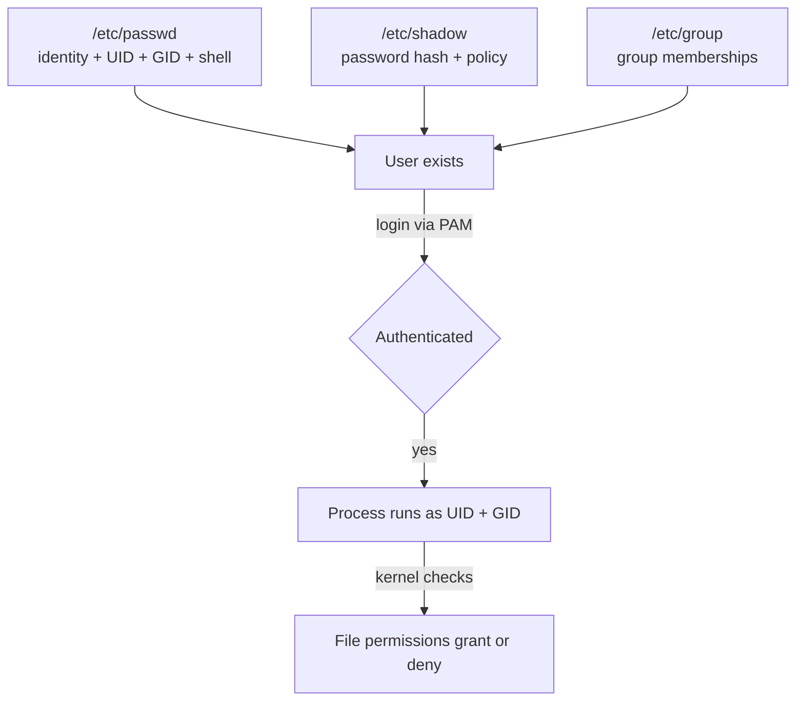

# 🧠 Topic: Users and Groups

> [!abstract] Executive Summary (ELI5)
> A Linux system identifies every actor — human or program — by a number (UID) and groups them into teams (GIDs). These identities are recorded in three plain-text files: `/etc/passwd`, `/etc/shadow`, and `/etc/group`. Management commands (`useradd`, `usermod`, `groupadd`, etc.) are just safe editors for those files.

---

## 🎯 The "Why"
- **Problem Solved:** On a multi-user system, you need to answer four questions constantly: *Who is this? What can they access? Which team do they belong to? Who can prove they are who they claim?* Users and groups are the kernel-level identity model that file permissions, process ownership, and access checks all consult.
- **Alternatives:** LDAP/FreeIPA (network identity), AWS IAM / cloud IAM (centralized cloud identity), RBAC systems (Kubernetes, OpenShift), SSO + PAM modules. All of these ultimately map back to the same UID/GID primitives at the OS level.
- **Trade-offs:** Local `/etc`-based accounts are simple, self-contained, and universal — perfect for a single server. They do not scale across machines (every server has its own `/etc/passwd`), which is why production fleets use directory services. Understanding the local model is the prerequisite for understanding all the networked ones.

## 💡 Mental Model & Analogy
- **Analogy:** A company with ID badges. `/etc/passwd` is the **employee directory** (name, ID number, department, office). `/etc/shadow` is the **secure vault** holding each employee's password hash — only HR (root) can open it. `/etc/group` is the **team roster** ("devops team: alice, bob, carol"). File permissions are door locks that open for specific badges or team members.
- **Visual/Diagram:**



## 🛠️ Core Principles & Code Snippets

### 1. The three files that define identity

| File | Contents | Who can read | Who can write |
|------|----------|--------------|---------------|
| `/etc/passwd` | login name, UID, GID, GECOS, home, shell | everyone | root |
| `/etc/shadow` | password hash + aging rules | **root only** | root |
| `/etc/group` | group name, GID, member list | everyone | root |

```bash
cat /etc/passwd
# alice:x:1000:1000:Alice Smith:/home/alice:/bin/bash
#  ^    ^    ^    ^      ^           ^          ^
# name x-uid gid  gecos  home        shell      (x = hash in shadow)
```

- The `x` in field 2 of `/etc/passwd` is a **placeholder** — the real hash lives in `/etc/shadow`. This is why `/etc/passwd` is world-readable but `/etc/shadow` is root-only.
- UID 0 = root. UIDs 1–999 are usually system/service accounts. UIDs 1000+ are regular humans.

> [!tip] Implementation Note
> The historical reason `/etc/passwd` is world-readable is that early Unix tools (like `ls` and `mail`) needed to translate UID numbers into usernames. Password hashes were moved to `/etc/shadow` precisely because making `/etc/passwd` readable to all made hash-cracking too easy.

### 2. Reading the identity — `id`, `groups`, `who`, `whoami`

```bash
id
# uid=1000(alice) gid=1000(alice) groups=1000(alice),27(sudo),135(docker)

id bob
# Inspect another user's identity.

groups
# alice sudo docker  (your group memberships)

groups bob
# List groups for another user.

who
# List who is currently logged in (from /var/run/utmp).

whoami
# Your effective username.
```

- `id` is the authoritative identity check — it shows UID, primary GID, and all supplementary groups.
- A user's **primary group** is stored in `/etc/passwd` (4th field). **Supplementary groups** come from `/etc/group`.
- When a new file is created, it is owned by the creator's UID and **primary GID** (unless the directory has the setgid bit).

### 3. Creating users — `useradd` vs `adduser`

```bash
sudo useradd -m -s /bin/bash -c "Bob Jones" bob
# -m   create home directory
# -s   login shell
# -c   GECOS (full name / comment)
# Creates the account with defaults from /etc/login.defs and /etc/default/useradd

sudo passwd bob
# Set the initial password (interactive prompt).
```

- `useradd` is the **low-level, portable** command — it does the minimum and requires you to specify flags (`-m`, `-s`) or accept sparse defaults.
- `adduser` (Debian/Ubuntu) is an **interactive wrapper** that asks for the password, creates the home dir, copies skeleton files, and is friendlier for manual account creation. It is not present on all distros.
- A newly created user has **no password** until you set one with `passwd`. Without a password, login is locked (not empty — locked).

> [!tip] Implementation Note
> On RHEL/CentOS, `useradd` creates home dirs by default (`CREATE_HOME yes` in `/etc/login.defs`). On Debian/Ubuntu, `useradd` does **not** unless you pass `-m`. Always pass `-m` explicitly in scripts to make behavior consistent across distros.

### 4. Modifying users — `usermod`

```bash
sudo usermod -aG docker alice
# -a  append (CRITICAL — without -a you REPLACE the group list)
# -G  supplementary groups

sudo usermod -aG sudo alice
# Grant sudo privileges (on Debian/Ubuntu; members of 'sudo' group may use sudo).

sudo usermod -s /bin/zsh alice
# Change login shell.

sudo usermod -L alice
# Lock the account (prepend ! to the hash in /etc/shadow).

sudo usermod -l bobby bob
# Rename the login from 'bob' to 'bobby'. Does NOT rename the home dir.
```

> [!warning] The `-aG` vs `-G` trap
> `usermod -G docker,ssh alice` **replaces** Alice's entire supplementary group list with only `docker,ssh`, silently removing her from every other group (including `sudo`!). Always use `-aG` (append) when adding to groups. This is one of the most destructive one-character mistakes in Linux administration.

### 5. Deleting users — `userdel`

```bash
sudo userdel bob
# Remove the account from /etc/passwd, /etc/shadow, /etc/group.
# Does NOT remove the home directory by default.

sudo userdel -r bob
# Also remove the home directory and mail spool.

sudo userdel -rZ bob
# On SELinux systems, also removes the SELinux user mapping.
```

- Without `-r`, the user's files remain on disk, now owned by a **free UID**. If a new user is later created with that same UID, they will unexpectedly own the old user's files.
- Best practice: archive the home directory before `userdel -r` if you might need the data.

### 6. Managing groups — `groupadd`, `groupmod`, `gpasswd`

```bash
sudo groupadd developers
# Create a new group.

sudo groupmod -n devs developers
# Rename the group.

sudo groupdel developers
# Delete the group (files retain the GID — they become "orphaned").

sudo gpasswd -a alice developers
# Add alice to the developers group.

sudo gpasswd -d alice developers
# Remove alice from the group.

getent group developers
# Inspect the group: developers:x:1002:alice,bob
```

- `gpasswd -a` is a clean, single-purpose way to add/remove group members.
- `usermod -aG group user` does the same thing but rewrites the whole membership list — `gpasswd` is safer for one-off changes.

### 7. Changing passwords and policy — `passwd` and `chage`

```bash
passwd
# Change your own password.

sudo passwd bob
# Reset another user's password.

sudo passwd -l bob
# Lock the password (disables password login).

sudo passwd -e bob
# Expire the password — forces a change at next login.

chage -l bob
# View password aging info.

sudo chage -M 90 bob
# Password expires after 90 days.

sudo chage -E 2026-12-31 bob
# Account expires on a specific date.
```

- `chage` ("change age") controls password **aging**: max/min days between changes, warning periods, expiry dates.
- `passwd -e` is a common onboarding step — it sets a temporary password and forces the user to choose their own at first login.

## ⚠️ Pitfalls & Anti-patterns
- **Common Mistakes:**
  - Running `usermod -G docker alice` (without `-a`) and silently stripping her from `sudo`, locking yourself out of admin access.
  - Forgetting `-m` on `useradd` and creating an account with no home directory, breaking login for GUI sessions and tools expecting `~/.config`.
  - Editing `/etc/passwd` or `/etc/group` directly with a text editor while the file is malformed, corrupting logins system-wide. Always use `vipw` / `vigr` (they lock the file and validate syntax).
  - `userdel bob` without `-r`, then later creating a new user who inherits bob's UID and accidentally owns his old files.
  - Assuming a new user can log in immediately — they need a password set (or an SSH key), and the account may be locked until then.
  - Confusing the **primary group** (in `/etc/passwd`) with **supplementary groups** (in `/etc/group`); they affect file creation differently.
- **When NOT to use local accounts:**
  - On a fleet of servers where users must have the same identity everywhere — use LDAP, FreeIPA, or cloud directory service.
  - In containerized environments where users are often injected via build args or runtime user directives (`USER` in Dockerfile).
  - For ephemeral/just-in-time access — use SSH certificate-based access or a bastion with short-lived credentials.
- **Performance/Security considerations:**
  - `/etc/shadow` should be mode `000` or `640` (root-only). World-readable hashes invite offline cracking.
  - Disabled accounts via `usermod -L` only lock **password** login — if the user has SSH keys in `~/.ssh/authorized_keys`, those still work. Remove the keys or set the shell to `/usr/sbin/nologin`.
  - Reusing UIDs after deletion causes accidental file ownership transfer; reserve retired UIDs or scrub the filesystem first.
  - `chage` policies are only effective if enforced — PAM must be configured to check them.

## 🔗 Deep Connections
- **Parent Topic:** [[Linux Operating System]]
- **Related Concepts:** [[Root_User_vs_Regular_User]], [[Sudo_and_Sudoers]], [[Linux Permissions]], [[Linux_Shell]], [[Linux_Important_Directories]]
- **Prerequisites:** Basic command-line usage ([[Linux_Commands]]), understanding file ownership (`ls -l` output).

## ❓ Active Recall Questions
> [!faq]- What three files define user and group identity on a local Linux system, and what does each contain?
> `/etc/passwd` — login name, UID, GID, GECOS, home dir, login shell (world-readable). `/etc/shadow` — password hashes and aging policy (root-only). `/etc/group` — group names, GIDs, and member lists (world-readable). See [[Users_and_Groups]].

> [!faq]- Why is the password hash stored in `/etc/shadow` and not `/etc/passwd`, given that `/etc/passwd` is world-readable?
> Early Unix tools (`ls`, `mail`) needed to map UIDs to names, so `/etc/passwd` had to be readable by all. Leaving password hashes there made offline cracking trivial. `/etc/shadow` was introduced as a root-only file to hold the hashes, leaving `/etc/passwd` world-readable for name lookups. The `x` in passwd field 2 points to shadow.

> [!faq]- What is the difference between `useradd` and `adduser`, and which should you use in a script?
> `useradd` is the **low-level, portable** command — minimal by default, requires explicit flags (`-m`, `-s`). `adduser` is an **interactive Perl wrapper** (Debian/Ubuntu only) that prompts for details. In scripts, always use `useradd` with explicit flags for predictability and portability across distros.

> [!faq]- What does `usermod -G docker,ssh alice` do that `usermod -aG docker,ssh alice` does not?
> Without `-a`, `-G` **replaces** Alice's entire supplementary group list with only `docker,ssh`, removing her from every other group — including `sudo`, potentially locking you out. With `-a` (append), the listed groups are **added** to her existing memberships. Always use `-aG`.

> [!faq]- A user is locked with `usermod -L alice`. Can she still log in? (Two correct answers depending on setup.)
> Password login is disabled (a `!` is prepended to her hash). **But** if she has an SSH key in `~/.ssh/authorized_keys`, **key-based login still works** — `-L` only blocks passwords. To fully disable the account, also remove her keys, set her shell to `/usr/sbin/nologin`, or expire the account via `chage -E 0`.

> [!faq]- Why is `userdel bob` without `-r` risky, and what problem can it cause later?
> The account is removed but the **home directory and files remain**, now owned by an unassigned UID. When a new user is later created with that same UID (UIDs get reused), they will **unexpectedly inherit** bob's old files. Use `-r` to remove the home dir, or archive it first.

> [!faq]- What is the difference between a user's primary group and supplementary groups, and where is each stored?
> The **primary group** is stored in `/etc/passwd` (4th field) and is the group used when the user **creates new files**. **Supplementary groups** are listed in `/etc/group` and grant additional memberships (e.g., `sudo`, `docker`) without affecting default file ownership.

> [!faq]- Why should you use `vipw` and `vigr` instead of editing `/etc/passwd` and `/etc/group` directly?
> They acquire a file lock to prevent concurrent edits and run **syntax validation** before committing. A malformed passwd/group file breaks logins system-wide. `vipw -s` edits `/etc/shadow` safely. If you must edit by hand, these are the safe tools.

---

## 📝 How to use this template effectively
1. **Never Copy-Paste:** If you find yourself copying documentation, stop. Read, close the tab, and write it from memory.
2. **Iterate:** Fill the 'ELI5' and 'Analogy' first. If you can't explain it simply, you don't understand it yet.
3. **The "Why" is King:** Seniority is defined by knowing *when* and *why* to use a tool, not just *how*.
4. **Update the Status:** Move from `analyzing` -> `implemented` -> `mastered` as you apply this in real projects.
