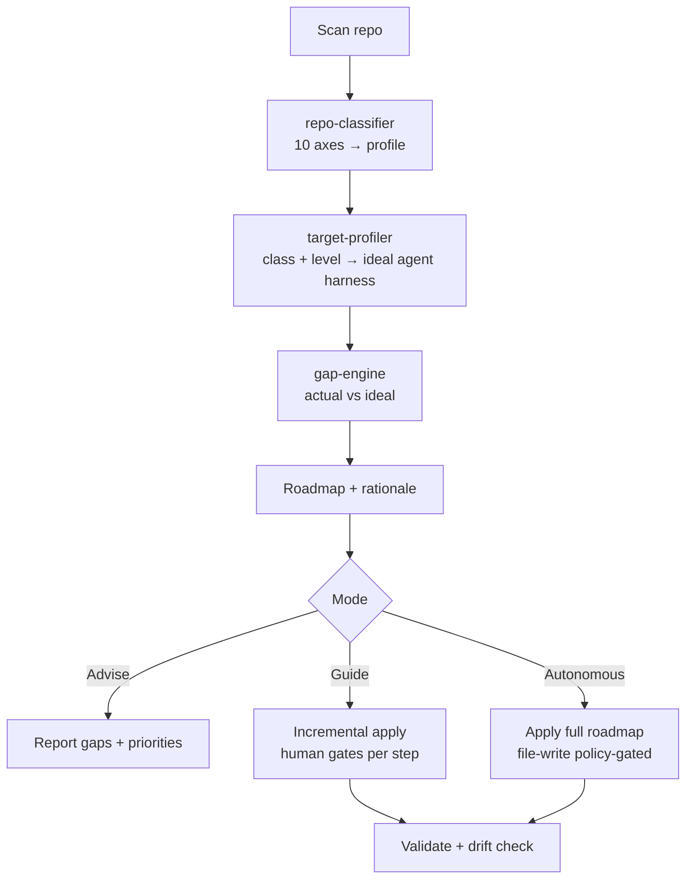
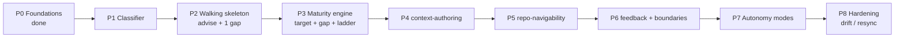

# Agent Harness Skill — Step-by-Step Implementation Plan

> [!abstract] TL;DR
> A **single skill** that prepares any repository for AI-agent work. It scans a repo, classifies its architecture across 10 axes, diagnoses agent-readiness gaps against a maturity ladder (L0→L3), and guides the user through advise/guide/autonomous modes. The ladder is **empirically anchored** in observed agent failure modes. Scope = repo config for agent convenience (context, feedback loop, architecture enforcement); deployment, project governance, and human-coordination are out of scope (sibling skills). Built **walking-skeleton-first**: a thin end-to-end slice validates the core hypothesis before thickening layers.
>
> 📄 **Architecture spec:** [[Agent Harness Skill — RFC]] · 🧱 **Foundations:** [[P0 — Foundations Decisions]] · 🔬 **Anchor:** [[Catalogue of Observed Agent Failure Modes — Study Block]]

---

## 🔬 Phase 1: EXTRACTION — What We Distilled

### Key Concepts

- **Agent Readiness as the whole product:** The skill prepares a repo so an AI agent can **understand** (context), **find** (navigability), **not break** (boundaries), and **self-check** (feedback loops). This was one of two axes in v4; in v5 it is the entire scope.
- **Pivot from dual-axis:** v4 bundled Deployment Readiness + Agent Readiness into a 3-package set. That scope was too large — two consumers, different cadences. v5 drops deploy entirely (future sibling skill), which **collapses** the 3-package topology, the dual-projection capability model, and the "bridge" sub-skills into a single-consumer design.
- **Pure skill, no scripts:** Classification and gap analysis are LLM-driven, not deterministic code, because repo setups are heterogeneous, evolving, and combinatorial. Discipline comes from a phased **Investigation Playbook** + strict output contracts, not from maintained scanners. (See [[P0 — Foundations Decisions]].)
- **Contracts as agent outputs:** `project-profile`, `capability`, `roadmap` are not files — they are structured outputs emitted into the conversation for downstream sub-skills to consume.
- **Agent-readiness maturity ladder (L0→L3):** L0 Blind → L1 Oriented (context + navigability) → L2 Self-Correcting (feedback loop + boundaries) → L3 Self-Maintaining (drift/resync). 4 levels, empirically anchored: each removes a class of observed failure (L1 = Code ~5%, L2 = System CI/test 17%, L3 = context poisoning). Old "Navigable" folded into L1. Recommend the *next* reasonable level, protecting greenfield from over-engineering.
- **Drift is the dominant failure mode:** For an agent-only harness, a stale `AGENTS.md` is worse than none — it actively misleads. Drift detection/resync is elevated to a first-class invariant.

### Novelty

The insight that reshaped the project: **the dual-axis design was carrying complexity that only the deploy consumer justified.** Once deploy leaves, the "provision once, project twice" registry becomes "provision once, project once"; the analyzer/projector bridges become plain sub-skills; the inward-only package dependency graph disappears. **Narrowing scope is not just descoping — it is a structural simplification** that removes whole categories of risk (semver between packages, compatibility matrices, drift between gate and loop).

Also: the maturity engine is a **roadmap generator**, not a scoring rubric. It doesn't say "you are 73% agent-ready" — it says "you are at L1; L2 requires a repo map, conventions, and nested context; here's why each matters for *your* project type."

### Architecture / Mechanics



**Agent harness modules (the deliverables):**

| Module | What it produces | Sub-skill |
|---|---|---|
| A. Context Layer | root + nested `AGENTS.md`, `README` | `context-authoring` |
| B. Navigability | repo map, naming conventions, indexes | `repo-navigability` |
| C. Guardrails-as-Feedback | self-check commands (parseable + fix) | `feedback-strategy` |
| D. Agent Tooling | command/script registry, slash-commands, MCP, hooks | `repo-navigability` |
| E. Boundaries | protected paths, forbidden zones | `boundary-context` |

### Key Quotes

> "Narrowing scope isn't descoping — dropping deploy removes whole categories of structural complexity."

> "A stale `AGENTS.md` is worse than none — it actively misleads the agent."

> "Recommend the next reasonable level, never dump L3 on a greenfield."

---

## 🧠 Phase 2: ANALYSIS — What This Means

### Strengths

- **Sharp scope:** One consumer (the agent), one product (the harness). No dual-projection, no inter-package contracts. Dramatically smaller surface than v4.
- **Greenfield-first:** Empty Next.js → meaningful L1 guidance without higher-level noise.
- **Explainable:** Every recommendation carries rationale — prerequisite for autonomous-mode trust.
- **Reusable seam preserved:** The classifier/profile is consumer-agnostic, so a future deploy skill can reuse it — without us paying for that abstraction now.

### Weaknesses / Limitations

- ~~**Agent-readiness ladder is harder to ground than delivery maturity.**~~ **Resolved:** anchored empirically in the failure-mode catalogue (33k PRs + DAP Lab) instead of SLSA/DORA. Each of the 4 levels removes a measured failure class.
- **Context drift is now the central risk, not a footnote.** An agent-only harness lives or dies on whether its generated context stays true.
- **Classification accuracy:** Pure-LLM detection from manifests is coarse on edge cases. The interview fallback must be smooth (handled by the Investigation Playbook).
- **The skill writes files.** Generating/overwriting `AGENTS.md` is a mutation — needs a careful file-write policy even in guide mode.

### Comparison

| Criterion | Agent Harness (v5) | Ad-hoc `AGENTS.md` | Generic scaffolder (Yeoman/Projen) | Cursor/aider rules |
|---|---|---|---|---|
| Architecture-aware | ✅ Classifies 10 axes | ❌ Manual | ❌ Template-driven | ❌ Manual |
| Maturity guidance | ✅ L0→L3 ladder | ❌ None | ❌ One-shot | ❌ None |
| Gap diagnosis | ✅ Built-in | ❌ None | ❌ None | ❌ None |
| Drift protection | ✅ Detect + resync | ❌ High drift risk | ❌ N/A | ❌ High drift risk |
| Greenfield UX | ✅ Next level, not final | ✅ Minimal | ⚠️ Often over-scaffolds | ✅ Minimal |

### Open Questions

- [x] **#1 Defensible ladder — RESOLVED (2026-06-09).** Anchored in the failure-mode catalogue (33k PRs + DAP Lab): L1 removes Code-layer failures (~5%), L2 removes CI/test (17%, largest addressable), L3 prevents context poisoning. SLSA/DORA rejected as anchors. See [[Catalogue of Observed Agent Failure Modes — Study Block]]. (P2 still validates advice is signal.)
- [ ] **#2 Context drift:** How to detect `AGENTS.md` no longer matches repo? On-demand, git hook, or CI?
- [ ] **#3 Detection vs interview balance:** How much to auto-detect before asking?
- [ ] **#4 Nested `AGENTS.md` granularity:** One per package or one per domain?
- [ ] **#5 Autonomous file-write policy:** What can be written without asking? (Overwrite/delete always gate.)
- [ ] **#6 Measuring agent productivity:** How do we know the harness actually helped?

---

## 🛠️ Phase 3: APPLICATION — How to Build It

Logic: **walking skeleton first**, then thicken. Run a thin end-to-end slice early to validate the core hypothesis (classify → target → gap → roadmap produces useful advice) before investing in full layers.



#### P0 — Foundations ✅ (largely done)

**Goal:** Choose paradigm, fix contracts, define investigation method.

**Status:** Decided in [[P0 — Foundations Decisions]]: pure skill (no scripts); three contracts as agent outputs; Investigation Playbook (phased fact-gathering + judgment + evidence-first); interview-question criteria.

**Remaining:** Assemble test corpus (5–6 repos of varying maturity). Study block **core complete** (AGENTS.md + context-engineering + failure-mode catalogue → ladder anchored, #1 resolved).

**Exit criteria:** Test corpus locked. ~~Study-block findings folded into the maturity ladder~~ ✅ done.

#### P1 — `repo-classifier` (the heart)

**Goal:** Repo → structured `project-profile` across 10 axes, with honest `undetermined`.

**Steps:**
1. Encode the Investigation Playbook as skill instructions (Phase 0 Orient → Phase 4 Escalate).
2. Per-axis detection heuristics (signals table) as guidance, not rules.
3. `undetermined` mechanism + interview-question generation from gaps.

**Study:** Framework detection heuristics; manifest-vs-AST sufficiency boundary; progressive disclosure for minimal interviews.

**Resolves:** **#3** (detection vs interview).

**Exit criteria:**
- Classifier produces a complete profile (all 10 axes) on every corpus repo.
- Every `value` is evidence-backed; ambiguity reliably routes to interview questions.

#### P2 — Walking skeleton: `advise` + one gap

**Goal:** Run the full pipeline thinly on one example to validate architecture before heavy investment.

**Steps:**
1. Pick one gap — **"no root `AGENTS.md`"**. Hardcode minimal target ("L1 requires a root `AGENTS.md`").
2. Run: classify → "missing root context" → roadmap of one item → **advise** (report only, no write).
3. Run on empty Next.js from corpus.

**Study:** Walking skeleton / tracer bullet; validating advice quality without execution (advise = safe sandbox for logic).

**Resolves:** Early signal on **#1** (is the ladder realistic at all?).

**Exit criteria:**
- classify→target→gap→roadmap works end-to-end.
- First feedback: is the advice signal or noise? **If noise → the ladder (#1) is wrong; return to research before building axes.**

#### P3 — Agent-Readiness Maturity Engine (the brain)

**Goal:** `target-profiler` + `gap-engine` + the L0→L3 ladder.

**Steps:**
1. `target-profiler`: project class → ideal agent harness per level.
2. `gap-engine`: delta, statuses present/partial/missing + weights.
3. Logic: recommend next level, not final.
4. Roadmap generation with "why" per item.

**Study:** ✅ done in study block — `AGENTS.md` spec, context-engineering, failure-mode catalogue are the empirical anchor. P3 now **encodes** the already-anchored 4-level ladder, it no longer needs to *discover* it.

**Resolves:** **#1** already resolved in research; P3 validates it holds in code. Partially **#4** (where nested context sits — now inside L1).

**Exit criteria:**
- **Defensible, reusable agent-readiness ladder**, tiered L0–L3, every item explainable.
- Level-transition rule (when has a repo "graduated"?).
- Decision: fixed importance weights, or class-dependent?

#### P4 — `context-authoring` (module A)

**Goal:** Generate root + nested `AGENTS.md` + `README` from the profile (reads all 10 axes).

**Steps:**
1. Root `AGENTS.md`: project identity, build/run/test, key commands, architecture summary.
2. Nested `AGENTS.md` per the context hierarchy (from `context-strategy`).
3. Lazy-loading structure (nearest-wins resolution).

**Study:** Context engineering for agents (structure/boundaries/examples vs noise); hierarchical `AGENTS.md` resolution; the user's own vault as a living example (root `AGENTS.md` + per-folder rules).

**Resolves:** **#4** (nested granularity).

**Exit criteria:**
- Rule: one per monorepo package or one per domain? (context vs noise).
- Template for a good `AGENTS.md` per project class.

#### P5 — `repo-navigability` (modules B, D)

**Goal:** Repo map, conventions, command/script registry.

**Steps:**
1. Repo map: where things live, folder roles, entry points.
2. Naming/structure conventions extracted from the actual repo.
3. Command/script registry (modules D): scripts, slash-commands, MCP, hooks.

**Study:** Repo-map formats that help agents; convention extraction from existing code; agent tooling surfaces (slash-commands, MCP, hooks).

**Exit criteria:**
- A navigability artifact that lets an agent locate a change target without full-repo scan.
- Command registry covering build/run/test/feedback entry points.

#### P6 — `feedback-strategy` + `boundary-context` (modules C, E)

**Goal:** Self-check feedback loops and boundaries.

**Steps:**
1. `feedback-strategy`: from capability registry → agent-runnable self-check commands (parseable output, fix commands).
2. `boundary-context`: protected paths, forbidden zones, "do not touch."
3. Wire feedback commands to reference the tool's real config (invariant: no forked configs).

**Study:** Machine-readable tool outputs (`eslint --format json`, `tsc`, `vitest --reporter=json`) — this *is* the feedback loop; sensitive-path heuristics (secrets, generated code, vendored deps) for boundaries.

**Resolves:** Foundations for boundaries; partial **#5**.

**Exit criteria:**
- Capability schema holding 3–4 tools with working agent feedback projections.
- Boundary list per project class (what an agent must never touch).

#### P7 — Autonomy modes (guide, autonomous)

**Goal:** Add execution on top of advise (which exists since P2).

**Steps:**
1. `guide`: incremental apply with human confirmation per step.
2. `autonomous`: full roadmap apply per file-write policy.
3. Policy gates: overwriting existing `AGENTS.md`, deletion, touching protected paths → always ask.

**Study:** Human-in-the-loop patterns; idempotent file generation (re-running shouldn't duplicate); safe overwrite (diff/backup before replacing context).

**Resolves:** **#5** (autonomous file-write policy).

**Exit criteria:**
- Clear list of "always gate" operations (overwrite/delete/protected paths).
- Idempotency: re-running the skill converges, doesn't accumulate.

#### P8 — Hardening: context drift and resync

**Goal:** Don't let `AGENTS.md` lie to the agent.

**Steps:**
1. Drift detector: repo structure changed → context stale.
2. Resync mechanism (regenerate affected `AGENTS.md`).
3. Validation: generated context is non-empty, accurate, current.

**Study:** "Docs as code" drift detection; git hooks / CI checks for context desync; how agents degrade on stale context (why this is critical).

**Resolves:** **#2** (context drift) — the dominant risk for an agent-only harness.

**Exit criteria:**
- Drift detection + remediation mechanism.
- Decision: on-demand, git-hook, or CI-based resync?

### Integration

- **Skill invocation:** `agent-harness advise` (report), `agent-harness guide` (incremental), `agent-harness autonomous` (policy-gated).
- **Drift check:** `agent-harness check` validates context currency and warns on drift.
- **Reuse seam:** profile output reusable by a future `deploy-harness` skill — not built now.

### Anti-patterns (when NOT to apply)

- **Don't use on throwaway/learning repos** — the maturity ladder assumes a project with a lifecycle.
- **Don't force autonomous mode without policy review** — the file-write gate list must be project-specific.
- **Don't skip P2 walking skeleton** — building full layers before validating the pipeline is a trap.
- **Don't re-introduce deploy concerns** — if a gap is about CI/CD/delivery, it belongs to the future sibling skill, not here.
- **Don't drift into project governance** — `CONTRIBUTING`/`ROADMAP`/PR templates/duplicate-PR prevention are a *separate sibling skill*. Tempting (23% of failures), but it's process integration, not agent convenience.
- **Don't try to fix reviewer abandonment** — 38% of failures, but social-technical (maintainer trust/bandwidth). No repo artifact fixes it. Fully out of scope.

---

## ✅ Phase 4: ACTION — What's Next

### Next Steps

- [x] **Study block core complete** → 4-level ladder anchored in failure-mode catalogue (#1 resolved).
- [ ] **Assemble test corpus:** 5 repos (empty Next.js, Nx/Turbo monorepo, Express API, microservices, legacy monolith). **← now the main blocker.**
- [ ] **P1:** Encode classifier + Investigation Playbook as skill instructions. Validate against corpus.
- [ ] **P2:** Walking skeleton — "no root `AGENTS.md`" gap, advise only, empty Next.js. Does the pipeline produce signal?
- [ ] *(Optional, non-blocking)* Scaffolder prior-art study (Backstage/Nx) for advise/guide UX inspiration.

### Critical Path

```
P0 (done) → P1 → P2 (walking skeleton)
                    ↑
                    └── First verifiable milestone.
                        If advice is noise after P2, the problem is the
                        agent-readiness ladder (#1). Return to research
                        before building authoring sub-skills.
```

### Risk Register

| Risk | Phase where it surfaces | Mitigation |
|---|---|---|
| ~~Agent-readiness ladder is arbitrary opinion~~ **mitigated** | P2 (first signal), P3 (full validation) | ✅ Anchored in failure-mode catalogue (33k PRs + DAP Lab); each level removes a measured failure class. P2 still validates advice quality. |
| Context drift makes agent worse | P8 | Drift detection + resync; CI/hook check |
| Classification too coarse | P1 | Targeted deep-read fallback; interview as safety net |
| File writes clobber existing context | P7 | Diff/backup before overwrite; always-gate policy |
| Scope creep back toward deploy | all | Hard non-goal; route delivery gaps to the sibling skill |

### Related Notes

- [[Agent Harness Skill — RFC]] — the architecture spec for this plan.
- [[P0 — Foundations Decisions]] — artifact form, contracts, Investigation Playbook.
- [[Repo Harness Skill — RFC v4 Architecture]] — dual-axis ancestor (deploy + agent).
- [[Repo Harness Skill — Step-by-Step Implementation Plan (RFC v4)]] — the 10-phase dual-axis plan this narrows from.

### Status History

- `2026-06-08`: RFC v4 (dual-axis) finalized.
- `2026-06-09`: **Pivot to agent-only scope.** Deploy split into a future sibling skill. RFC v5 + this plan distilled; topology collapsed from 3 packages to a single skill.
- `2026-06-09`: **Study block core complete + ladder anchored.** Failure-mode catalogue (33k PRs + DAP Lab) resolved #1. Ladder simplified 5→4 levels (Navigable folded into L1). Scope boundary locked: governance + reviewer-abandonment out of scope (sibling skills).

---

## 🗣️ Self-Conversation

*The hard call this session was admitting v4 was too big. The dual-axis design was elegant on paper, but elegance that ships two products at once ships neither. Cutting deploy hurt — the "provision once, project twice" registry was the cleverest part of v4 — but that cleverness existed only to serve a second consumer we no longer have. Cutting it is not loss; it's the simplification the design was begging for.*

*The risk that moved, not shrank: #1 (defensible ladder). In v4 I could lean on SLSA/DORA for delivery maturity. Agent-readiness has no such canon. So the ladder must be grounded empirically — in observed agent failure modes — not borrowed from a framework. P2's walking skeleton is the truth serum: if advise on an empty Next.js feels like noise, the ladder is invented, and no amount of authoring sub-skills will save it.*

*The risk that grew: #2 (drift). When deploy was in scope, drift was one concern among many. Now it's existential — an agent-only harness whose context lies is net-negative. That's why drift moved from a P10 afterthought to a first-class invariant and a dedicated P8.*
