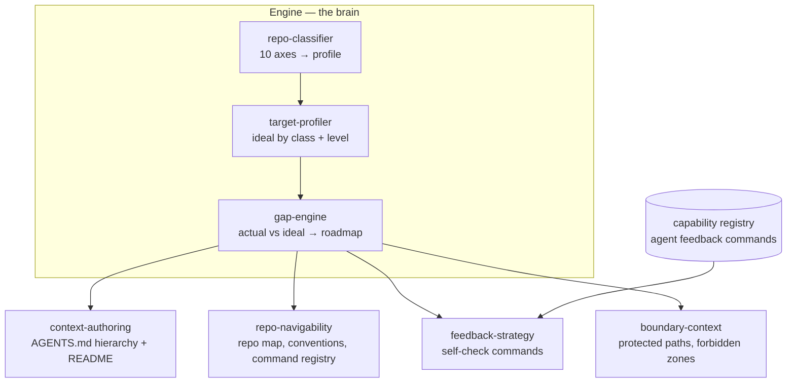
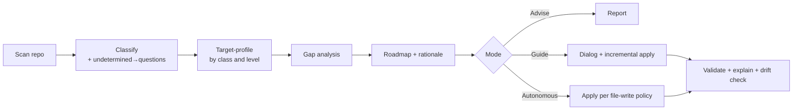

# RFC v5: Agent Harness Skill — Repository Agent-Readiness

> [!abstract] TL;DR
> A **single skill** that prepares any repository for safe and effective AI-agent work. It scans a repo, classifies its architecture across 10 axes, diagnoses agent-readiness gaps against a maturity ladder (L0→L3), and guides the user through advise/guide/autonomous modes. The ladder is **empirically anchored** in observed agent failure modes (33k-PR MSR'26 study + Columbia DAP Lab), not invented. Scope is deliberately narrow: **repository configuration for AI-agent convenience** — context (`AGENTS.md`), feedback loop (linters/tests/types), and architecture enforcement. Deployment readiness, project governance, and human-coordination failures are **explicitly out of scope** (sibling skills).
>
> 📄 **Ancestry:** narrowed from [[Repo Harness Skill — RFC v4 Architecture]] (dual-axis: agent + deploy). 📋 **Foundations:** [[P0 — Foundations Decisions]] · 🔬 **Empirical anchor:** [[Catalogue of Observed Agent Failure Modes — Study Block]], [[AGENTS.md Spec & Agent Failure Modes — Study Block]], [[Context Engineering — Study Block]]

---

## 1. Summary

A skill that brings any repository — from an empty greenfield project to a mature service — to a state of **Agent Readiness**: the context, navigation, boundary, and feedback-loop harness an AI agent needs to understand the repo, find the right place to work, avoid breaking things, and self-check its own output.

It scans, classifies, diagnoses gaps against a contextual ideal, advises, and guides toward the target state through dialogue or autonomously on request. It is implemented as a **pure skill** (LLM-driven instructions, no maintained scripts) over a single architectural profile.

**What changed from v4 (the pivot):** v4 tried to cover two orthogonal axes — Deployment Readiness *and* Agent Readiness — in one 3-package skill set. That scope is too large; the two consumers (the delivery machine vs the AI agent) evolve on different cadences and deserve independent skills. **v5 keeps only Agent Readiness.** Deployment becomes a future sibling skill. This collapses the 3-package topology, the dual-projection capability model, and the "bridge" sub-skills into a much simpler single-consumer design.

---

## 2. Motivation

An AI agent dropped into a repository must answer four questions before it can work safely:

1. **Understand** — what is this project, how is it built, how do I run and test it?
2. **Find** — where does the thing I need to change live? What are the conventions?
3. **Don't break** — what must I not touch? What are the boundaries?
4. **Self-check** — how do I verify my change is correct before handing it back?

Today this harness is built by hand, ad-hoc, per repo — and it rots. Three problems this skill solves:

1. **Contextual blindness** — `AGENTS.md` is written fundamentally differently depending on architecture (monorepo vs single app, SSR vs SPA). There is no universal template.
2. **No guidance** — tools either dump "everything at once" on a greenfield repo or diagnose nothing.
3. **Drift** — `AGENTS.md` and repo maps age faster than code; an outdated context file actively misleads the agent (worse than none).

---

## 3. Goals / Non-Goals

### Scope boundary (the one-line definition)

> **Configuring a repository for the convenience of AI agents:** the context layer (`AGENTS.md`), the feedback loop (linters, type-checkers, tests), and architecture enforcement. Nothing about humans, process, or delivery.

This boundary is drawn from the empirical failure-mode catalogue (see [[Catalogue of Observed Agent Failure Modes — Study Block]]). The catalogue splits every agent failure into a **missing affordance** (the repo lacks something the agent needs → *we fix this*) and an **ignored affordance** (the artifact exists but the agent didn't use it → agent capability, *not ours*). We own only the missing-affordance side, and only for the code/system layers — not the workflow or social-coordination layers.

### Goals
- Work on **any repo state**: from empty React/Next.js to mature monorepo.
- Classify the project across 10 architectural axes (a good `AGENTS.md` must describe the architecture).
- Diagnose agent-readiness gaps against a contextual ideal and **guide** through maturity levels (advise / guide / autonomous).
- Generate the agent harness: context layer, navigability, feedback loops, boundaries, architecture enforcement.
- Every recommendation must be explainable ("why").
- Keep generated context **honest** — detect and resync drift.

### Non-Goals
- **No deployment readiness.** CI/CD, progressive delivery, IaC, DORA — out of scope (future sibling skill).
- **No project governance.** `CONTRIBUTING.md`, `ROADMAP`, PR templates, duplicate-PR / unwanted-feature prevention (workflow layer of the catalogue) — out of scope, candidate **separate sibling skill**. This is where the biggest *addressable* failures beyond ours live (23% duplicate PRs), but they are about process integration, not agent convenience.
- **No human-coordination help.** Reviewer abandonment (the single largest observed failure, 38%) and reviewer misalignment are **fully out of scope** — they are social-technical realities (maintainer bandwidth, trust in bot PRs) that no repo artifact fixes.
- **No agent-capability assessment.** We measure what the *repo provides*, never what the *agent can do* with it. (MSR'26 measures the latter; we measure the former.)
- Do not write application code/tests from scratch — only the agent harness and configuration.
- Do not replace human review: autonomous mode works under explicit policy with gates (especially for file writes).
- Do not impose maximum maturity level — recommend the next reasonable one.

---

## 4. Topology Overview

A **single skill**, internally organized as an **engine** (classify → target → gap → roadmap) plus a set of **authoring sub-skills** that generate harness artifacts. There is no multi-package model, no inter-package dependency graph, no separate entry points — that complexity belonged to the dual-axis design and is now gone.



> [!note] Seam for the future deploy skill
> The `repo-classifier` and its 10-axis `project-profile` are deliberately consumer-agnostic. A future `deploy-harness` skill could reuse the same classification output. We design the profile to be shareable, but we **do not build for deploy now** — no abstractions, no projections, no hooks left dangling. YAGNI until the deploy skill is real.

---

## 5. Classification Model (10 Axes)

Single foundation for the agent harness. On greenfield, undetectable axes return `undetermined` and **become interview questions** (detection gap = interview agenda). The classifier is unchanged from v4 — it survives the pivot because **`context-authoring` consumes all 10 axes**: a good `AGENTS.md` must describe the architecture to the agent.

| Axis | Priority | Why the agent harness cares |
|---|---|---|
| Infrastructure (Docker/K8s/serverless/static) | 🔴 Critical | Agent must know runtime context, how to run locally |
| Backend architecture (monolith/microservices/BFF) | 🔴 Critical | Shapes nested `AGENTS.md` granularity and the repo map |
| Code organization (mono/polyrepo) | 🔴 Critical | Determines context hierarchy: one root vs nested per package |
| Client/server split (SPA/SSR/MPA/PWA) | 🔴 Critical | Conventions, where rendering logic lives |
| Delivery/rendering (SSG/CSR/ISR/Edge/RSC) | 🟡 Important | Affects "how to run/preview" instructions |
| Frontend scaling (micro-FE/Module Federation) | 🟡 Important | Repo map complexity, navigability |
| Auth/connectivity (JWT/BFF/OIDC) | 🟡 Important | Sensitive boundaries the agent must respect |
| Interaction protocols (REST/GraphQL/gRPC/WS) | 🟢 Optional | Self-check command shape (contract/types) |
| Data model/sync (CRDT/optimistic/SWR) | 🟢 Optional | Domain context richness |
| Build/runtime (Vite/Webpack/ESM/Bun) | 🟢 Optional | "How to build/run" feedback commands |

The detailed per-axis detection signals and the **Investigation Playbook** (phased fact-gathering + judgment + evidence-first) live in [[P0 — Foundations Decisions]].

---

## 6. Module Catalog (Agent Readiness)

The five modules of the agent harness. (In v4 these were axis "A–E"; here they are the whole product.)

| Module | What it does | Driven by |
|---|---|---|
| **A. Context Layer** | Hierarchy of `AGENTS.md` (root → nested) + `README`; lazy loading down the tree | `context-authoring` |
| **B. Navigability** | Folder structure, naming, repo map, indexes | `repo-navigability` |
| **C. Guardrails-as-Feedback** | Lint/tests/types as agent self-check commands (parseable output, fix commands) | `feedback-strategy` + capability registry |
| **D. Agent Tooling** | Commands, slash-commands, MCP, hooks, script registry | `repo-navigability` |
| **E. Boundaries** | Protected paths, forbidden zones, what not to touch | `boundary-context` |

### 6.1 Capability Registry (simplified to a single projection)

In v4 a capability was "provisioned once, projected twice" (deploy gate **and** agent feedback). With deploy gone, **there is only one projection: the agent feedback loop.** The registry now answers a single question per tool: *how does the agent run this for feedback, and how does it read the result?*

```yaml
capability:
  id: string                 # lint | typecheck | test | format | ...
  tool: string               # eslint | tsc | vitest | prettier | ...
  config_path: string|none   # the tool's real config — agent reads it, never forks it
  feedback:
    command: string          # how the agent runs it
    output_format: string    # how the agent parses results (e.g. eslint --format json)
    fix_command: string|null # auto-fix command if one exists
```

**Invariant:** the agent references the tool's **real config** (`config_path`); it never embeds a forked copy. This is the slimmed-down remnant of v4's single-source rule — now about agent↔repo consistency, not gate↔loop drift.

---

## 7. Advisory & Maturity Engine

Flow: `classify → target → gap → roadmap → execute`. The skill **guides**, not dumps "everything at once."

### 7.1 Agent-Readiness Maturity Ladder

A **4-level ladder**, purpose-built for agent readiness and **empirically anchored** in the failure-mode catalogue. v5 collapsed the earlier 5-level draft: the old "Navigable" rung was just *good context for a complex repo*, not a distinct stage, so it folds into L1. Simpler is better.

Each level is justified by the class of observed failure it removes — not by opinion:

| Level | Contents | Agent capability unlocked | Failure mode addressed |
|---|---|---|---|
| **L0 — Blind** | Nothing | Agent flies blind: no context, hallucinated structure, breaks things | — |
| **L1 — Oriented** | Effective `AGENTS.md` (role, build/run/test, key commands, architecture rules, boundaries), scaled to **nested** for monorepos; repo map + conventions so the agent can locate work | Agent understands intent + finds the right place to work | Incorrect/Incomplete implementation (~5%) |
| **L2 — Self-Correcting** | Feedback loop wired: lint/typecheck/test + architecture fitness as agent-runnable self-checks (parseable output + fix commands); boundaries enforced (protected paths) | Agent **validates and fixes its own work before handing it back** | **CI/test failure (17%) — the largest addressable failure** |
| **L3 — Self-Maintaining** | Drift detection + resync; tooling integration (MCP, hooks, slash-commands) | Context + feedback config stay honest as the repo evolves | Context poisoning / stale-context misdirection |

Module mapping: **L1 = A (context, root+nested) + B (navigability)** · **L2 = C (feedback) + E (boundaries) + D (tooling)** · **L3 = drift/resync + D (advanced)**.

> [!note] Why these four and not the catalogue's five
> The failure catalogue has five layers (Grounding → Code → System → Workflow → Socio-technical). We deliberately address only the **Code** and **System** layers — those are the *missing-affordance* failures a repo can actually fix (L1 = Code, L2 = System). The **Workflow** layer (duplicate PRs, unwanted features) is a candidate sibling governance skill; the **Socio-technical** layer (reviewer abandonment) is fully out of scope. L3 is not a catalogue layer — it is the maintenance discipline that keeps L1–L2 from rotting (the dominant agent-only failure per the Context Engineering study).

The skill recommends the **next** reasonable level, not the final one (greenfield → L1 immediately, never L3 dumped on an empty repo).

### 7.2 Gap Analysis
`gap-engine` compares the actual profile against the target at the current level. Each module/capability → `present | partial | missing` + importance weight → prioritized roadmap with "why."

### 7.3 Autonomy Modes — one roadmap, different gating

| Mode | Who approves | Who executes |
|---|---|---|
| **Advise** | — | nobody (report gaps + priorities) |
| **Guide** | human per step | skill, incrementally |
| **Autonomous** | skill per policy | skill, full roadmap |

Because this skill **writes files** (`AGENTS.md`, repo maps), autonomous mode needs an explicit file-write policy: overwriting an existing `AGENTS.md`, deleting, or touching protected paths always gates.

---

## 8. Sub-skills (Contracts)

| Sub-skill | Inputs | Outputs |
|---|---|---|
| `context-authoring` ⭐ | ALL 10 axes | root + nested `AGENTS.md`, `README` (module A) |
| `repo-navigability` ⭐ | Code organization, Frontend scaling, Backend arch | repo map, conventions, command/script registry (B, D) |
| `feedback-strategy` | Protocols, Build/runtime | agent self-check commands (C) — references capability registry |
| `boundary-context` | Auth, sensitive paths | protected paths, forbidden zones (E) |
| `context-strategy` | Code organization | context hierarchy shape — where nested `AGENTS.md` belong (feeds A) |

> **No more bridges.** In v4, `test-strategy`/`security-context`/`repo-strategy` were "dual by nature" (one analyzer, two projectors: deploy + agent). With deploy gone, each has a **single** projector. They are now ordinary agent sub-skills — the analyzer/projector split collapses. This is a major simplification the pivot buys us.

---

## 9. Execution Flow



1. **Scan** — read repo (manifests, layout, existing `AGENTS.md`/README).
2. **Classify** — fill 10 axes; `undetermined` → interview questions.
3. **Target** — derive ideal agent harness for project class at next maturity level.
4. **Gap** — delta; statuses present/partial/missing.
5. **Roadmap** — prioritized plan with "why."
6. **Execute** — by mode (advise/guide/autonomous), with file-write gating.
7. **Validate** — check generated context is non-empty, accurate, and not already drifting.

---

## 10. Key Invariants

1. **Target derives from classification** — no universal `AGENTS.md` templates.
2. **Recommend next level, not final** — greenfield protection.
3. **Detection gap = interview question** — single mechanism.
4. **Every recommendation explainable** — else autonomous mode is scary to enable.
5. **Context must not drift** — generated context stays in sync with the repo or is flagged stale (elevated to a first-class invariant in v5, since it is the dominant failure mode for an agent-only harness).
6. **Agent reads real configs, never forks them** — feedback commands reference the tool's actual config.
7. **File writes gate by policy** — overwriting/deleting existing context or touching protected paths always asks.

---

## 11. Open Questions

1. ~~**Defensible agent-readiness ladder** — biggest risk.~~ **RESOLVED (2026-06-09).** The ladder is now anchored in the empirical failure-mode catalogue (33k PRs MSR'26 + Columbia DAP Lab): L1 removes Code-layer failures (~5%), L2 removes the largest addressable System-layer failure (CI/test, 17%), L3 prevents context poisoning. SLSA/DORA were explicitly rejected as anchors — they measure supply-chain provenance and team delivery speed, not agent affordances. See [[Catalogue of Observed Agent Failure Modes — Study Block]]. (P2 walking skeleton still validates that the *advice* is signal, not noise.)
2. **Context drift detection** — how to detect that `AGENTS.md` no longer matches repo structure? On-demand, git hook, or CI? (Now central, not peripheral.)
3. **Detection vs interview balance** — how much to auto-detect before falling back to questions? Cost/accuracy sweet spot.
4. **Nested `AGENTS.md` granularity** — one per monorepo package, or one per domain? Context richness vs noise.
5. **Autonomous file-write policy** — what can the skill write without asking? (Overwriting existing `AGENTS.md` and deleting always gate.)
6. **Measuring agent productivity** — how do we know the harness actually helped the agent? What is the success signal?

(Dropped from v4 as deploy-specific: semver between packages, deploy×frontend compatibility matrix, DORA metrics, local-first rollback guardrail.)

---

## 12. Alternatives Considered

- **Dual-axis monolith (v4: agent + deploy in one skill set)** — rejected **now**: scope too large, two consumers with different cadences; deploy deserves its own skill. This RFC *is* the narrowing.
- **Keep the 3-package model for agent-only** — rejected: with a single consumer there is nothing to share a core *with*. The packaging complexity (semver, dependency boundaries, separate entry points) bought nothing. Collapsed to one skill.
- **Keep capability dual-projection** — rejected: no deploy gate to project onto. Single agent-feedback projection only.
- **Keep bridge sub-skills (analyzer/projector)** — rejected: a single projector means no bridge. They become ordinary sub-skills.
- **Generate final maturity level immediately** — rejected: drowns greenfield. Keep L0→L3 with "next level" recommendation.
- **Deterministic scanner scripts** — rejected (see [[P0 — Foundations Decisions]]): repo setups are heterogeneous and evolving; classification is a judgment task. Pure-skill + disciplined investigation playbook instead.

---

## Related Documents

- [[P0 — Foundations Decisions]] — artifact form, contracts, Investigation Playbook, interview criteria.
- [[Agent Harness Skill — Implementation Plan]] — phased build plan with exit criteria.
- [[Catalogue of Observed Agent Failure Modes — Study Block]] — empirical anchor for the ladder (33k PRs + DAP Lab).
- [[AGENTS.md Spec & Agent Failure Modes — Study Block]] — what makes `AGENTS.md` effective vs noise.
- [[Context Engineering — Study Block]] — positional bias, progressive disclosure, token budget.
- [[Repo Harness Skill — RFC v4 Architecture]] — the dual-axis ancestor (deploy + agent) this RFC narrows from.

---

*Last updated: 2026-06-09 (v5.1 — 4-level ladder, empirical anchor, scope boundary tightened: governance + reviewer-abandonment out of scope)*
