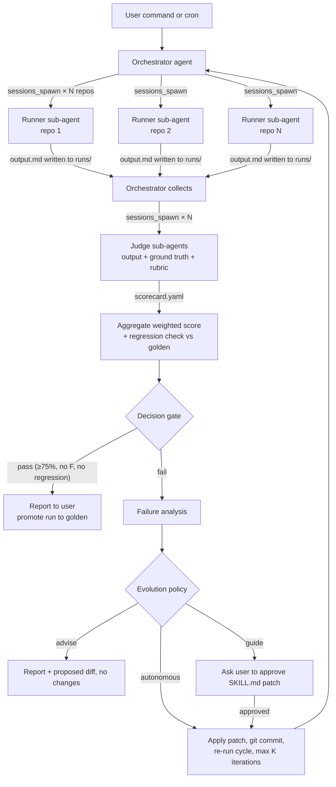

# OpenClaw Skill Evolution Loop — Implementation Plan

> [!abstract] TL;DR
> An automated test-and-evolve system for the `agent-harness-p2` skill, built on OpenClaw's native sub-agent orchestration. An **Orchestrator** agent spawns isolated **Runner** sub-agents (skill under test, clean room, no ground truth) against the 6-repo test corpus, then **Judge** sub-agents score the outputs against the [[Test Corpus Specification]] rubric. The orchestrator aggregates a weighted score, detects regressions vs golden outputs, and — per policy — proposes or applies a `SKILL.md` patch and re-runs the cycle. Scales from sequential single-repo runs to parallel fan-out across all repos with consistency replicas.
>
> 📋 **Inputs:** [[Test Corpus Specification]] · [[Test Corpus Workflow]] · [[Measuring Skill Evolution — Research Prompt]] · [[P0 — Foundations Decisions]] · [[Agent Harness Skill — RFC]]

---

## 1. System Overview

### 1.1 The loop



### 1.2 The three roles (separation of knowledge is the core design rule)

| Role | OpenClaw agent | Sees | Must NOT see | Model strategy |
|---|---|---|---|---|
| **Orchestrator** | `harness-orchestrator` (main agent, bound to your chat channel) | Everything: corpus, ground truth, runs, skill git history | — | Strong model (reasoning, failure analysis, patch authoring) |
| **Runner** | `harness-runner` (spawned via `sessions_spawn`, isolated session) | Skill under test + ONE corpus repo path | Ground truth, rubric, other runners' outputs, vault docs | Fixed target model + fixed settings — this is the "production" condition being measured |
| **Judge** | `harness-judge` (spawned via `sessions_spawn`) | One runner output + that repo's ground truth + rubric | The skill's internals (judges output, not implementation); other judges' scores | Strong model, ideally a *different* family than the runner (reduces self-preference bias) |

> [!important] Clean-room invariant
> The runner must never be able to read `ground-truth/`, `rubric/`, `golden/`, or this vault. If the runner can see expected answers, every score is worthless. Enforce via separate agent workspace + sandbox, not via prompt politeness.

### 1.3 Why this maps cleanly onto OpenClaw

- `sessions_spawn` is **non-blocking** and returns `runId` + `childSessionKey` → natural parallel fan-out (one spawn per repo).
- `sessions_yield` ends the orchestrator's turn and lets completion announcements arrive as the next message → no poll loops (explicitly the documented pattern).
- `subagents` tool + `/subagents list|log|info|kill` → inspection and intervention during long runs.
- Per-agent **workspaces** give each role its own `AGENTS.md`, `skills/`, and file visibility → the clean-room boundary.
- `agents.defaults.subagents.model` / per-spawn `model` override → cheap runners, strong judges, strong orchestrator.
- **Cron** → nightly regression cycles without human initiation.
- `tools.sessions.visibility: "tree"` → orchestrator sees only its own spawned children; runners get **no session tools at all** by default.

---

## 2. Workspace & Repository Layout

One lab directory on the gateway host. All artifacts are files (not transcript parsing) — runs are reproducible and diffable.

```
~/skill-lab/
├── skill/                          # git repo — the skill under test, versioned
│   └── skills/
│       └── agent-harness-p2/
│           └── SKILL.md            # copied from vault skill/SKILL.md, then evolves here
├── corpus/                         # git repo — the 6 test repos, tagged (corpus-v1)
│   ├── greenfield-nextjs/
│   ├── express-api/
│   ├── nx-monorepo/
│   ├── microservices-partial/
│   ├── legacy-monolith/
│   └── mature-reference/
├── ground-truth/                   # expected values per repo (judge-only)
│   ├── greenfield-nextjs.yaml      # extracted from Test Corpus Specification tables
│   ├── express-api.yaml
│   └── ...
├── rubric/
│   ├── scoring.md                  # rubric §1–8 + weights table from the spec
│   └── anti-patterns.txt           # deterministic forbidden-pattern list (see §5.2)
├── runner-ws/                      # harness-runner agent workspace (clean room)
│   ├── AGENTS.md                   # runner role instructions (minimal)
│   └── skills/agent-harness-p2/    # symlink → ../skill/skills/agent-harness-p2
├── judge-ws/                       # harness-judge agent workspace
│   ├── AGENTS.md                   # judge role instructions
│   └── (read access to ground-truth/, rubric/, runs/)
├── runs/                           # one folder per eval cycle
│   └── 2026-06-10T14-00_skill-a1b2c3d/
│       ├── manifest.yaml           # skill SHA, corpus tag, models, settings, replica count
│       ├── greenfield-nextjs/
│       │   ├── r1/output.md        # replica 1 runner output (raw, exact skill format)
│       │   ├── r2/output.md
│       │   ├── r3/output.md
│       │   └── scorecard.yaml      # judge verdict (per replica + consistency)
│       ├── express-api/ ...
│       └── report.md               # orchestrator aggregate: weighted score, gate verdict
├── golden/                         # approved outputs per skill version (regression baseline)
│   └── skill-a1b2c3d/<repo>/output.md
└── reports/                        # longitudinal: one line per cycle (see §8)
    └── history.jsonl
```

**Versioning rules:**
- `skill/` is a git repo. Every accepted SKILL.md change = one commit with the failure evidence in the message. The run ID embeds the short SHA → every score is attributable to an exact skill version (answers research-prompt §2.9 "correlate skill changes with metric changes").
- `corpus/` is a git repo with tags. Ground truth and corpus must change **together** (a corpus edit without a ground-truth edit is a bug).
- `runs/` is append-only. Never overwrite a run.

---

## 3. OpenClaw Configuration

### 3.1 Agents

```json5
// ~/.openclaw/openclaw.json (fragment)
{
  agents: {
    defaults: {
      subagents: {
        runTimeoutSeconds: 1800,        // hard kill for hung runners
      },
    },
    list: [
      {
        id: "harness-orchestrator",
        workspace: "~/skill-lab",
        tools: { profile: "coding" },   // includes sessions_spawn / sessions_yield / subagents
      },
      {
        id: "harness-runner",
        workspace: "~/skill-lab/runner-ws",
        // fixed "production condition" model for the skill under test:
        model: { primary: "<target-model>" },
        tools: {
          profile: "coding",
          deny: ["sessions_*", "subagents", "web_*", "message"],  // clean room: fs + exec only
        },
        // recommended: sandbox the runner so it physically cannot read ground-truth/
        // sandbox: { ... mount only runner-ws + the one corpus repo + runs/<id>/<repo> }
      },
      {
        id: "harness-judge",
        workspace: "~/skill-lab/judge-ws",
        model: { primary: "<strong-judge-model, different family than runner>" },
        tools: { profile: "coding", deny: ["sessions_*", "subagents", "web_*"] },
      },
    ],
  },
  tools: {
    sessions: { visibility: "tree" },   // orchestrator sees only its spawned children
  },
}
```

Notes:
- Cross-agent spawning (`sessions_spawn` with `agentId: "harness-runner"`) must be allowed for the orchestrator (`tools.agentToAgent` / spawn allowlist, depending on your OpenClaw version — verify with `/tools` from the orchestrator session).
- Runner consistency settings (research-prompt §2.5): pin model, pin thinking level, run M replicas (start with M=3 on the repos where it matters; M=1 while plumbing).

### 3.2 Runner workspace `AGENTS.md` (clean-room contract)

```markdown
# Runner Agent

You execute exactly one task per session: run the `agent-harness-p2` skill
against the repository path given in your task message.

Rules:
- Follow SKILL.md exactly. Produce the output in its exact format.
- Write the full output to the file path given in the task (OUTPUT_PATH).
- Do not read anything outside the given repo path and your workspace.
- Do not browse, do not message anyone, do not spawn anything.
- End your reply with only: DONE <OUTPUT_PATH>
```

### 3.3 Judge workspace `AGENTS.md` (scoring contract)

```markdown
# Judge Agent

You score ONE runner output against ground truth using the rubric.

Inputs (paths arrive in the task message):
- OUTPUT_PATH(s): runner output replica(s)
- TRUTH_PATH: ground-truth yaml for this repo
- RUBRIC: rubric/scoring.md

Procedure:
1. Deterministic checks first (§5.2 of the plan): format compliance,
   anti-pattern scan, axis-value exact/synonym match vs ground truth.
2. Graded checks (rubric): evidence quality, gap identification,
   level recommendation, special cases (greenfield/legacy/drift).
3. If multiple replicas: score each, then score consistency
   (same axes? same gap? same level? advice semantically equivalent?).
4. Emit scorecard.yaml at SCORECARD_PATH in the exact schema below. No prose outside it.
```

---

## 4. The Eval Cycle — Step by Step (what the Orchestrator does)

This is the orchestrator's core procedure — write it as the orchestrator's own skill: `~/skill-lab/skills/skill-eval-loop/SKILL.md`. The system you are building **is itself a skill**, which means it benefits from the same discipline (strict output contracts, evidence-first).

### Step 1 — Initialize run
1. `git -C skill rev-parse --short HEAD` → `SKILL_SHA`; corpus tag → `CORPUS_TAG`.
2. Create `runs/<timestamp>_skill-<SKILL_SHA>/` + `manifest.yaml` (skill SHA, corpus tag, runner model, judge model, replicas M, repo list, mode: sequential|parallel).
3. Parse the requested scope: one repo (debug), subset, or all 6.

### Step 2 — Fan out runners
For each repo × replica, call `sessions_spawn`:

```
task: |
  Run the skill `agent-harness-p2` on the repository:
  REPO_PATH: ~/skill-lab/corpus/greenfield-nextjs
  Write the complete skill output to:
  OUTPUT_PATH: ~/skill-lab/runs/<RUN_ID>/greenfield-nextjs/r1/output.md
agentId: harness-runner
label: run-<RUN_ID>-greenfield-r1
```

- **Parallel mode:** spawn all repo×replica combinations in one turn, then call `sessions_yield`. Completion events arrive as messages (push-based — the documented pattern; never poll).
- **Sequential mode:** spawn one, yield, process completion, spawn next. Use this while debugging or to control cost/rate limits.
- On timeout/failure announcements: retry once, then mark the cell `failed` in the manifest and continue (one hung runner must not kill the cycle).

### Step 3 — Fan out judges
After all runner completions for a repo are in, spawn one judge per repo (it scores all replicas at once — it needs them together for consistency scoring):

```
task: |
  Score the runner outputs for repo greenfield-nextjs.
  OUTPUT_PATHS: runs/<RUN_ID>/greenfield-nextjs/r{1,2,3}/output.md
  TRUTH_PATH: ground-truth/greenfield-nextjs.yaml
  SCORECARD_PATH: runs/<RUN_ID>/greenfield-nextjs/scorecard.yaml
agentId: harness-judge
label: judge-<RUN_ID>-greenfield
```

Then `sessions_yield` again.

### Step 4 — Aggregate
1. Read all `scorecard.yaml` files.
2. Compute the weighted score exactly per [[Test Corpus Specification]] §Scoring Summary: completeness 10% · evidence 15% · axis accuracy 25% · gap identification 25% · level recommendation 15% · special cases 10%.
3. **Regression check:** diff axis values, gap lists, and levels against `golden/<previous-skill-SHA>/`. Any metric that *dropped* on any repo = regression flag, even if the aggregate passes (research-prompt §2.7: "worse on any metric", not only aggregate).
4. Write `runs/<RUN_ID>/report.md` + append one summary line to `reports/history.jsonl`.

### Step 5 — Decision gate

| Condition | Verdict | Action |
|---|---|---|
| ≥75% weighted, zero F grades, no regression vs golden | **PASS** | Report. Promote this run's outputs to `golden/<SKILL_SHA>/`. |
| ≥75% but regression on some repo/metric | **PASS-WITH-REGRESSION** | Report with side-by-side diff. Do NOT auto-promote golden. Human decides. |
| 60–75%, no F | **FIX** | Enter evolution step (§6): targeted patch, re-run failed repos only. |
| <60%, or any F on gap identification / level recommendation, or greenfield gets L2/L3 advice | **STOP** | Per [[Test Corpus Workflow]] emergency brakes: do NOT auto-patch. The problem is conceptual (ladder/heuristics), not wording. Full report to human, loop halts. |

### Step 6 — Report to user
The orchestrator is bound to your chat channel — the report arrives as a message:

```
Eval cycle <RUN_ID> · skill a1b2c3d · corpus v1
Weighted: 81% (prev: 74%) — PASS
Per-repo: greenfield A/A/A · express A/B/A · nx B/B/A · micro A/A/B · legacy A/A/A · mature A/B/A
Regressions: none · Consistency: 0.93 avg
Golden promoted. Full report: runs/<RUN_ID>/report.md
```

---

## 5. Scoring Mechanics

### 5.1 `scorecard.yaml` schema (the judge's strict output contract)

```yaml
scorecard:
  repo: greenfield-nextjs
  run_id: 2026-06-10T14-00_skill-a1b2c3d
  replicas: 3
  deterministic:
    format_compliance: pass | fail        # exact P2 output structure present
    anti_pattern_violations: []           # list of matched forbidden patterns; MUST be empty
    roadmap_item_count: 1                 # P2: must be exactly 1
  per_axis:                               # vs ground truth, exact-or-synonym match
    - axis: project_class
      expected: web-frontend
      got: [web-frontend, web-frontend, web-frontend]   # per replica
      verdict: pass
      evidence_recorded: true
  grades:
    profile_completeness: pass | fail
    evidence_quality: A | B | C | F
    axis_accuracy: 4/4                    # P2 has 4 axes; P1 will have 10
    gap_identification: A | B | C | F
    level_recommendation: A | B | C | F
    special_case: pass | fail | n/a       # greenfield protection / legacy honesty / drift
  consistency:
    structural: 1.0                       # same axes, same gap, same level across replicas
    semantic_advice: 0.91                 # judge's similarity judgment of advice across replicas
  failure_notes:                          # ONLY observed failures, with quotes from output
    - "r2 advice mentions 'consider adding ESLint' — anti-pattern for P2 (forbidden: linting)"
```

### 5.2 Deterministic checks before LLM judgment (cheap, zero-variance)

These run as plain text checks (the judge does them first, mechanically; later they can become a script — but per [[P0 — Foundations Decisions]] philosophy, start prompt-side):

- **Format compliance:** all required sections present (`## Classification`, `## Gap Analysis`, `## Roadmap`, `## Advice`, `## What Was NOT Checked`).
- **Anti-pattern scan** (`rubric/anti-patterns.txt`): for P2, advice must not contain test/lint/CI/drift/nested-context/L2/L3 recommendations. Any match → automatic F on gap identification (this *is* the greenfield-protection criterion, automated).
- **Cardinality:** exactly 1 roadmap item; advice ≤3 paragraphs.
- **Axis exact/synonym match** vs ground-truth yaml (synonym lists live in the ground-truth file: `api-backend ≈ backend-api ≈ rest-api`).
- `undetermined` handling: valid value, but `undetermined` on an axis the ground truth marks as clearly-detectable = accuracy fail (per research-prompt §2.1 — `undetermined` is honest, not free).

### 5.3 LLM-judged dimensions (variance accepted, mitigated)

Evidence quality, gap relevance/actionability, advice quality, legacy honesty, drift detection, semantic consistency across replicas. Mitigations: judge model ≠ runner model family; rubric quotes the exact grade definitions from the spec; judge must quote the output text supporting every non-A grade (evidence-first applies to the judge too).

---

## 6. The Evolution Step (skill self-improvement, gated)

This is where the loop becomes an *evolution* system rather than a test harness.

### 6.1 Failure analysis → patch proposal

On a FIX verdict, the orchestrator (strong model, full context):

1. Collects all `failure_notes` across scorecards + the relevant raw outputs.
2. Classifies each failure into the noise taxonomy (research-prompt §2.6): hallucination / over-generalization / scope creep / ladder violation / missing evidence / format drift.
3. Maps failures to SKILL.md sections (e.g., "scope creep in advice" → tighten Step 5 constraint; "axis wrong on legacy repo" → adjust Step 2 heuristics).
4. Produces a **minimal diff** to SKILL.md with, for each hunk: the failure evidence (quoted), the hypothesis ("adding X will fix Y"), and the expected metric movement.

### 6.2 Anti-overfitting guardrails (non-negotiable)

| Guardrail | Rule |
|---|---|
| **No ground-truth leakage** | The patch may never contain corpus-specific strings (`greenfield-nextjs`, `billing-service`, exact expected values). Orchestrator self-checks the diff; judge-of-the-diff is a cheap second check. |
| **Generalize, don't memorize** | Patches must change *heuristics/constraints*, not add per-repo special cases. "If the repo looks exactly like X, answer Y" = forbidden. |
| **Hold-out validation (P1+)** | When the corpus grows beyond 6 (research-prompt open question #2), split: 6 dev repos drive patches, 2–3 hold-out repos are scored but never used for failure analysis. A patch that improves dev but regresses hold-out = overfit, revert. |
| **One patch per cycle** | Never batch unrelated fixes — attribution (research-prompt §2.9) requires one-change-one-measurement. |
| **STOP verdicts never auto-patch** | <60% / F-grades mean the ladder or heuristics are conceptually wrong — that's human research territory ([[Test Corpus Workflow]] emergency brakes). |

### 6.3 Evolution policy (mirrors the RFC's own autonomy modes)

| Mode | Who approves the patch | Loop behavior |
|---|---|---|
| **advise** | nobody applies | Report + proposed diff in chat. Default starting mode. |
| **guide** | human, per patch | Orchestrator posts the diff + evidence to chat, waits for "apply". On apply: commit, re-run failed repos, full report. |
| **autonomous** | policy | Apply → commit (`evolve: <hypothesis> [run <RUN_ID>]`) → re-run failed repos → if improved, full re-run all 6; if not improved after the patch, `git revert` and stop. **Hard limits:** max K=3 patch iterations per cycle, never two consecutive cycles without a PASS, STOP verdict always halts. |

Run autonomous mode only after guide mode has shown ≥3 sensible patches in a row. This is the same trust-building gradient your RFC prescribes for the harness skill itself.

---

## 7. Build Phases (with exit criteria)

### Phase 0 — Lab infrastructure (½ day)
1. Install/verify OpenClaw gateway; bind `harness-orchestrator` to your chat channel.
2. Create `~/skill-lab/` layout (§2); init `skill/` and `corpus/` git repos.
3. Copy `SKILL.md` from the vault into `skill/skills/agent-harness-p2/`; commit as `v0-baseline`.
4. Configure the three agents (§3.1); verify with `/tools` in each that the deny-lists hold (runner: no session tools, no web).
5. **Smoke test isolation:** from a spawned runner session, attempt to read `~/skill-lab/ground-truth/` — must fail (sandbox) or the path must not exist in its view.

**Exit:** orchestrator can spawn a runner that writes a file into `runs/` and announces completion; runner provably cannot see ground truth.

### Phase 1 — Corpus + ground truth (½–1 day)
1. Spawn a dedicated one-off sub-agent with ONLY [[Test Corpus Specification]] as input: "Create the 6 repos in `corpus/` per spec, exactly." (This is Phase A of [[Test Corpus Workflow]], executed inside OpenClaw.)
2. Verify directory trees against the spec; commit + tag `corpus-v1`.
3. Extract per-repo expected values from the spec tables into `ground-truth/*.yaml` (include synonym lists and which axes are "clearly detectable").
4. Write `rubric/scoring.md` (rubric §1–8 + weights verbatim from the spec) and `rubric/anti-patterns.txt`.

**Exit:** 6 repos exist and match spec; every repo has a ground-truth yaml; corpus tag and ground truth committed together.

### Phase 2 — Single-cell walking skeleton (½ day) ⭐ the truth detector
Manually (from chat) drive ONE cell end to end: runner on `greenfield-nextjs` → judge → scorecard.

This is simultaneously **Phase B of [[Test Corpus Workflow]] (P2 signal-or-noise)** and the plumbing validation:
- Does the runner produce the exact P2 output format?
- Does the judge produce a valid `scorecard.yaml`?
- Does greenfield protection pass (no L2/L3 noise)?

**Exit:** valid scorecard for greenfield; signal verdict per Workflow Phase B gate. If the *skill* produces noise here — stop building the loop and fix the skill/ladder first (the loop is pointless without a viable subject).

### Phase 3 — Orchestrator loop, sequential (1 day)
1. Write `skills/skill-eval-loop/SKILL.md` for the orchestrator encoding §4 verbatim (spawn → yield → judge → aggregate → gate → report).
2. Run sequentially over all 6 repos, M=1 replica.
3. Verify: manifest correct, 6 scorecards, weighted score computed per spec, report lands in chat.
4. Promote first PASS run to `golden/`.

**Exit:** one chat command produces a full 6-repo report with correct weighted scoring. This run **is** Workflow Phase C/D execution (classifier accuracy + level validation), now automated.

### Phase 4 — Parallelism + consistency (½ day)
1. Switch fan-out to parallel: all repo spawns in one turn + `sessions_yield`; confirm push-based completions (no polling).
2. Add replicas M=3 on at least `greenfield-nextjs` and `microservices-partial`; judge scores consistency.
3. Tune `runTimeoutSeconds`, add the retry-once-then-mark-failed rule.
4. Measure wall-clock and token cost sequential vs parallel; set the default.

**Exit:** parallel cycle completes reliably; consistency scores appear in scorecards; a deliberately-killed runner (`/subagents kill`) doesn't break the cycle.

### Phase 5 — Regression + golden workflow (½ day)
1. Implement the golden diff in aggregation (axis values, gap lists, levels vs `golden/<prev-SHA>/`).
2. Implement PASS-WITH-REGRESSION verdict (no auto-promotion).
3. Test: hand-edit SKILL.md to deliberately break one axis heuristic → run → confirm the regression is caught and attributed to the right repo/axis.

**Exit:** an injected regression is detected, named, and blocks golden promotion.

### Phase 6 — Evolution loop, guide mode (1 day)
1. Add the failure-analysis → patch-proposal procedure (§6.1) to the orchestrator skill, including the anti-overfitting self-checks (§6.2).
2. Run in **guide** mode: orchestrator posts diff + evidence to chat; you approve from chat; it commits and re-runs failed repos.
3. Do 2–3 real iterations on whatever the current skill actually fails.

**Exit:** at least one approved patch demonstrably improves the weighted score, with the hypothesis recorded in the commit message and visible in `reports/history.jsonl`.

### Phase 7 — Autonomy + scheduling (½ day, only after Phase 6 trust)
1. Enable **autonomous** mode with the hard limits (K=3, revert-on-no-improvement, STOP always halts).
2. Add an OpenClaw **cron job**: nightly full cycle in advise mode (regression sentinel); evolution runs stay manually triggered.
3. Optional: a second cron that posts a weekly trend summary from `history.jsonl`.

**Exit:** nightly report arrives without intervention; autonomous evolution session completes a full propose→apply→verify→(revert|keep) cycle unattended within limits.

### Phase 8 — Scale-out (ongoing, when P1/P3 skill phases land)
- Extend ground truth from 4 axes (P2) to 10 axes (P1) — the loop itself doesn't change, only `ground-truth/*.yaml`, rubric, and the scorecard's `per_axis` length.
- Add hold-out repos (§6.2) — including **real** repos (clone 2–3 public repos, hand-author ground truth) to escape synthetic-corpus bias.
- Consider per-repo judge specialization only if judge quality becomes the bottleneck.

---

## 8. Longitudinal Tracking

`reports/history.jsonl` — one line per cycle:

```json
{"run":"2026-06-10T14-00","skill_sha":"a1b2c3d","corpus":"v1","weighted":0.81,
 "per_repo":{"greenfield-nextjs":{"axis":"4/4","gaps":"A","level":"A"}, "...":{}},
 "consistency_avg":0.93,"verdict":"PASS","regressions":[],"patch_applied":null}
```

This is the minimum viable tracking from the research prompt (§2.9) — a flat file the orchestrator appends to and can summarize on demand ("show me the score trend since skill v3"). Targets to track against (from [[Measuring Skill Evolution — Research Prompt]]): axis accuracy ≥90%, gap precision ≥85%, gap recall ≥80%, level accuracy ≥95%, anti-pattern violations = 0, consistency ≥0.90.

---

## 9. Known Risks & Mitigations

| Risk | Mitigation |
|---|---|
| **Judge drift** — judge model update silently changes grading | Pin judge model in manifest; keep 2–3 frozen reference outputs with known grades, re-judge them each cycle as a judge-calibration canary |
| **Runner reads ground truth** | Sandbox/workspace isolation (Phase 0 smoke test); periodic re-test after config changes |
| **Overfitting to 6 synthetic repos** | Hold-out set + real repos (Phase 8); patch guardrails (§6.2) |
| **Self-preference bias** (same model judges its own family) | Judge from a different model family than the runner |
| **Cost blow-up** (6 repos × 3 replicas × judges × iterations) | Cheap-but-fixed runner model; M=1 default, M=3 only on consistency-sensitive repos; sequential mode for debug |
| **Intentional ladder changes break golden diffs** | Golden outputs are per-skill-SHA; a deliberate contract change = new golden baseline, approved by human (research-prompt §2.7 "intentional changes") |
| **Hung sub-agents** | `runTimeoutSeconds` + retry-once + mark-failed; `/subagents kill` as manual brake |

---

## 10. Open Questions

1. **Sandbox granularity** — per-spawn mount of exactly one corpus repo vs whole-corpus read access for the runner. Per-spawn is cleaner but operationally heavier; whole-corpus is acceptable since repos don't leak each other's ground truth.
2. **Judge-of-the-judge** — at what point do we need human spot-check sampling of judge grades (e.g., 1 random scorecard per cycle reviewed by hand)?
3. **Meta-evolution** — the orchestrator's own `skill-eval-loop` skill will also need evolving. Does it get its own (tiny) eval, or is human review enough? (The research prompt's "skill that improves skills" question, one level up.)
4. **When does this become a script?** Aggregation math (weighted score, diffing) is deterministic — candidate for a small script the orchestrator calls, per the P0 rule: deterministic fact-gathering may be tooled, judgment stays LLM-side.

---

## Related Documents

- [[Test Corpus Specification]] — ground truth + rubric source
- [[Test Corpus Workflow]] — validation phases this plan automates (B→C→D map to Phases 2→3)
- [[Measuring Skill Evolution — Research Prompt]] — metrics framework realized in §5, §8
- [[P0 — Foundations Decisions]] — contracts philosophy reused for scorecards
- [[Agent Harness Skill — RFC]] — the skill under test; its autonomy modes mirrored in §6.3

---

*Created: 2026-06-10*
