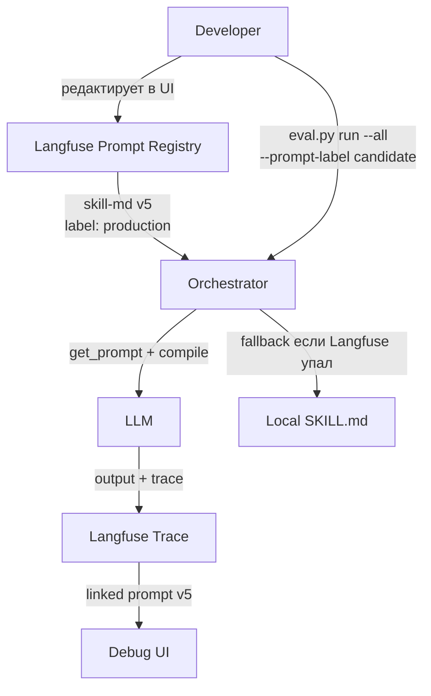

# PromptOps — Prompt Management & Operations

> [!abstract] Executive Summary (ELI5)
> PromptOps — это когда инструкции для нейросети (промпты) управляются как код: с версиями, тестами, откатами и CI/CD. Представь, что ты можешь поменять инструкцию для AI-ассистента в веб-интерфейсе и моментально увидеть, стало ли лучше — без перезапуска программы. Это как GitHub для текстов, которые говорят нейросети, что делать.

---

## 🎯 The "Why"

### Problem Solved: Промпты как статические файлы
В большинстве проектов промпты живут в коде или в `.md` файлах:
```python
# Плохо: промпт внутри Python-файла
SYSTEM_PROMPT = """You are a helpful assistant..."""

def run():
    response = client.chat.completions.create(
        model="gpt-4o",
        messages=[{"role": "system", "content": SYSTEM_PROMPT}]
    )
```

**Проблемы:**
- Чтобы поменять промпт — нужен `git commit`, деплой, перезапуск
- Нет истории версий: не понятно, какой промпт был вчера
- Нет A/B тестирования: нельзя сравнить «старый» vs «новый» на одних данных
- Нет связи с результатом: не понятно, какой промпт породил конкретный фейл

### Alternatives
| Подход | Плюс | Минус |
|---|---|---|
| **Git + файлы** | Просто, всё под контролем версий | Нет рантайм-переключения, нет tracing |
| **Hardcoded в коде** | Быстро для прототипа | Хаос при изменениях, нет versioning |
| **JSON config + S3** | Гибко | Нужно писать UI, tracing, eval самому |
| **Langfuse** | Prompt registry + tracing + eval в одном | Требует hosted сервис или self-hosting |

### Trade-offs
**PromptOps нужен**, если:
- Промпты меняются часто (еженедельно/ежедневно)
- Нужно A/B тестировать версии на фиксированных данных
- Нужно доказать, что «новый промпт лучше старого»
- Нетехнические пользователи (HR, аналитики) редактируют промпты

**PromptOps избыточен**, если:
- Один промпт, меняется раз в год
- Прототип на 2 дня
- Нет тестовых данных для eval

---

## 💡 Mental Model & Analogy

**Analogy:** PromptOps — это «GitHub Actions + Git + Datadog», но для текстовых инструкций нейросети.

| Классический devops | PromptOps (Langfuse) |
|---|---|
| Git — хранит код | Prompt Registry — хранит промпты |
| GitHub Actions — CI/CD | Experiments — автотесты промптов на датасете |
| Datadog — трейсинг | Traces — трейсинг каждого LLM-вызова |
| Feature flags — переключение версий | Labels — переключение промптов без деплоя |

**Visual:**


---

## 🛠️ Core Principles & Code Snippets

### 4 свойства промпта в Langfuse
Промпт в Langfuse — это **не строка**, а объект:

```python
prompt = langfuse.get_prompt("skill-md", label="production")

prompt.name      # "skill-md"
prompt.version   # 5 (автоинкремент)
prompt.label     # "production"
prompt.prompt    # "You are a runner... {{repo_path}}"
prompt.config    # {"model": "gpt-4o", "temperature": 0}
```

### 1. Version — неизменяемая история
Каждый `create_prompt()` с тем же именем создаёт новую версию:
- v1 → v2 → v3 → v4 → v5
- v3 навсегда остаётся v3
- Можно достать любую версию: `get_prompt(name, version=3)`

### 2. Label — указатель на версию
```
Версии:  v1 ──→ v2 ──→ v3 ──→ v4 ──→ v5
Labels:         prod ──→ prod          prod
                cand  ──→ cand  ──→ cand
```

**Ключевое свойство:** Label можно переключать в UI без деплоя кода. Код всегда пишет:
```python
prompt = langfuse.get_prompt("skill-md", label="production")
```
А в UI вы решаете, что значит `production` — v5 или v6.

### 3. Config — настройки модели рядом с текстом
```python
langfuse.create_prompt(
    name="runner-prompt",
    prompt="You are a runner...",
    config={
        "model": "gpt-4o",
        "temperature": 0,
        "max_tokens": 4000
    }
)
```

```python
# Чтение в коде
prompt = langfuse.get_prompt("runner-prompt")
model = prompt.config.get("model", "gpt-4o")  # "gpt-4o"
temperature = prompt.config.get("temperature", 0)  # 0
```

**Профит:** Настройки модели не дрейфуют отдельно от текста промпта. v3 может быть с `temperature=0`, v4 — с `temperature=0.7`.

### 4. Compile — шаблонизация в рантайме
Храним шаблон в Langfuse, а не готовый текст:
```markdown
# Langfuse Prompt: "runner-prompt"
You execute {{skill_name}} against {{repo_path}}.
Write output to {{output_path}}.
```

```python
prompt = langfuse.get_prompt("runner-prompt")
compiled = prompt.compile(
    skill_name="agent-harness-p2",
    repo_path="/path/to/repo",
    output_path="/tmp/output.md"
)
```

**Почему шаблон, а не готовый текст:** Если хранить готовый текст, каждый запрос с другим `repo_path` создавал бы новый промпт в реестре. Реестр превратился бы в мусорку. Шаблон = один промпт, бесконечное число использований.

### 5. Graceful Fallback — работа без Langfuse
```python
def get_prompt_with_fallback(name, label="production", fallback_path=None):
    try:
        return langfuse.get_prompt(name, label=label)
    except Exception as e:
        print(f"Langfuse unavailable: {e}. Using local fallback.")
        fallback_path = fallback_path or SKILL_MD_PATH
        text = fallback_path.read_text()
        return SimpleNamespace(
            prompt=text,
            compile=lambda **kwargs: text,
            config={"model": "gpt-4o", "temperature": 0}
        )
```

---

## 📋 5 примеров PromptOps в действии

### Пример 1: HR-скринер (корпоративный)

**Ситуация:** LLM скринит резюме. HR-менеджер не разработчик, но ему нужно менять критерии отбора.

```python
# Код (писали разработчики, не трогают)
def screen_resume(resume_text, position):
    prompt = langfuse.get_prompt(f"hr-screen-{position}", label="production")
    compiled = prompt.compile(resume=resume_text)
    return llm_call(compiled)
```

```yaml
# Langfuse Prompt: "hr-screen-java-developer"
Вы — HR-скринер. Оцените резюме на позицию Java-разработчик.
Критерии:
- Опыт Spring Boot: {{min_spring_years}}+ лет
- Опыт SQL: {{min_sql_years}}+ лет
- Наличие open-source проектов: {{require_opensource}}

Резюме:
{{resume}}
```

**HR-менеджер в Langfuse UI:**
1. Создаёт новый промпт «hr-screen-java-developer»
2. Меняет `min_spring_years` с 3 на 2 (ослабляет требования)
3. Label = `candidate`
4. Запускает eval на 50 резюме из датасета
5. Сравнивает с `production` — видит, что precision упал, но recall вырос
6. Принимает решение: merge или reject

**Профит:** HR-менеджер не обращается к разработчику. Сам управляет промптом, сам тестирует, сам видит метрики.

---

### Пример 2: Code Review Agent (coding agent)

**Ситуация:** Агент ревьюит PR. Команда хочет A/B тестировать строгий vs мягкий ревью.

```python
# Код
prompt = langfuse.get_prompt("code-reviewer", label="production")
review = llm_call(prompt.compile(
    diff=pr_diff,
    language="python",
    strictness="normal"  # или "strict" для эксперимента
))
```

```markdown
# Langfuse Prompt: "code-reviewer" v5
Вы — code reviewer. Оцените PR по критериям:
- Безопасность: SQL injection, XSS, hardcoded secrets
- Производительность: N+1 queries, unnecessary loops
- Стиль: PEP8, naming conventions

Строгость: {{strictness}}
```

**Эксперимент:**
1. Создаём v6 с `strictness=strict` в шаблоне
2. Label = `strict-experiment`
3. Запускаем на 100 PR из датасета
4. Langfuse показывает:
   - v5 (`normal`): precision=0.85, recall=0.70, latency=2.3s
   - v6 (`strict`): precision=0.92, recall=0.65, latency=4.1s
5. Команда решает: strictness добавляет precision, но latency растёт. Компромисс: `normal` + отдельный промпт для security-PR.

**Профит:** Решение основано на данных, а не на мнениях в Slack. Один eval — и видна полная картина.

---

### Пример 3: Финансовый аналитик (аудит + compliance)

**Ситуация:** Банк генерирует ежедневные отчёты о рынке. Регуляторы требуют аудит: «Какой промпт сгенерировал этот отчёт 3 месяца назад?»

```python
# Код
prompt = langfuse.get_prompt("financial-report-daily", label="production")
report = generate(prompt.compile(market_data=today_data))
# trace автоматически привязывает prompt version к generation
```

**Аудит:**
1. Регулятор просит отчёт от 15 марта
2. Аналитик открывает Langfuse → находит trace за 15 марта
3. Видит: «Prompt: financial-report-daily v12»
4. Кликает — видит точный текст, использованный в тот день
5. Сравнивает с текущей v17 — видит diff: «Добавлено требование о риск-факторах»

**Профит:** Полная аудиторская прослеживаемость. Каждый отчёт привязан к версии промпта. Без самописных логов, без grep по git history.

---

### Пример 4: Auto-fix Agent (отладка через trace)

**Ситуация:** Агент получает issue и генерирует PR с фиксом. Промпт содержит: «не трогай несвязанные файлы», «добавь тесты».

**Проблема:** Агент начал ломать CI — добавляет фиксы, но тесты падают. Не понятно, какой промпт породил сломанный PR.

**Решение:**
```python
# Код
prompt = langfuse.get_prompt("auto-fix-agent", label="production")
patch = llm_call(prompt.compile(issue=issue_body, codebase_summary=repo_summary))
# trace ID сохраняется в PR description
```

**PR description:**
```
Auto-fix generated by Langfuse
Trace: https://langfuse.com/trace/abc123
Prompt: auto-fix-agent v8
```

**Когда CI падает:**
1. Разработчик открывает trace по ссылке
2. Видит полный LLM conversation: system prompt, user prompt, ответ
3. Видит linked prompt: auto-fix-agent v8
4. Кликает на v8 — сравнивает с v7 (где CI не падал)
5. Видит diff: «В v8 добавлено требование 'add type hints' — LLM начал добавлять typing в файлы, где не импортированы нужные модули»
6. Откат к v7 или фикс промпта: «Добавляй type hints только если модуль уже импортирован»

**Профит:** Отладка сломанного PR занимает 5 минут вместо 2 часов. Не нужно искать логи, не нужно воспроизводить локально.

---

### Пример 5: Наш Skill Testing Framework (текущий проект)

**Сейчас:**
```python
# Сейчас (файл на диске)
skill_md = SKILL_MD_PATH.read_text()
runner_prompt = f"""...{skill_md}...{repo_path}..."""  # f-string
```

**После Фазы 1 (Langfuse):**
```python
# Целевое решение
runner_prompt = lf.get_prompt("runner-prompt", label="production")
skill_prompt = lf.get_prompt("skill-md", label=prompt_label)  # production или candidate

compiled = runner_prompt.compile(
    skill_md=skill_prompt.prompt,
    repo_path=repo_path,
    output_path=output_path
)
```

**Профит:**
- Меняем SKILL.md в Langfuse UI → `eval.py run --all --prompt-label latest` → тестируем
- Можно сравнить `v5` vs `v6` без изменения кода — просто меняем label
- В trace видно: «Этот run использовал skill-md v5»
- Если Langfuse упал — fallback на локальный файл (graceful degradation)

---

## ⚠️ Pitfalls & Anti-patterns

### Common Mistakes

1. **Сохранять промпты в коде, а Langfuse использовать только для tracing**
   - Тогда tracing — действительно «только картинки». Профит от Langfuse — 20%.

2. **Не использовать `label="production"`, а использовать `latest"`**
   - `latest` автоматически меняется при каждом upload. В проде это опасно — внезапно поменяется промпт.

3. **Не делать fallback на локальные файлы**
   - Если Langfuse недоступен — вся система падает. Нужен graceful degradation.

4. **Хранить в Langfuse готовые тексты вместо шаблонов**
   - Каждый запрос = новый промпт в реестре. Versioning теряет смысл.

5. **Забывать про `config` при upload**
   - Если `temperature` и `model` живут в коде, а не в `prompt.config` — теряется связь настроек с версией.

### When NOT to use

- Один промпт, меняется раз в год — проще хранить в коде
- Нет тестовых данных — dataset experiments бесполезны без датасета
- Прототип на 2 дня — overhead настройки не окупится

---

## 🔗 Deep Connections

- **Parent Topic:** [[LLM Application Architecture]]
- **Related Concepts:** [[Prompt Engineering]], [[LLM Observability]], [[CI/CD for AI]], [[A/B Testing]]
- **Project Phase:** [[Langfuse Integration Roadmap]] — Фаза 1: Prompt Management
- **Hybrid Model:** [[Langfuse/Hybrid Model — GitHub + SaaS]] — Phase 7 (future work)
- **Langfuse Overview:** [[Harness Engineering/Langfuse — PromptOps & EvalOps для LLM-приложений]]

---

## ❓ Active Recall Questions

> [!faq]- В чём разница между `version` и `label` в Langfuse prompt?
> Version — это число (v1, v2, v3), label — это тег (`production`, `candidate`). Одна версия может иметь несколько labels. Label позволяет переключать версии без изменения кода.

> [!faq]- Почему хранить промпты в Langfuse лучше, чем в файлах + git?
> Потому что label позволяет переключать версию в рантайме без деплоя. Git требует commit + push + deploy. Langfuse требует только `get_prompt(label="candidate")`.

> [!faq]- Что такое `prompt.compile()` и зачем оно нужно?
> `compile()` подставляет переменные в шаблон `{{variable}}`. Это позволяет хранить структуру промпта в Langfuse, а динамические данные (пути, имена) передавать из кода. Без шаблонов реестр превратился бы в мусорку.

> [!faq]- Как Langfuse помогает в отладке сломанного LLM-вызова?
> Trace содержит полный prompt, response, model, tokens, cost. + Linked prompt показывает точную версию промпта, которая была использована. Можно сравнить с предыдущей версией через diff в UI.

> [!faq]- Что такое graceful fallback и зачем он нужен?
> Если Langfuse сервер недоступен (timeout, 500 error), код не падает, а читает локальный файл. Это позволяет системе работать без Langfuse, но с полным функционалом только при доступном сервере.

> [!faq]- Почему config (model, temperature) должен храниться вместе с промптом?
> Чтобы настройки не дрейфовали отдельно от текста. v3 может быть с `temperature=0`, v4 — с `temperature=0.7`. При отладке trace показывает: «Использован prompt v3 с config {model: gpt-4o, temp: 0}».

---

## 📝 История обновлений заметки

- **2026-06-14** — Создана. PromptOps: 4 свойства промпта, 5 примеров, механики, pitfalls, active recall.
- **Следующее обновление** — После завершения Фазы 1: добавить code snippets реализованных функций `get_prompt()`, `compile()`, `fallback`.
