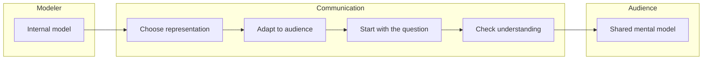

# 🧠 Topic: Communicating the Model

> [!abstract] Executive Summary (ELI5)
> Communicating the model means explaining the picture of a system in a way that the audience can understand, remember, and use to make decisions. It is not enough to draw a diagram; you must also make sure the message lands.

---

## 🎯 The "Why"
- **Problem Solved:** A model that only lives in one person's head is useless. Communication turns a private model into a shared one, enabling alignment and action across teams and stakeholders.
- **Alternatives:** Sending diagrams without context, writing long documents that nobody reads, or relying on code alone to explain intent.
- **Trade-offs:** More communication takes time. Less communication creates misunderstandings. The goal is the right amount of communication for the right audience at the right time.

## 💡 Mental Model & Analogy
- **Analogy:** Communicating a model is like giving someone a map. A good map is not enough by itself — you also need to know where the person wants to go, how much they already know about the area, and whether they need driving directions or a subway overview.
- **Visual/Diagram:**

## 🛠️ Core Principles
1. **Know your audience.** A CTO, a product manager, a developer, and a security engineer care about different things. Tailor the level of detail, vocabulary, and concerns you address.
2. **Start with the question.** Every communication should answer a specific question or support a specific decision. If you do not know the question, the model will likely miss the mark.
3. **Use the right representation.** Sometimes a diagram is best. Sometimes a table, a prototype, a story, or a short paragraph is better. Choose the medium that carries the message with the least friction.
4. **Show the right level of detail.** Too much detail overwhelms; too little leaves ambiguity. Progressive disclosure helps: start high-level and zoom in when asked.
5. **Use common language.** Avoid insider jargon when talking to non-technical stakeholders. When talking to technical peers, use precise terms to avoid confusion.
6. **Check for understanding.** Ask the audience to summarize, explain back, or ask questions. Communication is only successful when the model has been transferred and adjusted in their minds.

## 🏗️ Communication Techniques

### 1. Visual Models and Diagrams
*A picture that externalizes structure, relationships, or behavior.*
- Use C4, UML, flowcharts, or domain sketches depending on the audience and question.
- Keep diagrams focused: one diagram, one message.

### 2. Storytelling and Scenarios
*Walk through a concrete example.*
- "A user submits an order. The order service validates it, publishes an event, and the payment service picks it up..."
- Stories make abstract models relatable and memorable.

### 3. Analogies and Metaphors
*Connect the unknown to the known.*
- A load balancer is like a traffic cop. A message queue is like a mailbox. A cache is like a desk drawer near your workspace.
- Use them to build initial understanding, but point out the limits of the analogy.

### 4. Interactive Walkthroughs
*Navigate the model together.*
- Use a whiteboard, a digital board, or a live code repository to trace through the model with the audience.
- Interaction surfaces questions and reveals gaps.

### 5. Written Documentation
*Preserve the model for asynchronous consumption.*
- Architecture Decision Records (ADRs), design docs, README files, and wiki pages.
- Written documents should reference diagrams, not replace the thinking behind them.

> [!tip] Implementation Note
> When presenting a model, state the question it answers in the first 30 seconds. If the audience does not know why they are looking at the model, they will not remember it.

## ⚠️ Pitfalls & Anti-patterns
- **One diagram for everyone:** Using the same detailed technical diagram for executives and junior developers.
- **Communication without context:** Sending a diagram without explaining what problem it solves or what decision it supports.
- **Jargon overload:** Using technical terms that exclude the audience without building shared understanding first.
- **Assuming silence means understanding:** People often nod without grasping the model. Ask them to explain it back.
- **Ignoring feedback:** A model that the audience finds confusing is a communication problem, not an audience problem.
- **Decorative diagrams:** Diagrams that look good but do not answer a real question or support a decision.

## 🔗 Deep Connections
- **Parent Topic:** [[Software Architecture]], [[Modeling Software Architecture]], [[Technical Communication]]
- **Related Concepts:** [[Model]], [[Mental Model]], [[System]], [[System Modeling]], [[C4 Model]], [[Diagram]], [[Viewpoint]], [[Perspective]], [[ADR]]
- **Prerequisites:** [[Model]], [[Mental Model]], [[System]]

## ❓ Active Recall Questions
> [!faq]- Why is communicating a model just as important as creating it?
> A model that only one person understands cannot guide a team or influence decisions. Communication creates shared understanding and enables action.

> [!faq]- How should the model you communicate change depending on the audience?
> The level of detail, vocabulary, and concerns should match what the audience needs to know. Executives need the big picture; developers need implementation detail.

> [!faq]- What is a common sign that a model was poorly communicated?
> The audience asks questions that show they misunderstood the scope, the audience seems confused, or they do not know what decision to make based on the model.

> [!faq]- What is progressive disclosure and why is it useful in communication?
> Progressive disclosure means starting with a high-level view and adding detail only when needed. It prevents overload and keeps the audience focused on the current question.

> [!faq]- How can you verify that a model has been communicated successfully?
> Ask the audience to explain the model back in their own words, summarize the key decision, or pose questions that reveal their level of understanding.

---

*Related to the Udemy course: "Modeling Software Architecture: C4 viewpoints and perspectives".*
