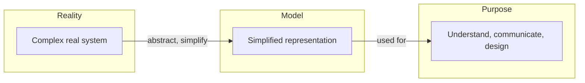

# 🧠 Topic: Model

> [!abstract] Executive Summary (ELI5)
> A model is a simplified representation of something complex. It is not the real thing, but it captures the parts we care about right now to help us understand, discuss, or design a system.

---

## 🎯 The "Why"
- **Problem Solved:** Software systems are too large and complex to keep in one person's head. A model helps us reason about structure, behavior, relationships, and decisions without building the entire system first.
- **Alternatives:** Trial-and-error coding, lengthy documents, verbal explanations, or relying only on the real running system.
- **Trade-offs:** A model is intentionally incomplete. It omits details that are irrelevant for a specific discussion. A wrong abstraction can mislead more than help.

## 💡 Mental Model & Analogy
- **Analogy:** A model is like a subway map. It does not show every building, street, or tree — it shows only stations, lines, and transfers, because that is what matters to the person using it. Different maps (for tourists, engineers, drivers) show different information.
- **Visual/Diagram:**

## 🛠️ Core Principles
1. **A model is purposeful.** It is built to answer a specific question or support a specific conversation.
2. **A model is abstract.** It intentionally leaves out details that are not relevant for the current purpose.
3. **A model is a communication tool.** It helps teams align on structure, decisions, and risks.
4. **A model is not the truth.** It is a useful approximation that can be refined as understanding grows.

> [!tip] Implementation Note
> When drawing a model, always ask: "Who is this for, and what question are we trying to answer?" If the answer is unclear, the model will likely be overloaded or irrelevant.

## ⚠️ Pitfalls & Anti-patterns
- **Trying to model everything:** A model that captures all details becomes as complex as the real system and loses its value.
- **Confusing the model with reality:** The map is not the territory. A well-drawn diagram does not guarantee a working system.
- **Using one model for every audience:** Executives, developers, and operations teams need different levels of detail.
- **Treating diagrams as documentation afterthoughts:** Models should be created to think, not only to decorate a document.

## 🔗 Deep Connections
- **Parent Topic:** [[Software Architecture]], [[Modeling Software Architecture]]
- **Related Concepts:** [[Abstraction]], [[C4 Model]], [[Viewpoint]], [[Perspective]], [[Diagram]]
- **Prerequisites:** None — this is a foundational concept.

## ❓ Active Recall Questions
> [!faq]- What makes a model different from a copy of the real system?
> A model is intentionally simplified. It removes irrelevant details to focus on the questions or concerns that matter right now.

> [!faq]- Why is a single model usually not enough for a software system?
> Different stakeholders care about different things. One model cannot simultaneously show high-level business context, deployment concerns, and low-level code structure in a useful way.

> [!faq]- What is the risk of a model being too detailed?
> It becomes hard to read, expensive to maintain, and can obscure the very insights it was meant to reveal.

---

*Related to the Udemy course: "Modeling Software Architecture: C4 viewpoints and perspectives".*
