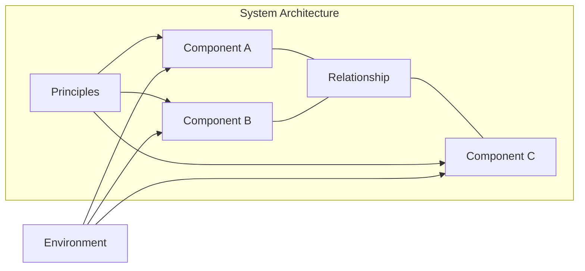

# 🧠 Topic: System Architecture

> [!abstract] Executive Summary (ELI5)
> System architecture is the high-level structure of a software system — the major parts it is made of, how those parts connect, and the rules that guide how the system is built and changed over time.

---

## 🎯 The "Why"
- **Problem Solved:** Software systems can grow into unmanageable complexity. Architecture defines the organizing structure so teams can build, maintain, and evolve the system without losing coherence.
- **Alternatives:** Letting code emerge without guiding structure, making every decision locally without a shared vision, or documenting everything in disconnected specifications.
- **Trade-offs:** Architecture imposes constraints and up-front decisions. A wrong architecture can slow down delivery and make change expensive. Too little architecture leads to a "big ball of mud."

## 💡 Mental Model & Analogy
- **Analogy:** System architecture is like the skeleton of a building. It defines the load-bearing walls, the foundation, the plumbing, and the electrical layout. It is not the paint or furniture, but it shapes what the building can become and how it stands over time.
- **Visual/Diagram:**

## 🛠️ Core Principles
1. **Architecture is about the important stuff.** It captures the decisions that are hard to change later, such as programming languages, runtime platforms, data storage, communication styles, and major component boundaries.
2. **Architecture is both structure and decisions.** It includes the components and their relationships, plus the rationale and principles behind them.
3. **Architecture is driven by requirements.** Functional requirements tell the system *what* to do. Non-functional requirements (quality attributes) tell it *how well* it must do those things.
4. **Architecture exists in the context of an environment.** It must account for users, external systems, organizational constraints, regulations, and existing infrastructure.
5. **Architecture evolves.** A system that is built once and never changed is rare. Good architecture allows controlled evolution without collapse.

## 🏗️ Key Elements of System Architecture

### 1. Components (or Elements)
*The major building blocks of the system.*
- Systems, subsystems, containers, services, modules, databases, clients, and external integrations.
- At the right level, components are the "things" that carry out the work.

### 2. Relationships
*How the components interact and depend on each other.*
- Data flows, call chains, dependencies, ownership, and communication paths.
- Relationships determine coupling, cohesion, and the cost of change.

### 3. Principles and Constraints
*The rules and guidelines that shape the design.*
- Standards, patterns, technology choices, security policies, and organizational conventions.
- These guide future decisions and keep the system consistent.

### 4. Environment
*The world in which the system operates.*
- Users, external systems, hardware, networks, cloud platforms, regulations, and business constraints.
- Architecture cannot be understood without its context.

### 5. Quality Attributes (Non-Functional Requirements)
*The "-ilities" that the architecture must satisfy.*
- Examples: performance, scalability, reliability, security, maintainability, usability, observability.
- These are often the primary drivers of architectural decisions.

### 6. Behaviors
*What the system does and how it responds to events over time.*
- Workflows, use cases, data flows, request/response cycles, asynchronous events, state transitions, and error-handling paths.
- Behavior is not only about visible features; it also includes how the system reacts under load, failure, or unexpected input.
- In architecture, behavior helps validate that the structure supports the intended dynamics and quality attributes.
- Often represented with sequence diagrams, activity diagrams, state machines, or scenario-based descriptions.

> [!tip] Implementation Note
> When defining architecture, focus on what is costly to change. Not every technical decision is architectural. The ones that shape the system's long-term shape and behavior are.

## ⚠️ Pitfalls & Anti-patterns
- **Architecture by PowerPoint:** Creating diagrams without grounding them in real decisions or code.
- **Over-engineering:** Adding layers, abstractions, and technologies before they are needed.
- **Architecture without stakeholders:** Designing in isolation without understanding business, user, and operational needs.
- **No architecture:** Accumulating code without guiding structure until the system becomes unmaintainable.
- **Ignoring quality attributes:** Focusing only on features and leaving performance, security, or reliability as afterthoughts.

## 🔗 Deep Connections
- **Parent Topic:** [[Software Architecture]], [[Modeling Software Architecture]]
- **Related Concepts:** [[Model]], [[System]], [[System Modeling]], [[C4 Model]], [[Viewpoint]], [[Perspective]], [[Diagram]], [[Quality Attributes]], [[Non-Functional Requirements]], [[Behavior]], [[Behaviors]]
- **Prerequisites:** [[System]], [[System Modeling]]

## ❓ Active Recall Questions
> [!faq]- How is system architecture different from system design?
> Architecture captures the high-level, hard-to-change decisions and structure. Design goes deeper into detailed implementation, algorithms, and interfaces within the constraints set by architecture.

> [!faq]- What are the main elements of system architecture?
> Components, relationships between them, the principles that guide them, the environment they operate in, the quality attributes the system must satisfy, and the behaviors the system exhibits over time.

> [!faq]- Why are quality attributes important in architecture?
> Quality attributes determine how well the system performs its functions. They drive major structural decisions, such as whether to use caching, queues, replication, or specific deployment patterns.

> [!faq]- Can a system have good architecture without diagrams?
> Yes, but diagrams and models make architecture visible, shareable, and discussable. The architecture exists in decisions and code, but it is hard to reason about without some form of representation.

> [!faq]- Why is behavior an element of system architecture?
> Because structure alone does not show how the system responds to events, handles errors, or performs under load. Behavior connects the static structure to the dynamic reality of the system.

---

*Related to the Udemy course: "Modeling Software Architecture: C4 viewpoints and perspectives".*
