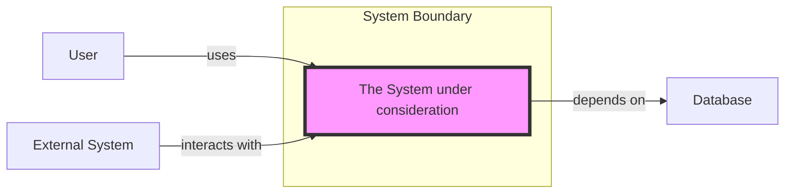

# 🧠 Topic: System

> [!abstract] Executive Summary (ELI5)
> A system is a software application or platform that delivers value to someone — a user, another system, or a business. It has a boundary, a purpose, and responsibilities, even if we do not yet know its internal structure.

---

## 🎯 The "Why"
- **Problem Solved:** Before discussing internals, we need to know *what* we are building and *for whom*. Defining the system establishes the boundary of our design and the scope of our decisions.
- **Alternatives:** Talking about "the app", "the platform", or "the service" without a clear boundary; mixing multiple systems together without distinguishing them.
- **Trade-offs:** Drawing a system boundary too narrowly hides important dependencies. Drawing it too broadly makes the model vague and hard to reason about.

## 💡 Mental Model & Analogy
- **Analogy:** A system is like a vending machine. From the outside, you see a boundary, inputs (buttons, money), and outputs (a snack). You do not need to know the internal mechanics to understand what it does and how to use it.
- **Visual/Diagram:**

## 🛠️ Core Principles
1. **A system has a defined boundary.** Inside the boundary is what we are building or responsible for; outside are users, external systems, and dependencies.
2. **A system delivers value.** It exists to solve a problem or satisfy a need for its users or consumers.
3. **A system can be abstracted at multiple levels.** In the C4 model, the system is the primary element at the System Context level.
4. **A system is a black box at the right level.** At the context level, we care about its responsibilities and relationships, not its internal components.

## 🏗️ Three Key Properties of a System

A complete description of a system usually covers three aspects:

### 1. Structure
*What the system is made of and how its parts are organized.*
- Components, modules, services, layers, databases, and interfaces.
- Static relationships and dependencies between those parts.
- In C4, structure is progressively revealed from Systems → Containers → Components → Code.

### 2. Function
*What the system does — its responsibilities and capabilities.*
- The features and services it provides to users or other systems.
- The business goals it supports.
- In diagrams, function is often described through labels and short descriptions rather than by listing every feature.

### 3. Behaviour
*How the system acts over time in response to events or inputs.*
- Workflows, data flows, request/response cycles, asynchronous events, state transitions.
- Performance characteristics, error handling, and timing.
- Behavior is often captured with dynamic diagrams, sequence diagrams, or scenarios, not just static boxes.

> [!tip] Implementation Note
> When modeling a system, always ask: "What is the boundary of what we are responsible for, and what value does it provide to its users?" If you cannot answer this clearly, your scope is probably undefined.

## ⚠️ Pitfalls & Anti-patterns
- **No clear boundary:** The system melts into everything else, making responsibilities unclear.
- **Modeling the system as a single box forever:** At some point you need to zoom in and show containers, components, and code.
- **Calling every codebase a separate system:** Sometimes multiple applications together form one system; sometimes one application contains multiple systems.
- **Ignoring external systems:** The system does not exist in isolation. Interactions with external systems are often critical to its design.
- **Describing only one of the three properties:** A useful architecture model usually needs to communicate structure, function, and behavior together.

## 🔗 Deep Connections
- **Parent Topic:** [[Software Architecture]], [[Modeling Software Architecture]]
- **Related Concepts:** [[Model]], [[C4 Model]], [[System Context]], [[Container]], [[Component]], [[Actor]], [[External System]]
- **Prerequisites:** [[Model]]

## ❓ Active Recall Questions
> [!faq]- What makes a system different from a container or component?
> A system is a higher-level abstraction that delivers value to users or other systems. Containers and components live inside a system and describe *how* it is built and organized internally.

> [!faq]- Why is the system boundary important in architecture modeling?
> The boundary separates what we control and are responsible for from the external world. It defines scope, ownership, and the interfaces that must be managed.

> [!faq]- Can a system be a user of another system?
> Yes. In C4, a system can be represented as an actor if it interacts with the system under consideration from outside its boundary.

> [!faq]- Why do we need three views of a system: structure, function, and behavior?
> Each view answers different questions. Structure shows what the system is made of. Function shows what it does. Behavior shows how it operates over time. Together they give a complete enough picture for design and communication.

---

*Related to the Udemy course: "Modeling Software Architecture: C4 viewpoints and perspectives".*
