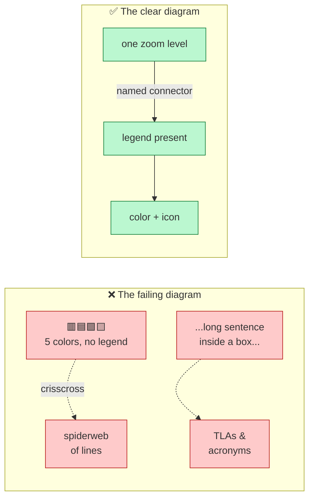
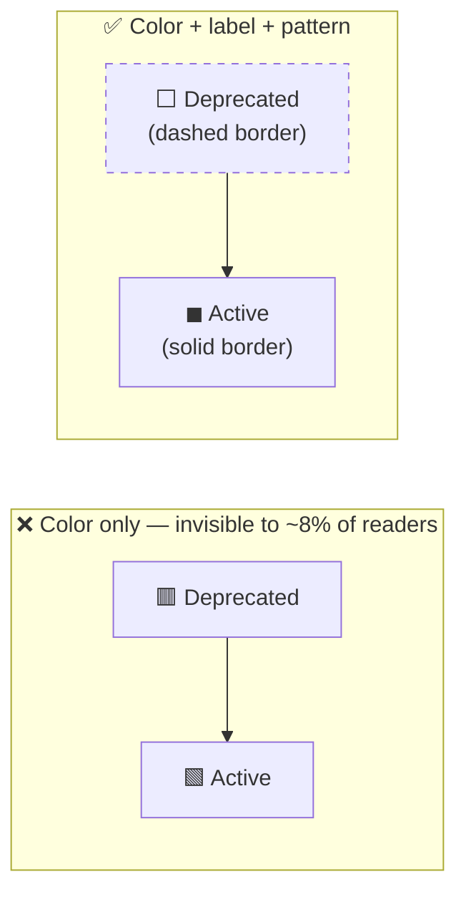
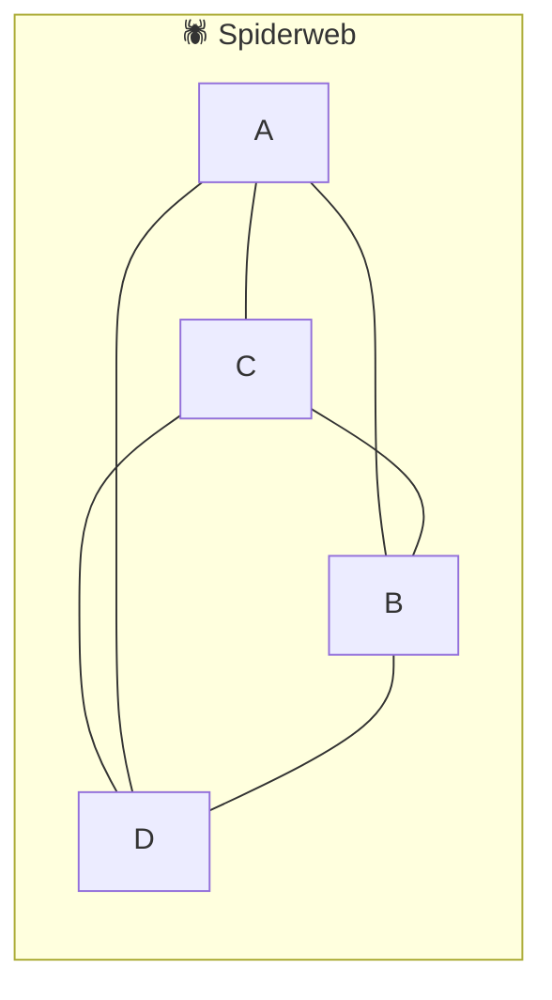

# 🧠 Topic: Anti-Patterns for Diagrams

> [!abstract] Executive Summary (ELI5)
> These are the **recurring ways architecture diagrams go wrong**. Each anti-pattern is a specific, named failure that makes a diagram harder to read than it needs to be. They are the dark mirror of [[Best Practices for Diagrams]] — every one of them is simply a *violated practice*. Learn to spot them by name, understand the harm each does, and apply the known fix. Naming the failure is half the cure.

> [!warning] The meta anti-pattern — "I know what I meant"
> Every anti-pattern here shares one root cause: the **curse of knowledge**. The author drew the diagram while holding the full system in their head, so every symbol, acronym, and color felt obvious *to them*. The reader holds none of that context. A diagram is communication, not self-expression — when in doubt, assume the reader knows nothing and over-explain.

---

## 🎯 The "Why"

- **Problem Solved:** Bad diagrams waste meetings. Stakeholders stare, pretend to understand, and disengage; engineers misread relationships and make wrong decisions. Cataloguing the common failures gives the team a shared vocabulary for *review* — "this has the spiderweb effect," "this is an everything-diagram" — so feedback is fast and specific instead of vague ("make it nicer").
- **Alternatives:** Leaving diagram quality to individual taste. Result: every diagram is a fresh dialect the reader must decode, and the same mistakes recur forever because nobody named them.
- **Trade-offs:** None of substance. Avoiding these costs only a little discipline and review time. The payoff is diagrams that transfer understanding in seconds.

## 💡 Mental Model & Analogy

- **Analogy:** A bad diagram is like a **badly written sign in a foreign airport** — tiny text, untranslated acronyms, five colors that mean nothing, arrows pointing everywhere. You *could* eventually figure out where your gate is, but the sign has failed its one job: to get you there instantly. A good sign (and a good diagram) is invisible — you just *know*.

The failing diagram fights the reader on five fronts at once; the clear one removes every fight.

---

## 🛠️ The Anti-Patterns (catalog)

The nine failures group into the **same four concerns** as the best practices, so each anti-pattern maps 1:1 to the practice it violates.

### A. Audience & Scope

#### 1. Diagrams that are too technical for the audience

- **What it looks like:** A diagram shown to business sponsors that names technologies — "Spring Boot API on EKS", "PostgreSQL via JDBC", "Kafka topic `orders.created.v2`" — instead of business concepts.
- **The harm:** The business audience's eyes glaze over. They either disengage ("I'm not technical") or, worse, nod along without understanding and approve something they didn't grasp. Decisions stall or get made on false assumptions.
- **The fix:** [[Best Practices for Diagrams]] §1 — *tailor to the audience*. For a business reader use functional, logical, high-level vocabulary (actors by role, domain nouns). Reserve technologies for the technical diagrams. The [[Context Viewpoint]] and [[Functional Viewpoint]] are the canonical business-facing views.

#### 2. Mixing high-level overviews with too much detail in one diagram ("the everything-diagram")

- **What it looks like:** One canvas that shows the system-as-one-box *and* the internal containers *and* a couple of component classes *and* a database table or two. A diagram trying to be a Context, Container, and Component view simultaneously.
- **The harm:** It's too dense for the overview reader (who wanted the shape) and too sparse for the detail reader (who wanted depth) — it serves no one. Readers can't tell what level they're on, so they can't form a stable mental model.
- **The fix:** [[Best Practices for Diagrams]] §2 — *keep levels separate*. One diagram = one zoom level. Split into a Context diagram, a Container diagram, and per-container Component diagrams. See [[Levels of Abstraction]] and [[Handling Complexity of Architecture Model]].

### B. Notation & Standards

#### 3. Assuming people know what your symbols and acronyms mean (no legend)

- **What it looks like:** Custom shapes with no key; TLAs ("IdP", "BSS", "MQ") scattered everywhere, never expanded; colors and line styles whose meaning is "obvious" — to the author.
- **The harm:** The reader must **decode before understanding**. Outsiders and new joiners are excluded; even insiders guess. The diagram becomes an IQ test instead of a communication.
- **The fix:** [[Best Practices for Diagrams]] §5 — *always include a legend* defining every symbol, color, line style, and acronym that carries meaning. Prefer standard notations ([[UML]], [[BPMN]], C4) so the legend is pre-learned; when you invent, document.

> The curse of knowledge strikes hardest here: once you know an acronym, it stops *looking* like jargon to you. Always write it out on first use, or in the legend.

#### 4. Inconsistent naming, symbols, or styles across diagrams

- **What it looks like:** The same component is `OrderService` on slide 3, `order-svc` on slide 7, and "Orders Module" on slide 12. A rounded blue box means "container" on one diagram and "external system" on another. Arrows are solid here, dashed there, for no stated reason.
- **The harm:** The reader **re-learns the visual language on every page** — a cognitive tax that compounds across a deck. Inconsistency also signals carelessness, which undermines the diagram's credibility ("if they didn't bother with the names, did they bother with the architecture?").
- **The fix:** [[Best Practices for Diagrams]] §4 & §8 — *consistent symbols/structures/layouts* and *consistent naming*. Pick one name, one shape vocabulary, one color semantics, and apply them everywhere. C4's fixed shape set is powerful precisely because it removes this variable.

### C. Visual Clarity & Accessibility

#### 5. Using too many colors with no purpose

- **What it looks like:** A rainbow palette where every box is a different hue "to make it pretty" — red, blue, green, yellow, purple, orange — with no semantic mapping. Or heavy decoration: gradients, 3D effects, drop shadows.
- **The harm:** Color carries **no signal**, so it becomes pure noise that competes with the actual content. Readers waste time asking "what do the colors mean?" and getting no answer. Ornament obscures structure.
- **The fix:** [[Best Practices for Diagrams]] §6 — *remove unnecessary colors and clutter*. Every color must encode meaning (e.g., green = external system). Maximize the data-ink ratio; if removing a color changes nothing, remove it.

#### 6. Relying only on color to differentiate elements

- **What it looks like:** "Red boxes are deprecated, green are active." "Blue is internal, red is external." Status indicated by hue alone — no label, icon, or pattern alongside.
- **The harm:** **Invisible to ~8% of men** (color blindness), and lost entirely in grayscale printouts, screenshots, and low-contrast screens. The distinction you relied on simply doesn't exist for those readers — an accessibility failure and a latent miscommunication.
- **The fix:** [[Best Practices for Diagrams]] §7 — *don't rely on color alone*. Pair every color with a **second channel**: a label, a shape, a pattern (dashed/solid), or an icon. `color + icon` is accessible; `color alone` is not.

#### 7. Long sentences and labels

- **What it looks like:** Paragraphs stuffed inside boxes. Full sentences on arrows ("when the user submits the form and validation passes, the service then calls..."). Boxes that grow to accommodate a wall of text.
- **The harm:** The diagram stops being a **visual** artifact and becomes a document you have to *read*. Scanning breaks down; boxes bloat and break layout; the eye can't grasp structure at a glance.
- **The fix:** Labels should be **nouns for elements, short verb-phrases for connectors** — "Order Service", "publishes `order.created`", "HTTPS/JSON". Move any explanation longer than a phrase into a side note, a legend, or companion text. A diagram complements prose; it doesn't replace it.

### D. Layout & Connections

#### 8. Crisscrossing lines everywhere (the spiderweb effect)

- **What it looks like:** A rat's nest of connectors crossing over each other repeatedly, where you can't trace a single path from source to target without losing the thread.
- **The harm:** The **relationships — the actual architectural decisions — become unreadable**. Readers guess at what connects to what. Often this is a *smell*, not just a cosmetic problem: a genuine spiderweb usually means either (a) too much on one canvas, or (b) the topology is genuinely over-coupled.
- **The fix:** [[Best Practices for Diagrams]] §10 — *keep connections clear*. Use orthogonal routing, spread parallel edges, route through a hub/gateway, and if it's still tangled, **split the diagram** or re-examine the coupling. See [[Key Elements of Architecture View]] — connectors are first-class; tangled ones hide the decisions that matter most.

Six edges among four nodes is already unreadable — a signal to split or simplify.

#### 9. Poor layout and uneven spacing

- **What it looks like:** Boxes crammed into one corner with vast empty space elsewhere; elements misaligned; arbitrary gaps; no visual grouping of related things; the primary flow zig-zags randomly instead of following a reading direction.
- **The harm:** The eye can't find the **flow** or the **groupings**. It reads as sloppy, which undermines trust in the content. The reader works harder to extract less.
- **The fix:** [[Best Practices for Diagrams]] §9 — *organize by natural reading patterns* (left-to-right, top-to-bottom). Align elements on a grid, group related elements spatially (proximity), keep spacing even, and make the primary flow follow the reading direction.

---

## ↔️ Anti-Pattern ↔ Violated Practice (the full map)

Every anti-pattern is a broken best practice. This table is the bidirectional bridge between the two notes.

| # | Anti-pattern (the failure) | Violated practice (the rule) |
|---|---|---|
| 1 | Too technical for the audience | §1 Tailor the diagram to your audience |
| 2 | Mixing overview with detail (everything-diagram) | §2 Keep high-level separate from low-level |
| 3 | Assuming symbols/acronyms are known (no legend) | §5 Include a legend |
| 4 | Inconsistent naming/symbols/styles | §4 Consistent symbols & §8 consistent naming |
| 5 | Too many colors with no purpose | §6 Remove unnecessary colors & clutter |
| 6 | Relying only on color | §7 Don't rely on color alone |
| 7 | Long sentences and labels | §6 Declutter (labels are content too) |
| 8 | Crisscrossing lines (spiderweb) | §10 Keep connections clear |
| 9 | Poor layout and uneven spacing | §9 Follow natural reading patterns |

> When reviewing a diagram, walk this table top-to-bottom. If you can name which anti-pattern you're seeing, the fix is already specified on the other side.

## ⚠️ How These Compound

Anti-patterns rarely appear alone. A failing diagram usually stacks three or four: an **everything-diagram** (#2) that is **too technical** (#1), covered in **acronyms with no legend** (#3), wired as a **spiderweb** (#8), with **rainbow colors** (#5) that are the **only** way to tell elements apart (#6). Each failure multiplies the cognitive load of the others. Fixing any one lightens the load; fixing them in order — audience first (#1), then scope (#2), then legend (#3) — tends to cascade and resolve the rest.

## 🔗 Deep Connections

- **Mirror note:** [[Best Practices for Diagrams]] — each anti-pattern here maps 1:1 to a violated practice there (see the table above).
- **Root cause:** [[Communicating the Model]] — every anti-pattern is a communication failure; this catalog operationalizes what "communicating badly" looks like concretely.
- **Audience & levels:** [[Levels of Abstraction]], [[Handling Complexity of Architecture Model]] — anti-patterns #1 and #2 are failures to respect abstraction levels; C4 ([[C4 Model]]) exists to prevent them.
- **Connectors:** [[Key Elements of Architecture View]] — anti-patterns #7 and #8 hide the connector decisions that carry the real architectural weight.
- **Notations:** [[UML]], [[BPMN]], [[ArchiMate]], [[Flowchart]] — using a standard notation pre-emptively kills anti-patterns #3 and #4.
- **Prerequisites:** [[Communicating the Model]], [[Levels of Abstraction]], [[Best Practices for Diagrams]].

## ❓ Active Recall Questions

> [!faq]- What is the single root cause shared by almost all diagram anti-patterns?
> The **curse of knowledge** — the author drew the diagram while holding the full system in context, so every symbol, acronym, and color felt obvious *to them*. The reader holds none of that context. Assuming the reader knows what you know produces the missing legend, the unexpanded acronyms, the unexplained colors.

> [!faq]- What is the "spiderweb effect," and what does it usually signal?
> Crisscrossing lines everywhere, where you can't trace a path from source to target without losing the thread. It's usually a **smell**, not just cosmetics: it means either (a) too much is on one canvas — split it, or (b) the topology is genuinely over-coupled. Connectors carry the real architectural decisions ([[Key Elements of Architecture View]]); a spiderweb hides them.

> [!faq]- Why is "relying only on color to differentiate elements" an anti-pattern, and what's the fix?
> It's **invisible to ~8% of men** (color blindness) and lost in grayscale prints and low-contrast screens. The fix is to pair every color with a **second channel** — a label, shape, pattern (dashed/solid), or icon — so the distinction survives without color.

> [!faq]- What is the "everything-diagram," and how do you fix it?
> One canvas mixing multiple zoom levels — the system-as-one-box *and* internal containers *and* component classes. It's too dense for the overview reader and too sparse for the detail reader, serving no audience. The fix is to split it by level: a Context diagram, a Container diagram, and per-container Component diagrams ([[Levels of Abstraction]], [[C4 Model]]).

> [!faq]- How do long sentences and labels harm a diagram?
> They turn a visual artifact into a document you must *read*. Scanning breaks down, boxes bloat and wreck layout, and the eye can't grasp structure at a glance. Labels should be nouns for elements and short verb-phrases for connectors; move longer explanation into side notes or companion prose.

> [!faq]- How do these anti-patterns relate to the best practices?
> They are the **inverse**: every anti-pattern is a violated practice. Use the mapping table in this note (e.g., "too technical for audience" ↔ "tailor to audience"; "spiderweb" ↔ "keep connections clear") so that naming the failure immediately tells you the fix, defined in [[Best Practices for Diagrams]].

---

## 📝 Related Notes

- [[Best Practices for Diagrams]]
- [[Communicating the Model]]
- [[Levels of Abstraction]]
- [[Handling Complexity of Architecture Model]]
- [[C4 Model]]
- [[Key Elements of Architecture View]]
- [[UML]]
- [[BPMN]]
- [[ArchiMate]]
- [[Flowchart]]
