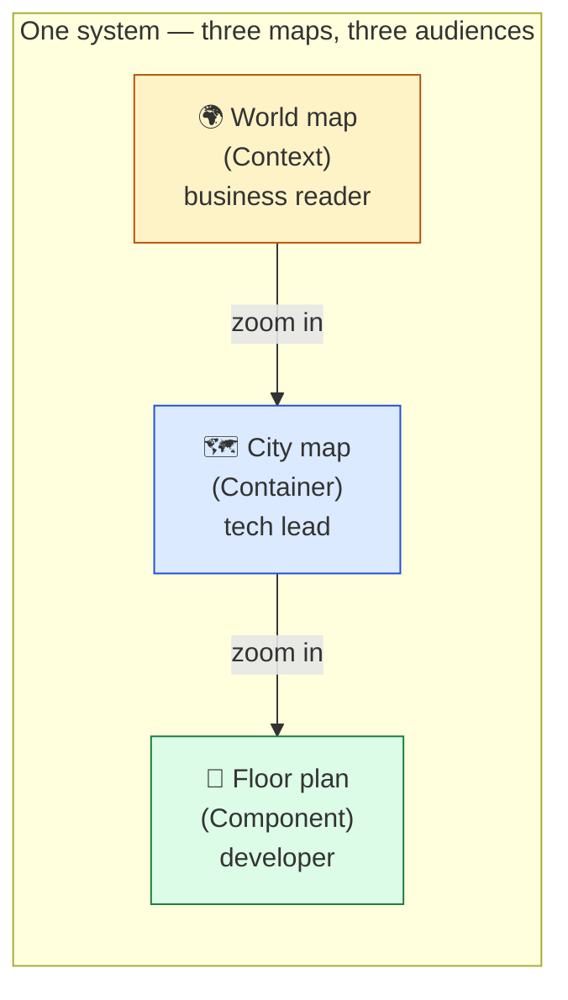
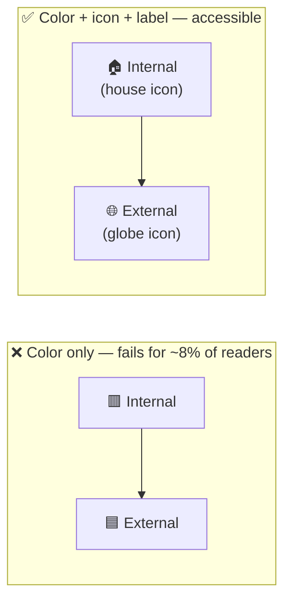

# 🧠 Topic: Best Practices for Diagrams

> [!abstract] Executive Summary (ELI5)
> An architecture diagram is a **communication artifact**, not artwork. Its only job is to move understanding from your head into someone else's head with the **least cognitive effort possible**. Every rule below is one expression of a single principle: *minimize the reader's effort to understand the message.* A beautiful diagram that confuses its audience has failed; an ugly diagram that clicks instantly has succeeded.

> [!warning] The #1 failure — one diagram for everyone
> The most common mistake is drawing **a single diagram and showing it to every audience**: business sponsors, developers, and ops engineers in the same room. It is inevitably too technical for the business and too vague for the engineers — it serves no one. A diagram is a *message to a specific reader*. Decide the reader first, then every other choice follows.

---

## 🎯 The "Why"

- **Problem Solved:** Architecture diagrams are notoriously bad. They suffer from cluttered lines, inconsistent symbols, mixed abstraction levels, color-only encoding, and missing legends — so readers spend more effort *decoding the diagram* than understanding the architecture. These practices remove that friction.
- **Alternatives:** "Just draw what feels right." Result: every team reinvents notation, every diagram looks different, and onboarding slows because nobody can read anyone else's diagrams.
- **Trade-offs:** Following standards and maintaining consistency costs a little discipline up front. The payoff is diagrams that are readable in seconds by anyone familiar with the notation — and that stay readable as the system grows.

## 💡 Mental Model & Analogy

- **Analogy:** A diagram is a **map**, and a map is always drawn for a *specific purpose at a specific scale*. A **world map** shows countries and borders; a **city map** shows streets and blocks; a **floor plan** shows rooms and doors. You would never draw individual streets on a world map — the clutter would serve no reader. Same system, different maps for different readers. The cardinal sin of diagramming is putting street-level detail on a country-level map.

Each map serves one audience at one zoom level. Keeping them separate is the whole point — see [[Levels of Abstraction]] and [[Handling Complexity of Architecture Model]].

---

## 🛠️ The Practices

The nine practices group into four concerns: **audience, notation, clarity, layout.**

### A. Audience & Scope

#### 1. Tailor the diagram to your audience — Business vs. Technical

This is the master practice; every other rule is downstream of it. Decide *who reads this*, then choose the abstraction level, vocabulary, and detail to match.

| Audience | Wants | Diagram style | Vocabulary | C4 level | Typical viewpoints |
|---|---|---|---|---|---|
| **Business** (sponsors, product, domain experts) | "What does it do, and for whom?" | **Functional, Logical, High-level** | Business domain (orders, customers, payments) | Context (L1) | [[Context Viewpoint]], [[Functional Viewpoint]], [[Information Viewpoint]] |
| **Technical** (architects, devs, ops) | "How is it built and how does it run?" | **Operational, Physical, Detailed** | Technologies, protocols, topology | Container/Component (L2/L3) | [[Container Viewpoint]], [[Component Viewpoint]], [[Deployment Viewpoint]], [[Development Viewpoint]], [[Concurrency Viewpoint]] |

- A **business** diagram names actors by role ("Customer", "Support agent") and hides all technology. The [[Context Viewpoint]] is the canonical example — the whole system is one box.
- A **technical** diagram names technologies ("Node.js API", "PostgreSQL", "Kafka") and shows protocols on every connector — because at that zoom, those decisions *are* the message.

> If you find yourself writing "this box is the API, written in Spring Boot, deployed on EKS, talking to Postgres via JDBC" on a diagram meant for a business sponsor, you are mixing audiences. Split it into two diagrams.

#### 2. Keep high-level overviews separate from low-level technical details

A direct corollary of practice #1. One diagram = one zoom level. Mixing a system-wide overview with a single container's internal classes produces a diagram that is simultaneously too dense (for the overview reader) and too sparse (for the detail reader).

- High-level overview → its own diagram (e.g., Context).
- Low-level detail → a *drill-down* diagram (e.g., Component view of one container).
- The C4 model is built on exactly this discipline: each level zooms into the one above. See [[C4 Model]] and [[Levels of Abstraction]].

> The test: *could a reader understand this diagram without having seen the level above or below?* If yes, the scope is right. If they need both to make sense of it, you have merged levels.

### B. Notation & Standards

#### 3. Use standard notations when possible

Prefer an established notation ([[UML]], [[ArchiMate]], [[SysML]], [[BPMN]], C4 shapes, [[Flowchart]]) over inventing your own. Standards are a shared language: a reader who knows the notation understands your diagram in seconds without explanation. An invented notation forces every reader to learn *your* dialect first.

- Match the notation to the content: process/behaviour → [[BPMN]] or [[Flowchart]]; structure → UML component/deployment or C4; enterprise layers → [[ArchiMate]].
- When no standard fits, invent minimally — and then document it (see the legend, practice #5).

> A notation is a *contract* with the reader. Breaking it (using a UML cylinder for something that isn't a database, say) is worse than not using one at all, because it actively misleads.

#### 4. Use consistent symbols, structures, and layouts across diagrams

Once a reader has learned that "blue rounded box = container" in one of your diagrams, every other diagram must use the same convention. Inconsistency forces the reader to re-learn the visual language on every page.

- Same shape → same meaning, everywhere.
- Same color → same semantic (e.g., green = external system, always).
- Same layout pattern for the same structure (e.g., request always flows left-to-right).
- This is why C4 is powerful: it fixes the shape vocabulary across all four levels.

#### 5. Include a legend

Every diagram whose symbols, colors, or line styles carry meaning needs a **legend** — a small key that decodes the visual language. Even standard notations benefit from a legend when you use a subset or add conventions.

- Place the legend in a corner, unobtrusively.
- Document shapes, colors, line styles (solid vs. dashed = synchronous vs. asynchronous, say), and any icons.
- A legend is the antidote to "I used these colors but didn't tell anyone what they mean."

### C. Visual Clarity & Accessibility

#### 6. Remove unnecessary colors, labels, and clutter

Every element on a diagram must *earn its place* by adding understanding. Decoration that does not communicate — gradient fills, drop shadows, 3D effects, a box for every trivial helper — is **noise** that competes with the signal.

- Ask of every visual element: *if I removed this, would the reader understand less?* If no, remove it.
- Tufte's principle applies: maximize the **data-ink ratio**. Ink should encode meaning, not ornament.
- Less is more: a diagram with 6 well-chosen boxes beats one with 30 boxes for transfer of understanding.

#### 7. Don't rely on color alone — use labels, patterns, or icons (accessibility)

Color blindness affects ~8% of men. A red/green status distinction, or a "blue means external, red means internal" scheme, is **invisible** to many readers and fails entirely in grayscale printouts.

- Always pair color with a **second channel**: a label, a shape difference, a pattern (dashed/solid), or an icon.
- `✅ color + icon` → accessible. `❌ color alone` → not accessible.
- This also helps when diagrams are screenshot, printed, or viewed on a low-contrast screen.

#### 8. Place labels close to elements; use consistent naming

- **Proximity:** a label must sit next to the element it describes. A floating label halfway across the diagram forces the reader to guess what it belongs to — a major source of misreading.
- **Consistent naming:** pick one naming style and keep it everywhere. If containers are "X-API", "Y-API", don't suddenly write "Z Service". Consistent naming is consistent *thinking* made visible.
- Name elements by their **role/responsibility**, not by a tech detail, unless the tech is the message (it is, at technical zoom).

### D. Layout & Connections

#### 9. Organize diagrams to follow natural reading patterns

Western readers scan **left-to-right, top-to-bottom**. Arrange the diagram so the eye follows the natural flow of the system: inputs on the left, processing in the middle, outputs/stores on the right; or trigger at the top, consequences below.

- Primary flow should follow the reading direction.
- Group related elements spatially (the [[Gestalt]] principle of proximity) — elements that belong together sit together.
- Avoid forcing the eye to zig-zag across the canvas to follow the main story.

#### 10. Keep connections clear; avoid overlapping lines

The connectors are where the hardest architectural decisions live (see [[Key Elements of Architecture View]] → connectors). Tangled, crossing, overlapping lines hide exactly those decisions.

- Use **orthogonal routing** (right-angle connectors) for structural diagrams; it reads cleaner than diagonals.
- Spread parallel edges so they don't overlap.
- If the diagram is a rat's nest of crossings, that is usually a *smell* — either the topology is genuinely too coupled, or you are showing too much on one canvas (split it).
- Re-route through a hub/gateway rather than drawing every low-level dependency across the canvas.

> Every crossing line is a place the reader's eye can lose the thread. Minimize crossings; where unavoidable, make it unambiguous which line goes where.

---

## ✅ Quick Checklist

Before sharing a diagram, run it through this list:

- [ ] **Audience decided?** One reader in mind (business OR technical, not both)?
- [ ] **One zoom level?** No mixing of overview and internals?
- [ ] **Standard notation?** Or, if custom, is it documented?
- [ ] **Consistent?** Same shape/color/layout pattern as the other diagrams?
- [ ] **Legend?** Present whenever symbols/colors carry meaning?
- [ ] **Decluttered?** Every element earns its place?
- [ ] **Color + second channel?** No color-only encoding?
- [ ] **Labels close & naming consistent?**
- [ ] **Reading order?** Primary flow left-to-right / top-to-bottom?
- [ ] **Connections clear?** No unnecessary crossings?

## ⚠️ Pitfalls & Anti-patterns

- **The "everything" diagram:** one canvas with Context + Container + Component detail mixed in. Serves no audience; overwhelms everyone. Split by level.
- **Color-only meaning:** "red boxes are deprecated" — invisible to color-blind readers and grayscale prints. Always add a label/icon/pattern.
- **No legend:** "the colors are obvious." They are obvious to *you*, the author — not to the reader. Always provide a key.
- **Decoration as substance:** 3D boxes, gradients, shadows, icons-for-flair. If it doesn't encode meaning, it's noise.
- **Inconsistent conventions across the deck:** a cylinder means "database" on slide 3 but "message queue" on slide 7. Re-learned visual language on every page.
- **Invented notation undocumented:** custom shapes with no legend. The reader must reverse-engineer your dialect.
- **Tangled connectors:** overlapping lines hiding the real relationships. Usually a sign of too much on one canvas or genuinely excessive coupling.
- **Vague connectors:** arrows labeled "talks to" — see [[Key Elements of Architecture View]]; the connector *type* (sync/async, protocol) is the decision. Name it.
- **Naming inconsistency:** "OrderService", "order-svc", "Orders Module" for the same thing across diagrams. Pick one.
- **Wrong audience vocabulary:** tech names on a business diagram, or business abstractions on a deployment diagram.

## 🔗 Deep Connections

- **Parent topic:** [[Communicating the Model]] — these practices *are* how you communicate a model clearly; this note operationalizes that concept.
- **Mirror note:** [[Anti-Patterns for Diagrams]] — the dark twin of this note. Each anti-pattern is a violated practice from above; that catalog gives each failure a name and the corresponding fix.
- **Audience ↔ abstraction:** [[Levels of Abstraction]] (why one diagram = one zoom level), [[Handling Complexity of Architecture Model]] (splitting complexity across levels), [[C4 Model]] (Context/Container/Component as the canonical audience-tailored levels).
- **Viewpoints as audience-tailored views:** [[Context Viewpoint]] & [[Functional Viewpoint]] (business-facing) vs. [[Deployment Viewpoint]], [[Development Viewpoint]], [[Concurrency Viewpoint]] (technical). The viewpoint you choose already encodes the audience.
- **Connectors are first-class:** [[Key Elements of Architecture View]] — practices #8 and #10 only matter because connectors carry real decisions; vague labels and tangled lines hide them.
- **Notations to prefer:** [[UML]], [[ArchiMate]], [[SysML]], [[BPMN]], [[Flowchart]], [[Event-Storming]] (practice #3 — use standard notations).
- **Prerequisites:** [[Communicating the Model]], [[Levels of Abstraction]], the idea that a [[Model]] is purposeful abstraction for an audience.

## ❓ Active Recall Questions

> [!faq]- What is the single most important decision before drawing a diagram, and why?
> **The audience.** A diagram is a message to a specific reader. Business readers need functional, logical, high-level views (domain vocabulary, no tech); technical readers need operational, physical, detailed views (technologies, protocols, topology). Drawing one diagram for both audiences fails both — too technical for business, too vague for engineers.

> [!faq]- Why should high-level overviews be kept separate from low-level technical details?
> Because mixing zoom levels produces a diagram that is simultaneously too dense (for the overview reader) and too sparse (for the detail reader). One diagram should serve one zoom level. The C4 model is built on this discipline — Context, Container, Component each zoom into the level above. Test: *could a reader understand this diagram without the level above or below?*

> [!faq]- Why must you not rely on color alone to encode meaning?
> Color blindness affects ~8% of men, and color distinctions vanish in grayscale printouts and low-contrast screens. Always pair color with a **second channel** — a label, shape, pattern (dashed/solid), or icon. `color + icon` is accessible; `color alone` is not.

> [!faq]- What does a legend buy you, and when is it needed?
> A legend decodes the visual language — shapes, colors, line styles, icons — so the reader doesn't have to guess. It is needed whenever symbols or colors carry meaning, even when using a standard notation (especially if you use a subset or add conventions). Without one, conventions are obvious only to the author.

> [!faq]- How do you keep connections between elements clear?
> Use orthogonal (right-angle) routing for structural diagrams, spread parallel edges apart, route through hubs/gateways instead of drawing every dependency across the canvas, and — if lines are a tangled rat's nest — treat it as a smell: either the topology is genuinely over-coupled, or too much is on one canvas (split it). Vague "talks to" connectors should be replaced with named connector types.

> [!faq]- How do these practices connect to the C4 model and viewpoints?
> The audience principle *is* what C4 encodes: Context (L1) for business, Container/Component (L2/L3) for technical readers — each level one zoom, one audience. Likewise the Rozanski & Woods viewpoints split along audience lines: [[Context Viewpoint]]/[[Functional Viewpoint]] are business-facing; [[Deployment Viewpoint]]/[[Development Viewpoint]]/[[Concurrency Viewpoint]] are technical. Choosing the viewpoint already chooses the audience.

---

## 📝 Related Notes

- [[Anti-Patterns for Diagrams]]
- [[Communicating the Model]]
- [[Levels of Abstraction]]
- [[Handling Complexity of Architecture Model]]
- [[C4 Model]]
- [[Context Viewpoint]]
- [[Container Viewpoint]]
- [[Component Viewpoint]]
- [[Key Elements of Architecture View]]
- [[UML]]
- [[ArchiMate]]
- [[BPMN]]
- [[Flowchart]]
