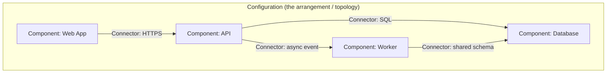
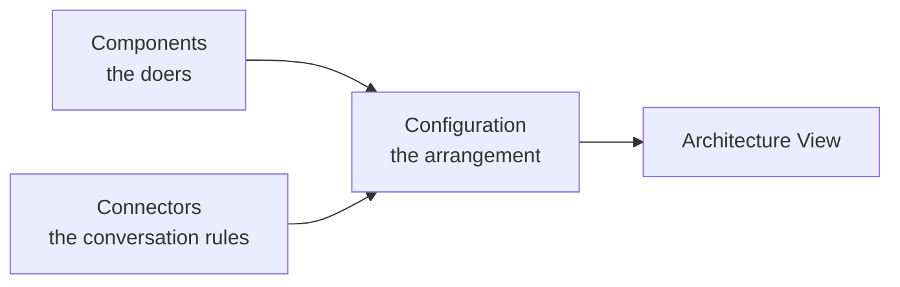

# 🧠 Topic: Key Elements of an Architecture View — Components, Connectors, Configurations

> [!abstract] Executive Summary (ELI5)
> Every architecture view is built from the same three ingredients. **Components** are the "things that do work" (a service, a database, a UI). **Connectors** are the "pipes and rules" that let those things talk (an HTTP call, a message queue, a shared file). **Configuration** is the overall arrangement — *which* components are wired to *which* connectors, and what that topology means. Together they answer: what are the parts, how do they interact, and how is it all laid out?

> [!warning] The #1 confusion
> People draw boxes and arrows but treat the **arrows as decoration**. A connector is a first-class architectural element with its own properties (sync/async, protocol, reliability, who owns the data). If you cannot name what kind of connector a line represents, your diagram is a sketch, not an architecture view.

---

## 🎯 The "Why"

- **Problem Solved:** Without a vocabulary for the parts, every architecture discussion collapses into vague "boxes and lines." Naming components, connectors, and configuration gives you a precise language to reason about structure, compare alternatives, and spot problems (e.g., a component with no clear responsibility, or a connector that hides a hidden dependency).
- **Alternatives:** Ad-hoc diagrams where boxes are "services" and lines are "talks to." This hides the decisions that actually matter — protocol, ownership, coupling — until they bite in production.
- **Trade-offs:** Treating connectors as first-class costs a little more modeling effort up front. The payoff is that integration problems (the hardest ones) become visible on the diagram instead of hidden inside a box.

## 💡 Mental Model & Analogy

- **Analogy:** Think of a city. **Components** are the buildings — a school, a hospital, a factory — each with a purpose. **Connectors** are the roads, power lines, and water pipes that let buildings serve each other, and each kind has its own rules (a road vs. a sewer vs. a fiber cable). **Configuration** is the city plan — where buildings sit relative to the roads, which neighborhoods connect to which, and what overall shape the city takes. The same buildings arranged differently produce a completely different city.

Note that the same component (`Database`) can be the target of **different** connectors (SQL from the API, shared-schema access from the Worker) — the connector, not just the line, carries meaning.

## 🛠️ The Three Elements

### 1. Components

*The loci of computation and data — the "things" that do the work.*

- **What they are:** Services, applications, databases, message brokers, UI clients, external systems, libraries, modules — any element that has a responsibility and performs work.
- **Key properties to capture:**
  - **Responsibility** — what this component does, in one sentence. If you cannot state it, the component is ill-defined.
  - **Provided/required interfaces** — what it offers to others and what it needs from others.
  - **Technology** — language, framework, runtime (relevant at Container/Component C4 levels).
  - **Ownership** — which team owns it (critical in larger organizations).
- **In C4:** "Component" is a specific level, but the *idea* of a component applies at every C4 level — a System, a Container, and a (code) Component are all "components" in this generic sense, just at different zoom. See [[System Architecture]] and [[Levels of Abstraction]].
- **Questions a good component answers:** What is my job? What do I depend on? What do I provide?

> A component with five responsibilities is five components that have not been discovered yet.

### 2. Connectors

*The interaction mechanisms — the "rules of conversation" between components.*

- **What they are:** Not just "a line." A connector is the **mechanism** by which components communicate or coordinate: HTTP/REST, gRPC, a message queue, a shared database, a file drop, an event bus, a direct function call.
- **Why they are first-class:** The connector carries the hardest architectural decisions — sync vs. async, coupling, reliability, ordering, security, performance. Two components with the same responsibility but different connectors behave very differently.
- **Key properties to capture:**
  - **Type** — synchronous call, asynchronous message, shared store, event subscription, etc.
  - **Protocol/contract** — REST schema, event payload, query interface.
  - **Reliability semantics** — at-least-once, exactly-once, best-effort, transactional.
  - **Direction of dependency** — who initiates, who owns the data, who can fail independently.
- **Common families:**
  | Family | Example | Coupling | Typical use |
  |---|---|---|---|
  | Sync RPC | HTTP, gRPC | tight, temporal | request/response, needs immediate answer |
  | Async messaging | queue, pub/sub | loose, temporal decoupling | work handoff, fan-out, retries |
  | Shared data store | common database | tight, data coupling | (often an anti-pattern) integration via data |
  | Event streaming | Kafka, event bus | very loose | domain events, audit, eventual consistency |
- **Questions a good connector answers:** synchronous or async? Who owns the data? What happens when the other side is down?

> If two components share a database, the database is the connector — and "shared database" is one of the highest-coupling connectors there is. It is rarely an accident; it should be a deliberate decision.

### 3. Configuration

*The overall arrangement — how components and connectors are composed into a topology.*

- **What it is:** The topology itself — *which* components are connected to *which* connectors, and the *shape* that emerges (layered, client-server, microservices, event-driven, pipeline, hub-and-spoke).
- **Why it matters separately:** The same components and connectors, arranged differently, yield radically different architectures. A set of services wired through a message bus (event-driven) behaves nothing like the same services wired point-to-point with HTTP, even if the component list is identical.
- **What it captures:**
  - **Topology** — the shape (layered, hexagonal, ring, mesh, star).
  - **Constraints** — e.g., "the UI may only talk to the API, never the database" (a layered rule).
  - **Patterns** — client/server, broker, pipes-and-filters, CQRS.
  - **Quality implications** — where the configuration enables or blocks scalability, resilience, evolvability (see [[System Architecture]] → Quality Attributes).
- **In C4:** A Container or Component diagram *is* a configuration — it shows the arrangement. The C4 model gives you a repeatable way to draw configurations at each zoom level.

> The configuration is where architectural *style* lives. Two teams can have the same components and connectors and still build very different systems because they composed them differently.

## 🔼 How the Three Work Together

An **architecture view** is a configuration of components connected by connectors, drawn to answer a specific question for a specific audience. Change any one of the three and the view — and the system it describes — changes.

## ⚠️ Pitfalls & Anti-patterns

- **Treating arrows as decoration:** A line that is just "talks to" hides the real decisions (protocol, sync/async, ownership). Name every connector's type.
- **Shared-database-as-integration:** Using one database as the connector between two components is invisible coupling. It is legitimate sometimes, but must be a deliberate choice, not an accident.
- **Components with fuzzy responsibilities:** "The core service" that does everything. A component you cannot describe in one sentence is under-modeled.
- **Forgetting connectors have failures:** Every connector can fail or stall. If your diagram only shows the happy path, you have not modeled behavior — see [[System]] (Structure / Function / Behaviour).
- **Confusing configuration with components:** Thinking that listing services is enough. The *arrangement* (topology, rules) is a separate architectural decision and deserves to be made explicitly.
- **One-element obsession:** Modeling components in detail while ignoring connectors (or vice versa). An architecture view needs all three to be meaningful.

## 🔗 Deep Connections

- **Parent Topic:** [[System Architecture]] (this triad is the building blocks of the "components, relationships, principles" described there), [[System Modeling]]
- **Related Concepts:** [[System]] (its Structure / Function / Behaviour maps onto these elements), [[Levels of Abstraction]] (components/connectors appear at every zoom level), [[Model]] (a view is a purposeful model), [[Communicating the Model]] (naming connectors clearly is a communication act)
- **Prerequisites:** [[Model]], [[System]], the idea that abstraction chooses what to reveal — see [[Mental Model]].

## ❓ Active Recall Questions

> [!faq]- What are the three key elements of an architecture view?
> **Components** (the things that do work), **Connectors** (the interaction mechanisms / rules of conversation), and **Configuration** (the overall arrangement — topology of components and connectors).

> [!faq]- Why should a connector be treated as a first-class element, not just a line?
> The connector carries the hardest architectural decisions — sync vs. async, protocol, reliability, data ownership, coupling. Two components with identical responsibilities but different connectors behave very differently. If you cannot name the connector type, the decision is hidden.

> [!faq]- What makes "shared database" a notable connector, and why is it risky?
> It couples components through their data — both depend on the same schema and writes. It is one of the highest-coupling connectors and turns integration into implicit data dependencies. It can be legitimate, but should always be a deliberate decision, not an accident.

> [!faq]- What does "configuration" capture that components and connectors alone do not?
> The **topology and composition rules** — *which* components connect to *which* connectors, and the architectural style that emerges (layered, event-driven, client-server). The same parts arranged differently produce a different system.

> [!faq]- How do these three elements map to the C4 model?
> "Component" in this generic sense exists at every C4 level (System, Container, Code-Component). A Container or Component diagram is literally a *configuration* — it shows the arrangement of components and the connectors between them. C4 gives you a repeatable way to draw configurations at each zoom level.

> [!faq]- Why is "a component with five responsibilities" a smell?
> It is likely five components that have not been separated. A well-modeled component should be describable in one sentence — a single, clear responsibility.

---

## 📝 Related Notes

- [[System Architecture]]
- [[System]]
- [[System Modeling]]
- [[Levels of Abstraction]]
- [[Model]]
- [[Communicating the Model]]
