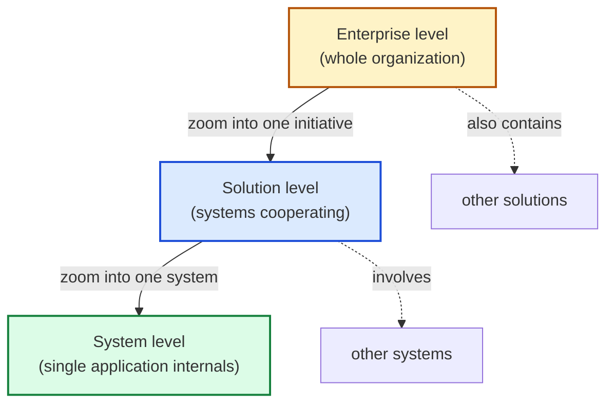

# 🧠 Topic: Levels of Abstraction — Enterprise, Solution, System

> [!abstract] Executive Summary (ELI5)
> Architecture happens at three zoom levels. **Enterprise** is the whole map of the organization — all systems and how they fit the business. **Solution** is one initiative inside that map — a few systems working together to deliver a specific outcome. **System** is a single application — one box on the map, opened up to see its internals. You pick the level that matches the question you are trying to answer.

> [!warning] The #1 confusion
> People mix the levels and argue past each other. One person is talking about the **enterprise** (do we even need this system?), another about the **solution** (how do systems A, B, C cooperate?), and a third about the **system** (what container holds the auth logic?). Each level has its own diagrams, audience, and decisions. Know which level you are on before you draw anything.

---

## 🎯 The "Why"

- **Problem Solved:** A single diagram cannot serve everyone. A CFO needs the enterprise view; a solution architect needs the cross-system view; a developer needs the single-system internals. Levels of abstraction let each audience get the right amount of detail without drowning in noise or starving for context.
- **Alternatives:** One giant "wall of boxes" diagram that tries to show everything. It satisfies nobody and becomes unmaintainable within months.
- **Trade-offs:** Splitting into levels adds overhead — you must keep the levels consistent (a system on the enterprise map must be the same system you zoom into at the system level). The benefit is clarity and the ability to navigate up and down the zoom.

## 💡 Mental Model & Analogy

- **Analogy:** Think of an online map. **Enterprise** is the country/world view — you see all the cities (systems) and how they sit in the landscape (business). **Solution** is the region view — you see a cluster of cities and the roads between them. **System** is the street view — you are inside one city, looking at individual buildings (containers/components). Same place, three zoom levels, each useful for a different task.

Each arrow downward is "open the box and look inside." Each arrow upward is "step back and see the bigger picture."

## 🛠️ The Three Levels

### 1. Enterprise (Enterprise Architecture)

*The whole organization as a portfolio of systems and capabilities.*

- **Scope:** All software systems across the business, plus the business capabilities they support.
- **Question it answers:** *"What systems do we have, which business capabilities do they serve, and where are the gaps, overlaps, and redundancies?"*
- **Audience:** CIO/CTO, enterprise architects, business stakeholders.
- **Typical elements:** Business capabilities, major systems, organizational units, external partners.
- **Decisions made here:** Investment, consolidation, sourcing (build vs. buy), technology standards, strategic roadmaps.
- **Relationship to C4:** The enterprise level sits **above** the C4 model. The C4 *System Context* diagram of one system is a window into the enterprise map from that system's point of view.

> Enterprise architecture is less about boxes and arrows and more about *portfolio coherence* — does the collection of systems make sense together?

### 2. Solution (Solution Architecture)

*One business initiative or problem — several systems working together to deliver an outcome.*

- **Scope:** A specific initiative (e.g., "launch a new checkout experience") and the set of systems that must cooperate to deliver it.
- **Question it answers:** *"Which systems are involved in this initiative, how do they exchange data and responsibilities, and how do we integrate them?"*
- **Audience:** Solution architects, tech leads, integration teams, product owners.
- **Typical elements:** 2–5 systems, integration points, data flows, contracts/APIs, deployment boundaries.
- **Decisions made here:** Integration patterns, data ownership, cross-system workflows, technology choices for the initiative.
- **Relationship to C4:** Often expressed as **multiple System Context diagrams connected together**, or a "system landscape" view showing the cooperating systems. This level bridges enterprise breadth and system depth.

> A solution is where cross-cutting concerns live — the stuff no single system owns but the initiative requires (e.g., an agreed event schema shared by three systems).

### 3. System (System Architecture)

*A single system opened up — its internal structure.*

- **Scope:** One system's internal organization: containers, components, and (rarely) code.
- **Question it answers:** *"How is this system built internally, and how do its parts cooperate to fulfill its responsibilities?"*
- **Audience:** Development teams, system architects, tech leads.
- **Typical elements:** Containers (web app, API, database, message broker), components inside them, and their interactions.
- **Decisions made here:** Technology stack, container boundaries, component decomposition, data storage, deployment topology.
- **Relationship to C4:** This is where **C4 shines** — the System Context is the boundary, then you drill into Containers and Components. See [[System Architecture]] for the full set of elements.

### Side-by-side comparison

| | Enterprise | Solution | System |
|---|---|---|---|
| **Scope** | Whole organization | One initiative, several systems | One application |
| **Core question** | What systems exist & why? | How do systems cooperate? | How is this one built? |
| **Audience** | Executives, enterprise architects | Solution architects, integration teams | Developers, system architects |
| **Typical count of "things"** | All systems (dozens+) | 2–5 systems | Containers/components |
| **C4 fit** | Above C4 (context) | Multiple contexts linked | C4 Levels 1–4 |

## 🔼 Abstracting UP vs. DOWN

- **Abstracting UP (System → Solution → Enterprise):** Hide internal detail, keep relationships. You lose *how*, you keep *what* and *why*.
- **Abstracting DOWN (Enterprise → Solution → System):** Open a box, reveal its internals. You lose *the big picture*, you gain *implementation detail*.

This is the same progressive-disclosure mechanism that powers the C4 model's Context → Container → Component → Code drill-down — just applied at the level of *which system* you are looking at.

> [!tip] Implementation Note
> Always state the level before drawing. "This is a solution-level diagram showing how the checkout, payments, and inventory systems cooperate." That one sentence prevents 90% of "why is this box missing / too detailed" arguments.

## ⚠️ Pitfalls & Anti-patterns

- **Mixing levels in one diagram:** Putting enterprise-wide concerns, solution integrations, and system containers on the same canvas. The result is unreadable. Pick a level and stay on it.
- **Drawing system-level detail for an enterprise audience:** A CFO does not need to see your message broker. Zoom out to capabilities and major systems.
- **Treating levels as silos:** The levels must stay consistent — the system you model at the system level must be recognizable as a box on the solution and enterprise views. Drift between levels makes the whole model untrustworthy.
- **Skipping the solution level:** Going straight from "all systems" to "one system's containers" hides integration reality — often where the hardest problems live.
- **Confusing "level of abstraction" with "C4 level":** C4's Context/Container/Component/Code are zoom levels *inside one system*. Enterprise/Solution/System are zoom levels *across systems*. They are orthogonal and combine freely.

## 🔗 Deep Connections

- **Parent Topic:** [[System Modeling]], [[Modeling Software Architecture]]
- **Related Concepts:** [[System]], [[System Architecture]] (the System level opened up), [[Mental Model]] (abstraction as compression), [[Model]] — see also C4 Context/Container/Component/Code as the *intra-system* zoom.
- **Prerequisites:** [[System]], [[Model]], the idea that abstraction is about choosing what to hide (see [[Mental Model]]).

## ❓ Active Recall Questions

> [!faq]- What question does each level of abstraction answer — Enterprise, Solution, System?
> Enterprise: "What systems do we have and why?" Solution: "How do a few systems cooperate for one initiative?" System: "How is this single system built internally?"

> [!faq]- How do the three levels relate to the C4 model?
> The C4 System Context diagram is a view *into* the enterprise map from one system's perspective. The Solution level is often multiple System Contexts linked. The System level is where C4's Container/Component/Code drill-down lives. Enterprise/Solution/System are zoom levels *across* systems; C4 levels are zoom levels *inside one system*.

> [!faq]- What goes wrong when you mix levels in a single diagram?
> Enterprise concerns, solution integrations, and system containers on one canvas become unreadable. Each audience needs a different amount of detail, and no single diagram serves them all — pick a level and stay on it.

> [!faq]- Why is the Solution level easy to skip and why is that a mistake?
> It sits between enterprise breadth and system depth, so people jump straight from "all systems" to "one system's containers." But cross-system integration — data ownership, contracts, shared workflows — is often where the hardest problems live, and only the solution level surfaces them.

> [!faq]- What is the difference between "levels of abstraction" and "C4 levels"?
> Levels of abstraction (Enterprise/Solution/System) zoom *across systems*. C4 levels (Context/Container/Component/Code) zoom *inside one system*. They are orthogonal and combine freely — e.g., a Container diagram is always at the System level of abstraction.

---

## 📝 Related Notes

- [[System]]
- [[System Architecture]]
- [[System Modeling]]
- [[Mental Model]]
- [[Model]]
