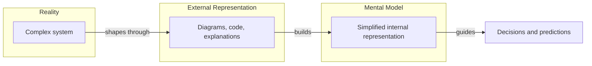

# 🧠 Topic: Mental Model

> [!abstract] Executive Summary (ELI5)
> A mental model is a simplified picture inside your head of how something works. It helps you understand, predict, and reason about a system without remembering every detail.

---

## 🎯 The "Why"
- **Problem Solved:** Software systems are too complex to hold in full detail. Mental models let us compress reality into something we can think about, discuss, and use to make decisions.
- **Alternatives:** Memorizing every fact, relying on documentation alone, or repeatedly exploring the real system through trial and error.
- **Trade-offs:** A mental model is always incomplete. A wrong model can lead to bad predictions and decisions. The goal is a useful approximation, not perfect accuracy.

## 💡 Mental Model & Analogy
- **Analogy:** A mental model is like the picture you have in your head of how a car works. You may not know every wire and piston, but you know that pressing the pedal makes it go, the steering wheel turns it, and the brakes stop it. That internal picture is enough for everyday driving.
- **Visual/Diagram:**

## 🛠️ Core Principles
1. **A mental model is personal.** Each person builds their own based on experience, knowledge, and the representations they have seen.
2. **A mental model is a compression.** It keeps the patterns and relationships that matter and discards the rest.
3. **A mental model is dynamic.** It changes as we learn more, encounter new situations, or receive better explanations.
4. **A mental model drives action.** We use it to make predictions, solve problems, and communicate with others.
5. **Shared mental models enable collaboration.** When a team has similar mental models, discussions become faster and more productive.

## 🏗️ Building Strong Mental Models

### 1. Start with an Analogy
*Connect the new concept to something already familiar.*
- A database is like a filing cabinet. A message queue is like a mailbox. A load balancer is like a traffic cop.
- Analogies are not perfect, but they create an initial scaffold for understanding.

### 2. Use Visual Representations
*Diagrams, sketches, and maps externalize thinking.*
- A diagram lets you see relationships that are hard to hold in working memory.
- C4 diagrams, flowcharts, and sequence diagrams are tools for building and aligning mental models.

### 3. Chunk Information
*Group related details into higher-level concepts.*
- Instead of remembering every API endpoint, remember the service boundary and its responsibilities.
- Chunking reduces cognitive load and makes the model easier to reason about.

### 4. Progressive Disclosure
*Learn layers from simple to complex.*
- Start with a high-level picture. Add details only when needed.
- This matches how the C4 model works: Context → Container → Component → Code.

### 5. Test and Refine
*Check your model against reality.*
- Ask questions, trace through scenarios, compare predictions with actual system behavior.
- A mental model that never collides with reality can become quietly wrong.

> [!tip] Implementation Note
> When explaining architecture to someone, your goal is not just to transfer information, but to shape their mental model. Use concrete examples, analogies, and diagrams. Check for understanding by asking them to explain it back in their own words.

## ⚠️ Pitfalls & Anti-patterns
- **The single right model:** Believing there is one correct mental model. Different roles need different models of the same system.
- **Model rigidity:** Holding onto a mental model even when evidence contradicts it.
- **Over-simplification:** Using analogies that hide critical distinctions.
- **Ignoring the gap:** Assuming that because you explained something, others now share your mental model.
- **Model without ground truth:** A mental model that is not periodically checked against code or reality drifts.

## 🔗 Deep Connections
- **Parent Topic:** [[Learning]], [[Cognitive Load]], [[Software Architecture]], [[Modeling Software Architecture]]
- **Related Concepts:** [[Levels of Abstraction]] (Enterprise/Solution/System as three zoom levels — a concrete application of abstraction as compression), [[Model]], [[System]], [[System Modeling]], [[C4 Model]], [[Diagram]], [[Abstraction]], [[Analogy]], [[Cognitive Load Theory]]
- **Prerequisites:** [[Model]], [[System]]

## ❓ Active Recall Questions
> [!faq]- What is a mental model?
> A simplified internal representation of how something works, used to understand, predict, and reason about a system.

> [!faq]- Why are mental models important in software architecture?
> Architecture is abstract. Mental models let architects and developers reason about systems, make decisions, and communicate effectively without holding every detail in memory.

> [!faq]- How do diagrams relate to mental models?
> Diagrams are external representations that help build, share, and align mental models across a team.

> [!faq]- What is the risk of having a wrong mental model?
> A wrong mental model leads to wrong predictions, poor decisions, and miscommunication about how the system behaves.

> [!faq]- How can you help someone build a better mental model of a system?
> Use analogies, visual diagrams, progressive disclosure, concrete examples, and verify their understanding by having them explain the system back.

---

*Related to the Udemy course: "Modeling Software Architecture: C4 viewpoints and perspectives".*
