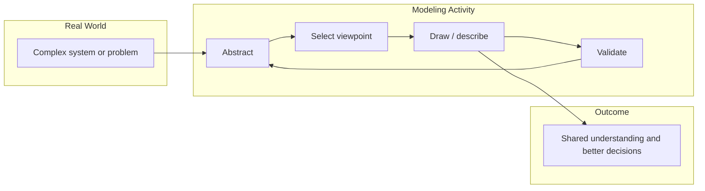

# 🧠 Topic: System Modeling

> [!abstract] Executive Summary (ELI5)
> System modeling is the process of creating simplified pictures or descriptions of a software system so we can understand it, talk about it, and make better design decisions before or while building it.

---

## 🎯 The "Why"
- **Problem Solved:** Real systems are too large, complex, and expensive to explore only by building them. Modeling lets us think through structure, behavior, and decisions earlier and more cheaply.
- **Alternatives:** Direct coding without up-front thinking, writing long textual specifications, or relying on informal whiteboard sketches that disappear.
- **Trade-offs:** Modeling takes time and can become outdated if not maintained. A bad model can mislead the team. The goal is "just enough" modeling — not perfect documentation.

## 💡 Mental Model & Analogy
- **Analogy:** System modeling is like making a scale model of a building before construction. Architects use it to discuss layout, materials, and flow with clients and engineers without pouring concrete. The model is cheaper to change than the real building.
- **Visual/Diagram:**

## 🛠️ Core Principles
1. **Modeling is an activity, not a deliverable.** The value is in the thinking and alignment it produces, not only in the diagrams saved to a wiki.
2. **Start with the question, not the diagram.** A model must serve a purpose: who is the audience and what decision does it support?
3. **Iterate and refine.** Early models are rough. They evolve as understanding deepens and the system changes.
4. **Choose the right level of abstraction.** Too much detail hides the big picture; too little detail leaves ambiguity.
5. **Use a common notation when it helps.** Frameworks like C4, UML, or ArchiMate provide shared languages. Use them where they reduce confusion, but do not let notation drive the thinking.

## 🔑 Key Activities in System Modeling

### 1. Abstraction
*Deciding what to include and what to leave out.*
- Identify the elements, relationships, and concerns relevant to the current question.
- Hide details that are not needed at this level of discussion.

### 2. Selecting a Viewpoint
*Choosing the angle from which to look at the system.*
- A viewpoint frames the concerns: who are the stakeholders and what do they care about?
- Examples: functional, deployment, security, performance, data flow.

### 3. Representing the System
*Choosing a notation, diagram, or description.*
- Boxes, lines, text, tables, formal languages, or code prototypes.
- The representation should match the audience and the question.

### 4. Validation
*Checking that the model is useful and correct enough.*
- Review with stakeholders, compare with code, test against scenarios, update when reality changes.
- A model that nobody trusts is shelf-ware, not a model.

### 5. Functional Modeling
*Describing what the system does from the user's perspective.*
- Captures features, capabilities, use cases, workflows, and interactions with users or external systems.
- Focuses on behavior, inputs, outputs, and value delivered rather than internal structure.
- Often represented with use case diagrams, user story maps, process flows, or sequence diagrams.
- Helps answer: "What can the system do, and who does it serve?"
- See [[Functional Viewpoint]] for the focused treatment of capabilities, use cases, and how this maps onto C4.

### 6. Architectural Modeling
*Describing how the system is organized and built to satisfy its functional and non-functional requirements.*
- Captures structure, components, containers, deployment, communication paths, and technology choices.
- Focuses on quality attributes such as scalability, reliability, security, maintainability, and performance.
- Often represented with component diagrams, deployment diagrams, C4 diagrams, or network topology diagrams.
- Helps answer: "How is the system structured, and will it meet its quality goals?"

> [!tip] Implementation Note
> In practice, model little and often. Big up-front modeling rarely survives contact with implementation. Treat diagrams as conversation tools that evolve with the system.

## ⚠️ Pitfalls & Anti-patterns
- **Modeling for the sake of modeling:** Creating diagrams because the process requires them, not because they answer a real question.
- **Analysis paralysis:** Spending too long refining the model before building anything.
- **One model to rule them all:** Trying to capture every concern in a single diagram.
- **Models that never change:** A model that is not updated as the system evolves becomes misleading.
- **Notation worship:** Arguing about which shape to use instead of focusing on the meaning and decisions.

## 🔗 Deep Connections
- **Parent Topic:** [[Software Architecture]], [[Modeling Software Architecture]]
- **Related Concepts:** [[Model]], [[System]], [[C4 Model]], [[Viewpoint]], [[Perspective]], [[Diagram]], [[Abstraction]], [[Functional Viewpoint]], [[Architectural Modeling]]
- **Prerequisites:** [[Model]], [[System]]

## ❓ Active Recall Questions
> [!faq]- What is the main goal of system modeling?
> To create a shared, simplified representation of a system so that people can understand, discuss, and make decisions about it more effectively.

> [!faq]- Why is it dangerous to model too much detail?
> Too much detail makes the model hard to read, expensive to maintain, and can obscure the key insights it was meant to communicate.

> [!faq]- What is the relationship between system modeling and the C4 model?
> The C4 model is one specific approach to system modeling. It provides a set of hierarchical abstractions and diagrams for describing software architecture at different levels of detail.

> [!faq]- What does "selecting a viewpoint" mean in system modeling?
> It means choosing the perspective from which to describe the system based on the concerns of a particular audience, such as developers, security engineers, or operations teams.

> [!faq]- How does functional modeling differ from architectural modeling?
> Functional modeling focuses on what the system does and the value it delivers to users. Architectural modeling focuses on how the system is structured and built to meet functional and non-functional requirements.

> [!faq]- Why are both functional and architectural models needed?
> A functional model alone does not show whether the system can scale, be secure, or be maintained. An architectural model alone does not show whether the system actually solves the user's problem. Together they give a balanced view.

---

*Related to the Udemy course: "Modeling Software Architecture: C4 viewpoints and perspectives".*
