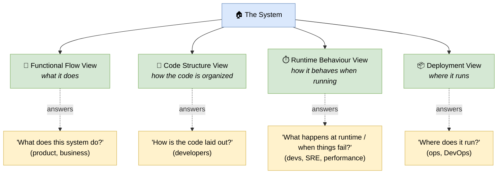

# 🧠 Topic: Architectural Views

> [!abstract] Executive Summary (ELI5)
> An **architecture view** is the concrete picture you draw for *your* system by looking through a chosen [[Viewpoint|viewpoint]]. Where the viewpoint is the reusable lens ("show me the deployment"), the view is the actual diagram you produce ("here is how *our* checkout system is deployed"). A complete architecture description is a **set of complementary views** — because no single picture can serve every concern. The four views below are the ones you reach for most often: *what the system does*, *how the code is organized*, *how it behaves at runtime*, and *where it runs*.

> [!warning] The #1 confusion — View vs. Viewpoint (again)
> People ask for "the deployment view" when they mean the *Deployment viewpoint*, and vice versa. Remember the recipe metaphor from [[Viewpoint]]: the **viewpoint** is the recipe (reusable, general); the **view** is the cake you actually bake for your system (concrete, specific). This note is about the *cakes* — the views you produce — and the four kinds you will draw again and again.

> [!note] Don't confuse this with "Key Elements of an Architecture View"
> This note is about **which set of views** a framework prescribes and *which concern each one answers*. The sibling note [[Key Elements of Architecture View]] is about the **ingredients inside any single view** — components, connectors, configuration. Read that one to understand *what a view is made of*; read this one to understand *which views to draw and why*.

---

## 🎯 The "Why"

- **Problem Solved:** One stakeholder wants to know "what does this system do?", another wants "how is the code laid out?", a third wants "what runs where in production?", and an SRE wants "what happens when a node dies?". These are different questions for different audiences. A single diagram cannot answer all four without becoming a wall of boxes. A **set of views** lets each question get its own focused, readable answer.
- **Alternatives:** The "one diagram to rule them all" — see [[Viewpoint]] for why it fails. Another alternative is only ever drawing one kind of view (e.g., only deployment) and being blind to all other concerns.
- **Trade-offs:** Each extra view is another artifact to keep consistent with the others. The payoff is that every stakeholder gets a picture tuned to their concern, and the architecture can be reasoned about from several angles. The art is choosing the **minimal sufficient set** — see [[System Modeling]] → Selecting a Viewpoint.

## 💡 Mental Model & Analogy

- **Analogy:** Selling a house. The **estate agent's listing** (functional flow — what the house offers: "4 bedrooms, open kitchen"), the **floor plan** (code structure — how the space is laid out), the **walkthrough video of a family using it** (runtime behaviour — how people actually move through it), and the **site/location map** (deployment — where it physically sits). Same house, four views, four different buyers. You would not hand a buyer only the site map and call it "the house."

Each view answers a different question for a different audience. Together they describe the system; no single one *is* the architecture.

## 🛠️ Core Principles

1. **A view is always the product of a viewpoint applied to a system.** No viewpoint → no disciplined view. See [[Viewpoint]].
2. **Each view targets one concern and one audience.** A view that tries to answer two unrelated concerns satisfies neither. Split it.
3. **Views overlap by design; they must stay consistent.** The same component appears in the Code Structure, Runtime, and Deployment views — under the same name, with compatible relationships. Consistency is enforced by the [[Architecture Metamodel]].
4. **A view is a configuration of components and connectors.** The *ingredients* of any view are [[Key Elements of Architecture View|components, connectors, and their configuration]] — what changes between views is *which* elements you choose to show and *how* you arrange them.
5. **Choose the minimal sufficient set.** Not every project needs all four views. Pick the ones that match real stakeholder concerns — drawing a view nobody asked for is ceremony, not architecture.

## 🔀 The Four Most-Used Views

The course and most practice converge on four workhorse views. Each pairs a *concern* with a *primary audience* and maps onto one of the Rozanski & Woods / C4 viewpoints already covered elsewhere in the vault.

### 1. Functional Flow View — *what the system does*

*How capabilities and data flow through the system to deliver business value.*

- **Concern:** what are the system's capabilities, and how do inputs flow through them to produce outputs? Which steps happen, in what order, between which actors/systems?
- **Audience:** product, business analysts, developers new to the system.
- **What it shows:** actors, capabilities/functions, the sequence of steps and data passed between them (often a flow, sequence, or activity).
- **Maps onto:** the [[Functional Viewpoint]]. At the system boundary, the [[Context Viewpoint]] is its simplest form.
- **Looks like:** a flow across capabilities — "User → Place Order → Validate → Charge → Confirm."

> If a non-technical stakeholder cannot understand your Functional Flow view, you have drawn the wrong thing. This view exists to be read by the business.

### 2. Code Structure View — *how the code is organized*

*The static organization of the codebase — modules, packages, layers, and their compile-time dependencies.*

- **Concern:** how is the source code structured? What are the modules/packages, what depends on what, what are the layers and their allowed dependencies?
- **Audience:** developers — especially newcomers onboarding onto the codebase.
- **What it shows:** modules, packages, layers, namespaces, and *static* (compile-time) dependencies between them. Not runtime, not infrastructure.
- **Maps onto:** the [[Development Viewpoint]]. In C4 terms, this sits at the [[Component Viewpoint]] / [[Code]] zoom.
- **Looks like:** a layered or package diagram — "UI → Domain → Data Access," with rules like "UI may not call Data Access directly."

> This is the view developers reach for first when joining a project. Keep it honest: a Code Structure view that does not match the real folder layout is worse than none.

### 3. Runtime Behaviour View — *how it behaves when running*

*The dynamic behaviour — which instances exist at runtime, how they interact, what happens across time, including failure paths.*

- **Concern:** what runs concurrently? How do runtime instances communicate? What happens during a request, an event, or a failure?
- **Audience:** developers (logic), performance/throughput engineers, SREs (failure handling).
- **What it shows:** runtime instances (processes, threads, replicas), their interactions over time, concurrency, and error/fallback paths. Distinct from the static Code Structure — the same code can produce very different runtime topologies.
- **Maps onto:** the [[Concurrency Viewpoint]] (what runs concurrently) and, for temporal interaction, sequence/activity-style diagrams. Often combined with a [[Perspective|perspective]] like [[Availability and Resilience Perspective]] to show failure behaviour.
- **Looks like:** a sequence/concurrency diagram — "3 replicas of the API, requests load-balanced, retries on timeout, dead-letter queue on failure."

> The most expensive bugs live here. A Code Structure view shows the happy, static layout; the Runtime Behaviour view shows what actually happens under load and when things break.

### 4. Deployment View — *where it runs*

*The physical/virtual infrastructure: where each runtime element is deployed, and how it is networked.*

- **Concern:** where does each container/service run? Which environments exist (dev/stage/prod)? How are things networked, and what are the failure domains?
- **Audience:** operations, DevOps, platform/infrastructure, security.
- **What it shows:** servers, cloud regions/zones, containers, networks, load balancers, environments, and which software element is deployed onto which node.
- **Maps onto:** the [[Deployment Viewpoint]].
- **Looks like:** a topology over nodes — "API deployed to 3 EC2 instances across 2 AZs behind an ALB; DB is a managed RDS instance."

> The Deployment view is where security and availability concerns land most concretely. Apply the [[Security Perspective]] and [[Availability and Resilience Perspective]] here to ask "is this deployment secure / resilient?"

## ↔️ The Four Views at a Glance

| View | Question | Primary audience | Course viewpoint | C4 zoom |
|---|---|---|---|---|
| **Functional Flow** | What does the system do? | Product, business | [[Functional Viewpoint]] | Context / Component |
| **Code Structure** | How is the code organized? | Developers | [[Development Viewpoint]] | Component / Code |
| **Runtime Behaviour** | How does it behave when running / failing? | Developers, SRE, performance | [[Concurrency Viewpoint]] | Container / Component |
| **Deployment** | Where does it run? | Ops, DevOps, security | [[Deployment Viewpoint]] | Container |

Notice how the four views cover **both static perspectives** (Code Structure, Deployment — "what is where") **and dynamic ones** (Functional Flow, Runtime Behaviour — "what happens"). A good architecture description balances both.

## 🔼 Views vs. Viewpoints vs. Domains — the full picture

Three related but distinct axes. Keeping them straight prevents most architecture-conversation confusion:

| | **Viewpoint** | **View** | **[[Architecture Domains\|Domain]]** |
|---|---|---|---|
| What it is | The reusable lens/recipe | The concrete picture you draw | The subject area you describe |
| Scope | General | Specific to your system | A layer of content (B/D/A/T) |
| Answers | "How should we look?" | "What does *this* system look like through that lens?" | "Which layer am I describing?" |
| Example | "the Deployment viewpoint" | "the deployment view of our checkout" | "the Technology domain" |

A **view** is produced by applying a **viewpoint** to a **domain** of your system. "Our checkout's deployment view" = Deployment viewpoint × Technology domain × the checkout system.

## ⚠️ Pitfalls & Anti-patterns

- **Drawing only one view:** Most teams draw only deployment (or only code structure) and think they have "the architecture." The other concerns — behaviour, functional flow — stay invisible and become surprises in production.
- **Conflating view and viewpoint:** See [[Viewpoint]] → "The #1 confusion." The view is the artifact; the viewpoint is the recipe.
- **Inconsistent naming across views:** The "OrderService" in the Code Structure view becomes "order-svc" in Deployment and "the billing thing" in Functional Flow. Same element, three names — traceability breaks. The [[Architecture Metamodel]] exists to prevent this.
- **Only the happy path in Runtime Behaviour:** Showing what happens on success but not on failure. Resilience bugs hide in the paths you did not draw. Pair this view with the [[Availability and Resilience Perspective]].
- **Drawing views nobody asked for:** Producing all four views by checklist when only one concern was raised. Views serve concerns, not the reverse — see [[System Modeling]].
- **Confusing Code Structure with Runtime Behaviour:** Thinking the static dependency graph *is* the runtime topology. The same code can run as one process or as fifty replicas; the views are different.

## 🔗 Deep Connections

- **Parent Topic:** [[Architecture Framework]] (a framework prescribes a set of views; the four here are the practical core)
- **Sibling Concepts:** [[Architecture Process]] (the process *produces* views each cycle), [[Architecture Domains]] (a view is a viewpoint applied to a domain), [[Architecture Metamodel]] (the metamodel keeps views consistent by typing their elements)
- **Related Concepts:** [[Viewpoint]] (the lens that produces a view), [[Key Elements of Architecture View]] (the ingredients *inside* a view — components, connectors, configuration), [[System Modeling]] (selecting which views to draw), [[Communicating the Model]] (each view is a communication artifact for its audience)
- **Prerequisites:** [[Viewpoint]], [[Architecture Framework]].

## ❓ Active Recall Questions

> [!faq]- What is the difference between a view and a viewpoint?
> The **[[Viewpoint|viewpoint]]** is the reusable lens/recipe — it defines which concern, notation, and audience a view will have. The **view** is the concrete artifact you draw for your specific system by looking through that viewpoint. Viewpoint = recipe; view = cake.

> [!faq]- What are the four most-used architectural views, and which concern does each answer?
> **Functional Flow** (what the system does — product/business), **Code Structure** (how the code is organized — developers), **Runtime Behaviour** (how it behaves at runtime and under failure — devs/SRE/performance), and **Deployment** (where it runs — ops/DevOps). The first and third are *dynamic*; the second and fourth are *static*.

> [!faq]- Why are the Code Structure view and the Runtime Behaviour view different?
> Because the *static* organization of the code (modules, packages, compile-time dependencies) is not the same as the *dynamic* runtime topology (processes, replicas, concurrent interactions). The same code can run as one process or as many replicas, with different concurrency and failure behaviour — so the two views show different things.

> [!faq]- How does this note differ from [[Key Elements of Architecture View]]?
> This note is about **which set of views** to draw and which concern each answers. [[Key Elements of Architecture View]] is about the **ingredients inside any single view** — components, connectors, and configuration. One is "which cakes to bake"; the other is "what every cake is made of."

> [!faq]- What goes wrong if you only ever draw a deployment view?
> You answer "where does it run?" but stay blind to "what does it do?", "how is the code organized?", and "what happens at runtime / under failure?". Those concerns then surface as surprises — especially the runtime/failure ones, which is where the expensive bugs live.

> [!faq]- Why must views stay consistent with each other, and what enforces it?
> Because the same element (e.g., OrderService) appears in several views under one name. If the views disagree — different names, incompatible dependencies — traceability breaks and the description stops being trustworthy. The [[Architecture Metamodel]] enforces consistency by typing elements (building blocks) and their relationships once, then reusing them across views.

---

## 📝 Related Notes

- [[Architecture Framework]]
- [[Architecture Process]]
- [[Architecture Domains]]
- [[Architecture Metamodel]]
- [[Viewpoint]]
- [[Key Elements of Architecture View]]
- [[Functional Viewpoint]]
- [[Development Viewpoint]]
- [[Concurrency Viewpoint]]
- [[Deployment Viewpoint]]
- [[System Modeling]]
- [[Communicating the Model]]
