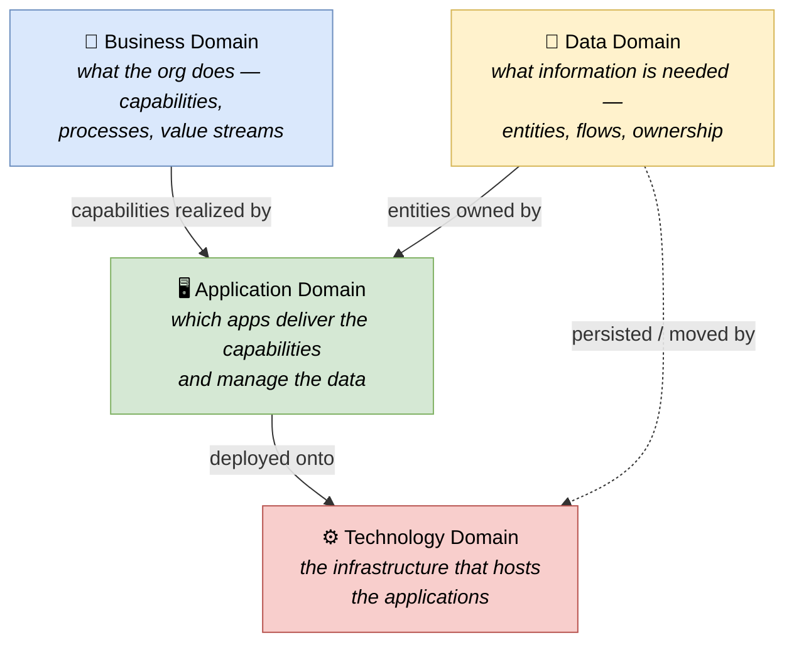

# 🧠 Topic: Architecture Domains

> [!abstract] Executive Summary (ELI5)
> An enterprise-architecture practice splits the world into a few broad layers called **architecture domains**: **Business** (what the organization does), **Data** (what information it needs), **Application** (the software that processes that data), and **Technology** (the infrastructure it runs on). These four — known as the **BDAT** stack — are the "what is being architected" axis. They let you describe a system at the right level of abstraction without mixing "how the business works" with "what server it runs on."

> [!warning] The #1 confusion — Domain vs. Viewpoint
> A **domain** is a *subject area* — a slice of *what* you are describing (the business, the data, the apps, the tech). A **[[Viewpoint|viewpoint]]** is a *lens* — *how* you look at it for a given concern and audience. The two axes are independent: you can draw a Deployment view (a viewpoint) of the Technology domain, or a Functional view (a viewpoint) of the Business domain. Domains slice *content*; viewpoints slice *perspective*.

---

## 🎯 The "Why"

- **Problem Solved:** Trying to describe "everything about the system" at once produces a tangled picture where business processes, database tables, microservices, and Kubernetes clusters all appear on the same diagram. Nobody can read it. Domains separate concerns **by subject area**, so each layer can be reasoned about, owned, and changed by the right people without dragging the others along.
- **Alternatives:** A single flat "architecture" with no layering. This collapses the stack and makes traceability impossible — you cannot answer "which business capability does this server support?" because the links were never made explicit.
- **Trade-offs:** Four domains mean four (or more) sets of artifacts to keep consistent. The payoff is **traceability**: every technology component should trace up through the applications and data to a business capability it serves — and every business capability should trace down to the tech that realizes it. That chain is the whole point.

## 💡 Mental Model & Analogy

- **Analogy:** Think of a city's master plan. The **Business** domain is the economy — which industries exist, what services citizens need. The **Data** domain is the land registry, census, and records — the information the city runs on. The **Application** domain is the buildings and services that *use* that information — the tax office, the hospital booking system. The **Technology** domain is the roads, power grid, and water supply that the buildings sit on. Each layer supports the one above, and a good plan traces every road up to the hospital it serves.

The four domains form a **stack**: each upper layer is realized by the layer(s) below. The arrows are the traceability you must be able to follow in a mature architecture description.

## 🛠️ Core Principles

1. **A domain is a subject area, not a view.** It partitions *what* you describe, not *how you look at it*. The Business domain is content; the Functional viewpoint is a lens onto that content.
2. **The BDAT stack is layered, with traceability in both directions.** Business capabilities are realized by Applications that manage Data and run on Technology — and every Technology artifact should trace back up to a Business reason for existing.
3. **Each domain has its own experts and vocabulary.** Business analysts speak capabilities; data architects speak entities and lineage; app architects speak services and APIs; platform/infrastructure architects speak networks and runtimes. Domains map onto real team boundaries.
4. **Domains are independent but must stay consistent.** The Business domain can change (a new capability) without rewriting the Technology domain — but somewhere a link must be updated so traceability survives. This is what the [[Architecture Metamodel]] enforces.
5. **Not every project touches all four domains.** A small service may live entirely in the Application + Technology domains. But a *complete* enterprise architecture description spans all four — that is what makes it "enterprise."

## 🏗️ The Four BDAT Domains

The acronym **BDAT** (Business, Data, Application, Technology) is the TOGAF ordering. Sometimes written **BDA** (Technology folded into Application) or **BDAT**+Security; the four-way split is the canonical reference.

### 1. Business Architecture (the "why" and "what")

*What the organization does, for whom, and why it matters.*

- **Concerns:** business strategy, capabilities, value streams, processes, organization, business objects.
- **Typical artifacts:** capability maps, value-stream maps, business process models, org/actor maps.
- **Answers:** "What capabilities must the system support? Who are the actors? What is the business value?"
- **In this course's terms:** much of this surfaces in the [[Context Viewpoint]] (actors and the system's purpose) and the [[Functional Viewpoint]] (capabilities the system provides).

> If you cannot connect a piece of software to a business capability, you cannot justify its cost. The Business domain is where that justification lives.

### 2. Data Architecture (the "information")

*What information the business needs, how it is structured, where it flows, and who owns it.*

- **Concerns:** data entities, conceptual/logical/physical models, data flows, master data, data ownership and lineage.
- **Typical artifacts:** entity-relationship models, data flow diagrams, data lineage maps.
- **Answers:** "What data must exist? Who owns it? How does it move between systems? What are its quality/security constraints?"
- **In this course's terms:** this is the [[Information Viewpoint]] — how data is structured, stored, and moved.

> Data is often the most stable part of an architecture: capabilities and apps come and go, but "Customer," "Order," and "Product" persist for decades. Modeling data well pays off for a long time.

### 3. Application Architecture (the "software")

*Which applications deliver the business capabilities and manage the data.*

- **Concerns:** applications, services, APIs, components, their responsibilities and dependencies — the *software* layer.
- **Typical artifacts:** application/component maps, API catalogs, service dependency graphs.
- **Answers:** "Which apps support which capabilities? What are their responsibilities and interfaces? How do they depend on each other?"
- **In this course's terms:** this is where C4 lives — the [[Container Viewpoint]] and [[Component Viewpoint]] describe the Application domain's structure. The [[Development Viewpoint]] shows how the code is organized within it.

> The Application domain is the bridge: each application should trace *up* to a business capability and *down* to the data entities it owns.

### 4. Technology Architecture (the "infrastructure")

*The platforms, networks, runtimes, and infrastructure that host the applications.*

- **Concerns:** servers, cloud services, networks, containers, databases-as-a-service, deployment environments.
- **Typical artifacts:** deployment/topology diagrams, network diagrams, environment maps.
- **Answers:** "Where do things run? How are they networked? What environments exist (dev/prod)? How is it provisioned?"
- **In this course's terms:** this is the [[Deployment Viewpoint]] and, for runtime topology, the [[Concurrency Viewpoint]].

## ↔️ Domains vs. Viewpoints — the two orthogonal axes

This is the distinction that clears up most confusion:

| | **Architecture Domain** | **[[Viewpoint]]** |
|---|---|---|
| Axis | *What* you describe (subject area) | *How* you look at it (lens/concern) |
| Slices content by | Layer (Business / Data / App / Tech) | Concern (Functional / Deployment / Concurrency...) |
| Examples | "the Data domain," "the Technology domain" | "the Deployment viewpoint," "the Functional viewpoint" |
| Question | "Which layer am I describing?" | "Which concern am I answering, for whom?" |

The two compose freely: a **Functional view of the Business domain** shows business capabilities; a **Deployment view of the Technology domain** shows where things run. The same viewpoint can be applied to different domains.

## 🗺️ Mapping the BDAT domains onto this course's viewpoints

The course uses C4 + Rozanski & Woods viewpoints, which are lenses, not domains. But each viewpoint most naturally describes one domain's content:

| BDAT Domain | Most relevant course viewpoints |
|---|---|
| **Business** | [[Context Viewpoint]] (actors, purpose), [[Functional Viewpoint]] (capabilities) |
| **Data** | [[Information Viewpoint]] (structure, storage, flow of data) |
| **Application** | [[Container Viewpoint]], [[Component Viewpoint]], [[Development Viewpoint]] (code structure) |
| **Technology** | [[Deployment Viewpoint]] (where things run), [[Concurrency Viewpoint]] (runtime instances) |

So when the course says "draw the Deployment view," it is (in BDAT terms) producing a view of the **Technology domain**. Domains and viewpoints are different axes that meet on the same diagram.

## ⚠️ Pitfalls & Anti-patterns

- **Confusing domain with viewpoint:** "The Data view" mixes the two. Data is a *domain*; to describe it you pick a *viewpoint* (Information, or Security-applied-to-Information). See the table above.
- **No traceability between domains:** Drawing four independent domain pictures with no links between them. The value of BDAT is the traceability chain — without it, you have four disconnected diagrams.
- **Starting from the Technology domain:** Jumping to "which cloud, which database" before understanding the business capabilities and data. This builds tech that serves nobody. The [[Architecture Process|process]] deliberately describes Business first.
- **One domain swallows the others:** "Everything is just Application architecture." This collapses the stack and hides where business value, data ownership, and infrastructure risk actually live.
- **Treating domains as silos:** Each domain owned by a team that never talks to the others. Traceability dies in the gaps; changes in one layer break the next silently.
- **Forgetting Data as a first-class domain:** Folding data into Application. Data often outlives the applications that manage it; treating it as a peer domain preserves lineage and ownership.

## 🔗 Deep Connections

- **Parent Topic:** [[Architecture Framework]] (BDAT is the content decomposition most enterprise frameworks adopt; TOGAF names these four explicitly)
- **Sibling Concepts:** [[Architecture Process]] (the ADM walks through the domains B→C/D→… in order), [[Architectural Views]] (a view is a viewpoint applied to a domain), [[Architecture Metamodel]] (building blocks are typed by domain)
- **Related Concepts:** [[Viewpoint]] (orthogonal axis to domains), [[System Architecture]] (a system's architecture spans multiple domains), [[Levels of Abstraction]] (each domain can be described at multiple zoom levels)
- **Prerequisites:** [[Architecture Framework]], [[Viewpoint]].

## ❓ Active Recall Questions

> [!faq]- What are the four BDAT architecture domains?
> **Business** (capabilities, processes, actors), **Data** (entities, flows, ownership), **Application** (the software/services that realize capabilities and manage data), **Technology** (the infrastructure that hosts the applications). BDAT = Business, Data, Application, Technology.

> [!faq]- What is the difference between an architecture domain and a viewpoint?
> A **domain** is a *subject area* — a slice of *what* you describe (Business, Data, Application, Technology). A **[[Viewpoint|viewpoint]]** is a *lens* — *how* you look at it for a given concern and audience. They are orthogonal: you can apply any viewpoint to any domain.

> [!faq]- Why must the four domains stay traceable to each other?
> Because that traceability is the whole value of splitting them. Every Technology artifact should trace up through Applications and Data to a Business capability it serves; every Business capability should trace down to the tech that realizes it. Without the links you have four disconnected diagrams, not an architecture.

> [!faq]- Which BDAT domain do the course's Deployment and Concurrency viewpoints describe?
> The **Technology domain**. The Deployment view shows where things run (infrastructure), and the Concurrency view shows runtime instances — both are lenses onto Technology-domain content.

> [!faq]- Why should the Business domain be described before the Technology domain?
> Because the upper layers are realized by the lower ones. If you start with "which cloud, which database" you risk building infrastructure that serves no identified business capability. The [[Architecture Process|architecture process]] describes Business → Data/Application → Technology precisely to keep the chain grounded in business value.

> [!faq]- Why is Data treated as a first-class domain rather than folded into Application?
> Because data often outlives the applications that manage it — "Customer," "Order," "Product" persist for decades while apps come and go. Modeling data as a peer domain preserves lineage, ownership, and quality independently of whichever app currently touches it.

---

## 📝 Related Notes

- [[Architecture Framework]]
- [[Architecture Process]]
- [[Architectural Views]]
- [[Architecture Metamodel]]
- [[Viewpoint]]
- [[System Architecture]]
- [[Levels of Abstraction]]
