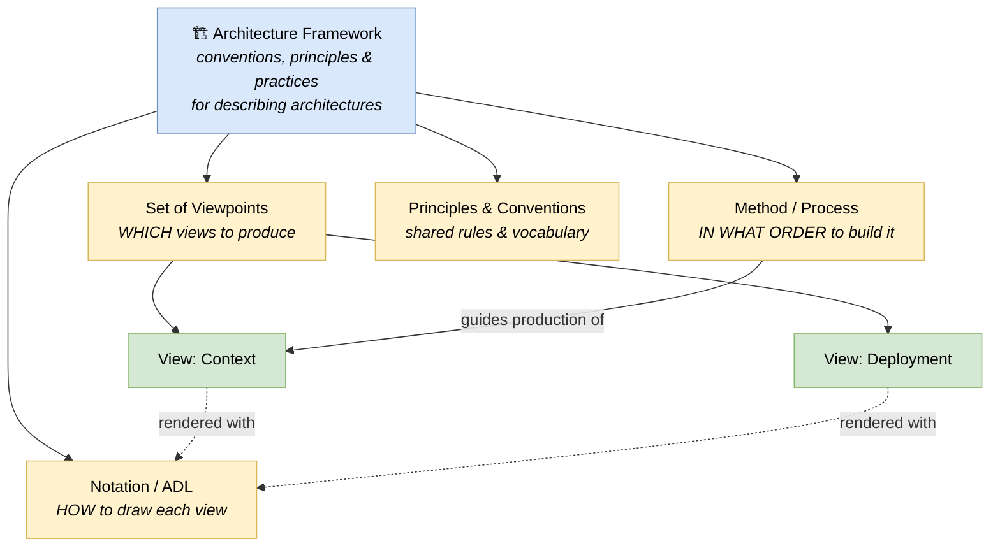

# 🧠 Topic: Architecture Framework

> [!abstract] Executive Summary (ELI5)
> An **architecture framework** is a shared set of rules that tells a team *which* architecture views to produce, *how* to draw them, and *by what process* — so that everyone describes a system the same way and different people's diagrams can be understood and compared. Think of it as the "building code + standard blueprint types + permitting process" of software architecture: it does not design the building for you, but it makes sure every architect draws the same kinds of drawings the same way.

> [!warning] The #1 confusion — Framework vs. Notation vs. Method vs. Standard
> These four words are used loosely and overlap in practice, but they answer different questions. An **architecture framework** answers *"which views should exist and how do they relate?"* A **notation / ADL** answers *"how do I draw each element on a view?"* A **method/process** answers *"in what order do I create the architecture?"* A **standard** is a formal, often-ISO-blessed definition of the terms themselves. Many real-world tools are a mix — e.g., TOGAF ships a framework *and* a method (the ADM). See the comparison table below.

---

## 🎯 The "Why"

- **Problem Solved:** Without an agreed framework, every architect and every team invents their own set of diagrams, their own box-and-arrow meanings, and their own way of slicing the system. The result: diagrams that cannot be compared, stakeholders who each get a different picture, and "the architecture" that exists only in one person's head. A framework provides a **shared vocabulary and structure** so architecture descriptions are consistent, complete (no important concern forgotten), and transferable between people and projects.
- **Alternatives:** Ad-hoc modeling — "we just draw what feels right each time." Cheap at first, but it produces inconsistent, incomplete, and audience-blind artifacts. Another alternative is a single rigid diagram; see [[Viewpoint]] for why one picture can never serve all concerns.
- **Trade-offs:** A framework adds upfront discipline and a learning curve (you must learn its viewpoints and notation). The payoff is consistency, completeness, and communication — the architecture becomes something a team can reason about together rather than a set of personal doodles. Heavy frameworks (e.g., TOGAF, DoDAF) can be bureaucratic for small systems; lightweight ones (e.g., C4) trade breadth for simplicity.

## 💡 Mental Model & Analogy

- **Analogy:** Imagine building a house. There is a **building code** that says, for safety, every project must submit a floor plan, an elevation, an electrical layout, and a plumbing layout — each drawn with agreed symbols (a door looks *this* way, a socket *that* way) and reviewed in a defined order. That whole system — *which drawings, which symbols, which process* — is the construction industry's "framework." It does not design your house; it guarantees that whoever picks up the plans can read them. A **software architecture framework** plays exactly this role: it fixes the views, the notation, and (often) the process, so any architect can read any system's description.

A framework ties together four things — viewpoints, notation, method, and shared conventions — into one coherent approach to describing an architecture.

## 🛠️ Core Principles

1. **A framework fixes the set of viewpoints.** It pre-declares which views an architecture description should contain (e.g., the 4+1 model's five views, or Rozanski & Woods' seven viewpoints). You no longer guess which diagrams to draw — the framework tells you the concern each view addresses. See [[Viewpoint]].
2. **A framework establishes a shared vocabulary.** It defines what words like "container," "component," "viewpoint," or "perspective" mean, so two architects do not use the same term for different things.
3. **A framework prescribes a notation (or lets you choose one).** Some ship their own (ArchiMate), some adopt a standard one (UML), and some are notation-agnostic but recommend one (C4 + Structurizr/PlantUML). The point is that the symbols are agreed, not improvised.
4. **A framework is domain- or community-scoped.** Per ISO/IEC/IEEE 42010, a framework is established *"within a specific domain of application and/or community of stakeholders."* DoDAF serves defense; TOGAF serves the enterprise; C4 serves software-system teams. Pick the framework that matches your community.
5. **A framework is a skeleton, not the architecture.** It gives you the scaffolding (which views, which rules). The actual architecture — the decisions, the components, the trade-offs — is yours to fill in. Confusing the two leads to "we adopted TOGAF, therefore we have an architecture" (you don't; you have a process).

## 🧩 Anatomy — what a framework typically bundles

| Part | Question it answers | Example |
|---|---|---|
| **Viewpoints / Views** | *Which* views should the description contain? | 4+1's Logical/Process/Development/Physical/Scenarios; R&W's seven viewpoints |
| **Notation / ADL** | *How* are elements drawn and named? | UML, ArchiMate, SysML, C4 shapes |
| **Method / Process** | *In what order* do we produce the architecture? | TOGAF ADM, iterative C4 modeling |
| **Principles & Conventions** | *What rules* govern naming, granularity, consistency? | "One container = one deployable unit" (C4) |
| **Stakeholder map** | *Who* is each view for? | R&W assigns each viewpoint an audience |

Not every framework ships all five. C4 deliberately omits a heavy method; TOGAF deliberately omits a fixed notation; UML is *only* a notation and is not a framework by itself.

## 🌍 Well-known Architecture Frameworks

| Framework | Origin / Domain | What it defines | Notation |
|---|---|---|---|
| **4+1 View Model** | P. Kruchten (1995), software | 5 views: Logical, Process, Development, Physical, + Scenarios | UML (typically) |
| **Rozanski & Woods** | *Software Systems Architecture*, software | 7 viewpoints + 7 perspectives — **used by this course** | Tool-agnostic |
| **C4 model** | Simon Brown, software | 4 zoom levels: Context, Container, Component, Code | C4 shapes (PlantUML/Structurizr/draw.io) |
| **TOGAF** | The Open Group, enterprise | Framework + ADM method + content metamodel | Notation-agnostic |
| **ArchiMate** | The Open Group, enterprise | 3 layers × aspects × viewpoints | ArchiMate notation (its own) |
| **DoDAF / MODAF / NAF** | Defense (US/UK/NATO) | Many viewpoints (OV/SV/TV/CV…) | MODAF/NAF tools |
| **ISO/IEC/IEEE 42010** | ISO standard | *Meta*-standard — defines "architecture description," "viewpoint," "stakeholder," "concern" formally | None (it describes frameworks) |

> The course centers on **C4** (its notation and zoom levels) layered on top of **Rozanski & Woods** viewpoints and perspectives. Both are, formally, architecture frameworks in the sense of ISO/IEC/IEEE 42010: each fixes a set of viewpoints and conventions for describing a software system's architecture.

## ↔️ Framework vs. Notation vs. Method vs. Standard

This distinction clears up most arguments about "is C4 a framework or a notation?":

| | **Framework** | **Notation / ADL** | **Method / Process** | **Standard** |
|---|---|---|---|---|
| Answers | Which views, how they relate | How to draw each element | In what order to build it | What the terms formally mean |
| Example | 4+1, R&W, TOGAF, DoDAF | UML, ArchiMate, SysML, C4 shapes | TOGAF ADM, SAFe | ISO/IEC/IEEE 42010 |
| Scope | Whole description | One view's symbols | The creation workflow | The vocabulary/meta-model |
| Produces | A set of views | Readable diagrams | A repeatable process | Agreed definitions |

Real-world tools blur the lines: **C4** is a *model/framework* (zoom levels = viewpoints) that also defines a *notation* (its shapes); **TOGAF** is a *framework* that also defines a *method* (ADM); **ArchiMate** is a *notation* bundled with *viewpoint* conventions. When in doubt, ask which of the four questions above a tool answers.

## ⚠️ Pitfalls & Anti-patterns

- **Confusing the framework with the architecture:** Adopting TOGAF or C4 does not mean you have an architecture. The framework is the scaffolding; the architecture is the set of decisions you put inside it.
- **Picking a framework too heavy for the job:** Using DoDAF or full TOGAF for a small service is bureaucratic overkill. Match the framework's weight to the system's size and stakeholder set.
- **Treating a notation as a framework:** "We use UML, so we have a framework" — UML is a notation, not a framework. It does not tell you *which* diagrams to produce or how they relate. See the table above.
- **Inventing a private framework per team:** If every team defines its own "viewpoints," views cannot be compared across the org. Agree on a shared framework (C4 + a few R&W viewpoints is a common pragmatic choice).
- **Following the framework dogmatically:** A framework is a checklist of concerns, not a law. If a viewpoint answers no real stakeholder concern for your system, skip it — see [[System Modeling]] → "Selecting a Viewpoint."
- **Forgetting the audience:** A framework lists viewpoints, but each view is still for a specific stakeholder. A view drawn for a framework's sake but shown to the wrong audience fails to communicate — see [[Communicating the Model]].

## 🔗 Deep Connections

- **Parent Topic:** [[Modeling Software Architecture]], [[System Modeling]] (choosing a framework is the first modeling decision)
- **Sibling Concepts:** [[Viewpoint]] (a framework is, at its core, an agreed *set of viewpoints*), [[Perspective]] (frameworks may also bundle cross-cutting perspectives, as R&W does)
- **Decomposition of a framework (the four parts):** [[Architecture Process]] (the *how/when* — e.g., TOGAF ADM), [[Architecture Domains]] (the *what* — BDAT: Business/Data/Application/Technology), [[Architectural Views]] (the *outputs* — Functional Flow, Code Structure, Runtime Behaviour, Deployment), [[Architecture Metamodel]] (the *grammar* — reusable building blocks, interfaces, consistency rules)
- **Related Concepts:** [[Model]] (a framework structures the models/views you produce), [[System Architecture]] (the thing a framework helps you describe), [[Levels of Abstraction]] (frameworks often align viewpoints with zoom levels — e.g., C4)
- **Concrete frameworks analyzed:** [[C4 Model]], [[Viewpoints and Perspectives]], [[4+1 View Model]], [[TOGAF]] _(+ `togaf/` and `4+1/` deep-dive subtrees)_
- **Notations side (sibling parent):** [[Architecture Notation]] (the counterpart to this note — what a notation/ADL is, and the four notation axes) → concrete notations [[UML]], [[ArchiMate]], [[SysML]], [[BPMN]] in `notations/`
- **Prerequisites:** [[System Architecture]], [[Viewpoint]].

## ❓ Active Recall Questions

> [!faq]- What is an architecture framework, in one sentence?
> A shared set of conventions, principles, and practices for describing architectures — established within a specific domain or stakeholder community — that fixes which views to produce, how to draw them, and (often) how to build them.

> [!faq]- What problem does an architecture framework solve?
> Without one, every team invents its own diagrams, symbols, and slicing of the system, so descriptions cannot be compared, are incomplete, and only make sense to their author. A framework provides a shared vocabulary and structure for consistent, complete, transferable architecture descriptions.

> [!faq]- Framework vs. notation vs. method — what's the difference?
> A **framework** fixes *which* views exist and how they relate; a **notation/ADL** fixes *how* to draw each view's elements; a **method** fixes *in what order* to produce the architecture. They are often bundled (TOGAF = framework + ADM method; C4 = framework + notation), but they answer different questions.

> [!faq]- Is adopting a framework the same as having an architecture?
> No. The framework is the scaffolding (which views, which rules); the architecture is the set of decisions you put inside it. "We use TOGAF" describes your *approach*, not your *architecture*.

> [!faq]- Which two frameworks does this C4 course build on?
> **C4** (Simon Brown) for the structural zoom levels and notation, layered on the **Rozanski & Woods** set of viewpoints and perspectives. Both are architecture frameworks in the ISO/IEC/IEEE 42010 sense.

> [!faq]- Why is "we use UML, therefore we have a framework" a mistake?
> Because UML is a **notation**, not a framework. It defines how to draw elements (classes, sequences, components) but does not tell you *which* diagrams to produce, for whom, or how they relate. You can use UML inside many different frameworks.

---

## 📝 Related Notes

- [[Modeling Software Architecture]]
- [[System Modeling]]
- [[System Architecture]]
- [[Viewpoint]]
- [[Perspective]]
- [[Model]]
- [[Communicating the Model]]
- [[Levels of Abstraction]]
