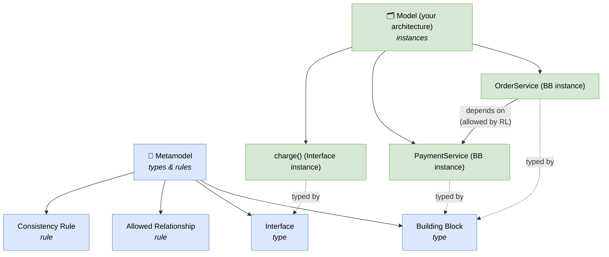

# 🧠 Topic: Architecture Metamodel

> [!abstract] Executive Summary (ELI5)
> An **architecture metamodel** is the *data model of the architecture itself*: it defines the types of things an architecture description is built from (a **Building Block**, an **Interface**, a **Service**, a **Node**) and the rules for how they may connect and be reused. If the [[Architectural Views|views]] are the pictures you draw, the metamodel is the grammar that keeps those pictures mutually consistent — so the "OrderService" in your deployment view is the same object as the "OrderService" in your code-structure view, governed by the same rules, reusable across projects.

> [!warning] The #1 confusion — Model vs. Metamodel
> A **model** describes *your system* (this service, that database, this connection). A **metamodel** describes *the model itself* — what kinds of things can exist in any model and how they may relate. It is one level of abstraction up: model = "OrderService talks to PaymentService"; metamodel = "an Application Component may expose Interfaces and may depend on other Components." Same relationship as a database (the data) and its schema (the rules for the data).

> [!note] "Meta" = "about itself"
> A metamodel is literally a model *about the model*. Where [[Model]] models the system, the metamodel models the architecture description. ISO/IEC/IEEE 42010 calls the equivalent concept the "**architecture description's framework**" — the conventions under which a description is produced and kept consistent.

---

## 🎯 The "Why"

- **Problem Solved:** Without a metamodel, each view is a freehand drawing. The same service is named differently across views, relationships are drawn ad hoc, and nothing is reusable — when you start the next project you re-invent the same concepts from scratch. A metamodel fixes this by giving every architecture element a **type**, a **name**, a **set of allowed relationships**, and a **home in a repository**, so views become consistent, comparable, and reusable.
- **Alternatives:** Free-form diagrams with no underlying schema. Flexible, but every diagram is an island: you cannot trace an element across views, you cannot check that the views agree, and you cannot reuse a building block without re-drawing it.
- **Trade-offs:** A metamodel adds structure (and sometimes a tool) to architecture work. The payoff is **consistency, traceability, and reuse** — the same building block appears wherever it is used, governed by the same rules, available for the next project. Without it, an enterprise architecture never accumulates; every program starts from a blank page.

## 💡 Mental Model & Analogy

- **Analogy:** Think of how a library works. The books are the **building blocks** (each one a discrete, reusable thing with a title, an author, a category). The **catalog schema** — "every book has an ISBN, belongs to a section, can be referenced by multiple borrowers, cannot be in two sections at once" — is the **metamodel**: it defines what a book *is* and the rules for how books relate to sections and borrowers. The library itself (the shelves, the books on them) is the **model**. Without the catalog schema, you just have piles of books; with it, you can find, track, and reuse them.

The metamodel defines the **types**; your architecture is a set of **instances** of those types, obeying the relationships and rules. Every element on every view is an instance of some metamodel type — that is what makes views consistent.

## 🛠️ Core Principles

1. **A metamodel defines element *types*.** Building Block, Interface, Service, Node, Data Entity, Capability — these are the *types* of thing your architecture descriptions are built from. An actual architecture is a population of *instances* of these types.
2. **A metamodel defines *allowed relationships*.** "An Application Component may depend on another Application Component"; "a Node may host a Container"; "a Capability may be realized by one or more Components." These rules are what let a tool (or a reviewer) catch illegal connections.
3. **A metamodel enforces *consistency rules*.** The same building block must carry one identity across all views; names must be unique within their type; a relationship valid in one view must not contradict another. This is what keeps the views from drifting apart.
4. **A metamodel makes building blocks *reusable*.** Because blocks are typed and stored once, the same block can appear on multiple views and be reused across projects — that is how an enterprise architecture *accumulates* instead of restarting each time.
5. **A metamodel is the backbone of tooling and governance.** Architecture tools (ArchiMate modelers, TOGAF repositories, Structurizr) are essentially metamodel editors: they let you create instances of the types and check them against the rules. Governance then becomes "does the built system still match the stored blocks?" — see [[Architecture Process]] → Phase G.

## 🧩 The Core Constructs

Three ideas do most of the work in any architecture metamodel:

### 1. Architecture Building Blocks (ABBs) — *the reusable units*

*A typed, named, reusable element of an architecture description.*

- **What they are:** the nouns of the architecture — a Capability, a Business Process, a Data Entity, an Application Component, a Service, a Technology Node. Each is a discrete thing with a type (which domain it belongs to — see [[Architecture Domains]]) and a defined responsibility.
- **Key properties:** name, type/domain, responsibility, owner, interfaces exposed/required, lifecycle status.
- **Why "building block":** the name is deliberate. They are meant to be *composed* into larger structures and *reused* across views and projects — like LEGO bricks that snap together according to the rules.
- **Relationship to the course:** a C4 *Container* or *Component* is a building block in this sense — a typed, named element with a responsibility and relationships, reusable across the Context/Container/Component views. See [[Key Elements of Architecture View]].

> A building block that is described once and used in five places is worth five that are described once and used once. Reuse is the metamodel's reason to exist.

### 2. Interfaces & Contracts — *the snap points*

*The points at which building blocks connect, and the rules governing that connection.*

- **What they are:** every building block exposes **interfaces** (what it offers) and has **required interfaces** (what it needs). An interface carries a contract — the protocol, the data shape, the behavioural guarantees.
- **Why first-class:** because two blocks can only connect *through* compatible interfaces. Making interfaces explicit turns "a line between two boxes" into a checkable contract — does the provider's interface match what the consumer requires?
- **Maps onto:** this is exactly the *connector-as-first-class-element* idea from [[Key Elements of Architecture View]] — a connector is an interface/contract between two building blocks.

### 3. Consistency Rules — *the grammar*

*The rules that keep a population of building blocks coherent across views and time.*

- **What they are:** constraints like "each Application Component must realize at least one Capability"; "a Node may host Containers but not other Nodes"; "an Interface must be exposed by exactly one Component and required by one or more." Some are structural; some are naming/traceability rules.
- **Why they matter:** they are what makes governance possible. Instead of eyeballing diagrams, you can *check* an architecture description against the rules and find violations (an orphan component with no capability, a cycle where none is allowed).
- **Enforced by:** tools (modelers flag illegal relationships) and reviews (a human checks the description against the agreed rules in Phase G of the [[Architecture Process]]).

## 🌍 Example: the TOGAF Content Metamodel

The canonical reference is the **TOGAF Content Metamodel**. Its core entity types mirror the BDAT domains (see [[Architecture Domains]]):

| Metamodel entity | Domain | Example instance |
|---|---|---|
| **Actor / Organization Unit** | Business | "Customer", "Billing Team" |
| **Business Capability / Function** | Business | "Process Payment", "Manage Inventory" |
| **Data Entity** | Data | "Order", "Customer", "Product" |
| **Application Component** | Application | "OrderService", "PaymentService" |
| **Interface / Service** | Application | "charge()", "placeOrder()" |
| **Technology Node / Platform Service** | Technology | "us-east-1 EC2", "managed Postgres" |

Plus the relationships that wire them: a Component *realizes* a Capability, *owns* Data Entities, *depends on* other Components, and is *deployed onto* a Node. TOGAF organizes these into **metamodel extensions** (Core, Governance, Services, etc.) so you adopt only what you need.

> You do not need the full TOGAF metamodel to benefit. Even a tiny metamodel — "*we have Containers and Components; each Component belongs to one Container and may depend on others; each has a single name*" — is exactly what the C4 model gives you. C4 is, in effect, a lightweight metamodel focused on the Application/Technology domains.

## ↔️ Metamodel vs. Model vs. Architecture — three levels

Keeping these three straight is essential:

| Level | Describes | Example |
|---|---|---|
| **Metamodel** | The model itself (types, rules) | "An Application Component may depend on another" |
| **Model** (architecture description) | *Your* system, as instances of those types | "OrderService depends on PaymentService" |
| **Architecture** (the system) | The real, built system-in-the-world | The actual running services in production |

A common failure mode is to confuse the metamodel with the architecture: "we adopted the TOGAF metamodel, therefore we have an architecture." You don't — you have a vocabulary. The architecture is the set of decisions you instantiate *inside* it. (Compare [[Architecture Framework]] → Pitfalls: adopting a framework is not the same as having an architecture.)

## ⚠️ Pitfalls & Anti-patterns

- **Confusing metamodel with architecture:** Adopting a rich metamodel and believing the architecture is done. The metamodel is the schema; the architecture is the data you put in it. An empty database has a schema but no data.
- **No metamodel at all:** Free-form diagrams with no shared types. Views cannot be checked for consistency, and nothing is reusable. Every project starts from zero.
- **Metamodel too heavy for the job:** Adopting the full TOGAF content metamodel for a small system. The overhead swamps the value. Start minimal (C4-style: Containers, Components, dependencies) and extend only when a real need appears.
- **Inconsistent naming across views:** The same block called three different things across views — the very inconsistency the metamodel exists to prevent. One identity per block, enforced by the rules.
- **Drawing relationships the metamodel forbids:** A line is not always legal. If the metamodel says "a Capability is realized by Components, not by Nodes," then a Capability→Node arrow is a violation that a tool or review should catch.
- **Treating building blocks as one-off:** Re-declaring the same service on every view instead of reusing one instance. This defeats reuse — the metamodel's central benefit.

## 🔗 Deep Connections

- **Parent Topic:** [[Architecture Framework]] (a framework's "content metamodel" is one of its core parts — see the anatomy table there)
- **Sibling Concepts:** [[Architecture Process]] (governance in Phase G checks the built system against the stored building blocks), [[Architecture Domains]] (metamodel entity types are typed by domain — Business/Data/Application/Technology), [[Architectural Views]] (a view is a projection of the metamodel instances — the metamodel is what keeps views consistent)
- **Related Concepts:** [[Model]] (the concept one level down — a metamodel models a model), [[Key Elements of Architecture View]] (components/connectors are the metamodel's building blocks and interfaces made concrete), [[System Architecture]], [[Levels of Abstraction]] (model vs. metamodel is itself a two-level abstraction jump)
- **Prerequisites:** [[Architecture Framework]], [[Model]].

## ❓ Active Recall Questions

> [!faq]- What is an architecture metamodel, and how does it differ from a model?
> A **metamodel** describes the architecture *model itself* — the types of elements (Building Block, Interface, Node) and the rules for how they may relate. A **model** describes *your system* as instances of those types. Metamodel = the schema; model = the data; the relationship mirrors a database and its schema.

> [!faq]- What are the three core constructs of an architecture metamodel?
> **Architecture Building Blocks** (typed, named, reusable elements like a Component or Capability), **Interfaces & Contracts** (the snap points that govern how blocks connect), and **Consistency Rules** (the grammar that keeps the population of blocks coherent across views and checkable for violations).

> [!faq]- Why does a metamodel make building blocks reusable?
> Because blocks are *typed* and *stored once* with a single identity, the same block can appear on multiple views and be reused across projects. Instead of re-drawing "OrderService" on every view, you reference the one stored instance — so an enterprise architecture accumulates rather than restarting each time.

> [!faq]- How does the metamodel keep architectural views consistent with each other?
> By giving every element a single identity and a set of allowed relationships. The same block carries one name and one set of connections wherever it appears; the consistency rules (e.g., "each Component realizes at least one Capability") can be checked against any view, so contradictions between views become detectable violations rather than silent drift.

> [!faq]- What is the relationship between the metamodel and architecture governance?
> Governance (Phase G of the [[Architecture Process\|architecture process]]) checks whether the *built* system still matches the *stored* building blocks and rules. The metamodel makes that check mechanical: instead of eyeballing diagrams, you compare instances and relationships against the allowed types and rules, and flag deviations.

> [!faq]- Is adopting the TOGAF content metamodel the same as having an architecture?
> No. The metamodel is a vocabulary/schema, not an architecture. You can adopt it and still have an empty description. The architecture is the set of decisions you instantiate *inside* the metamodel — the same way a database schema is not the data. (Compare the [[Architecture Framework\|framework]] pitfall: adopting a framework ≠ having an architecture.)

---

## 📝 Related Notes

- [[Architecture Framework]]
- [[Architecture Process]]
- [[Architecture Domains]]
- [[Architectural Views]]
- [[Model]]
- [[Key Elements of Architecture View]]
- [[System Architecture]]
- [[Levels of Abstraction]]
