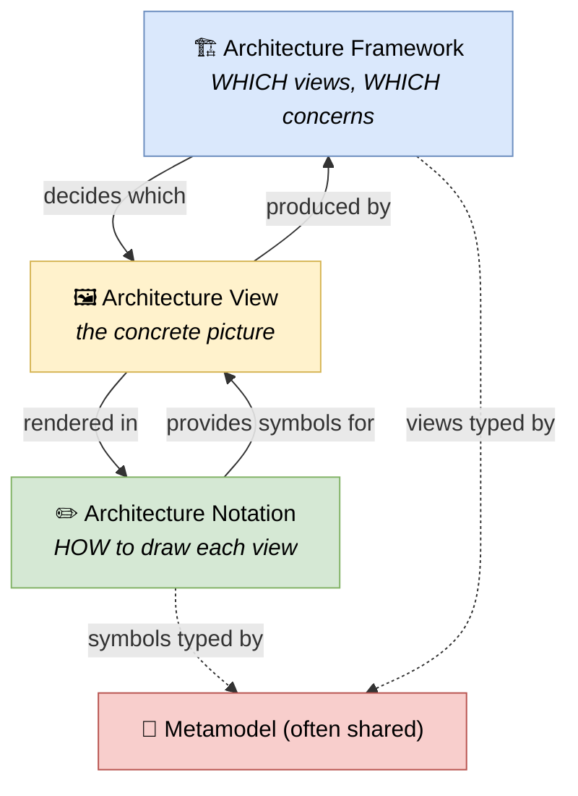

# 🧠 Topic: Architecture Notation

> [!abstract] Executive Summary (ELI5)
> An **architecture notation** is the **set of symbols and rules** for drawing an architecture — the answer to *"how do I render each element on a [[Architectural Views|view]]?"* Where an [[Architecture Framework|architecture framework]] decides *which views to produce* and *what concerns they answer*, a notation decides *what the boxes and arrows look like and mean*. A formal notation (with a metamodel behind it) makes a diagram **unambiguous**: a rectangle is a Class or a Component or an Application Component *by rule*, not by guesswork. Informal boxes-and-lines, by contrast, mean whatever the drawer intended — and nobody else can be sure.

> [!warning] The #1 confusion — Notation vs. Framework (again, because it matters)
> People say "we use UML" as if it were a framework. It isn't. **UML is a notation** — it defines how to draw elements (classes, components, deployments), not *which diagrams to produce or how they relate*. You can draw UML inside [[4+1 View Model|4+1]], inside [[Viewpoints and Perspectives|R&W]], or standalone. The framework picks the views; the notation draws them. The two are orthogonal. The full breakdown (Framework vs. Notation vs. Method vs. Standard) lives in [[Architecture Framework]] → "Framework vs. Notation vs. Method vs. Standard."

> [!note] Parent of the notations side of this folder
> This note is the **notations counterpart** to [[Architecture Framework]] (which parents the frameworks side). Where frameworks are analyzed through four axes (Process, Domains, Views, Metamodel), **notations are analyzed through a different four axes** (defined below): Symbol set, Diagram types, Metamodel coupling, Tooling/format. Concrete notations ([[UML]], [[ArchiMate]], [[SysML]], [[BPMN]]) live in the `notations/` subfolder.

---

## 🎯 The "Why"

- **Problem Solved:** Without an agreed notation, every diagram means something different. One team's rectangle is a service, another's is a database, a third's is a layer — and there is no way to tell from the picture. A formal notation fixes the **vocabulary of shapes** so any architect can read any diagram: the symbol *is* the meaning, and the metamodel behind it makes the relationships checkable.
- **Alternatives:** Ad-hoc boxes-and-lines. Flexible and fast, but every diagram is private to its author; nothing is comparable, and the hard decisions (sync vs. async, what owns what) hide behind unlabelled arrows. See [[Key Elements of Architecture View]] → "treating arrows as decoration."
- **Trade-offs:** A formal notation has a **learning curve** (you must learn the shapes and rules) and can feel heavyweight for quick sketches. The payoff is **precision, comparability, and tool support** — a UML or ArchiMate diagram can be checked, generated from a model, and read by anyone trained in the notation.

## 💡 Mental Model & Analogy

- **Analogy (music):** Think of music. The **framework** is the *form* — a symphony has four movements with certain expectations; a pop song has verse-chorus-verse. The **notation** is the *sheet music* — the staff, the clef, the note shapes, the rests. The form decides *what kind of piece* you write; the notation decides *how you write it down* so any musician can play it. You can write a symphony or a pop song on the same staff — form and notation are independent.

A **view** sits at the intersection: the framework decides *which* view you need, the notation decides *how* you draw it, and a shared metamodel often types the elements in both.

## ↔️ Notation vs. Framework vs. Method vs. Standard (recap)

This is detailed in [[Architecture Framework]] → "Framework vs. Notation vs. Method vs. Standard." Quick recap, because the distinction is the whole point of having a separate notations side:

| | Framework | **Notation** | Method | Standard |
|---|---|---|---|---|
| Answers | Which views, how they relate | **How to draw each element** | In what order to build it | What the terms formally mean |
| Example | 4+1, R&W, TOGAF, C4 | **UML, ArchiMate, SysML, BPMN, C4 shapes** | TOGAF ADM, RUP | ISO/IEC/IEEE 42010 |
| Scope | Whole description | **One view's symbols** | The creation workflow | The vocabulary/meta-model |

> Real-world blur: **C4** is a framework *and* a notation (its shapes); **ArchiMate** is a notation bundled with viewpoint conventions; **TOGAF** is a framework that is notation-agnostic (you bring UML/ArchiMate/C4). When in doubt, ask which of the four questions above a tool answers.

## 🧭 The Four Notation Axes (the comparison template for concrete notations)

Every concrete notation in the `notations/` subfolder is analyzed through these four axes — the notations counterpart to the framework four axes (Process, Domains, Views, Metamodel):

### 1. Symbol set — *what shapes exist and what do they mean?*

The heart of a notation: the **defined element shapes** and their semantics. UML has Class, Component, Node, Artifact; ArchiMate has Active Structure Elements (Business Actor, Application Component, Node), Behavioral Elements, and Passive Elements; BPMN has Events, Gateways, Tasks, Sub-Processes. A formal notation *defines* what each shape means — it is not up to the drawer.

| Question | What it tells you |
|---|---|
| What are the element types? | The vocabulary of "things" you can place |
| What are the relationship/connector types? | The vocabulary of "how things relate" |
| Are shapes semantics-bearing? | Yes = formal; No = decorative |

### 2. Diagram types — *which kinds of picture can you produce?*

A notation typically defines multiple **diagram kinds**, each for a different concern. UML has 14 diagram kinds (class, sequence, deployment, activity…); ArchiMate has ~25 named viewpoints; BPMN focuses on process flow diagrams.

| Question | What it tells you |
|---|---|
| Which diagram kinds are defined? | The range of concerns the notation can express |
| Is there one diagram or many? | Narrow (BPMN) vs. broad (UML) scope |
| Do diagram kinds map to a framework's views? | E.g., UML diagrams map onto [[4+1 View Model\|4+1]]'s four views |

### 3. Metamodel coupling — *is there a typed model behind the pictures?*

This is the crucial differentiator. Some notations are **just pictures** (you draw shapes); others are **projections of a typed metamodel** (the shapes are instances of typed elements with rules). The stronger the metamodel coupling, the more checkable and toolable the notation.

| Coupling level | Examples | Implication |
|---|---|---|
| **Strong** (model-first) | ArchiMate, UML (when modeled), SysML | The picture is generated from a typed model; relationships are checked against rules |
| **Medium** | C4 (esp. via Structurizr) | Model-as-code generates the views |
| **Weak** (drawing-first) | BPMN-as-sketch, freehand UML | The picture is the only source of truth; no checks |

> See [[Architecture Metamodel]] — a notation with strong metamodel coupling *embodies* the metamodel idea; one with weak coupling is just a drawing convention.

### 4. Tooling & format — *what tools and interchange formats exist?*

How is the notation authored, stored, and exchanged? Formal notations usually have **standardized interchange formats** and a tool ecosystem.

| Question | What it tells you |
|---|---|
| Authoring tools? | Vendor tools, open-source modelers, drawing apps |
| Interchange format? | XMI (UML/SysML), Open Exchange (ArchiMate), PlantUML/Mermaid text |
| Generation? | Can views be generated from a model (model-first) or only hand-drawn? |

## 🌍 The Major Architecture Notations (preview)

| Notation | Origin / scope | Symbol focus | Deep dive |
|---|---|---|---|
| **[[Flowchart]]** | Generic (ANSI/ISO 5807) | ~6 universal shapes for sequential process flow + decisions; *the untyped ancestor of BPMN/UML activity* | [[Flowchart]] |
| **[[UML]]** | Software (OMG, 1997) | 14 diagram kinds for software structure & behavior | [[UML]] |
| **[[ArchiMate]]** | Enterprise (The Open Group, 2004) | 3 layers × aspects × viewpoints; pairs with TOGAF | [[ArchiMate]] |
| **[[SysML]]** | Systems engineering (OMG, 2007) | UML reduced + systems additions (requirements, blocks, parametrics) | [[SysML]] |
| **[[BPMN]]** | Business processes (OMG, 2004) | Flow objects for business process modeling | [[BPMN]] |
| **[[Event-Storming]]** | DDD / collaborative modeling (Brandolini) | Colored sticky notes — domain events, commands, aggregates; *notation fused with a workshop process* | [[Event-Storming]] |
| **C4 shapes** | Software (Simon Brown) | The notation half of the [[C4 Model]] — Person/System/Container/Component shapes | (covered in [[C4 Model]]) |

> Note: the **C4 notation** is already covered inside [[C4 Model]] — C4 is a framework *and* a notation, and we treat it on the frameworks side. The `notations/` subfolder holds the four *standalone* notations that are not also frameworks.

## ⚠️ Pitfalls & Anti-patterns

- **Treating a notation as a framework:** "We use UML, so we have a framework." UML is a notation — it doesn't tell you *which* diagrams to produce or how they relate. Pair it with a framework.
- **Drawing without knowing the symbol semantics:** a UML class diagram where the drawer doesn't know the difference between aggregation and composition. The notation's value is its semantics — use them or don't bother.
- **Picking the notation before the concern:** "We need a UML diagram" before knowing what question is being asked. The concern drives the diagram kind; the notation serves it.
- **Weak-coupled notation where you need checks:** using drawing-only BPMN/UML for a system that needs model-level consistency checks. Pick a metamodel-coupled notation (or tool).
- **Mixing notations in one diagram:** UML classes with ArchiMate icons with ad-hoc arrows. Pick one notation per diagram; if you must mix, add a legend.
- **Over-formalizing sketches:** insisting on full UML for a whiteboard discussion. Notations have a cost; right-size the formality to the audience and purpose.

## 🔗 Deep Connections

- **Sibling parent:** [[Architecture Framework]] (the frameworks side; its "Framework vs. Notation vs. Method vs. Standard" table is the canonical reference for the distinction)
- **The four notation axes (defined above):** Symbol set, Diagram types, Metamodel coupling, Tooling/format
- **Concrete notations (in `notations/`):** [[Flowchart]], [[UML]], [[ArchiMate]], [[SysML]], [[BPMN]], [[Event-Storming]]
- **Notation-as-part-of-a-framework:** [[C4 Model]] (C4 is framework + notation; the notation half is covered there), [[4+1 View Model]] (4+1 is UML-coupled by design)
- **Related Concepts:** [[Architectural Views]] (a view is what a notation draws), [[Architecture Metamodel]] (a notation's metamodel coupling is the notations-side expression of the metamodel idea), [[Key Elements of Architecture View]] (components/connectors are what notations render), [[Communicating the Model]] (a notation is a communication discipline)
- **Prerequisites:** [[Architecture Framework]], [[Architectural Views]].

## ❓ Active Recall Questions

> [!faq]- What is an architecture notation, and how does it differ from a framework?
> A notation is the **set of symbols and rules for drawing an architecture** — it answers *"how do I render each element on a view?"* A framework decides *which views to produce*; a notation decides *what the boxes and arrows look like and mean*. They are orthogonal: you can draw UML (notation) inside 4+1, R&W, or TOGAF (frameworks). See [[Architecture Framework]] → "Framework vs. Notation vs. Method vs. Standard."

> [!faq]- What are the four notation axes, and what does each evaluate?
> **Symbol set** (what shapes exist and what they mean), **Diagram types** (which kinds of picture the notation defines), **Metamodel coupling** (is there a typed model behind the pictures — strong/medium/weak), and **Tooling/format** (tools and interchange formats). Concrete notations are compared across these four axes.

> [!faq]- Why does metamodel coupling matter for a notation?
> Because it determines whether the notation is **checkable and toolable**. A strongly-coupled notation (ArchiMate, model-first UML/SysML) renders views from a typed model, so relationships can be checked against rules. A weakly-coupled notation (freehand UML, BPMN-as-sketch) is just a picture — no checks, no generation, the drawing is the only source of truth.

> [!faq]- Is "we use UML" equivalent to "we have a framework"?
> No. UML is a **notation**, not a framework. It defines how to draw elements (classes, components, deployments) but does not tell you *which* diagrams to produce, for whom, or how they relate. You can use UML inside many different frameworks (4+1, R&W, standalone). The framework picks the views; UML draws them.

> [!faq]- Why is C4's notation covered in [[C4 Model]] rather than in the `notations/` subfolder?
> Because C4 is a **framework *and* a notation** (its four zoom levels are viewpoints, its shapes are the notation), and we treat it on the frameworks side as a unified thing. The `notations/` subfolder holds notations that are *not also frameworks* — UML, ArchiMate, SysML, BPMN.

---

## 📝 Related Notes

- [[Architecture Framework]]
- [[Architectural Views]]
- [[Architecture Metamodel]]
- [[UML]]
- [[ArchiMate]]
- [[SysML]]
- [[BPMN]]
- [[C4 Model]]
- [[4+1 View Model]]
- [[Key Elements of Architecture View]]
- [[Communicating the Model]]
