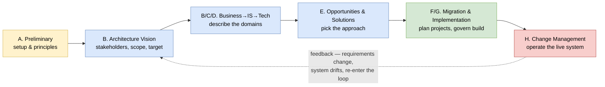
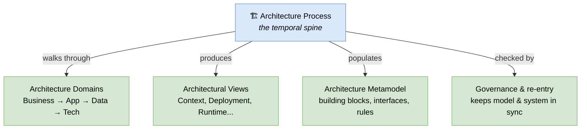

# 🧠 Topic: Architecture Process

> [!abstract] Executive Summary (ELI5)
> An **architecture process** is the *how* and *when* of architecture: a repeatable sequence of activities that takes you from "we have a business problem" to "we have a working, documented architecture" — and keeps it alive as the system changes. If an [[Architecture Framework|architecture framework]] is the set of blueprints you must draw, the process is the construction schedule that says *in what order you draw them, who you talk to at each step, and when you re-check your decisions*.

> [!warning] The #1 confusion — Process vs. Framework vs. Method
> People say "we use TOGAF" as if it were one thing. It isn't. TOGAF is an [[Architecture Framework|architecture framework]] **plus** an architecture method — the **ADM (Architecture Development Method)** — which *is* the process. The framework tells you *what* to produce (views, building blocks); the process tells you *how to get there and keep it current*. You can use a framework without its process, or a process without a formal framework — but a mature practice has both.

---

## 🎯 The "Why"

- **Problem Solved:** Left to themselves, teams draw a few diagrams, call it "the architecture," and never look at them again — until the diagrams are so stale they become lies. An architecture process fixes this by making architecture **a lifecycle activity**: it forces you to understand the problem before solving it, to capture decisions when they are made, to validate them against concerns, and to revisit them as the system and its environment evolve.
- **Alternatives:** "Big Design Up Front" — draw everything, then build for years without revisiting. Cheap to start, but the model rots fast. The opposite extreme — "no architecture, just code" — leaves no model to reason about or communicate. See [[System Modeling]].
- **Trade-offs:** A defined process adds ceremony (phases, gates, artifacts). Done well it makes architecture decisions durable and traceable; done badly it becomes bureaucratic theater that produces documents nobody reads. The art is right-sizing the process to the system's size and risk.

## 💡 Mental Model & Analogy

- **Analogy:** A city's urban-planning department does not design a city once and stop. It runs a continuous process: understand what residents need → draft a zoning plan → review with stakeholders → approve → build → monitor how the city actually grows → revise the plan. Architecture of software works the same way: it is a **plan–build–govern–revise loop**, not a one-shot drawing exercise.

The process is fundamentally **cyclic**, not linear: every trip around the loop revises the architecture in response to what changed. The labeled phases above mirror TOGAF ADM (A–H) as the canonical example — but every sound process has the same shape: *frame → describe → decide → build → operate → re-enter*.

## 🛠️ Core Principles

1. **It starts with the problem, not the technology.** The first activity is always to understand stakeholder concerns and the business goal (see [[Viewpoint]] — concerns drive everything). Tech choices come later, only once you know what problem you are solving.
2. **It is concern-driven, not artifact-driven.** You produce views because a *concern* needs answering, not because a checklist says "produce a deployment diagram." The artifact serves the concern, never the reverse. See [[System Modeling]] → Selecting a Viewpoint.
3. **It is iterative and cyclic.** Architecture is never "done." Each cycle deepens or revises the model: an early cycle may produce only a Context view; a later cycle adds Deployment and Concurrency views once runtime concerns surface.
4. **It separates "describe current," "envision target," and "plan the gap."** Mature processes (ADM) explicitly model the *Baseline (as-is)*, the *Target (to-be)*, and the *Gap analysis* between them — the gap is what drives the actual work.
5. **It closes the loop with governance.** Decisions made during architecture must be checked against the live system (compliance reviews, conformance to principles). Without governance, the model and the code drift apart — see [[Architecture Metamodel]] for how building blocks make this checkable.
6. **It is right-sized to context.** A startup service does not need the full ADM. But every non-trivial system benefits from the skeleton: *understand → sketch target → build → revisit*.

## 🔄 The Canonical Cycle — TOGAF ADM as the reference

The **Architecture Development Method (ADM)** is the most widely taught architecture process. Its phases map onto the generic loop above:

| Phase | What you do | Concern answered | Produces |
|---|---|---|---|
| **A. Preliminary** | Set up the practice: principles, scope, stakeholder map | "How will we work? What are our rules?" | Architecture principles, governance setup |
| **B. Architecture Vision** | Frame the problem: stakeholders, business drivers, target vision | "Why are we doing this, for whom?" | Statement of work, vision, scope — often a first [[Context Viewpoint\|Context view]] |
| **C. Business Architecture** | Describe business processes, org, functions | "What does the business do?" | Business-domain views — see [[Architecture Domains]] |
| **D. Information Systems Architectures** | Describe Data + Application domains | "What data and apps support the business?" | Data + Application domain views |
| **E. Opportunities & Solutions** | Choose among architectural options | "Which approach best fits the gap?" | Candidate architectures, trade-off analysis |
| **F. Migration Planning** | Break the gap into deliverable projects | "In what order do we get there?" | Roadmap, transition architectures |
| **G. Implementation Governance** | Oversee build, check conformance | "Did they build what we decided?" | Compliance reviews, waivers |
| **H. Architecture Change Management** | Monitor the live system, trigger re-entry | "What changed? Do we re-enter the loop?" | Change requests → back to B |

> The letters are TOGAF-specific, but the **shape is universal**: *setup → vision → describe domains → choose → plan → build → govern → evolve*. Any process you encounter (SAFe's architecture runway, DDD's strategic design loop, C4's iterative modeling) is a lighter or heavier variant of this same loop.

## ↔️ How the Process relates to the rest of a framework

The process is the **temporal spine** that threads the other framework parts together:

- Each cycle through the process **describes the domains** (see [[Architecture Domains]]).
- Each cycle **produces or updates views** that answer stakeholder concerns (see [[Architectural Views]]).
- Each cycle **records decisions as building blocks** in the metamodel, so they are reusable next time (see [[Architecture Metamodel]]).

## ⚠️ Pitfalls & Anti-patterns

- **Big Design Up Front:** Treating architecture as a one-shot, draw-everything-before-coding activity. The model rots before the code is written. Architecture is a lifecycle; iterate.
- **Artifact-driven process:** "Phase C is where we produce the 12 required diagrams." You produce a view because a *concern* demands it — not because a template lists it. Producing views nobody asked for is theater.
- **Skipping the Baseline:** Jumping straight to a target architecture without modeling the as-is. You cannot plan a meaningful gap if you don't know where you start.
- **No governance / no re-entry:** Building the architecture, shipping, and never looking back. Within a year the model and the system have diverged; the model is now fiction. Phase H (change management) exists for exactly this reason.
- **Process heavier than the system:** Running full ADM ceremony for a small service. Right-size it — a trimmed loop (understand → sketch target → build → revisit) carries the essence without the weight.
- **Disconnecting process from principles:** A process without agreed [[Architecture Framework|architecture principles]] drifts; each cycle re-litigates the same fundamental choices. Principles are decided once in Phase A and reused.

## 🔗 Deep Connections

- **Parent Topic:** [[Architecture Framework]] (a framework bundles a process; TOGAF's process is the ADM)
- **Sibling Concepts:** [[Architecture Domains]] (the process walks through the BDAT domains), [[Architectural Views]] (the process produces views that answer concerns), [[Architecture Metamodel]] (the process records decisions as reusable building blocks)
- **Related Concepts:** [[System Modeling]] (modeling is the core activity inside the process), [[Viewpoint]] (concerns drive which views the process produces), [[Communicating the Model]] (each cycle's output must be communicated to its stakeholders)
- **Prerequisites:** [[System Architecture]], [[Architecture Framework]].

## ❓ Active Recall Questions

> [!faq]- What is an architecture process, and how does it differ from an architecture framework?
> A **framework** fixes *what* to produce (the set of viewpoints, notation, rules). A **process** fixes *how and when* — the repeatable sequence of activities that takes you from a business problem to a documented, living architecture and keeps it current. TOGAF, for example, is a framework *plus* a process (the ADM).

> [!faq]- Why is an architecture process cyclic rather than linear?
> Because the system, its requirements, and its environment keep changing. A linear "draw once, then build forever" process produces a model that rots. The process re-enters the loop each time something changes — new concerns, drift in the live system, new business goals — so the architecture stays aligned with reality.

> [!faq]- What are the phases of the TOGAF ADM, in spirit?
> Setup & principles (A) → Vision & stakeholders (B) → describe the Business domain (C) → describe Data & Application domains (D) → choose among solutions (E) → plan the migration (F) → govern implementation (G) → manage change & re-enter (H). The shape — *frame → describe → decide → build → operate → re-enter* — is universal even if the letters are TOGAF-specific.

> [!faq]- What is the "Baseline / Target / Gap" pattern, and why does it matter?
> A mature process explicitly models the **Baseline (as-is)**, the **Target (to-be)**, and performs **Gap analysis** between them. The gap is what drives the actual work: without a baseline you cannot tell how far the target is, and without a target the baseline has no direction.

> [!faq]- What goes wrong if you skip governance / change management (Phase H)?
> The model and the live system drift apart. Within a release or two the architecture description no longer reflects what was built, so it stops being a trustworthy basis for decisions. Phase H exists to catch drift early and trigger a re-entry into the loop.

> [!faq]- Why is "artifact-driven" process an anti-pattern?
> Because producing a view should be motivated by a stakeholder **concern**, not by a checklist. "Phase C is where we produce the 12 required diagrams" produces documents nobody reads. The concern drives the artifact — never the reverse.

---

## 📝 Related Notes

- [[Architecture Framework]]
- [[Architecture Domains]]
- [[Architectural Views]]
- [[Architecture Metamodel]]
- [[System Modeling]]
- [[Viewpoint]]
- [[System Architecture]]
- [[Communicating the Model]]
