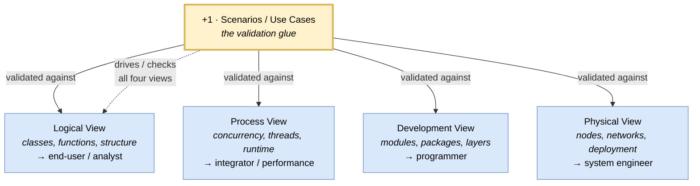

# 🧠 Topic: 4+1 View Model (Kruchten)

> [!abstract] Executive Summary (ELI5)
> The **4+1 View Model** (Philippe Kruchten, 1995) is the original "use several views, not one diagram" framework. It says a software architecture should be described through **four views** — **Logical** (what the system does, as classes/functions), **Process** (what runs concurrently at runtime), **Development** (how the code is organized), and **Physical** (where it deploys) — plus a **"+1"** : a set of **scenarios / use cases** that act as *glue* to validate that the other four actually work together. It is historically foundational: it predates and shaped both R&W and C4, and it was designed to be drawn in **UML**.

> [!warning] The #1 confusion — the "+1" is not a fifth view; it is the test
> People count "Logical, Process, Development, Physical, Scenarios = five views." But the "+1" is deliberately set apart because it plays a *different role*: the scenarios are not another thing to draw alongside the others — they are the **validation tool** you run *against* the four views to check they actually realize the system's important behavior. The four views describe the architecture; the +1 proves they hang together. Hence "four *plus* one," not "five."

> [!note] This note describes 4+1 *as a framework* — through the four axes
> The course's viewpoint notes are Rozanski & Woods–flavored, not Kruchten-flavored, but each 4+1 view maps closely onto an existing viewpoint. This note cross-links rather than re-deriving them.

---

## 🎯 The "Why"

- **Problem Solved:** In the early 1990s, "the architecture" meant *one* diagram (usually a module/component box-and-line), drawn for *one* audience (developers). Kruchten's argument: no single view can serve the end-user (who cares about functionality), the integrator (concurrency/integration), the programmer (code), and the system engineer (deployment) at once. His solution: **multiple concurrent views**, each serving one stakeholder concern — the now-familiar multi-view idea that R&W and C4 later built on.
- **Alternatives at the time:** A single architectural diagram; or unstructured piles of UML diagrams with no theory of which ones matter. 4+1 gave the *canonical set* of views and their audiences. **Today's alternatives:** [[C4 Model]] (zoom-based, not stakeholder-based) and [[Viewpoints and Perspectives]] (adds a separate quality axis) — both descendants of Kruchten's multi-view move.
- **Trade-offs:** 4+1 is **UML-coupled** and **stakeholder-sliced** (one view per audience). That makes it concrete and tool-supported, but it is also more rigid than C4 (no free zoom), and it **embeds quality concerns inside views** (performance lives in the Process View) rather than separating them into a perspectives axis the way R&W does.

## 💡 Mental Model & Analogy

- **Analogy:** Designing a building again — but sliced *by tradesperson*, not by zoom. The **Logical View** is the architect's rendering (rooms and their purpose, for the owner). The **Process View** is the structural engineer's load/flow diagram (how people and air move, for the engineer). The **Development View** is the contractor's blueprint (how it is built, for the builder). The **Physical View** is the site plan (where on the plot, for the surveyor). And the **+1 (Scenarios)** is the walkthrough — you simulate "a family arrives home, cooks, sleeps" to check that the rendering, the structure, the blueprint, and the site plan *all agree*. The walkthrough is not a fifth drawing; it is the test that the four are consistent.

The four views describe the architecture from four stakeholder angles; the +1 (scenarios) is held up *against* all four to verify they realize the system's key behavior. A scenario that no view can satisfy exposes a gap.

## 🛠️ Core Principles

1. **One view per stakeholder concern.** Each view is written for a distinct audience: Logical (end-user/analyst), Process (integrator/performance), Development (programmer), Physical (system engineer). This is 4+1's defining organizational principle — *stakeholder-sliced*, not zoom-sliced like C4.
2. **The views are concurrent, not nested.** Unlike C4's zoom levels (Context ⊃ Container ⊃ Component), the four 4+1 views are *peers* describing different aspects of the same system. They are not drill-downs of one another.
3. **The "+1" (scenarios) is the consistency check.** Use cases / scenarios are applied to the four views to validate them. A scenario that the Logical View supports but the Process View cannot execute reveals an inconsistency. This is the ancestor of "traceability" in later frameworks.
4. **Each view has a preferred UML notation.** Logical → class/object diagrams; Process → activity/concurrency diagrams; Development → component/package diagrams; Physical → deployment diagrams. 4+1 is firmly UML-coupled by design.
5. **Quality concerns are embedded, not separated.** Unlike R&W, there is no separate "perspectives" axis. Performance/concurrency lives *inside* the Process View; internationalization/evolvability is mentioned *inside* the Development/Logical views. This is the key philosophical difference from R&W.

## 🧭 4+1 Analyzed Through the Four Framework Axes

### 1. Process — *originally tied to RUP, the Rational Unified Process*

4+1 was created within Rational Software and is historically tied to the **Rational Unified Process (RUP)** — an iterative, use-case-driven process. The "+1" (scenarios) drives the whole cycle: you start from use cases, elaborate the four views to support them, and iterate. But the model itself does not *mandate* RUP; it can be used with any iterative process.

| | 4+1 (with RUP) | Contrast: TOGAF ADM | Contrast: C4 |
|---|---|---|---|
| Process coupling | Originally **tied to RUP** (use-case-driven, iterative) | Ships its own 8-phase method | **None** — process-light |
| Driver | Use cases / scenarios ("+1") drive elaboration | Business requirements → Baseline/Target/Gap | Drill-down by question |

> Separated from RUP, 4+1 is just a *set of views* with no strong process opinion. See [[Architecture Process]].

### 2. Domains — *Application + Technology primary, Business/Data embedded*

4+1 is a *software-system* model, not an enterprise one — so like C4, it lives mostly in the Application + Technology domains:

| BDAT Domain | 4+1 coverage |
|---|---|
| **Business** | Indirect — via the "+1" scenarios/use cases (which encode business behavior) and the Logical View's functional decomposition. No capability/value-stream modeling. |
| **Data** | **Embedded** in the Logical View (the object/class model includes persistent data). No separate data view — a notable gap vs. R&W's [[Information Viewpoint]]. |
| **Application** | **Direct** — the Logical View (functionality/classes) and Development View (code structure) are its heart. |
| **Technology** | **Direct** — the Physical View is pure deployment/infrastructure. |

> 4+1 folds Data into Logical and has no standalone data view. R&W later separated this out as the [[Information Viewpoint]]; TOGAF elevates Data to a first-class BDAT domain. See [[Architecture Domains]].

### 3. Views — *four concurrent views + scenarios*

This is 4+1's main axis. Each of the four views maps closely onto a course viewpoint (this is how the course relates to it):

| 4+1 View | What it shows | Primary audience | UML notation | → Course viewpoint |
|---|---|---|---|---|
| **Logical** | The system's functional structure — classes, objects, key abstractions, how they collaborate to provide functionality. | End-user, analyst | Class / object / interaction diagrams | [[Functional Viewpoint]] + part of [[Information Viewpoint]] |
| **Process** | Runtime concurrency — processes, threads, tasks, their communication and synchronization. Captures performance, availability, scalability behavior. | Integrator, performance engineer | Activity / concurrency diagrams | [[Concurrency Viewpoint]] |
| **Development** | The code's static organization — modules, packages, layers, subsystems, and their compile-time dependencies. | Programmer | Component / package diagrams | [[Development Viewpoint]] |
| **Physical** | The deployment topology — hardware nodes, networks, and which software element maps onto which node. | System engineer | Deployment diagram | [[Deployment Viewpoint]] |
| **+1 · Scenarios** | The architecturally significant use cases / scenarios. Used as the *validation glue* across all four views. | All | Use case diagrams | (cross-cuts all viewpoints) |

> Notice: the four 4+1 views collectively cover the same ground as R&W's [[Context Viewpoint]]/[[Functional Viewpoint]]/[[Information Viewpoint]] (Logical), [[Concurrency Viewpoint]] (Process), [[Development Viewpoint]] (Development), and [[Deployment Viewpoint]] (Physical). The difference is *organization*: 4+1 slices by stakeholder and bundles some together (e.g., data inside Logical); R&W slices by concern and separates them (e.g., Information as its own viewpoint).

### 4. Metamodel — *UML's, not its own*

4+1 does **not define its own metamodel**. Its element types come entirely from **UML**: Class, Component, Node, Artifact, Package, plus the runtime concepts (Process, Thread, Task) informally. There is no "4+1 content metamodel" the way TOGAF has one.

| | 4+1 | Contrast: TOGAF | Contrast: C4 |
|---|---|---|---|
| Metamodel source | **UML's** (Class, Node, Component, Package…) | Its own content metamodel (dozens of typed entities) | Its own minimal one (4 types) |
| Cross-view consistency | Via the "+1" scenarios (validate against all views) | Via the content-metamodel repository | Via the 4-type nesting rules |

> 4+1's consistency mechanism is the "+1": scenarios are the *check* that the four views agree. This is a lightweight, behavioral consistency strategy, in contrast to TOGAF's structural (typed-repository) one. See [[Architecture Metamodel]].

## ↔️ 4+1 vs. R&W vs. C4 — the three-way comparison

Because we now have three frameworks analyzed, the contrast clarifies each one's distinctive move:

| | **4+1 (Kruchten)** | **R&W Viewpoints & Perspectives** | **C4** |
|---|---|---|---|
| Organizing principle | **Stakeholder-sliced** (one view per audience) | **Concern-sliced** + a quality axis | **Zoom-sliced** (4 drill-down levels) |
| Number of structural views | 4 (Logical, Process, Development, Physical) | 7 viewpoints | 4 zoom levels |
| Quality concerns | **Embedded** inside views (perf → Process) | **Separate axis** (7 perspectives applied to views) | None built-in |
| The "glue" | **Scenarios (+1)** — validation across views | Perspectives applied to views (the matrix) | Zoom nesting (containers = context box) |
| Notation | UML (tightly coupled) | Agnostic (use C4/UML/ArchiMate) | Its own shapes |
| Domains covered | Application + Technology (Data folded into Logical) | All four BDAT (incl. standalone Information) | Application + Technology |
| Process tie | RUP (use-case-driven) | Light, concern-driven | None (process-light) |

> **The arc of ideas:** 4+1 (1995) established that you need *multiple views* and a *validation glue* (scenarios). R&W (2005) kept the multi-view idea but added a *second axis* — perspectives — so quality concerns (security, performance) get a first-class home instead of being buried inside a view. C4 (2010s) kept multi-view but reorganized around *zoom* with a fixed, simple notation. Each inherits the previous idea and adds a move.

## ⚠️ Pitfalls & Anti-patterns

- **Treating "+1" as a fifth view:** It is not. The scenarios are the *validation tool*, not another artifact to produce alongside the other four. Counting five misses Kruchten's whole point.
- **Drawing all four views without running scenarios:** The +1 is what catches inconsistencies. Without it, the four views can silently disagree (the Logical View supports a use case the Process View cannot execute).
- **Equating "Process View" with "business process":** In 4+1, "Process" means **runtime concurrency** (processes/threads/tasks), *not* business workflows. It maps to R&W's [[Concurrency Viewpoint]], not to business process modeling. This collision trips many readers.
- **Folding data into Logical without a separate data view:** 4+1 has no standalone data view; data lives in the Logical View's class model. For data-intensive systems this is a real limitation — R&W's [[Information Viewpoint]] and TOGAF's Data domain both address it.
- **Using 4+1 without UML:** 4+1 is designed around UML notation. Freehand boxes-and-lines lose the type discipline (Class/Node/Component) that makes the views precise. If you don't want UML, C4 may be a better fit.
- **Expecting 4+1 to handle quality concerns explicitly:** It does not — security/performance/availability are *embedded* in specific views (mostly Process), with no separate mechanism. If cross-cutting quality analysis matters, R&W's perspectives are the answer.
- **Conflating 4+1's "Development View" with "software development process":** The Development View is the *code's static organization* (modules/packages/layers), not the process of developing it. It maps to R&W's [[Development Viewpoint]].

## 🔗 Deep Connections

- **Parent Topic:** [[Architecture Framework]] (4+1 is one of the frameworks listed there; analyzed here through the same four axes)
- **The four axes (sibling notes):** [[Architecture Process]] (4+1 historically tied to RUP), [[Architecture Domains]] (4+1 covers Application + Technology, Data folded into Logical), [[Architectural Views]] (the four views map onto the common views), [[Architecture Metamodel]] (4+1 has no own metamodel — it uses UML's)
- **Concrete frameworks (siblings):** [[C4 Model]] (zoom-sliced descendant), [[Viewpoints and Perspectives]] (concern-sliced descendant with a quality axis)
- **4+1 deep-dive subtree** (`4+1/` subfolder — the four views + the validation glue):
  - **The four views:** [[Logical View (4+1)]] (functional structure → [[Functional Viewpoint]] + [[Information Viewpoint]]), [[Process View (4+1)]] (runtime concurrency → [[Concurrency Viewpoint]]), [[Development View (4+1)]] (code structure → [[Development Viewpoint]]), [[Physical View (4+1)]] (deployment → [[Deployment Viewpoint]])
  - **The "+1":** [[Scenarios (4+1)]] — architecturally significant use cases traced across the four views as a consistency check (no R&W equivalent)
- **Course viewpoint mappings:** [[Functional Viewpoint]] + [[Information Viewpoint]] (← Logical), [[Concurrency Viewpoint]] (← Process), [[Development Viewpoint]] (← Development), [[Deployment Viewpoint]] (← Physical)
- **Related Concepts:** [[Viewpoint]] (each 4+1 view is a viewpoint in the general sense), [[Levels of Abstraction]] (4+1 views are *concurrent peers*, not nested zoom — contrast with C4), [[System Modeling]], [[Communicating the Model]] (each view targets a specific stakeholder)
- **Other frameworks for comparison:** [[TOGAF]], `UML`, `ArchiMate` *(future notes)*
- **Prerequisites:** [[Architecture Framework]], [[Viewpoint]].

## ❓ Active Recall Questions

> [!faq]- What is the 4+1 View Model, and what problem does it solve?
> Kruchten's 4+1 (1995) says a software architecture should be described through **four views** — Logical, Process, Development, Physical — each for a different stakeholder, **plus** a "+1" of **scenarios/use cases** that validate the four hang together. It solved the 1990s problem of "one diagram for one audience" by making multi-view, multi-stakeholder description the norm.

> [!faq]- Why is the "+1" not just a fifth view?
> Because it plays a different role. The four views *describe* the architecture; the scenarios *validate* them — you run each architecturally significant use case across all four views to check they realize it. A scenario no view can satisfy exposes a gap. Hence "four *plus* one," not "five views."

> [!faq]- What are the four views, their audiences, and their course-viewpoint equivalents?
> **Logical** (end-user/analyst → [[Functional Viewpoint]]/[[Information Viewpoint]]), **Process** (integrator/performance → [[Concurrency Viewpoint]]), **Development** (programmer → [[Development Viewpoint]]), **Physical** (system engineer → [[Deployment Viewpoint]]). They are *concurrent peers*, not drill-down levels like C4.

> [!faq]- Does "Process View" mean business process?
> No — a common trap. In 4+1, "Process" means **runtime concurrency**: processes, threads, tasks, and their communication/synchronization. It maps to R&W's [[Concurrency Viewpoint]], not to business process modeling.

> [!faq]- How does 4+1 handle quality concerns (security, performance), and how does that differ from R&W?
> 4+1 **embeds** quality inside specific views — performance/concurrency lives in the Process View, evolvability in Development/Logical. There is no separate quality mechanism. R&W instead provides a **separate perspectives axis**: Security, Performance, etc. are applied *to* any view. R&W's move gives cross-cutting quality a first-class home that 4+1 lacks.

> [!faq]- Where does data live in 4+1, and what is the limitation?
> Data is folded into the **Logical View** (the class/object model includes persistent data); there is no standalone data view. For data-intensive systems this is a limitation — R&W later separated it as the [[Information Viewpoint]], and TOGAF elevates Data to a first-class BDAT domain.

> [!faq]- What notation does 4+1 use, and what is its consistency mechanism?
> Notation: **UML** (class, deployment, component, package, activity diagrams) — 4+1 is UML-coupled by design. Consistency: the "+1" scenarios — you validate the four views against the key use cases, which catches cross-view inconsistency behaviorally (contrast TOGAF's typed-metamodel repository or C4's zoom-nesting).

---

## 📝 Related Notes

- [[Architecture Framework]]
- [[Architecture Process]]
- [[Architecture Domains]]
- [[Architectural Views]]
- [[Architecture Metamodel]]
- [[C4 Model]]
- [[Viewpoints and Perspectives]]
- [[Viewpoint]]
- [[Functional Viewpoint]]
- [[Information Viewpoint]]
- [[Concurrency Viewpoint]]
- [[Development Viewpoint]]
- [[Deployment Viewpoint]]
- [[Levels of Abstraction]]
- [[System Modeling]]
- [[Communicating the Model]]
