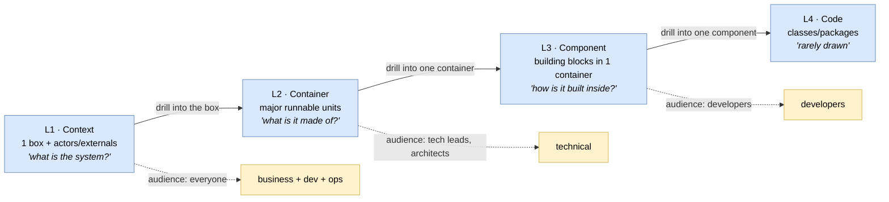

# 🧠 Topic: C4 Model

> [!abstract] Executive Summary (ELI5)
> The **C4 model** (Simon Brown) is an [[Architecture Framework|architecture framework]] for software systems built around a single idea: **use the same simple notation at four zoom levels**, like Google Maps. You start with the whole system as one box (**C**ontext), open it into major runnable units (**C**ontainers), zoom into one container's building blocks (**C**omponents), and optionally into the code. The four C's — **C**ontext, **C**ontainers, **C**omponents, **C**ode — give you a family of structural [[Viewpoint|viewpoints]] with one consistent set of shapes, so every audience gets a picture at the right zoom without learning a new notation each time.

> [!warning] The #1 confusion — C4 is a framework *and* a notation (not "just diagrams")
> People call C4 "a way to draw diagrams." It is more: it is a **framework** (it fixes a set of viewpoints and rules) that also ships a **notation** (its shapes) and an implicit lightweight **metamodel** (Person, Software System, Container, Component and their allowed relationships). What C4 deliberately does *not* ship is a heavy [[Architecture Process|process]] — it is process-light by design. See the four-axis breakdown below.

> [!note] This note describes C4 *as a framework* — through the four axes
> The detailed drill-downs into each zoom level already exist as viewpoint notes: [[Context Viewpoint]], [[Container Viewpoint]], [[Component Viewpoint]]. Read those for *what each level shows*. Read this note for *how C4 works as a framework*: its process, domains, views, and metamodel.

---

## 🎯 The "Why"

- **Problem Solved:** UML is precise but unreadable to non-developers; PowerPoint boxes-and-lines are readable but meaningless (every team reinvents what a box means). C4 splits the difference: a **small, fixed notation** (a handful of shapes) reused across **four zoom levels**, each tuned to a different audience. You get consistency (one notation) *and* audience-fit (four zooms) without the weight of UML or the anarchy of ad-hoc drawings.
- **Alternatives:** **UML** — rich, standardized, but opaque to business stakeholders and expensive to maintain. **Ad-hoc diagrams** — easy, but every diagram means something different; not comparable across teams. **ArchiMate** — enterprise-grade, broader scope, but heavier. See [[Architecture Framework]] → "Well-known Frameworks."
- **Trade-offs:** C4's deliberate narrowness is both its strength and its limit. It models the **Application + Technology domains** (see [[Architecture Domains]]) beautifully but has no first-class Business or Data domain, no heavy process, and a minimal metamodel. For a single software system it is ideal; for enterprise-wide architecture you outgrow it and reach for TOGAF/ArchiMate.

## 💡 Mental Model & Analogy

- **Analogy (the canonical one, from Simon Brown): Google Maps.** Maps show the same country at multiple zoom levels — the *world view* (borders and neighbours), the *country map* (regions/cities), the *city map* (streets), the *street view* (buildings). Each zoom serves a different need, but the cartography is consistent. C4 does this for software: **Context** = world view, **Container** = country map, **Component** = city map, **Code** = street view. You pick the zoom for the question being asked.

Each zoom is a drill-down from the one above: open a box, get the next level. The same notation is used at every level — only the *granularity* changes.

## 🛠️ The Four C's — and where their detail lives

C4's four zoom levels are themselves structural [[Viewpoint|viewpoints]]. Each already has a dedicated deep-dive note; this section is the map.

| Level | Viewpoint | Zoom / question | Audience | Deep dive |
|---|---|---|---|---|
| **L1** | **Context** | The system as one box + actors & external systems. *"What is this system, and what does it interact with?"* | Everyone (entry point) | [[Context Viewpoint]] |
| **L2** | **Container** | Major deployable/runnable units inside the system. *"What is it made of?"* | Tech leads, architects | [[Container Viewpoint]] |
| **L3** | **Component** | Building blocks inside one container. *"How is one container organized inside?"* | Developers | [[Component Viewpoint]] |
| **L4** | **Code** | Classes/packages inside one component. *"What is the code structure?"* | Developers (rarely drawn) | _(optional; rarely modeled)_ |

> A key C4 discipline: **the zoom levels nest.** All containers together = the single Context box. All components inside one container = that container. Open a component → optionally, code. If a level's content doesn't sum to its parent, the model is inconsistent.

## 🧭 C4 Analyzed Through the Four Framework Axes

This is the lens we use for every framework in this folder — see [[Architecture Framework]] → "Anatomy." C4's profile on each axis is distinctive and explains both its strengths and its limits.

### 1. Process — *minimal by design*

C4 ships **no mandated process**. It is a *modeling* framework, not a method. The only implicit process is: *start at Context, drill down only as far as the question requires, stop.* There is no TOGAF-style phased lifecycle.

| | C4 | Contrast: TOGAF ADM |
|---|---|---|
| Process weight | **Light** — "start wide, drill down as needed" | **Heavy** — 8 phases (A–H), Baseline/Target/Gap |
| Mandates order? | Only the zoom hierarchy | Yes — Business → IS → Tech etc. |
| Governance? | None built-in | Phase G implementation governance |

> C4's philosophy: the framework should not tell you *how* to run your project. Combine C4 with whatever [[Architecture Process|process]] your team already uses — agile iteration, DDD, etc. See [[System Modeling]] for how C4 fits a lightweight iterative process.

### 2. Domains — *Application + Technology only*

C4 covers the **Application domain** (containers, components — the software) and the **Technology domain** (via the [[Deployment Viewpoint]] and technology labels on containers). It has **no first-class Business or Data domains** — see [[Architecture Domains]].

| BDAT Domain | C4 coverage |
|---|---|
| **Business** | Indirect only — the [[Context Viewpoint]] implies business scope (actors, purpose), and the [[Functional Viewpoint]] covers capabilities. No business-capability or value-stream modeling. |
| **Data** | Indirect — the [[Information Viewpoint]] (a non-C4 R&W viewpoint) handles it. C4 shows data *stores* (a database is a container) but not data *entities/lineage*. |
| **Application** | **Core strength** — Containers and Components are the heart of C4. |
| **Technology** | Covered — via the [[Deployment Viewpoint]] and the technology labels on each container ("PostgreSQL," "React SPA"). |

> This is the main reason C4 is a *software-system* framework, not an *enterprise* framework. If you need Business/Data as first-class domains, layer C4 onto Rozanski & Woods (which the course does) or reach for TOGAF/ArchiMate.

### 3. Views — *four structural zooms + deployment*

C4's native views are the four zoom levels. Through the lens of [[Architectural Views]], they map onto the "four most-used views" as follows:

| C4 level | → Architectural View it most naturally produces |
|---|---|
| Context (L1) | The system boundary — closest to a **Functional Flow** view at the highest level |
| Container (L2) | The high-level **Code Structure** + part of **Deployment** (logical containers) |
| Component (L3) | The detailed **Code Structure** inside one container |
| (Cross-level) Deployment | The **Deployment view** — where containers run; C4 treats this as a separate diagram type overlaying the Container view |

C4 does **not** natively produce a **Runtime Behaviour** view — that is the [[Concurrency Viewpoint]] (a R&W viewpoint the course adds on top of C4). So C4 covers 3 of the 4 common views directly and leans on R&W for the 4th.

### 4. Metamodel — *tiny but real*

C4 has an **implicit, minimal metamodel** — four element types and a few allowed relationships. This is what makes a C4 diagram unambiguously readable: every box is one of these types.

| Element type | What it is | Appears at |
|---|---|---|
| **Person** | A human actor (user, admin) | All levels |
| **Software System** | The highest-level unit; the thing being modeled (or an external one) | Context, Container |
| **Container** | A single deployable/runnable unit inside a software system | Container, Component (as parent) |
| **Component** | A grouping of related code inside one container, with one responsibility | Component |

Allowed relationships: a Person/Software System/Container/Component may *depend on* or *interact with* another, via a named **connector** (the [[Key Elements of Architecture View|connector]] carries protocol/technology). Relationships are directional and labeled.

> Contrast with [[Architecture Metamodel]] / TOGAF's content metamodel: C4 has ~4 types vs TOGAF's dozens. This minimalism is deliberate — it keeps C4 readable and tool-light (you can draw it by hand, in PlantUML/Structurizr/draw.io, or model it in a repository). The cost is that C4 cannot express business capabilities, data entities, or technology nodes as distinct typed elements — it has no vocabulary for them.

## ✏️ The C4 Notation

One of C4's defining choices is a **fixed, small notation** reused at every zoom. The same shapes mean the same thing regardless of level — only the granularity changes.

| Shape | Element | Notes |
|---|---|---|
| Rounded box | **Person** | Often a stick figure in informal drawings |
| Box | **Software System** / **Container** / **Component** | Same rectangle shape; the *type label* + *granularity* tell you which |
| Cylinder | **Database** (a special container) | Database-as-container shorthand |
| Arrow | **Relationship** | Always labeled with the interaction ("sends order to", "reads from") and ideally the protocol/tech |

> The discipline: **a C4 diagram without type labels and labeled relationships is just boxes-and-lines.** The labels *are* the notation. See [[Key Elements of Architecture View]] — the connector carries the architectural decision.

Tooling: C4 diagrams can be drawn in **draw.io**, **PlantUML** (with the C4-PlantUML macros), **Structurizr** (Simon Brown's own tool, which models the metamodel as code), or **Mermaid**. Structurizr is notable because it treats the model (the metamodel instances) as the source of truth and *generates* the views from it — a direct embodiment of the [[Architecture Metamodel]] idea.

## ⚠️ Pitfalls & Anti-patterns

- **Treating C4 as "just diagrams":** C4 is a framework + notation + (minimal) metamodel. Drawing boxes without type labels and labeled relationships throws away the notation and collapses back to ad-hoc drawing.
- **Drawing all four levels always:** Most audiences need only L1 (Context) and maybe L2 (Container). L3 (Component) is per-container and only for complex ones; L4 (Code) is almost never drawn. Drill down only as far as the question requires.
- **Confusing C4 "container" with Docker container:** A C4 container is a *logical* deployable unit; Docker is one deployment mechanism. See [[Container Viewpoint]] → "#1 confusion."
- **Expecting C4 to cover business/data architecture:** It doesn't — that's the BDAT gap. Layer on R&W viewpoints (as this course does) or move to TOGAF/ArchiMate for enterprise scope.
- **Too many containers/components:** 30 "containers" means you've leaked the level below. C4 levels must nest cleanly — see [[Handling Complexity of Architecture Model]].
- **No deployment view:** A Container diagram shows *what* runs, not *where*. Forgetting the [[Deployment Viewpoint]] leaves the ops/security audience unserved.
- **Inconsistent notation across teams:** If every team invents its own "C4 shapes," you lose the cross-team comparability that is C4's point. Agree on one tool/shape set.

## 🔗 Deep Connections

- **Parent Topic:** [[Architecture Framework]] (C4 is one of the frameworks listed there; analyzed here through the same four axes)
- **The four axes (sibling notes):** [[Architecture Process]] (C4 is process-light), [[Architecture Domains]] (C4 covers Application + Technology only), [[Architectural Views]] (C4's zooms map onto the common views), [[Architecture Metamodel]] (C4's 4-type minimal metamodel)
- **The C4 zoom levels (detailed notes):** [[Context Viewpoint]] (L1), [[Container Viewpoint]] (L2), [[Component Viewpoint]] (L3) — these hold the per-level detail; this note does not repeat it
- **Related Concepts:** [[Viewpoint]] (each C4 level is a structural viewpoint), [[Key Elements of Architecture View]] (Person/System/Container/Component are the building blocks; arrows are connectors), [[Levels of Abstraction]] (the four C's are a zoom hierarchy), [[System Modeling]] (C4 as a lightweight iterative process), [[Communicating the Model]] (each C4 level targets a different audience)
- **Other frameworks for comparison:** [[Viewpoints and Perspectives]], [[4+1 View Model]], [[TOGAF]], `ArchiMate`, `UML` *(future notes — for contrast on each of the four axes)*
- **Prerequisites:** [[Architecture Framework]], [[Viewpoint]], [[Context Viewpoint]].

## ❓ Active Recall Questions

> [!faq]- What is the C4 model, and what problem does it solve?
> C4 (Simon Brown) is an architecture framework that uses **one simple notation at four zoom levels** — **C**ontext, **C**ontainers, **C**omponents, **C**ode — like Google Maps. It solves the trade-off between UML (precise but unreadable to non-developers) and ad-hoc diagrams (readable but meaningless) by fixing a small set of shapes reused across four audience-tuned zooms.

> [!faq]- What are the four C's, and what question does each answer?
> **Context** (what is the system + who/what it interacts with), **Container** (the major runnable units inside), **Component** (the building blocks inside one container), **Code** (classes/packages — rarely drawn). Each is a drill-down from the level above; the levels must nest (all containers = the context box).

> [!faq]- Is C4 a framework, a notation, or a metamodel?
> All three, in a lightweight form. It is a **framework** (fixes a set of viewpoints), a **notation** (its shapes), and a **minimal metamodel** (Person, Software System, Container, Component + allowed relationships). What it deliberately is *not* is a heavy **process** — it is process-light by design.

> [!faq]- Which BDAT domains does C4 cover, and which does it not?
> C4 covers **Application** (containers/components — its core strength) and **Technology** (deployment + technology labels). It has **no first-class Business or Data domains** — business scope is only implied by the Context view, and data entities/lineage are not modeled. This is why C4 is a software-system framework, not an enterprise one.

> [!faq]- How does C4 compare to UML and to ad-hoc diagrams?
> C4 sits between them. **UML** is richer and standardized but opaque to business stakeholders and expensive to maintain. **Ad-hoc diagrams** are easy but every box means something different per team. C4 fixes a *small* notation reused at four zooms — consistent *and* readable, at the cost of narrow scope (no business/data domain, minimal metamodel).

> [!faq]- What is C4's metamodel, and how does it differ from TOGAF's?
> C4 has a minimal metamodel of **four element types** — Person, Software System, Container, Component — plus directional, labeled relationships. TOGAF's content metamodel has dozens of typed entities (Capability, Data Entity, Node, etc.) across all four BDAT domains. C4's minimalism keeps it readable and tool-light; the cost is no vocabulary for business/data/infrastructure as distinct types.

> [!faq]- Why does the course pair C4 with Rozanski & Woods viewpoints?
> Because C4 covers only Application + Technology. R&W supplies the viewpoints C4 lacks — [[Functional Viewpoint]] (business capabilities), [[Information Viewpoint]] (data), [[Concurrency Viewpoint]] (runtime behaviour), [[Deployment Viewpoint]] (where things run), etc. — plus the cross-cutting [[Perspective|perspectives]] (security, performance, availability). C4 gives the notation and zoom; R&W fills the domain and concern gaps.

---

## 📝 Related Notes

- [[Architecture Framework]]
- [[Architecture Process]]
- [[Architecture Domains]]
- [[Architectural Views]]
- [[Architecture Metamodel]]
- [[Context Viewpoint]]
- [[Container Viewpoint]]
- [[Component Viewpoint]]
- [[Viewpoint]]
- [[Levels of Abstraction]]
- [[Key Elements of Architecture View]]
- [[System Modeling]]
- [[Communicating the Model]]
