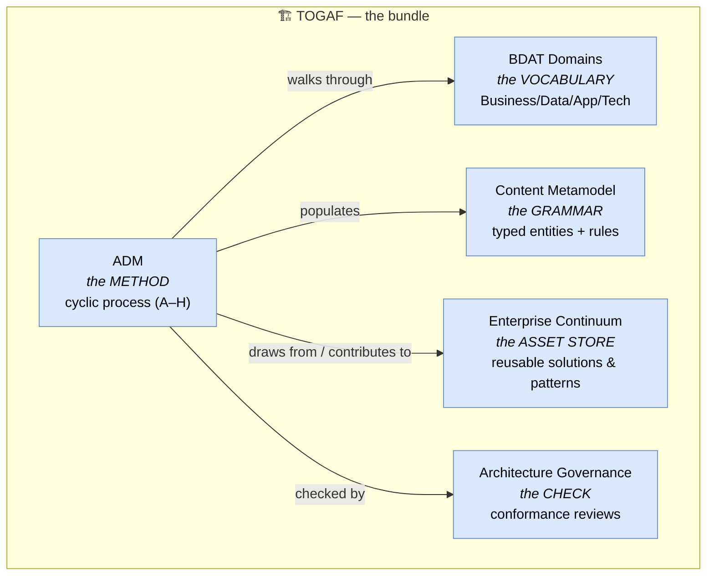

# 🧠 Topic: TOGAF — The Open Group Architecture Framework

> [!abstract] Executive Summary (ELI5)
> **TOGAF** (The Open Group Architecture Framework) is the heavyweight, **enterprise-grade** architecture framework. Where [[C4 Model|C4]], [[Viewpoints and Perspectives|R&W]], and [[4+1 View Model|4+1]] describe a single software system, TOGAF describes *the whole enterprise* — every business capability, every application, every data store, every server, across the organization. Its **defining contribution is the ADM** (Architecture Development Method): a cyclic, phased [[Architecture Process|process]] that takes you from business goal to running, governed architecture. It is also the source of much of the vocabulary this folder already uses — **BDAT domains**, **Architecture Building Blocks**, the **Content Metamodel** are all TOGAF terms.

> [!warning] The #1 confusion — "TOGAF" is not one thing; it is a bundle
> People say "we use TOGAF" as if it were a diagram style. It isn't. TOGAF is a **bundle**: a **method** (the ADM), a **content framework** (the metamodel + domains), a set of **techniques**, a **reference model**, and an **Enterprise Continuum** for classifying reusable assets. When someone says "we use TOGAF," ask *which part* — most teams adopt the ADM and the BDAT vocabulary without the full content metamodel.

> [!note] This note describes TOGAF *as a framework* — through the four axes
> The four axis-notes already use TOGAF as their canonical reference: [[Architecture Process]] (the ADM), [[Architecture Domains]] (BDAT), [[Architecture Metamodel]] (the Content Metamodel). This note ties them together and adds what is uniquely TOGAF (Enterprise Continuum, ABB/SBB, Repository), rather than repeating those notes.

---

## 🎯 The "Why"

- **Problem Solved:** In a large enterprise, the architecture spans hundreds of systems, dozens of teams, and decades of legacy — and it never stops changing. C4/R&W/4+1 describe *one system*; none tells you *how to run architecture as an ongoing practice* across an entire organization. TOGAF fills exactly that gap: it provides a **repeatable process** (ADM) to move from business strategy to governed architecture, a **vocabulary** (BDAT domains + metamodel) so every team speaks the same language, and a **repository model** so architecture assets accumulate and are reused instead of being re-invented.
- **Alternatives:** For a single software system, [[C4 Model|C4]] + [[Viewpoints and Perspectives|R&W]] is lighter and sufficient — TOGAF would be overkill. For enterprise scope, alternatives are **ArchiMate** (notation-focused, pairs with TOGAF), **DoDAF/MODAF/NAF** (defense sector), or going without any framework and letting each team invent its own. See [[Architecture Framework]] → "Well-known Frameworks."
- **Trade-offs:** TOGAF is **comprehensive but heavy**. Its strength — a complete, enterprise-wide method and vocabulary — is also its weakness for small teams: the full ADM and content metamodel are bureaucratic for a single service. The mature practice is to **adopt the parts that fit**: the ADM cycle (trimmed), the BDAT vocabulary, and selected metamodel entities.

## 💡 Mental Model & Analogy

- **Analogy:** If C4/R&W/4+1 are the **architecture of one building**, TOGAF is the **urban planning department** of a whole city. It does not design individual buildings — it runs a *continuous process* (zoning, permitting, review) that keeps the entire city coherent as buildings are built, demolished, and renovated over decades. It has a *method* (the ADM — how a zoning change is proposed, reviewed, approved, built, monitored), a *classification* of what exists (BDAT domains — residential/commercial/industrial/infrastructure), a *registry* of reusable patterns (the Enterprise Continuum — "here's a standard school design, reuse it"), and a *governance* body that checks buildings comply with the plan.



TOGAF is not a single artifact or diagram type — it is a bundle of method + vocabulary + grammar + asset store + governance, all centered on the ADM.

## 🛠️ Core Principles

1. **Business-driven.** The ADM starts from business goals and drivers; technology follows. Phase A (Preliminary) and B (Architecture Vision) establish the business context before any IT is described. Contrast with starting from "which cloud."
2. **Enterprise scope by default.** TOGAF assumes the unit of work is the *enterprise*, not a single system. Its vocabulary (BDAT) and repository are designed for cross-organization consistency and reuse.
3. **Architecture is a governed lifecycle, not a one-off.** The ADM is cyclic; Phase H (Architecture Change Management) feeds back into Phase B, so the architecture evolves with the business. Governance (Phase G) checks that what is built matches what was decided.
4. **Architecture assets are reusable.** The Enterprise Continuum + Architecture Repository mean solutions, patterns, and building blocks are classified and stored for reuse — the enterprise's architecture *accumulates* rather than restarting each project.
5. **Adopt what fits.** TOGAF explicitly anticipates that organizations adopt a *subset*. Most teams take the ADM cycle, the BDAT vocabulary, and selected metamodel entities; few run the full content metamodel for every initiative.

## 🧭 TOGAF Analyzed Through the Four Framework Axes

### 1. Process — *the ADM is TOGAF's defining contribution*

Of all four frameworks in this folder, **only TOGAF ships a full method**. The ADM (Architecture Development Method) is its centerpiece — a cyclic, phased process that takes you from "we have a business problem" to "we have a governed architecture," and back again.

The ADM's eight phases (A–H) are detailed in [[Architecture Process]] → "The Canonical Cycle." In summary:

| Phase | Spirit | What happens |
|---|---|---|
| **A. Preliminary** | Setup | Principles, scope, governance, stakeholder map |
| **B. Architecture Vision** | Frame | Stakeholders, business drivers, target vision, scope |
| **C. Business Architecture** | Describe Business | Business capabilities, processes, org — the Business domain |
| **D. Information Systems Architectures** | Describe Data + App | Data entities, application components — Data + Application domains |
| **E. Opportunities & Solutions** | Decide | Choose among architectural approaches for the gap |
| **F. Migration Planning** | Plan | Break the gap into deliverable projects, transition architectures |
| **G. Implementation Governance** | Govern | Oversee build; check conformance to the architecture |
| **H. Architecture Change Management** | Evolve | Monitor the live system; trigger re-entry into the loop |

> Key contrast: [[C4 Model|C4]], [[Viewpoints and Perspectives|R&W]], and [[4+1 View Model|4+1]] are all **process-light** — they describe *what* a good architecture description contains, not *how to get there*. TOGAF is **process-heavy**: the ADM is prescriptive about order, gates, and re-entry. This is TOGAF's unique strength (repeatable, governed) and its common criticism (bureaucratic for small scope).

### 2. Domains — *BDAT, explicitly labeled, enterprise-wide*

TOGAF is where the **BDAT** vocabulary comes from — the four domains already detailed in [[Architecture Domains]]. TOGAF's distinction is that it treats them as **explicitly labeled, enterprise-spanning layers** with traceability between them.

| BDAT Domain | TOGAF scope | Contrast with C4/R&W/4+1 |
|---|---|---|
| **Business** | First-class: capabilities, value streams, org, business objects | C4/R&W have this only indirectly |
| **Data** | First-class: data entities, conceptual/logical/physical models, lineage | 4+1 folds data into Logical; C4 shows only stores |
| **Application** | First-class: applications, services, components, interfaces | All four frameworks cover this |
| **Technology** | First-class: platforms, networks, runtimes, environments | All four cover this |

> TOGAF is the only framework here that gives **all four domains first-class status**, including Business and Data as named layers with their own artifacts and experts. This is what makes it enterprise-grade. See [[Architecture Domains]].

### 3. Views — *viewpoint-based, but TOGAF defers to a separate standard*

TOGAF's own view mechanism is **less prescriptive than R&W's or 4+1's**. It defines the concept of an **Architecture View** (a representation of a system from the perspective of related concerns) and an **Architecture Viewpoint** (the template/pattern), and it references **ISO/IEC/IEEE 42010** for the formal definitions. But it does *not* ship a fixed set of named viewpoints the way R&W ships seven or 4+1 ships four.

| | TOGAF | Contrast |
|---|---|---|
| Fixed viewpoint set? | **No** — defers to ISO 42010; lets you define your own | R&W ships 7; 4+1 ships 4 |
| Notation? | **Notation-agnostic** | C4 ships its own; ArchiMate ships its own |
| What it fixes instead | The **domains** (BDAT) and the **metamodel entity types** that populate views | C4 fixes zoom levels; R&W fixes the viewpoints×perspectives matrix |

> Practical consequence: teams running TOGAF usually **render its views in ArchiMate or C4**. TOGAF tells you *which building blocks exist*; a notation tells you *how to draw them*. This is why TOGAF and ArchiMate are so often used together.

### 4. Metamodel — *the Content Metamodel, TOGAF's other major contribution*

Alongside the ADM, TOGAF's second big artifact is the **Content Metamodel** — the typed entity model that defines what an architecture description is built from. This is the reference example used in [[Architecture Metamodel]].

Core entity types (mirroring BDAT):

| Metamodel entity | Domain | Example instance |
|---|---|---|
| Actor / Organization Unit | Business | "Customer", "Billing Team" |
| Business Capability / Function | Business | "Process Payment" |
| Data Entity | Data | "Order", "Customer" |
| Application Component | Application | "OrderService" |
| Interface / Service | Application | "charge()", "placeOrder()" |
| Technology Node / Platform Service | Technology | "us-east-1 EC2", "managed Postgres" |

Plus the relationships that wire them: a Component *realizes* a Capability, *owns* Data Entities, *depends on* other Components, and is *deployed onto* a Node. TOGAF organizes these into **metamodel extensions** (Core, Governance, Services, etc.) so you adopt only what you need.

> Contrast: C4 has ~4 types; TOGAF has dozens, across all four BDAT domains. TOGAF's metamodel is the richest of any framework here — it can express business capabilities and data entities as distinct typed elements, which C4 and 4+1 cannot. See [[Architecture Metamodel]].

## 🧩 What Is Uniquely TOGAF (beyond the four axes)

The four axes describe what TOGAF shares with other frameworks. TOGAF also adds several concepts that have **no equivalent** in C4/R&W/4+1:

### 1. The Enterprise Continuum — *a classification of reusable assets*

The Enterprise Continuum is a spectrum that classifies architecture assets by how **specific vs. generic** they are, so you know what to reuse where:

```
Generic ←————————————————————————————→ Specific
Foundation Architecture  →  Common Systems  →  Industry  →  Organization-Specific
(TOGAF TRM)                 (reusable solutions)  (sector patterns)  (your enterprise)
```

- **Left side (generic):** universal building blocks — e.g., the TOGAF Technical Reference Model (TRM), a generic platform taxonomy.
- **Right side (specific):** your organization's own architecture — tailored, with your names and constraints.
- **Use:** when starting an initiative, you scan from left to right — "is there a generic pattern I can reuse before designing from scratch?" — and as you build, you contribute your specific solutions back to the continuum.

> No equivalent in C4/R&W/4+1. The Continuum is the enterprise-architecture answer to "don't re-invent; reuse."

### 2. Architecture Building Blocks (ABBs) vs. Solution Building Blocks (SBBs)

TOGAF distinguishes two kinds of building blocks — a distinction absent from the other frameworks:

| | **Architecture Building Block (ABB)** | **Solution Building Block (SBB)** |
|---|---|---|
| What it is | A *specification* of what is needed — a typed requirement from the architecture | A *realization* that fulfills an ABB — a concrete product/component |
| Level of detail | "We need a component that processes payments" | "We will use Stripe API v2 to process payments" |
| Lives in | The Architecture Definition (the target architecture) | The Solution Building Block catalogue / implementation |
| Maps to | [[Architecture Metamodel]] entity types | Specific products, vendors, configurations |

> An ABB says *what*; an SBB says *which*. This separation keeps the architecture (the "what") stable while solutions (the "which") evolve — e.g., swapping Stripe for Adyen changes the SBB, not the ABB.

### 3. The Architecture Repository

TOGAF defines a structured **Architecture Repository** — the enterprise's single source of truth for architecture assets: the metamodel instances, the building block catalogues, the reference models, the standards, and the governance logs. This is the operational home of everything the ADM produces.

> The Repository is what makes governance (Phase G) mechanical: instead of eyeballing diagrams, you compare the built system against the stored building blocks and rules. It is the concrete embodiment of the [[Architecture Metamodel]] idea at enterprise scale.

## ↔️ TOGAF vs. C4 vs. R&W vs. 4+1 — the four-way comparison

| | **TOGAF** | **C4** | **R&W** | **4+1** |
|---|---|---|---|---|
| Scope | **Enterprise** | Software system | Software system | Software system |
| Defining contribution | **The ADM (process)** + Content Metamodel | Notation + zoom | Viewpoints × perspectives matrix | Multi-view + scenarios |
| Process weight | **Heavy** (8-phase ADM) | None | Light (concern-driven) | RUP-tied (light) |
| Domains | **All four BDAT** (first-class) | Application + Technology | All four (via viewpoints) | App + Tech (Data in Logical) |
| Notation | None (bring ArchiMate/C4) | Its own shapes | Agnostic | UML |
| Metamodel | **Rich** (dozens of types) | Minimal (4 types) | Implicit per viewpoint | UML's |
| Unique concepts | **Enterprise Continuum, ABB/SBB, Repository** | — | Perspectives axis | +1 scenarios |
| Quality concerns | Via governance + viewpoints applied | None built-in | Separate perspectives axis | Embedded in views |

> **The pattern across all four:** each framework's *defining contribution* is on a different axis. C4 → notation/zoom. R&W → the perspectives axis. 4+1 → multi-view + validation. TOGAF → the process (ADM) + enterprise metamodel. This is why they **compose** rather than compete: the course uses C4's notation inside R&W's viewpoint structure, and an enterprise could run all of that inside TOGAF's ADM.

## ⚠️ Pitfalls & Anti-patterns

- **Running the full ADM for a small system:** TOGAF's ADM and content metamodel are enterprise-scope. Applying them wholesale to a single microservice is bureaucratic overkill. Adopt the trimmed cycle: *understand → sketch target → build → revisit*.
- **"We adopted TOGAF, therefore we have an architecture":** TOGAF is a method and vocabulary, not an architecture. You can run the ADM and produce an empty repository. The architecture is the decisions you instantiate inside it — see [[Architecture Framework]] → Pitfalls.
- **Confusing ADM phases with waterfall:** the ADM is **cyclic**, not linear. Phase H feeds back into B; iterations deepen the model. Treating it as a one-shot A→H pipeline produces a frozen, stale architecture.
- **Adopting the vocabulary without the method (or vice versa):** common and fine, but be explicit. Many teams take BDAT + the metamodel without the full ADM. Know which subset you adopted and why.
- **Ignoring the Enterprise Continuum:** re-inventing solutions that already exist as reusable assets. Scan the continuum before designing from scratch.
- **Treating TOGAF as notation:** TOGAF is notation-agnostic. Trying to draw "TOGAF diagrams" without a notation (ArchiMate, C4, UML) produces freehand boxes-and-lines that lose the type discipline.
- **Governance as bureaucracy:** Phase G (Implementation Governance) exists to catch drift, not to block. If governance becomes a paperwork bottleneck that nobody respects, it has failed its purpose.
- **Confusing ABB and SBB:** mixing *what is needed* (ABB) with *which product fulfills it* (SBB) couples the architecture to a specific vendor prematurely and makes change expensive.

## 🔗 Deep Connections

- **Parent Topic:** [[Architecture Framework]] (TOGAF is one of the frameworks listed there; analyzed here through the same four axes)
- **The four axes (sibling notes):** [[Architecture Process]] (the ADM is the canonical reference there), [[Architecture Domains]] (BDAT is TOGAF's domain decomposition), [[Architectural Views]] (TOGAF defers to ISO 42010 for view concepts), [[Architecture Metamodel]] (the Content Metamodel is the canonical reference there)
- **Concrete frameworks (siblings):** [[C4 Model]], [[Viewpoints and Perspectives]], [[4+1 View Model]] — all three are software-system scope; TOGAF is enterprise scope
- **TOGAF deep-dive subtree** (`togaf/` subfolder — detailed treatment of each part):
  - **Method:** [[Architecture Development Method]] (the ADM, phases A–H)
  - **Deliverables:** [[Architecture Content Framework]] (parent) → [[Architecture Catalogs]], [[Architecture Matrices]], [[Architecture Diagrams]]
  - **Practice:** [[Architecture Capability Framework]] (parent) → [[Architecture Reference Models]] (parent) → [[Technical Reference Model]], [[III-RM]]
  - **Domains:** [[TOGAF Architecture Domains]] (BDAT parent) → [[Business Architecture]], [[Data Architecture]], [[Application Architecture]], [[Technology Architecture]]
  - **Partitioning:** [[Architecture Partitioning]] (parent) → [[Enterprise Architecture]], [[Segment Architecture]], [[Capability Architecture]]
  - **Time horizons:** [[Architecture Time Horizons]] (parent) → [[Baseline Architecture]], [[Transition Architecture]], [[Target Architecture]]
- **Related Concepts:** [[Architecture Framework]] → "Framework vs. Notation vs. Method vs. Standard" (TOGAF is the clearest example of a framework *+ method*), [[System Architecture]], [[System Modeling]], [[Communicating the Model]]
- **Future notes for comparison:** `ArchiMate` (the notation most often paired with TOGAF), `UML` *(future notes)*
- **Prerequisites:** [[Architecture Framework]], [[Architecture Process]].

## ❓ Active Recall Questions

> [!faq]- What is TOGAF, and how does its scope differ from C4, R&W, and 4+1?
> TOGAF (The Open Group Architecture Framework) is an **enterprise-grade** architecture framework: it describes the whole enterprise (all business capabilities, apps, data, infrastructure), not a single software system like C4/R&W/4+1. Its defining contribution is the **ADM** (Architecture Development Method) — a cyclic, phased process for running architecture as an ongoing practice.

> [!faq]- Why is "we use TOGAF" an ambiguous statement?
> Because TOGAF is a **bundle**, not one thing: a method (ADM), a content framework (metamodel + BDAT domains), techniques, a reference model, and an Enterprise Continuum. Most teams adopt a subset (often the ADM + BDAT vocabulary). Asking "which part?" clarifies what is actually in use.

> [!faq]- What is the ADM, and what makes it different from the process stance of C4/R&W/4+1?
> The ADM (Architecture Development Method) is TOGAF's cyclic 8-phase process (A–H: Preliminary → Vision → Business → Data/App → Opportunities → Migration → Implementation Governance → Change Management), with Phase H feeding back into B. It is the **only full method** among the four frameworks here — C4/R&W/4+1 are all process-light, describing *what* a description contains, not *how* to produce it in order. See [[Architecture Process]].

> [!faq]- What are the BDAT domains, and what is TOGAF's distinction here?
> **Business, Data, Application, Technology** — the four architecture domains. TOGAF's distinction is that it gives **all four first-class status**, including Business and Data as explicitly labeled layers with their own artifacts. C4 covers Application + Technology only; 4+1 folds Data into Logical. See [[Architecture Domains]].

> [!faq]- What are ABBs and SBBs, and why does the distinction matter?
> An **Architecture Building Block (ABB)** specifies *what is needed* ("a payment-processing component"); a **Solution Building Block (SBB)** is a *concrete realization* ("Stripe API v2"). The separation keeps the architecture (the "what") stable while solutions (the "which") can be swapped — changing the vendor changes the SBB, not the ABB. No other framework here makes this distinction.

> [!faq]- What is the Enterprise Continuum, and what problem does it solve?
> A spectrum classifying architecture assets from **generic** (foundation reference models) to **specific** (your organization's architecture). It solves the "don't re-invent" problem: when starting an initiative you scan from generic to specific for reusable patterns, and contribute your solutions back. No equivalent exists in C4/R&W/4+1.

> [!faq]- How does TOGAF handle views and notation?
> View-wise, TOGAF is **less prescriptive** than R&W or 4+1: it defines the *concepts* of Architecture View and Viewpoint (deferring to ISO/IEC/IEEE 42010) but does **not** ship a fixed set of named viewpoints. Notation-wise, it is **agnostic** — you bring a notation (ArchiMate, C4, UML) to render TOGAF's domains and building blocks. This is why TOGAF + ArchiMate is a common pairing.

---

## 📝 Related Notes

- [[Architecture Framework]]
- [[Architecture Process]]
- [[Architecture Domains]]
- [[Architectural Views]]
- [[Architecture Metamodel]]
- [[C4 Model]]
- [[Viewpoints and Perspectives]]
- [[4+1 View Model]]
- [[System Architecture]]
- [[System Modeling]]
- [[Communicating the Model]]
