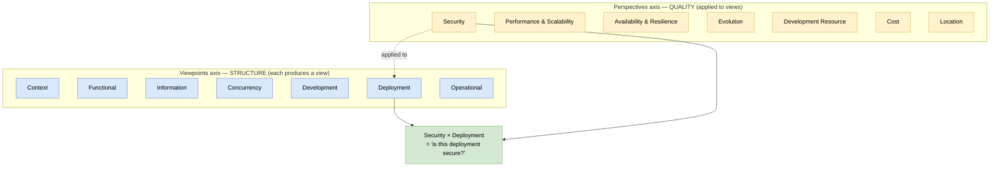

# 🧠 Topic: Viewpoints and Perspectives (Rozanski & Woods)

> [!abstract] Executive Summary (ELI5)
> **Viewpoints and Perspectives** — from Rozanski & Woods' *Software Systems Architecture* — is the [[Architecture Framework|architecture framework]] this course is built on (it is literally the course's subtitle). Its one big idea: split architectural description into **two orthogonal axes**. **Viewpoints** are structural lenses that each produce a view (Context, Functional, Deployment…). **Perspectives** are cross-cutting quality concerns with no view of their own, *applied to* those views (Security, Performance, Availability…). Architecture, in R&W, is the **matrix** of viewpoints × perspectives — you describe structure, then hold each quality lens up to it.

> [!warning] The #1 confusion — already the title of the framework
> "Viewpoint" and "perspective" are near-synonyms in everyday English, which is cruel. In R&W they are precise opposites that **combine**: a **viewpoint** builds *structure* (it produces a view); a **perspective** evaluates *quality* (it produces no view — it is applied to existing ones). "Show me the security view" is a category error — security is a perspective. The parent notes [[Viewpoint]] and [[Perspective]] own this distinction; this note treats R&W as a *framework*.

> [!note] This note describes R&W *as a framework* — through the four axes
> The individual viewpoints (Context, Functional, Information, Concurrency, Development, Deployment, Operational) and perspectives (Security, Performance, Availability, Evolution, Development Resource, Cost, Location) each have their own deep-dive notes. This note does not repeat them — it explains how R&W works *as a whole* and links out.

---

## 🎯 The "Why"

- **Problem Solved:** Before R&W, architecture descriptions were a pile of unrelated diagrams with no theory of *which* diagrams to draw, *for whom*, or how to ensure *quality* was addressed. R&W gave the practice two things at once: (1) a fixed **set of viewpoints** so you cover the right structural concerns for the right audiences, and (2) a **second axis of perspectives** so cross-cutting qualities (security, performance, resilience) are designed in deliberately, not discovered in production. The matrix makes both axes explicit.
- **Alternatives:** **C4** alone — excellent notation and zoom, but it has no built-in concept of perspectives, so quality concerns are easy to forget. **UML** — rich notation but it does not separate structure from quality; "is this UML deployment secure?" has no first-class answer. **TOGAF** — enterprise-grade but heavyweight; R&W is purpose-built for *software systems*. See [[Architecture Framework]] → "Well-known Frameworks."
- **Trade-offs:** R&W is comprehensive (7 viewpoints + 7 perspectives = a large possible matrix), and it is **notation-agnostic** — it tells you *which* views and qualities, not *how to draw* them. That freedom is a strength (you can use C4's notation inside R&W — which is exactly what this course does) but means you must bring your own notation. Applying the full matrix is impractical; R&W itself says select by risk (see [[Perspective]] → "How to select perspectives").

## 💡 Mental Model & Analogy

- **Analogy:** Designing a building. The **viewpoints** are the different drawings the architect produces — the floor plan, the elevation, the electrical layout, the plumbing layout — each showing structure for a different concern. The **perspectives** are the building inspectors' checklists — fire safety, structural load, accessibility, energy efficiency — each held up *to the drawings* to evaluate quality. You don't have a "fire safety floor plan"; you have the floor plan *inspected for* fire safety. R&W makes this two-axis thinking explicit: structure on one axis, quality on the other.

A complete architecture description is a **populated matrix**: a set of views (from viewpoints) × a set of applied perspectives. Each cell is a question — "is *this* view *this* quality?" Not every cell must be filled; you fill the cells where the risk justifies it.

## 🛠️ Core Principles

1. **Two orthogonal axes.** Viewpoints describe *structure*; perspectives describe *quality*. They are independent — any perspective can apply to any view.
2. **Viewpoints produce views; perspectives do not.** A viewpoint is a recipe for a diagram. A perspective is a checklist applied *to* a diagram. This single rule prevents the "show me the security view" category error. See [[Viewpoint]] and [[Perspective]].
3. **Concern-driven, not artifact-driven.** R&W explicitly ties each viewpoint and perspective to the *concerns* it addresses and the *stakeholders* it serves. You produce a view because a concern demands it — see [[System Modeling]].
4. **Notation-agnostic.** R&W fixes *which* views and qualities, not *how* to draw them. You can render R&W viewpoints in UML, ArchiMate, or — as this course does — **C4**. This is why C4 and R&W compose so well: C4 supplies the notation and zoom; R&W supplies the viewpoints C4 lacks and the entire perspectives axis.
5. **Select by risk, not by checklist.** R&W never asks you to apply all 7 perspectives to all 7 views (49 cells). You pick the viewpoints your stakeholders raised and the perspectives that match your real risks — typically 3–5 perspectives per system. See [[Perspective]] → "How to select perspectives."

## 🧭 R&W Analyzed Through the Four Framework Axes

The same four-axis lens we use for every framework in this folder (see [[Architecture Framework]] → "Anatomy"). R&W's profile on each axis is what distinguishes it from C4, TOGAF, and UML.

### 1. Process — *a lightweight, concern-driven cycle*

R&W describes architecture work as a cycle of **identify concerns → select viewpoints → create views → apply perspectives → refine** — but, like C4, it does **not mandate** a heavy phased process. It is a *descriptive* framework (what a good description contains), not a *prescriptive method* (in what order to build it).

| | R&W | Contrast: TOGAF ADM |
|---|---|---|
| Process weight | **Light** — concern-driven cycle, no fixed phases | **Heavy** — 8 phases (A–H), Baseline/Target/Gap |
| What it fixes | *What* a description contains (viewpoints + perspectives) | *How and when* you produce it |
| Governance | Implicit (perspectives as quality gates) | Explicit (Phase G implementation governance) |

> R&W pairs naturally with whatever [[Architecture Process|process]] your team uses. The course combines R&W's concern-driven cycle with C4's iterative "start wide, drill down" rhythm. See [[Architecture Process]].

### 2. Domains — *Application + Technology primary, Business/Data indirect*

R&W's seven viewpoints collectively cover all four [[Architecture Domains|BDAT domains]], though not as explicitly labeled layers:

| BDAT Domain | R&W coverage |
|---|---|
| **Business** | Indirect — via the [[Context Viewpoint]] (actors, purpose) and the [[Functional Viewpoint]] (capabilities). No value-stream/org modeling. |
| **Data** | **Direct** — the [[Information Viewpoint]] is a first-class R&W viewpoint (this is something C4 lacks). |
| **Application** | **Direct** — the [[Development Viewpoint]] (code structure) and, in C4 terms, Container/Component. |
| **Technology** | **Direct** — the [[Deployment Viewpoint]] (where things run) and the [[Concurrency Viewpoint]] (runtime instances). |

> R&W covers more domains than C4 (notably the Data/Information domain) but does not label them as "domains" the way TOGAF does. The viewpoint set is the domain coverage.

### 3. Views — *seven viewpoints spanning static AND dynamic*

This is R&W's broadest axis. Through the lens of [[Architectural Views]], R&W's seven viewpoints map onto the four common views as follows:

| R&W viewpoint | → Architectural View | Static / Dynamic |
|---|---|---|
| [[Context Viewpoint]] | Functional Flow (system boundary) | Static |
| [[Functional Viewpoint]] | Functional Flow (capabilities) | Static / Dynamic |
| [[Information Viewpoint]] | (Data — not in the "four common views") | Static |
| [[Concurrency Viewpoint]] | Runtime Behaviour | **Dynamic** |
| [[Development Viewpoint]] | Code Structure | Static |
| [[Deployment Viewpoint]] | Deployment | Static |
| [[Operational Viewpoint]] | Runtime Behaviour (operation/monitoring) | **Dynamic** |

> Key contrast with C4: R&W explicitly includes **Runtime Behaviour** (Concurrency + Operational viewpoints) and the **Information/Data** viewpoint — two areas C4 does not cover natively. This is precisely why the course layers C4 *on top of* R&W: C4 gives the notation for the structural views; R&W supplies the viewpoints C4 omits.

### 4. Metamodel — *implicit and lightweight*

R&W does not ship a formal [[Architecture Metamodel|metamodel]] the way TOGAF's content metamodel does. Its "types" are implicit: each viewpoint implies its own element types (actors & external systems in Context; capabilities in Functional; data entities in Information; runtime instances in Concurrency; modules in Development; nodes in Deployment; operational processes in Operational). Perspectives, being evaluation lenses, introduce no new element types — they add quality *attributes* to existing elements.

| | R&W | Contrast: TOGAF | Contrast: C4 |
|---|---|---|---|
| Metamodel form | **Implicit** — types embedded in each viewpoint | **Explicit & rich** — dozens of typed entities | **Minimal** — 4 types (Person/System/Container/Component) |
| Cross-view consistency | By shared concerns & stakeholders, not a typed registry | By the content metamodel repository | By the 4-type nesting rules |

> R&W relies on **shared concerns and stakeholder mapping** to keep views consistent, rather than a typed metamodel repository. This is lighter but less mechanically checkable than TOGAF's approach.

## ↔️ R&W vs. C4 — the definitive comparison

Because this course uses *both*, the comparison matters. They are **complementary, not competing**:

| | **C4** | **R&W Viewpoints & Perspectives** |
|---|---|---|
| What it primarily is | A **notation + zoom hierarchy** | A **framework** (set of viewpoints + a perspectives axis) |
| Axes | One axis: 4 zoom levels (structural) | Two axes: viewpoints (structure) × perspectives (quality) |
| Notation | **Yes** — its own shapes | **No** — notation-agnostic (use C4, UML, ArchiMate) |
| Quality concerns (perspectives) | None built-in | **7 perspectives** — its defining contribution |
| Data/Information view | No (just data stores) | **Yes** — Information Viewpoint |
| Runtime behaviour view | No | **Yes** — Concurrency + Operational Viewpoints |
| Process | Minimal | Minimal (concern-driven) |
| Metamodel | 4 types | Implicit per viewpoint |

> **The course's synthesis:** C4 provides the *notation and zoom* (how to draw the structural views); R&W provides the *viewpoints C4 lacks* (Information, Concurrency, Operational) *and the entire quality axis* (the seven perspectives). Together they form a complete, lightweight software-architecture framework. See [[C4 Model]].

## 📐 The Seven Viewpoints × Seven Perspectives Matrix

A complete R&W architecture description is a populated version of this matrix. Rows = viewpoints (structure); columns = perspectives (quality). Each cell is the question "is *this* view *this* quality?" — fill only the cells your risks justify.

| | 🔒 Security | ⚡ Perf. & Scal. | 🛡️ Avail. & Resilience | 🔄 Evolution | 👷 Dev. Resource | 💰 Cost | 📍 Location |
|---|---|---|---|---|---|---|---|
| **Context** | who may access? | — | external dependency risk | — | — | — | data residency at boundary |
| **Functional** | authorization of capabilities | hot-path functions | critical-path functions | extensibility | — | — | — |
| **Information** | **encryption, privacy** | data volume growth | data durability | schema evolution | — | storage cost | **data sovereignty** |
| **Concurrency** | thread-safety | **throughput, contention** | **failover, replicas** | — | — | — | latency from geo-distribution |
| **Development** | secrets in code | build performance | — | **modularity** | **testability, skills** | — | — |
| **Deployment** | **network exposure** | **autoscaling** | **HA topology** | deploy frequency | tooling fit | **run cost** | **region/residency** |
| **Operational** | audit, access logs | monitoring overhead | **recovery, DR** | runbook change | on-call load | ops cost | **multi-site ops** |

> The **bolded cells** are the ones that matter most in practice — e.g., Security × Information/Deployment, Performance × Concurrency/Deployment, Availability × Deployment/Operational. You rarely fill the whole matrix; R&W explicitly recommends selecting by risk. The detailed one-line questions per cell live in each perspective's deep-dive note (e.g., [[Security Perspective]], [[Performance and Scalability Perspective]]).

## ⚠️ Pitfalls & Anti-patterns

- **Treating a perspective as a viewpoint:** "Draw me the security diagram." Security is a perspective — apply it to an existing view. See [[Perspective]] → "#1 confusion."
- **Trying to fill the whole 7×7 matrix:** that is 49 cells. R&W itself says select 3–5 perspectives by risk. Filling everything is analysis paralysis.
- **Using R&W without a notation:** R&W is notation-agnostic, which means *you must bring one*. Freehand boxes-and-lines lose the value. Pair it with C4 (as the course does), UML, or ArchiMate.
- **Forgetting the Information and Operational viewpoints:** teams raised on C4 often forget these exist (C4 has no native equivalent). Data and runtime-operation concerns then go unmodeled.
- **Applying perspectives too late:** evaluating security/performance only after the architecture is built. Perspectives must *shape* design, not just audit it. See [[Perspective]] → Pitfalls.
- **Confusing R&W's "Operational" with SRE operations:** in the course's sense, the Operational viewpoint covers runtime behaviour (user journeys & automated sequences), not SRE/ops tooling. Keep them distinct.
- **Duplicating C4's levels as separate R&W viewpoints:** Context/Container/Component are *C4 zoom levels* of the structural viewpoints — not three more R&W viewpoints. They are the *notation* for the R&W viewpoints, not additional rows in the matrix.

## 🔗 Deep Connections

- **Parent Topic:** [[Architecture Framework]] (R&W is one of the frameworks listed there; analyzed here through the same four axes)
- **The framework's own parent concept notes:** [[Viewpoint]] (the structure axis — a viewpoint produces a view), [[Perspective]] (the quality axis — applied *to* a viewpoint)
- **The four axes (sibling notes):** [[Architecture Process]] (R&W is process-light, concern-driven), [[Architecture Domains]] (R&W covers all four BDAT domains via its viewpoints), [[Architectural Views]] (the seven viewpoints map onto the common views), [[Architecture Metamodel]] (R&W's metamodel is implicit per viewpoint)
- **The seven viewpoints:** [[Context Viewpoint]], [[Functional Viewpoint]], [[Information Viewpoint]], [[Concurrency Viewpoint]], [[Development Viewpoint]], [[Deployment Viewpoint]], [[Operational Viewpoint]]
- **The seven perspectives:** [[Security Perspective]], [[Performance and Scalability Perspective]], [[Availability and Resilience Perspective]], [[Evolution Perspective]], [[Development Resource Perspective]], [[Cost Perspective]], [[Location Perspective]]
- **Complementary framework:** [[C4 Model]] (provides the notation + zoom that R&W lacks; the course uses both together)
- **Related Concepts:** [[System Modeling]] (selecting viewpoints/perspectives by concern and risk), [[Communicating the Model]] (each viewpoint targets an audience), [[Key Elements of Architecture View]] (the components/connectors inside each view)
- **Other frameworks for comparison:** [[4+1 View Model]], [[TOGAF]], `ArchiMate`, `UML` *(future notes)*
- **Prerequisites:** [[Architecture Framework]], [[Viewpoint]], [[Perspective]].

## ❓ Active Recall Questions

> [!faq]- What is the defining idea of the Rozanski & Woods "Viewpoints and Perspectives" framework?
> It splits architectural description into **two orthogonal axes**: **viewpoints** (structural lenses that each produce a view) and **perspectives** (cross-cutting quality concerns applied *to* those views). A complete architecture description is a populated **viewpoint × perspective matrix** — you describe structure, then hold each quality lens up to it.

> [!faq]- What is the difference between a viewpoint and a perspective in R&W?
> A **viewpoint** builds *structure* — it produces a view (Context, Functional, Deployment…). A **perspective** evaluates *quality* — it produces no view of its own; it is applied to existing views (Security, Performance, Availability…). "Show me the security view" is a category error; security is a perspective applied *to* a view.

> [!faq]- Why does the course combine R&W with C4? What does each contribute?
> They are **complementary**. C4 provides the **notation and zoom hierarchy** (how to draw structural views) but has no perspectives and omits Information/Concurrency/Operational views. R&W provides **the viewpoints C4 lacks** (Information, Concurrency, Operational) **and the entire quality axis** (the seven perspectives). C4 = notation + zoom; R&W = missing viewpoints + quality lens.

> [!faq]- How does R&W's domain coverage compare to C4's?
> R&W is broader: it covers **all four BDAT domains** via its viewpoints, including a first-class **Data/Information** viewpoint that C4 lacks, plus **Runtime Behaviour** (Concurrency + Operational) that C4 also omits. C4 covers Application + Technology well but has no native Business or Data domain.

> [!faq]- Should you fill all 49 cells of the 7-viewpoint × 7-perspective matrix?
> No. R&W explicitly recommends **selecting by risk** — typically 3–5 perspectives that address the system's real risks, applied to the views where they matter most (e.g., Security × Information/Deployment, Performance × Concurrency/Deployment). Filling the entire matrix is analysis paralysis.

> [!faq]- What does R&W ship for notation and for metamodel?
> **Notation:** none — R&W is notation-agnostic; you bring your own (C4, UML, ArchiMate). **Metamodel:** implicit and lightweight — element types are embedded in each viewpoint (actors in Context, data entities in Information, nodes in Deployment…), with consistency maintained by shared concerns and stakeholders rather than a typed repository (contrast TOGAF's content metamodel).

> [!faq]- Name R&W's seven viewpoints and seven perspectives.
> Viewpoints: Context, Functional, Information, Concurrency, Development, Deployment, Operational. Perspectives: Security; Performance & Scalability; Availability & Resilience; Evolution; Development Resource; Cost; Location.

---

## 📝 Related Notes

- [[Architecture Framework]]
- [[Viewpoint]]
- [[Perspective]]
- [[Architecture Process]]
- [[Architecture Domains]]
- [[Architectural Views]]
- [[Architecture Metamodel]]
- [[C4 Model]]
- [[Context Viewpoint]]
- [[Functional Viewpoint]]
- [[Information Viewpoint]]
- [[Concurrency Viewpoint]]
- [[Development Viewpoint]]
- [[Deployment Viewpoint]]
- [[Operational Viewpoint]]
- [[System Modeling]]
- [[Communicating the Model]]
