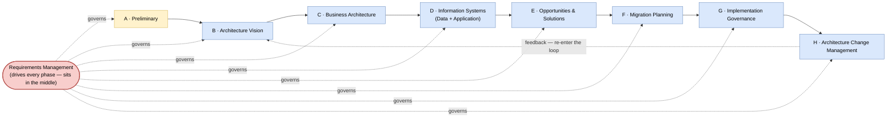

# 🧠 Topic: Architecture Development Method (ADM)

> [!abstract] Executive Summary (ELI5)
> The **ADM** is TOGAF's centerpiece — a **reliable, repeatable, cyclic process** for doing enterprise architecture. It walks you through eight phases (A–H), from *understanding the business problem* → *describing the architecture* → *planning the change* → *governing the build* → *managing the evolution*, and back again. It is the **only full method** shipped by any framework in this folder — where [[C4 Model|C4]], [[Viewpoints and Perspectives|R&W]], and [[4+1 View Model|4+1]] tell you *what* a description contains, the ADM tells you *how to get there and keep it alive*.

> [!warning] The #1 confusion — the ADM is cyclic, not waterfall
> People see phases A→B→C→D→E→F→G→H and assume it is a linear, one-shot waterfall. It is not. Phase H (Architecture Change Management) **feeds back into** Phase B (Architecture Vision), so the ADM is a **loop** you re-enter as the business, the system, and the environment change. Each pass deepens or revises the architecture. The cycle also supports **iteration within a pass** (you can loop C→D→E before leaving Requirements Management).

> [!note] Part of the TOGAF deep-dive
> This note lives under the [[TOGAF]] subfolder and details the ADM. The high-level four-axis treatment (Process axis) is in [[Architecture Process]]; this note goes deeper into the phases and their mechanics.

---

## 🎯 The "Why"

- **Problem Solved:** Without a method, enterprise architecture is a one-off exercise that produces a slide deck nobody uses, which rots within a year. The ADM makes architecture a **repeatable engineering practice**: a defined sequence of activities with entry/exit criteria, artifacts, and governance gates, so that *every* initiative follows the same disciplined path and produces comparable, reusable results.
- **Alternatives:** Ad-hoc "draw some diagrams and hope." Or a heavyweight waterfall (RUP-like) that never revisits. The ADM splits the difference: prescriptive enough to be repeatable, cyclic enough to stay alive.
- **Trade-offs:** The ADM is **comprehensive**, which means the *full* cycle is bureaucratic for small initiatives. The mature practice is to **right-size it**: trim phases or run a lightweight loop (*understand → sketch target → build → revisit*) for small projects, while reserving the full cycle for enterprise-scale initiatives.

## 💡 Mental Model & Analogy

- **Analogy:** The ADM is like the **product development lifecycle of a city planning office**. A new initiative ("build a transit line") enters the cycle: frame the need (Vision), study the current city (Baseline), design the future layout (Target), plan the construction phases (Migration), oversee the builders (Governance), then monitor how the city actually changes and feed lessons back (Change Management → re-enter). Same loop for every initiative; the city evolves through repeated cycles.

Requirements Management is at the center: it doesn't have its own phase letter because it *pervades* every phase — requirements flow in, get refined, and drive each activity.

## 🛠️ The Eight Phases

The phases are grouped by purpose. Note how C and D walk through the [[Architecture Domains|BDAT domains]] in order (Business first, then Data/Application).

### Setup & framing

| Phase | Name | Purpose | Key outputs |
|---|---|---|---|
| **A** | Preliminary | Set up the practice: define architecture principles, scope, governance, stakeholder map. | Architecture principles, governance framework, scope statement |
| **B** | Architecture Vision | Frame the problem: who are the stakeholders, what are the business drivers, what is the target vision and scope? | Statement of Architecture Work, Architecture Vision, refined stakeholder map |

> Phase A is run **once** (when establishing the practice); Phases B–H are re-entered for each architecture cycle / initiative.

### Describing the architecture (walking the BDAT domains)

| Phase | Domain | What you describe | Key outputs |
|---|---|---|---|
| **C** | [[Business Architecture\|Business]] | Business capabilities, value streams, processes, organization, business objects | Baseline + Target Business Architecture |
| **D** | [[Data Architecture\|Data]] + [[Application Architecture\|Application]] | Data entities & flows; application components, services, interfaces | Baseline + Target Data & Application Architectures |

> Phases C and D deliberately describe [[Business Architecture\|Business]] *before* [[Data Architecture\|Data]]/[[Application Architecture\|Application]] — because the upper domains must be realized by the lower ones, and you cannot trace an application to a capability you never modeled. See [[TOGAF Architecture Domains]].

### Deciding & planning the change

| Phase | Name | Purpose | Key outputs |
|---|---|---|---|
| **E** | Opportunities & Solutions | Generate candidate architectures; perform gap analysis (Baseline → Target); pick the approach. | Candidate solutions, gap analysis, recommended approach |
| **F** | Migration Planning | Break the gap into a series of deliverable projects with Transition Architectures. | Implementation roadmap, Transition Architectures, work packages |

> Phase E is where **gap analysis** happens — comparing the [[Baseline Architecture\|Baseline (as-is)]] to the [[Target Architecture\|Target (to-be)]]; the gap drives the work. Phase F breaks that gap into [[Transition Architecture\|Transition Architectures]] — intermediate states between Baseline and Target. See [[Architecture Time Horizons]].

### Governing & evolving

| Phase | Name | Purpose | Key outputs |
|---|---|---|---|
| **G** | Implementation Governance | Oversee the actual build; check that what is built conforms to the Target Architecture. | Compliance reviews, architecture contracts, waivers |
| **H** | Architecture Change Management | Monitor the live system; detect drift; decide whether to re-enter the loop. | Change requests → back to Phase B |

> Phase G is what makes the ADM *governed* (not just designed). Without it, the built system silently drifts from the architecture. Phase H closes the loop — it is the mechanism that keeps the ADM cyclic rather than one-shot.

### Requirements Management (the hub)

**Requirements Management** has no phase letter because it sits at the center and drives every phase: requirements flow in at the start, get refined and prioritized throughout, and flow out as drivers of each activity. It is the "nervous system" of the ADM.

## 🧭 Core ADM Concepts (cross-references)

The ADM produces several artifacts and uses concepts that have their own notes:

- **Architecture Building Blocks (ABBs) vs. Solution Building Blocks (SBBs)** — during Phases C/D you define *what is needed* (ABBs); during E/F you select *which products fulfill them* (SBBs). See [[Architecture Content Framework]].
- **Baseline / Target / Transition Architectures** — the three time horizons the ADM moves between. See [[Architecture Time Horizons]].
- **Architecture Partitioning** — for large enterprises, the ADM runs at multiple levels (Enterprise / Segment / Capability) simultaneously. See [[Architecture Partitioning]].
- **Content Framework artifacts** — each phase produces [[Architecture Catalogs|catalogs]], [[Architecture Matrices|matrices]], and [[Architecture Diagrams|diagrams]]. See [[Architecture Content Framework]].
- **Gap analysis** — the core Phase E activity: what exists (Baseline) vs. what is wanted (Target) = the work to do.

## ⚠️ Pitfalls & Anti-patterns

- **Treating the ADM as waterfall:** running A→H once and stopping. The ADM is a loop; Phase H re-enters B. A one-shot run produces a frozen, stale architecture.
- **Skipping the Baseline (Phase C/D as-is):** jumping straight to a Target without modeling the current state. You cannot plan a meaningful gap if you don't know where you start. See [[Baseline Architecture]].
- **Artifact-driven, not concern-driven:** producing catalogs/matrices/diagrams because "Phase C requires them," not because a stakeholder concern demands them. The ADM serves concerns, not the reverse.
- **Full ADM for a small initiative:** bureaucratic overkill. Right-size: a trimmed loop (*understand → sketch target → build → revisit*) carries the essence.
- **No governance (skipping Phase G):** building the Target, shipping, and never checking conformance. The built system drifts from the architecture within one release.
- **Ignoring Requirements Management:** treating requirements as a one-time input rather than a living driver of every phase. Requirements change; the ADM must absorb the change.
- **Phase A every cycle:** Phase A (Preliminary) sets up the practice *once*. Re-running it per initiative conflates setup with framing — that is Phase B's job.

## 🔗 Deep Connections

- **Parent Topic:** [[TOGAF]] (the ADM is TOGAF's defining contribution), [[Architecture Process]] (the four-axis "Process" treatment)
- **What the ADM walks through:** [[TOGAF Architecture Domains]] (BDAT — Phases C/D), [[Architecture Time Horizons]] (Baseline/Target/Transition — Phases C–F), [[Architecture Partitioning]] (running the ADM at Enterprise/Segment/Capability levels)
- **What the ADM produces:** [[Architecture Content Framework]] (catalogs, matrices, diagrams), [[Architecture Capability Framework]] (the practice that runs the ADM)
- **Siblings in this subfolder:** [[Architecture Content Framework]], [[Architecture Capability Framework]]
- **Contrast:** [[C4 Model]], [[Viewpoints and Perspectives]], [[4+1 View Model]] (all process-light)
- **Prerequisites:** [[TOGAF]], [[Architecture Process]].

## ❓ Active Recall Questions

> [!faq]- What is the ADM, and what makes it unique among the frameworks in this folder?
> The ADM (Architecture Development Method) is TOGAF's cyclic, 8-phase process for enterprise architecture (A Preliminary → B Vision → C Business → D Data/App → E Opportunities → F Migration → G Governance → H Change Management). It is the **only full method** here — C4/R&W/4+1 are process-light (they describe *what* a description contains, not *how* to produce it in order).

> [!faq]- Why is the ADM cyclic rather than linear?
> Because the enterprise, its requirements, and its systems keep changing. Phase H (Architecture Change Management) feeds back into Phase B (Vision), so each pass revises the architecture. A linear A→H run produces a frozen model that rots; the loop keeps the architecture aligned with reality.

> [!faq]- What happens in Phases C and D, and why that order?
> Phase C describes the **Business Architecture**; Phase D describes the **Data** and **Application** domains. Business comes first because the lower domains must be traceable up to business capabilities — you cannot justify a data entity or application without the business capability it serves. See [[TOGAF Architecture Domains]].

> [!faq]- What is gap analysis, and in which phase does it happen?
> Gap analysis compares the **Baseline (as-is)** to the **Target (to-be)** to identify the work needed. It happens in **Phase E (Opportunities & Solutions)**, and its output drives Phase F's migration planning and Transition Architectures. See [[Architecture Time Horizons]].

> [!faq]- What is the role of Requirements Management, and why does it have no phase letter?
> Requirements Management sits at the *center* of the ADM and drives every phase — requirements flow in, get refined, and flow out as drivers of each activity. It has no letter because it is not a sequential step but a continuous hub that pervades the whole cycle.

> [!faq]- Why is skipping Phase G (Implementation Governance) a problem?
> Because without governance, the built system silently drifts from the Target Architecture within one release. Phase G checks conformance and catches drift early, which is what makes the ADM *governed* rather than just designed.

---

## 📝 Related Notes

- [[TOGAF]]
- [[Architecture Process]]
- [[Architecture Content Framework]]
- [[Architecture Capability Framework]]
- [[TOGAF Architecture Domains]]
- [[Architecture Time Horizons]]
- [[Architecture Partitioning]]
- [[Architecture Domains]]
