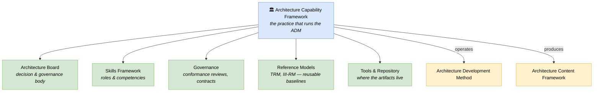

# 🧠 Topic: Architecture Capability Framework

> [!abstract] Executive Summary (ELI5)
> The **Architecture Capability Framework** is the part of TOGAF that answers *"how do we run architecture as an ongoing organizational practice — not just produce documents?"* It defines the **structures, roles, skills, and governance** needed to operate the [[Architecture Development Method|ADM]] repeatedly and reliably: the architecture board, the [[Architecture Reference Models|reference models]] to reuse, the [[TOGAF Skills Framework|skills]] the team needs, and the governance process that checks conformance. Where the ADM is the *method* and the [[Architecture Content Framework|Content Framework]] is the *deliverables*, the Capability Framework is the **organization that runs them**.

> [!warning] The #1 confusion — "Capability" here means organizational capability, not business capability
> The word collides with "Business Capability" from [[Business Architecture|the BDAT domains]]. In *this* framework's name, "Capability" means the **architecture practice's own capability** — its ability to do architecture well: the board, the skills, the processes, the tools. It is about *the architecting organization*, not the business being architected.

> [!note] Part of the TOGAF deep-dive
> This note lives under the [[TOGAF]] subfolder. It covers the "practice" dimension; the [[Architecture Reference Models|Reference Models]] it bundles (TRM, III-RM) have their own notes.

---

## 🎯 The "Why"

- **Problem Solved:** You can adopt the ADM and the Content Framework and still *fail* if there is no organization to run them — no board to make decisions, no defined roles, no skills, no governance. Architecture becomes a one-person side project that dies when that person leaves. The Capability Framework defines the **standing organization** that makes architecture a durable practice.
- **Alternatives:** Ad-hoc architecture by whoever is interested. No continuity, no governance, no skill development. The Capability Framework institutionalizes the practice.
- **Trade-offs:** Standing up an architecture board and skill framework is an organizational investment. The payoff is **continuity and governance**: decisions outlast individuals, and the built system is checked against the architecture.

## 💡 Mental Model & Analogy

- **Analogy:** If the ADM is the *recipe* and the Content Framework is the *kitchen equipment*, the Capability Framework is the **restaurant's staffing and management structure** — the head chef, the line cooks, the health-inspector checks, the training program. A recipe and equipment produce nothing without trained staff running them in a governed way.

## 🛠️ Core Components

1. **Architecture Board** — the standing body that owns architecture decisions: reviews Target Architectures, approves/waivers deviations (Phase G), arbitrates conflicts. Without it, decisions are unowned.
2. **Architecture Governance** — the process that checks the *built* system conforms to the *decided* architecture (Phase G of the ADM). Uses architecture contracts, compliance reviews, and waivers. See [[Architecture Development Method]].
3. **Architecture Contracts** — formal agreements between the architecture function and the implementers (or between parties) specifying what will be delivered and the conformance criteria. The governance mechanism's teeth.
4. **TOGAF Skills Framework** — a competency model defining the roles (Architecture Board member, Enterprise Architect, Solution Architect, etc.) and the skills each requires (business analysis, modeling, TOGAF knowledge, leadership…).
5. **Reference Models** — reusable, pre-defined baselines that accelerate ADM work: the [[Technical Reference Model|TRM]] (technology platform taxonomy) and the [[III-RM|III-RM]] (integrated information infrastructure). See [[Architecture Reference Models]].
6. **Architecture Repository & Tools** — the operational home for all artifacts (catalogs, matrices, diagrams, building blocks, reference models, governance logs). The single source of truth.

## ↔️ The Capability Framework vs. the other TOGAF parts

| TOGAF part | Answers | This framework's role |
|---|---|---|
| [[Architecture Development Method\|ADM]] | *How* to build the architecture (process) | The Capability Framework **runs** the ADM |
| [[Architecture Content Framework\|Content Framework]] | *What* to write down (deliverables) | The Capability Framework **governs** those deliverables |
| **Capability Framework** | ***Who* runs it and *how* it's sustained** | The practice itself — board, skills, governance, reference models |

> All three are needed: a method (ADM) without a governing organization (Capability) produces ungoverned artifacts; artifacts (Content) without governance drift. See [[TOGAF]].

## ⚠️ Pitfalls & Anti-patterns

- **Adopting the ADM without the Capability Framework:** no board, no governance. The architecture is produced but never enforced; the built system drifts.
- **Toothless Architecture Board:** a board that only advises and never decides or blocks. Governance without authority is ceremony.
- **No skills development:** assigning "architect" titles without matching competencies. The Skills Framework exists to make expectations explicit.
- **Skipping governance (Phase G):** the most common failure. Architecture is decided but never checked against what was built.
- **Confusing "Capability" with "Business Capability":** in *this* name, it means the architecture practice's own capability (the organization), not a BDAT business capability.
- **Ignoring the Reference Models:** re-inventing technology taxonomies that the TRM/III-RM already provide. Reuse first.

## 🔗 Deep Connections

- **Parent Topic:** [[TOGAF]]
- **Reference Models it bundles:** [[Architecture Reference Models]] (parent), [[Technical Reference Model|TRM]], [[III-RM]]
- **What it runs/governs:** [[Architecture Development Method]] (the ADM), [[Architecture Content Framework]]
- **Related:** [[Architecture Metamodel]] (the Repository stores metamodel instances), [[Architecture Partitioning]] (the board governs across partitions)
- **Prerequisites:** [[TOGAF]].

## ❓ Active Recall Questions

> [!faq]- What is the Architecture Capability Framework, and what does "Capability" mean here?
> It defines the **organizational structures, roles, skills, and governance** needed to run the [[Architecture Development Method|ADM]] as a durable practice: the Architecture Board, governance process, skills framework, reference models, and repository. Here "Capability" means the **architecture practice's own capability** — not a Business Capability from the BDAT domains.

> [!faq]- Why is adopting the ADM without the Capability Framework a failure mode?
> Because the ADM is a *method*; without a governing organization (board, governance, skills) to run it, the architecture is produced but never enforced — the built system drifts from the Target within a release. The Capability Framework provides the standing body that makes decisions and checks conformance (Phase G).

> [!faq]- What reference models does the Capability Framework bundle?
> The [[Architecture Reference Models|Reference Models]]: the **[[Technical Reference Model|TRM]]** (a generic technology platform taxonomy) and the **[[III-RM|III-RM]]** (an integrated information infrastructure reference model for the Application/Data space). These are pre-defined, reusable baselines that accelerate ADM work.

---

## 📝 Related Notes

- [[TOGAF]]
- [[Architecture Development Method]]
- [[Architecture Content Framework]]
- [[Architecture Reference Models]]
- [[Technical Reference Model]]
- [[III-RM]]
- [[Architecture Metamodel]]
