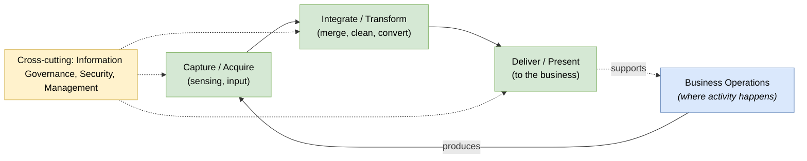

# 🧠 Topic: III-RM — Integrated Information Infrastructure Reference Model

> [!abstract] Executive Summary (ELI5)
> The **III-RM** (Integrated Information Infrastructure Reference Model) is TOGAF's second reference model — a **generic, vendor-neutral taxonomy of the *information infrastructure* that supports the business**. Where the [[Technical Reference Model|TRM]] classifies the *platform* (the bottom), the III-RM classifies the *application/data services* that turn business activity into managed, flowing information (the middle). It is built around a vision of **"boundaryless information flow"** — information moving freely across organizational and system boundaries to support the business.

> [!warning] The #1 confusion — III-RM is not the TRM with apps added
> The III-RM is a *different model with a different purpose*, not "the TRM plus applications." The TRM asks "what platform services exist?" (bottom-up, infrastructure). The III-RM asks "how does information flow to support the business?" (top-down, business-supporting). Its taxonomy is organized around information flow, not platform capability.

> [!note] Part of the TOGAF deep-dive
> One of two reference models bundled in the [[Architecture Capability Framework]]. Sibling: [[Technical Reference Model]] (covers the platform layer below).

---

## 🎯 The "Why"

- **Problem Solved:** In large enterprises, information is trapped in silos — each system owns its data and the boundaries block flow. The III-RM provides a **reference structure for breaking down those boundaries**: a taxonomy of the application/data services that integrate information across the enterprise, oriented around supporting the business. It gives teams a shared model for the "information infrastructure" layer.
- **Alternatives:** Treating each application and its data as an island. Result: duplicated data, inconsistent definitions, integration spaghetti. The III-RM orients design around *information flow*, not individual apps.
- **Trade-offs:** The III-RM is more abstract/conceptual than the TRM (it's about flow and service categories, not concrete platform components). It is a thinking model for integration, not a product map.

## 💡 Mental Model & Analogy

- **Analogy:** If the [[Technical Reference Model|TRM]] is the city's **utility grid** (power, water, roads — the infrastructure), the III-RM is the city's **logistics and information network** — how goods and records move between businesses, warehouses, and citizens to keep the city functioning. The TRM provides the pipes; the III-RM describes what flows through them and why.

The III-RM is organized around a vision of **boundaryless information flow**, structured into domains. At its heart: business activity produces information, which is captured, integrated, transformed, and delivered back to support the business.

The model traces information from business activity → capture → integration/transformation → delivery → back to support the business, with governance/security as cross-cutting concerns.

## 🛠️ Core Structure & Service Categories

The III-RM organizes the information infrastructure into broad service groupings, all oriented around supporting business operations:

| Grouping | Role | Example services |
|---|---|---|
| **Business Operations** | Where the business activity happens (the driver of information flow) | Line-of-business applications, operational systems |
| **Capture / Acquire** | Getting information *in* | Data entry, sensing, ingestion, B2B exchange |
| **Integrate / Transform** | Merging, cleaning, converting information across sources | ETL, data integration, master-data management, mediation |
| **Deliver / Present** | Getting information *to* the business | Reporting, dashboards, portals, query, analytics delivery |
| **Information Governance / Security / Management** (cross-cutting) | Managing quality, access, and lifecycle across the flow | Metadata, access control, audit, data quality, retention |

> The emphasis is on **flow and integration** — the III-RM exists to model how information crosses boundaries (the "boundaryless information flow" vision), not to enumerate platform components like the TRM does.

## ↔️ TRM vs. III-RM — the two reference models

| | [[Technical Reference Model\|TRM]] | III-RM |
|---|---|---|
| Layer | Technology / platform (bottom) | Application / Data information infrastructure (middle) |
| Driving question | "What platform services exist?" (bottom-up) | "How does information flow to support the business?" (top-down) |
| Orientation | Platform capability | Business-supporting information flow |
| Concreteness | More concrete (platform components) | More conceptual (flow & integration services) |
| Vendor-neutral? | Yes | Yes |

> The III-RM sits *above* the TRM: the platform (TRM) hosts the information services (III-RM) that support the business. Neither covers [[Business Architecture]] — business is organization-specific. See [[Architecture Reference Models]].

## ⚠️ Pitfalls & Anti-patterns

- **Confusing the III-RM with the TRM:** different purpose. TRM = platform taxonomy (bottom-up); III-RM = information-flow taxonomy (top-down, business-supporting).
- **Treating it as a product map:** it is a conceptual flow model, not a vendor catalogue. You map your integration products onto it.
- **Expecting concrete platform components:** the III-RM is more abstract — it's about categories of information service and how they flow.
- **Applying it to a single system:** the III-RM's value is at *enterprise* scope, where boundaryless information flow is the problem. A single app doesn't need it.
- **Forgetting the governance layer:** the cross-cutting governance/security/management grouping is what makes the flow trustworthy; omitting it produces integrated but ungovernable information.

## 🔗 Deep Connections

- **Parent Topic:** [[Architecture Reference Models]], [[Architecture Capability Framework]]
- **Sibling reference model:** [[Technical Reference Model]]
- **What it classifies:** [[Application Architecture]] + [[Data Architecture]] (the BDAT App/Data space)
- **Where it lives:** the [[TOGAF|Enterprise Continuum]] (generic/Foundation end)
- **Prerequisites:** [[TOGAF]].

## ❓ Active Recall Questions

> [!faq]- What is the III-RM, and how does it differ from the TRM?
> The **Integrated Information Infrastructure Reference Model** is a generic, vendor-neutral taxonomy of the **information infrastructure that supports the business**, organized around **boundaryless information flow**. The [[Technical Reference Model|TRM]] classifies the *platform* (bottom-up, infrastructure); the III-RM classifies the *application/data information services* (top-down, business-supporting). The III-RM sits above the TRM.

> [!faq]- What is the "boundaryless information flow" vision?
> The idea that information should move freely across organizational and system boundaries to support the business, rather than being trapped in silos. The III-RM is the reference model that structures the application/data services needed to achieve it — capture, integrate/transform, deliver — with governance as a cross-cutting concern.

> [!faq]- What are the main service groupings of the III-RM?
> **Business Operations** (where activity happens), **Capture/Acquire** (getting information in), **Integrate/Transform** (merging/cleaning/converting across sources), **Deliver/Present** (getting information to the business), and cross-cutting **Information Governance/Security/Management**. The orientation is *flow*, not platform components.

---

## 📝 Related Notes

- [[TOGAF]]
- [[Architecture Capability Framework]]
- [[Architecture Reference Models]]
- [[Technical Reference Model]]
- [[Application Architecture]]
- [[Data Architecture]]
