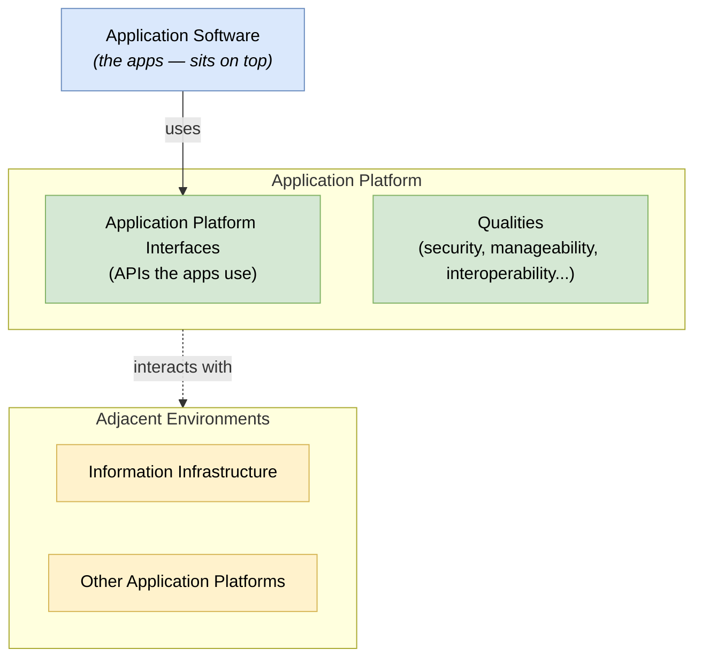

# 🧠 Topic: Technical Reference Model (TRM)

> [!abstract] Executive Summary (ELI5)
> The **TRM** (Technical Reference Model) is TOGAF's **generic, vendor-neutral taxonomy of the technology platform** — the infrastructure layer everything runs on. It categorizes the parts of a computing platform (operating systems, networks, databases, security, management, development, user-interface services) into a standard structure so that any enterprise can describe its technology stack in a common vocabulary. It is the **technology layer's reusable baseline** at the generic end of the Enterprise Continuum.

> [!warning] The #1 confusion — the TRM is a taxonomy, not a product list
> The TRM has a "Database" category; it does not say "use PostgreSQL." It is a **classification of capability types**, vendor-neutral, so you map your specific products onto it. It tells you *what kinds of thing* exist in a platform, not *which products* to buy.

> [!note] Part of the TOGAF deep-dive
> One of two reference models bundled in the [[Architecture Capability Framework]]. Sibling: [[III-RM]] (covers the application/data information infrastructure above the platform).

---

## 🎯 The "Why"

- **Problem Solved:** Without a common technology taxonomy, "what's in our platform?" gets a different answer from every team, and technology choices can't be compared or rationalized. The TRM provides a **shared structure** for the platform so technology decisions are categorized consistently.
- **Alternatives:** Each enterprise building its own platform taxonomy from scratch. High effort, non-comparable, and reinvents what TOGAF already provides.
- **Trade-offs:** The TRM is generic (covers common capability types, not your niche tech). You adopt it and specialize. The payoff is comparability and a fast start.

## 💡 Mental Model & Analogy

- **Analogy:** The TRM is like the **Dewey Decimal System for a library's technology shelves** — it defines the *categories* (operating systems here, networking there, security in that section) so any book (product) has a clear home. It doesn't tell you which books to buy; it tells you where each one belongs.

The TRM is built around two main parts and a central "Application Software" element:

- **Application Software** — the apps, sitting on top.
- **Application Platform** — the services the apps rely on (the bulk of the taxonomy: OS, network, data management, security, UI, development, transaction processing, etc.), exposed via **Application Platform Interfaces (APIs)**.
- **Qualities** — cross-cutting attributes (security, manageability, interoperability) that apply across the platform.
- **Adjacent Environments** — other systems the platform connects to.

## 🛠️ Core Categories of the Application Platform

The meat of the TRM is the **Application Platform service categories** — the kinds of platform service any enterprise will recognize:

| Category | Examples of service type |
|---|---|
| **Data Management** | Database, data interchange, file services |
| **Data Interchange** | EDI, data format conversion |
| **Graphics & Imaging** | Rendering, image processing |
| **Network** | Communications, naming/directory, time service |
| **Operating System** | Process, memory, file, shell |
| **Security** | Authentication, authorization, audit, cryptography |
| **Software Engineering** | Development tools, build, test, runtime libraries |
| **Transaction Processing** | Transaction manager, resource manager |
| **User Interface** | UI services, window management, presentation |
| **Internationalization / Localization** | i18n/l10n services |
| **System & Network Management** | Monitoring, configuration, fault management |

> These are *categories*, not products. You map "PostgreSQL" into Data Management; "Kubernetes" partly into Operating System / System Management; "OAuth provider" into Security.

## ↔️ TRM vs. III-RM — the two reference models

| | TRM | [[III-RM]] |
|---|---|---|
| Layer | Technology / platform (bottom) | Application / Data information infrastructure (middle) |
| Focus | What the platform provides | How information flows to support the business |
| Vendor-neutral taxonomy? | Yes | Yes |
| Has a generic model? | Yes (this note) | Yes |

> The TRM is the *foundation* (the platform); the III-RM sits *above* it (the information services that run on the platform). See [[Architecture Reference Models]].

## ⚠️ Pitfalls & Anti-patterns

- **Treating the TRM as a product list:** it is a capability taxonomy, vendor-neutral. Don't expect "use PostgreSQL"; expect a "Data Management" category.
- **Adopting it verbatim:** specialize it to your org (add your specific products/standards) along the Enterprise Continuum.
- **Expecting it to cover applications or business:** it covers the *platform* only. Apps and business have their own treatment (III-RM; Business Architecture).
- **Ignoring it and reinventing platform categories:** loses comparability and the fast start.

## 🔗 Deep Connections

- **Parent Topic:** [[Architecture Reference Models]], [[Architecture Capability Framework]]
- **Sibling reference model:** [[III-RM]]
- **What it classifies:** [[Technology Architecture]] (the BDAT Technology domain)
- **Where it lives:** the [[TOGAF|Enterprise Continuum]] (generic/Foundation end)
- **Prerequisites:** [[TOGAF]].

## ❓ Active Recall Questions

> [!faq]- What is the TRM, and is it a product list?
> The **Technical Reference Model** is a generic, vendor-neutral **taxonomy of the technology platform** — it categorizes platform capability *types* (Data Management, Security, Network, OS, etc.). It is **not** a product list: it has a "Database" category, not "use PostgreSQL." You map your products onto it.

> [!faq]- What are the main structural parts of the TRM?
> **Application Software** (the apps, on top), the **Application Platform** (the service categories the apps rely on — OS, network, data management, security, etc. — exposed via Application Platform Interfaces), **Qualities** (cross-cutting attributes like security/manageability), and **Adjacent Environments** (other connected systems).

> [!faq]- How does the TRM differ from the III-RM?
> The **TRM** covers the **Technology/platform layer** (bottom) — what the platform provides. The **[[III-RM]]** covers the **Application/Data information infrastructure** (middle) — how information flows to support the business. The III-RM sits above the TRM. See [[Architecture Reference Models]].

---

## 📝 Related Notes

- [[TOGAF]]
- [[Architecture Capability Framework]]
- [[Architecture Reference Models]]
- [[III-RM]]
- [[Technology Architecture]]
