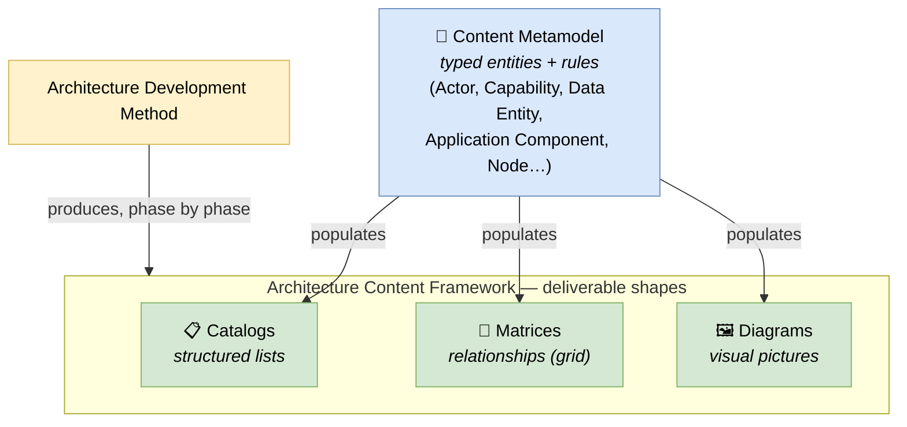

# 🧠 Topic: Architecture Content Framework

> [!abstract] Executive Summary (ELI5)
> The **Architecture Content Framework** is the part of TOGAF that answers *"what should an architecture description actually contain?"* It provides a **structured model of the artifacts** the [[Architecture Development Method|ADM]] produces, organized into three kinds: **catalogs** (lists), **matrices** (relationships), and **diagrams** (pictures). Sitting underneath all three is the **Content Metamodel** — the typed entity model (Actor, Capability, Data Entity, Application Component, Node…) that gives those artifacts a consistent vocabulary. Where the ADM says *how* to build the architecture, the Content Framework says *what to write down* while doing it.

> [!warning] The #1 confusion — Content Framework vs. Content Metamodel
> They are different layers. The **Content Metamodel** is the *grammar* — the typed entities and the rules for how they relate (it is the reference example in [[Architecture Metamodel]]). The **Content Framework** is the *organization* of artifacts built *from* that metamodel — the catalogs, matrices, and diagrams the ADM produces. Metamodel = the vocabulary/types; Content Framework = the deliverable shapes that use those types.

> [!note] Part of the TOGAF deep-dive
> This note lives under the [[TOGAF]] subfolder. The four-axis "Metamodel" treatment is in [[Architecture Metamodel]]; here we focus on the artifact structure (catalogs/matrices/diagrams) TOGAF layers on top.

---

## 🎯 The "Why"

- **Problem Solved:** Without a content framework, every TOGAF initiative produces a different pile of documents — some teams write prose, some draw diagrams, none are comparable. The Content Framework fixes this by defining a **canonical set of artifact types** (catalogs, matrices, diagrams) and the **metamodel entities** that populate them, so any architect can read any initiative's outputs.
- **Alternatives:** Free-form documentation. Flexible, but non-comparable and hard to govern — you cannot mechanically check whether two initiatives describe the same building block consistently.
- **Trade-offs:** The Content Framework adds structure (and tooling expectations). The payoff is **consistency and governance**: the same metamodel entity (e.g., an Application Component) appears in a catalog, a matrix, and a diagram under one identity, so changes propagate and contradictions are detectable.

## 💡 Mental Model & Analogy

- **Analogy:** Think of a financial reporting system. The **metamodel** is the chart of accounts (the defined types: asset, liability, revenue) and the rules (debits = credits). The **Content Framework** is the set of **standard reports** the system produces: a **ledger** (a catalog — a list of accounts), a **cross-reference table** (a matrix — which departments touch which accounts), and a **chart** (a diagram — a visual of the numbers). Same underlying data (metamodel), three deliverable shapes (Content Framework).

The ADM produces artifacts; the Content Framework defines the *shapes* of those artifacts; the metamodel defines the *entities* that fill them.

## 🛠️ The Three Artifact Types

The Content Framework organizes everything the ADM produces into three complementary shapes. Each has a different strength, and a complete description uses all three.

| Type | What it is | Strength | Example | Deep dive |
|---|---|---|---|---|
| **Catalog** | A structured **list** of entities of one type, with attributes | Completeness, enumeration | Application Portfolio catalog, Data Entity catalog | [[Architecture Catalogs]] |
| **Matrix** | A **grid** showing relationships between two entity types | Cross-referencing, traceability, gap detection | Application × Function matrix, Capability × Service matrix | [[Architecture Matrices]] |
| **Diagram** | A **visual** representation of entities and relationships | Communication, big-picture understanding | Business Footprint diagram, Application Communication diagram | [[Architecture Diagrams]] |

> The three are complementary: a **catalog** ensures you have all the entities; a **matrix** shows how they relate across types; a **diagram** communicates the picture to stakeholders. You need all three for a complete, governable description.

## 🧩 The Content Metamodel (the grammar underneath)

The metamodel is the typed entity model that populates the catalogs/matrices/diagrams. It is the reference example used in [[Architecture Metamodel]]. Core entity types, organized by BDAT domain:

| Domain | Metamodel entities |
|---|---|
| **Business** | Actor, Role, Organization Unit, Business Capability, Function, Process, Business Service, Business Object |
| **Data** | Data Entity, Data Element, Logical/Application Component (data-flavored), Information Flow |
| **Application** | Application Component, Application Service, Interface, Function (application) |
| **Technology** | Node, Technology Component, Platform Service, Network, Artifact |

Plus **relationships**: *realizes*, *depends on*, *used by*, *assigned to*, *triggers*, *flows to*. These are what matrices visualize and rules constrain.

> TOGAF organizes the metamodel into **extensions** so you adopt only what you need: **Core** (the minimum), **Governance** (contracts, principles), **Services** (services & interfaces), **Process Modeling**, **Organization**, etc. See [[Architecture Metamodel]].

## 🏗️ How the Content Framework maps to ADM phases

Each ADM phase produces specific artifacts. The Content Framework tells you *which shapes* to produce; the phase tells you *when*.

| ADM Phase | Typical catalogs | Typical matrices | Typical diagrams |
|---|---|---|---|
| **B (Vision)** | Stakeholder catalog, Driver/Goal/Objective catalog | (light) | Business Scenarios, Value Chain |
| **C (Business)** | Organization/Actor catalog, Value Stream catalog, Business Service/Function catalog, Contract/Measure catalog | Business Footprint matrix (Goal ↔ Capability) | Business Footprint diagram, Functional Decomposition |
| **D (Data/App)** | Data Entity/Business Info catalog, Application Portfolio catalog, Interface catalog | Data Entity ↔ Application Component matrix, Application Communication matrix | Data Dissemination diagram, Application Communication diagram, Data Migration diagram |
| **E (Opportunities)** | Project catalog, Work Package catalog, Consolidated Reusable Building Blocks | Implementation Factor ↔ Project matrix, Gap Analysis matrix | Solution Evolution diagram, Project Context diagram |
| **F (Migration)** | Work Package catalog, Implementation & Migration Plan | (rolled up) | Migration Impact diagram, Implementation Migration diagram |

> The pattern: catalogs dominate early (enumerate the entities), matrices grow in C/D (cross-reference), diagrams appear throughout (communicate). See [[Architecture Development Method]].

## ↔️ ABBs vs. SBBs — where they live in the Content Framework

The ABB/SBB distinction (see [[TOGAF]] → unique concepts) is expressed *through* the Content Framework:

- **Architecture Building Blocks (ABBs)** — populate the catalogs/matrices/diagrams during Phases B–D. An ABB is a *specification* ("a payment component is needed") typed by a metamodel entity (e.g., Application Component).
- **Solution Building Blocks (SBBs)** — appear in Phases E–F as the *realizations* ("Stripe API v2 fulfills the payment ABB"). They populate the Solution Building Block catalogue.

The Content Framework thus tracks the journey from *what is needed* (ABB, in the architecture) to *which product fulfills it* (SBB, in the solution).

## ⚠️ Pitfalls & Anti-patterns

- **Confusing Content Framework with Content Metamodel:** the metamodel is the grammar (entities + rules); the Content Framework is the deliverable shapes (catalogs/matrices/diagrams). Don't conflate them.
- **Producing only diagrams:** diagrams communicate well but don't guarantee completeness. Without catalogs you may miss entities; without matrices you lose traceability.
- **Producing all artifacts by checklist:** the Content Framework is a menu, not a mandate. Produce the artifacts that your stakeholders' concerns demand — see [[System Modeling]].
- **Ignoring the metamodel and free-typing entities:** if every team invents its own entity types, catalogs/matrices become non-comparable and governance breaks. Stick to the metamodel types (or agreed extensions).
- **Not mapping artifacts to phases:** producing a Gap Analysis matrix in Phase C (too early) or a Stakeholder catalog in Phase F (too late). Each artifact has a natural phase — see the table above.
- **Treating the metamodel as fixed:** TOGAF explicitly supports extensions (Governance, Services, Process Modeling…). Adopt the extensions your context needs; don't try to use all of them.

## 🔗 Deep Connections

- **Parent Topic:** [[TOGAF]], [[Architecture Metamodel]] (the metamodel is the four-axis reference example)
- **The three artifact types:** [[Architecture Catalogs]], [[Architecture Matrices]], [[Architecture Diagrams]]
- **How artifacts are produced:** [[Architecture Development Method]] (phase-by-phase artifact production)
- **What the artifacts describe:** [[TOGAF Architecture Domains]] (BDAT), [[Architecture Time Horizons]] (Baseline/Target/Transition), [[Architecture Partitioning]] (Enterprise/Segment/Capability)
- **Sibling in this subfolder:** [[Architecture Development Method]], [[Architecture Capability Framework]]
- **Prerequisites:** [[TOGAF]], [[Architecture Metamodel]].

## ❓ Active Recall Questions

> [!faq]- What is the Architecture Content Framework, and how does it differ from the Content Metamodel?
> The **Content Framework** defines the *deliverable shapes* an architecture description contains — catalogs, matrices, diagrams. The **Content Metamodel** is the *grammar* underneath — the typed entities (Actor, Capability, Application Component, Node…) and the rules for how they relate. Metamodel = vocabulary/types; Content Framework = the report shapes built from those types.

> [!faq]- What are the three artifact types, and what is each good for?
> **Catalogs** (structured lists — good for completeness/enumeration), **matrices** (relationship grids — good for cross-referencing/traceability/gap detection), and **diagrams** (visual pictures — good for communication). A complete description uses all three: catalogs ensure you have all entities, matrices show how they relate, diagrams communicate the picture.

> [!faq]- How do the artifacts map to ADM phases?
> Catalogs dominate early (Phase B/C — enumerate entities), matrices grow in C/D (cross-reference entities across domains), and diagrams appear throughout (communicate). Phase E produces gap/project matrices; Phase F produces migration diagrams. See [[Architecture Development Method]].

> [!faq]- Where do ABBs and SBBs live in the Content Framework?
> **Architecture Building Blocks (ABBs)** populate the catalogs/matrices/diagrams during Phases B–D — they are *specifications* of what is needed ("a payment component"), typed by metamodel entities. **Solution Building Blocks (SBBs)** appear in Phases E–F as *realizations* ("Stripe API v2 fulfills the payment ABB"). The Content Framework tracks the journey from ABB to SBB.

---

## 📝 Related Notes

- [[TOGAF]]
- [[Architecture Metamodel]]
- [[Architecture Catalogs]]
- [[Architecture Matrices]]
- [[Architecture Diagrams]]
- [[Architecture Development Method]]
- [[Architecture Capability Framework]]
- [[TOGAF Architecture Domains]]
