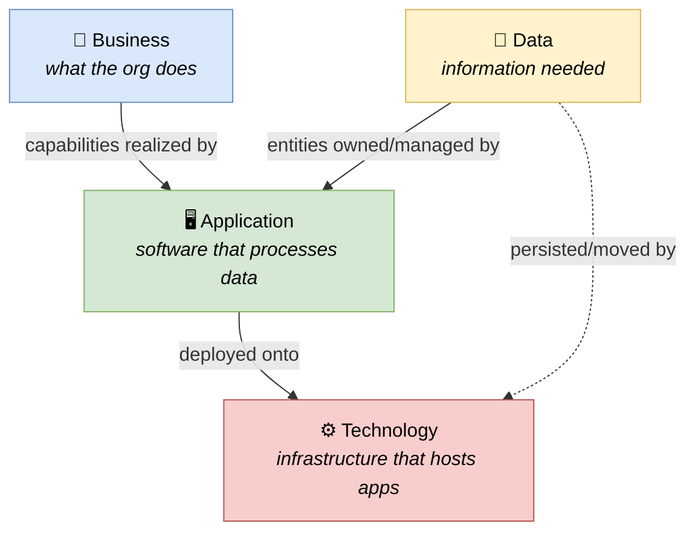

# 🧠 Topic: TOGAF Architecture Domains (BDAT)

> [!abstract] Executive Summary (ELI5)
> TOGAF splits enterprise architecture into **four architecture domains**, known as **BDAT**: **Business** (what the org does), **Data** (what information it needs), **Application** (the software that processes that data), and **Technology** (the infrastructure it runs on). These are the **"what is being architected" axis** — TOGAF's way of partitioning the content so each layer can be described, owned, and changed by the right people, with traceability up and down the stack. Each is a first-class domain with its own artifacts, experts, and ADM phase.

> [!note] This is the TOGAF deep-dive into domains
> The four-axis treatment (Domains axis) lives in [[Architecture Domains]] — it covers the general concept, the BDAT-vs-Viewpoint distinction, and the domain→viewpoint mapping. This note and its children go deeper into each domain *as TOGAF treats it*: the artifacts, the ADM phases, and the metamodel entities.

> [!warning] Naming note
> This note is named "TOGAF Architecture Domains" because a note simply called "Architecture Domains" already exists in the parent folder ([[Architecture Domains]]). Obsidian wikilinks are path-independent, so the names must differ.

---

## 🎯 The "Why"

- **Problem Solved:** Describing "the whole enterprise" at once produces an unreadable tangle. BDAT separates concerns **by subject area** so each layer can be reasoned about independently, yet stay traceable to the others. The value is the **traceability chain**: every Technology artifact traces up through Applications and Data to a Business capability it serves — and every Business capability traces down to the tech that realizes it.
- **Alternatives:** A single flat "architecture" with no layering — traceability becomes impossible ("which capability does this server support?").
- **Trade-offs:** Four domains mean four sets of artifacts to keep consistent. The payoff is completeness (no domain forgotten) and traceability (the chain that justifies every artifact's existence).

## 💡 Mental Model & Analogy

- **Analogy (from the general note):** A city's master plan. **Business** = the economy (industries, citizen needs). **Data** = the land registry/census (the information the city runs on). **Application** = the buildings/services that use that information (the tax office, the hospital booking system). **Technology** = the roads, power grid, water supply that the buildings sit on. Each layer supports the one above; a good plan traces every road up to the hospital it serves.

## 🛠️ The Four Domains (deep dives)

Each domain has its own note covering its artifacts, metamodel entities, ADM phase, and reference model:

| Domain | Concern | ADM phase | Reference model | Deep dive |
|---|---|---|---|---|
| **Business** | Capabilities, value streams, processes, org, business objects | Phase C | (none — org-specific) | [[Business Architecture]] |
| **Data** | Data entities, models, flows, ownership, lineage | Phase D | (part of III-RM) | [[Data Architecture]] |
| **Application** | Applications, services, components, interfaces, dependencies | Phase D | [[III-RM]] | [[Application Architecture]] |
| **Technology** | Platforms, networks, runtimes, environments | Phase D | [[Technical Reference Model\|TRM]] | [[Technology Architecture]] |

> Note that **Business is described first** (Phase C), before Data/Application/Technology (Phase D). This ordering is deliberate: the upper layers are realized by the lower, so you must know the business capabilities before you can justify the data, apps, or tech. See [[Architecture Development Method]].

## ↔️ BDAT vs. Viewpoint — the orthogonal axes

The crucial distinction (detailed in [[Architecture Domains]]): a **domain** is a *subject area* (what you describe); a **[[Viewpoint|viewpoint]]** is a *lens* (how you look at it). They compose: you can draw a Deployment view (viewpoint) of the Technology domain, or a Functional view (viewpoint) of the Business domain.

## ↔️ BDAT vs. the four common Architectural Views

Mapping BDAT to the [[Architectural Views|four common views]]:

| BDAT Domain | → Common view |
|---|---|
| Business | Functional Flow |
| Data | (Data view — outside the "four common") |
| Application | Code Structure |
| Technology | Deployment + Runtime Behaviour |

## ⚠️ Pitfalls & Anti-patterns

- **Confusing domain with viewpoint:** see the table above and [[Architecture Domains]].
- **No traceability between domains:** four disconnected diagrams with no links. The value is the chain.
- **Starting from Technology:** "which cloud, which database" before Business capabilities. Builds tech that serves nobody.
- **Folding Data into Application:** data often outlives apps; keep it a peer domain.
- **Treating domains as silos:** each owned by a team that never coordinates. Traceability dies in the gaps.

## 🔗 Deep Connections

- **Parent Topic:** [[TOGAF]], [[Architecture Domains]] (the four-axis general treatment)
- **The four domains (deep dives):** [[Business Architecture]], [[Data Architecture]], [[Application Architecture]], [[Technology Architecture]]
- **How the ADM walks them:** [[Architecture Development Method]] (Phase C = Business, Phase D = Data/Application/Technology)
- **Reference models:** [[III-RM]] (App/Data), [[Technical Reference Model]] (Technology)
- **Prerequisites:** [[TOGAF]], [[Architecture Domains]].

## ❓ Active Recall Questions

> [!faq]- What are the four TOGAF architecture domains (BDAT)?
> **Business** (capabilities, value streams, processes, org), **Data** (entities, models, flows, ownership), **Application** (software/services/components that process data), **Technology** (infrastructure/platforms that host apps). BDAT = Business, Data, Application, Technology.

> [!faq]- In what order does the ADM describe the domains, and why?
> **Business first** (Phase C), then **Data/Application/Technology** (Phase D). Business comes first because the lower layers are realized by / traceable up to business capabilities — you cannot justify a data entity or application without the capability it serves. See [[Architecture Development Method]].

> [!faq]- Which reference models support which domains?
> **Technology** is supported by the [[Technical Reference Model|TRM]]; **Application/Data** by the [[III-RM]]. **Business** has no generic reference model because it is organization-specific. See [[Architecture Reference Models]].

---

## 📝 Related Notes

- [[TOGAF]]
- [[Architecture Domains]]
- [[Business Architecture]]
- [[Data Architecture]]
- [[Application Architecture]]
- [[Technology Architecture]]
- [[Architecture Development Method]]
- [[III-RM]]
- [[Technical Reference Model]]
