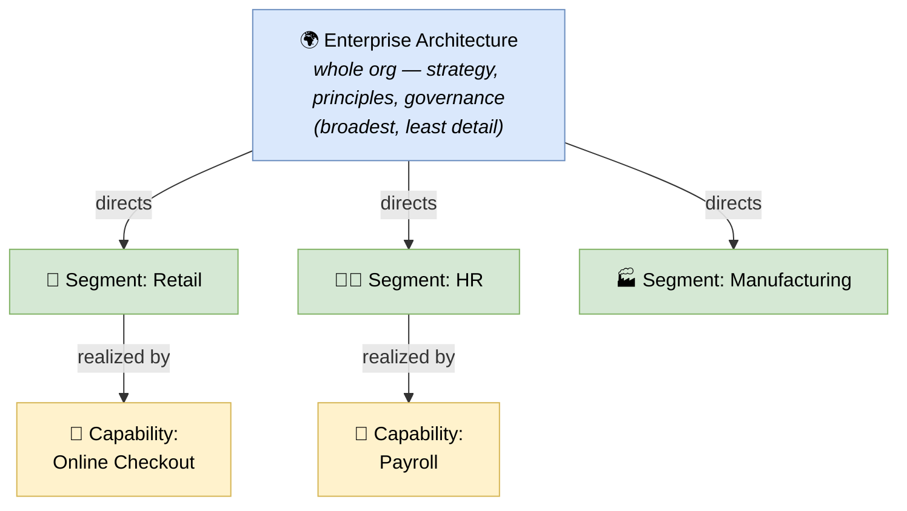

# 🧠 Topic: Architecture Partitioning

> [!abstract] Executive Summary (ELI5)
> **Architecture Partitioning** is how TOGAF splits a too-big-to-model enterprise into **manageable chunks at different levels of detail**, each with its own scope, stakeholders, and ADM cycle. There are three levels: **Enterprise** (the whole org — strategy, principles, governance), **Segment** (a business area, e.g. "Retail" or "HR"), and **Capability** (detailed solutions for specific functions or projects). You cannot model a multinational at one level of detail; partitioning lets each level work at the right altitude, with the levels consistent and nested.

> [!warning] The #1 confusion — Partitioning (breadth/altitude) vs. BDAT Domains (subject) vs. Time Horizons (when)
> These are three *different* axes. **BDAT domains** slice by *subject* (Business/Data/App/Tech). **Time Horizons** slice by *when* (Baseline/Transition/Target). **Partitioning** slices by *breadth and altitude* (Enterprise/Segment/Capability) — how wide a slice and at what level of detail. They are orthogonal: within the Retail segment you still have all four BDAT domains and three time horizons.

> [!note] Part of the TOGAF deep-dive
> Partitioning answers *"how do we carve up a huge enterprise so each piece is workable?"* It works *with* [[TOGAF Architecture Domains]] (which is partitioned), [[Architecture Time Horizons]] (each partition has Baseline/Target), and the [[Architecture Development Method|ADM]] (run per partition).

---

## 🎯 The "Why"

- **Problem Solved:** A global enterprise has thousands of capabilities, applications, and nodes. Trying to describe all of it in one architecture initiative at one level of detail is impossible — it would never finish and be unreadable. Partitioning breaks the work into **nested chunks**: a small, high-level Enterprise architecture that sets direction; several Segment architectures at business-area level; and many Capability architectures at project detail. Each is workable; together they are consistent.
- **Alternatives:** One giant architecture initiative (never finishes), or isolated per-project architectures with no enterprise context (inconsistent, duplicated). Partitioning gives both manageability and coherence.
- **Trade-offs:** Partitioning adds coordination overhead — the levels must stay consistent. The payoff is that each level is achievable and the whole stays coherent.

## 💡 Mental Model & Analogy

- **Analogy:** Military planning. **Strategic** level sets overall objectives and rules of engagement (Enterprise). **Operational** level plans campaigns in a theater/region (Segment). **Tactical** level fights specific battles (Capability). Each level has a different scope, detail, and timescale, but they must be consistent — tactics serve operations serve strategy.

Top sets direction; each level down narrows scope and adds detail. The levels are nested and consistent — a Capability architecture must fit its Segment, which must fit the Enterprise.

## 🛠️ The Three Levels

| Level | Scope | Altitude / detail | Typical timescale | Focus | Deep dive |
|---|---|---|---|---|---|
| **Enterprise** | Whole organization | Broadest, least detail | Long (years) | Strategy, principles, governance, target direction | [[Enterprise Architecture]] |
| **Segment** | A business area (Retail, HR, Manufacturing) | Medium | Medium | Coherent architecture for one business area | [[Segment Architecture]] |
| **Capability** | A specific function or project | Narrowest, most detail | Short (project) | Detailed solution for one capability/project | [[Capability Architecture]] |

> As you go down: scope **narrows**, detail **increases**, timescale **shortens**. Each lower level *realizes* part of the level above and must be *consistent* with it.

## ↔️ Partitioning vs. the other two axes

| Axis | Slices by | Levels |
|---|---|---|
| **BDAT Domains** | Subject area | Business / Data / Application / Technology |
| **Time Horizons** | When | Baseline / Transition / Target |
| **Partitioning** | Breadth & altitude | Enterprise / Segment / Capability |

> They compose: *within* the Retail Segment, you describe all four BDAT domains, across Baseline/Transition/Target. Partitioning is the third orthogonal axis that makes a huge enterprise workable.

## ⚠️ Pitfalls & Anti-patterns

- **Modeling everything at one level:** trying to do Enterprise detail — it's too broad to be detailed and never finishes. Each level has its appropriate altitude.
- **Disconnected levels:** Capability architectures that ignore the Segment/Enterprise context — reinventing direction, duplicating capability, violating principles.
- **Wrong level of detail for the scope:** detailed Component-level modeling at the Enterprise level (too granular), or strategy-level vagueness at the Capability level (too abstract).
- **No consistency enforcement:** the Architecture Board (see [[Architecture Capability Framework]]) must check that lower partitions fit higher ones.
- **Confusing partitioning with domains or time horizons:** they are three separate axes. Don't call a BDAT domain a "partition."

## 🔗 Deep Connections

- **Parent Topic:** [[TOGAF]]
- **The three levels:** [[Enterprise Architecture]], [[Segment Architecture]], [[Capability Architecture]]
- **What is partitioned:** [[TOGAF Architecture Domains]] (each partition has all four domains), [[Architecture Time Horizons]] (each partition has Baseline/Target)
- **How partitions run:** [[Architecture Development Method]] (an ADM cycle per partition), [[Architecture Capability Framework]] (the board keeps levels consistent)
- **Prerequisites:** [[TOGAF]].

## ❓ Active Recall Questions

> [!faq]- What is Architecture Partitioning, and why is it needed?
> It splits a too-big-to-model enterprise into **nested chunks at different altitudes**: Enterprise (whole org, strategy), Segment (business area), Capability (project detail). It's needed because a global enterprise cannot be described in one initiative at one level of detail — partitioning makes each piece workable while keeping the whole coherent.

> [!faq]- How does Partitioning differ from BDAT Domains and Time Horizons?
> They are three **orthogonal axes**. BDAT slices by *subject* (Business/Data/App/Tech); Time Horizons slice by *when* (Baseline/Transition/Target); Partitioning slices by *breadth and altitude* (Enterprise/Segment/Capability). They compose — within the Retail Segment you still have all four domains across all three horizons.

> [!faq]- What happens to scope, detail, and timescale as you move down the levels?
> Scope **narrows** (whole org → business area → project), detail **increases** (strategy → area architecture → solution detail), and timescale **shortens** (years → months → project length). Each lower level *realizes* part of the level above.

---

## 📝 Related Notes

- [[TOGAF]]
- [[Enterprise Architecture]]
- [[Segment Architecture]]
- [[Capability Architecture]]
- [[TOGAF Architecture Domains]]
- [[Architecture Time Horizons]]
- [[Architecture Development Method]]
- [[Architecture Capability Framework]]
