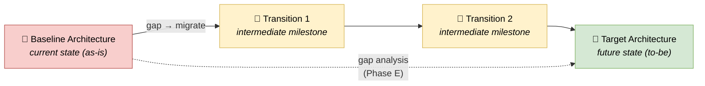

# 🧠 Topic: Architecture Time Horizons

> [!abstract] Executive Summary (ELI5)
> TOGAF doesn't just describe architecture *as it is* — it describes it across **three time horizons**: the **Baseline** (the current as-is state), the **Target** (the future to-be vision), and the **Transition Architectures** (the intermediate steps between them). The point of having all three is **gap analysis**: you cannot plan how to get from here to there if you haven't modeled both "here" and "there." Transitions break a scary big-bang change into manageable, deliverable milestones.

> [!warning] The #1 confusion — these are the same architecture at different points in time
> Baseline, Transition, and Target are not three different architectures — they are **the same architecture described at different moments** along its evolution. The same Application Component exists in Baseline and Target (perhaps changed); a Transition shows it mid-migration. They must stay consistent as one evolving thing.

> [!note] Part of the TOGAF deep-dive
> This is the *when* axis, orthogonal to [[TOGAF Architecture Domains|BDAT (subject)]] and [[Architecture Partitioning|Partitioning (breadth/altitude)]]. Each partition, across all four domains, has these three horizons.

---

## 🎯 The "Why"

- **Problem Solved:** If you only model a Target ("the future system"), you have a vision with no path. If you only model a Baseline ("the current system"), you have a snapshot with no direction. Modeling both — plus the Transitions between — lets you perform **gap analysis** (what must change) and plan a **realistic migration** in deliverable steps. This is the core of ADM Phases E–F.
- **Alternatives:** "Big bang" — design the Target and build it all at once. High risk, long lead time, and no way to course-correct. Transitions decompose the risk.
- **Trade-offs:** Modeling three horizons is more work than one. The payoff is a *navigable* path from as-is to to-be, with checkpoints.

## 💡 Mental Model & Analogy

- **Analogy:** A home renovation. The **Baseline** is the current house (photos, measurements, wiring). The **Target** is the architect's final rendering. The **Transitions** are the staged plan: "Phase 1 — demolish the old kitchen; Phase 2 — rough plumbing/electric; Phase 3 — install new kitchen." You don't move from old house to dream house in one teleport; you pass through livable intermediate states. Each Transition is a house you could actually inhabit.

## 🛠️ The Three Horizons

| Horizon | What it is | ADM phase | Deep dive |
|---|---|---|---|
| **Baseline** | The current architecture **as it is today** (as-is) | Described in C/D | [[Baseline Architecture]] |
| **Transition** | An **intermediate state** between Baseline and Target — a deliverable milestone | Planned in E/F | [[Transition Architecture]] |
| **Target** | The **desired future architecture** (to-be) | Defined in B–D | [[Target Architecture]] |

> **Gap analysis** (Phase E) compares Baseline to Target; the gap is what the Transitions must traverse. **Migration planning** (Phase F) sequences the Transitions into an implementation roadmap. See [[Architecture Development Method]].

## ↔️ Time Horizons vs. the other two axes

| Axis | Slices by | Levels |
|---|---|---|
| **BDAT Domains** | Subject | Business / Data / Application / Technology |
| **Partitioning** | Breadth & altitude | Enterprise / Segment / Capability |
| **Time Horizons** | When | **Baseline / Transition / Target** |

> They compose: within the Retail Segment, for the Application domain, you may have a Baseline (current apps), a Target (future apps), and Transitions (migration milestones). All three axes together make a navigable enterprise architecture.

## ⚠️ Pitfalls & Anti-patterns

- **Skipping the Baseline:** designing only a Target. You cannot plan a meaningful gap if you don't know where you start.
- **Big-bang Target with no Transitions:** one giant jump from as-is to to-be. High risk; no checkpoints; no way to deliver incrementally.
- **Treating the horizons as different architectures:** they are one evolving architecture at different moments — keep them consistent.
- **Target with no path:** a vision with no Transition plan is aspiration, not architecture.
- **Stale Baseline:** the as-is description not updated as the system changes — gap analysis then measures against a fiction.

## 🔗 Deep Connections

- **Parent Topic:** [[TOGAF]]
- **The three horizons:** [[Baseline Architecture]], [[Transition Architecture]], [[Target Architecture]]
- **Where they are produced:** [[Architecture Development Method]] (Baseline/Target in C/D; gap analysis in E; Transitions/roadmap in F)
- **What they describe:** [[TOGAF Architecture Domains]] (each horizon spans all four domains), within an [[Architecture Partitioning|partition]]
- **How you move between them in practice:** [[How to Version Control the Architecture Model]] — each ADD version is a snapshot on the Baseline → Transition → Target timeline; the ADR log explains the decisions that advanced the system along it.
- **Prerequisites:** [[TOGAF]].

## ❓ Active Recall Questions

> [!faq]- What are the three architecture time horizons, and why have all three?
> **Baseline** (current as-is), **Target** (future to-be), and **Transition** (intermediate milestones). All three are needed because you cannot plan a path from here to there without modeling both "here" and "there" — and the Transitions break a big-bang change into deliverable steps. The gap between Baseline and Target is what the work traverses.

> [!faq]- What is gap analysis, and where does it happen?
> Gap analysis compares the **Baseline (as-is)** to the **Target (to-be)** to identify what must change. It happens in **Phase E (Opportunities & Solutions)** of the ADM, and its output drives Phase F's migration planning and the Transition Architectures. See [[Architecture Development Method]].

> [!faq]- How do Time Horizons relate to BDAT Domains and Partitioning?
> They are three **orthogonal axes**. BDAT slices by *subject*; Partitioning by *breadth/altitude*; Time Horizons by *when*. They compose — within the Retail Segment, for the Application domain, you may have Baseline (current apps), Target (future apps), and Transitions (migration milestones).

---

## 📝 Related Notes

- [[TOGAF]]
- [[Baseline Architecture]]
- [[Transition Architecture]]
- [[Target Architecture]]
- [[Architecture Development Method]]
- [[TOGAF Architecture Domains]]
- [[Architecture Partitioning]]
