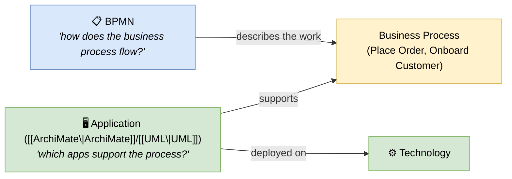

# 🧠 Topic: BPMN — Business Process Model and Notation

> [!abstract] Executive Summary (ELI5)
> **BPMN** (Business Process Model and Notation, OMG, 2004) is a **business-process notation** — a visual language for drawing the **flow of work** through a business process: the events that start/stop it, the tasks performed, the decision gateways where the flow branches, and the actors (pools/lanes) who do the work. Where [[UML]]/[[SysML]] model *systems* and [[ArchiMate]] models the *enterprise layers*, BPMN is **narrow and deep on one concern**: how a business process actually flows, step by step, end to end. It is the standard notation for business analysts.

> [!warning] The #1 confusion — BPMN is process-flow, not architecture structure
> BPMN answers *"how does work flow through this business process?"* — not "what is the system's structure?" or "what runs where?" It complements structural notations: BPMN describes the **business process** that an application (in [[UML]]/[[ArchiMate]]) **supports**. They are different concerns and different audiences. Don't try to draw your deployment topology in BPMN.

> [!note] Part of the notations side of this folder
> One of four standalone notations in the `notations/` subfolder (parent: [[Architecture Notation]]). Analyzed through the four notation axes.

---

## 🎯 The "Why"

- **Problem Solved:** Business processes are how value is delivered, and they live in people's heads unless externalized. BPMN provides a **standardized, executable-friendly** way to draw them: every business analyst reads the same symbols, and the diagrams can be detailed enough to drive workflow automation (BPMN engines execute them).
- **Alternatives:** **UML activity diagrams** (similar flow logic, but UML-flavored and less business-friendly), plain flowcharts (no semantics), [[ArchiMate]]'s Business Process elements (coarser, part of a larger notation). For pure business-process modeling, BPMN is the standard.
- **Trade-offs:** BPMN is **narrow** — it does process flow and nothing else. Its depth (events, gateways, pools, message flows) is powerful but can over-formalize simple workflows. For architecture structure, you need a different notation.

## 🧭 BPMN Through the Four Notation Axes

### 1. Symbol set — *flow objects + connecting objects + swimlanes*

BPMN's symbols are organized around flow:

| Category | Elements |
|---|---|
| **Flow objects** | **Events** (start, intermediate, end — with triggers like message, timer, error), **Activities** (tasks, sub-processes), **Gateways** (exclusive/parallel/inclusive/event-based — decision/branch points) |
| **Connecting objects** | Sequence flow (solid — order), Message flow (dashed — cross-pool messages), Association |
| **Swimlanes** | **Pools** (participants — e.g., "Customer", "Vendor"), **Lanes** (sub-divisions within a pool — e.g., "Sales", "Finance") |
| **Artifacts** | Data objects, annotations, groupings |

> The richness of **Events** (start/intermediate/end × message/timer/error/signal triggers) and **Gateways** (parallel, exclusive, inclusive, event-based, complex) is BPMN's signature — they let you express process logic with precision, including error handling and asynchronous message flows.

### 2. Diagram types — *essentially one: the Business Process Diagram*

Unlike UML's 14 kinds or ArchiMate's 25 viewpoints, BPMN essentially has **one diagram kind**: the **Business Process Diagram (BPD)**. Different process views are produced by:

- **Private vs. collaborative** (one pool vs. multiple pools exchanging messages)
- **Internal vs. black-box** (showing internal flow vs. treating a pool as opaque)
- **Orchestration vs. choreography** (one central controller vs. peer-to-peer message exchange)

> BPMN's narrowness is its strength — one diagram kind, deeply defined. It does flow and nothing else.

### 3. Metamodel coupling — *variable (sketch → executable)*

BPMN's coupling spans the widest range of any notation here, depending on usage:

| Coupling level | Usage | Reality |
|---|---|---|
| **Executable** (strong) | Detailed models feeding BPMN engines (Camunda, Activiti) | The model runs; semantics fully specified |
| **Analytical** (medium) | Detailed for analysis but not executed | Semantics mostly specified |
| **Sketch** (weak) | Whiteboard-level flow charts | The picture is the only source |

> BPMN is unique in that its **highest coupling level is executable** — a precise BPMN process can literally run on a process engine. This makes it bridge modeling and automation. See [[Architecture Metamodel]].

### 4. Tooling & format — *mature, with execution engines*

- **Authoring tools:** Camunda Modeler, Bizagi, Signavio, draw.io (basic), many vendor BPM suites.
- **Interchange format:** **BPMN XML** (the OMG standard — interchangeable between tools and executable by engines).
- **Execution:** Camunda, Activiti, jBPM, IBM BPM — engines that run BPMN models directly.

## ↔️ BPMN vs. the other notations — narrowness vs. breadth

| | BPMN | [[UML]] | [[ArchiMate]] |
|---|---|---|---|
| Concern | Business process flow | Software structure & behavior | Enterprise (all layers) |
| Diagram kinds | Essentially 1 (BPD) | 14 | ~25 viewpoints |
| Audience | Business analysts | Developers | Enterprise architects |
| First-class elements | Events, gateways, tasks, swimlanes | Class, component, node | Business actor, app component, node |
| Executable? | **Yes** (at highest detail) | No (but code-generable) | No |

> BPMN is the **deepest** notation on its one concern (process flow), the **narrowest** in scope (only process), and the **only** one whose model can directly execute. Each notation has a different sweet spot.

## ↔️ Where BPMN fits in the architecture picture

BPMN describes the **business process** that the rest of the architecture **supports**:

BPMN feeds the **Business Architecture** domain in [[TOGAF]] (Phase C) and maps onto the [[Functional Viewpoint]] in R&W (capabilities delivered by processes). It is upstream of application/technology modeling — you model the process first, then build apps to support it.

## ⚠️ Pitfalls & Anti-patterns

- **Using BPMN for structure:** it's process-flow, not architecture. Don't draw system components or deployment in BPMN.
- **Over-detailing simple workflows:** BPMN's event/gateway richness can overwhelm a 5-step process. Right-size the formality.
- **Sketching only, then expecting execution:** if you intend to automate, you must reach the executable detail level (full event/trigger semantics) — a sketch won't run.
- **Mixing BPMN with UML flowchart conventions:** pick BPMN's symbols (not generic flowchart shapes) — the symbols carry the semantics.
- **Forgetting swimlanes:** pool/lane assignment is what makes a process diagram actionable — without it, "who does this?" is unclear.
- **Ignoring error/edge events:** only modeling the happy path. BPMN's intermediate error/boundary events exist precisely for failure handling.

## 🔗 Deep Connections

- **Parent Topic:** [[Architecture Notation]] (the four notation axes), [[Architecture Framework]]
- **Concrete notation siblings:** [[UML]], [[ArchiMate]], [[SysML]]
- **Where BPMN feeds:** [[Business Architecture]] (TOGAF Phase C), [[Functional Viewpoint]] (R&W), [[Architecture Domains]] (Business domain)
- **Contrast:** [[UML]] activity diagrams (similar logic, UML-flavored), [[ArchiMate]] Business Process (coarser, enterprise-scoped)
- **Related Concepts:** [[Architectural Views]] (a BPMN process is a view of business behavior), [[Architecture Metamodel]] (BPMN's executable-coupling is unique), [[Communicating the Model]] (BPMN is a communication discipline for business stakeholders)
- **Prerequisites:** [[Architecture Notation]], [[Architecture Framework]].

## ❓ Active Recall Questions

> [!faq]- What is BPMN, and what single concern does it address?
> BPMN (Business Process Model and Notation) is a **business-process notation** for drawing the flow of work through a process — events, tasks, decision gateways, swimlanes. It addresses one concern: *"how does this business process flow, step by step?"* It is narrow (only process) and deep (rich flow semantics), and is the standard for business analysts.

> [!faq]- What are the four notation axes' values for BPMN?
> **Symbol set:** flow objects (events, activities, gateways), connecting objects (sequence/message flow), swimlanes (pools/lanes). **Diagram types:** essentially one — the Business Process Diagram (private/collaborative, orchestration/choreography variants). **Metamodel coupling:** variable — from sketch (weak) to **executable** (strong; runs on engines like Camunda). **Tooling/format:** mature, with the BPMN XML interchange standard and execution engines.

> [!faq]- What is unique about BPMN's metamodel coupling?
> It spans the widest range — from a weak sketch to a strong, **executable** model that runs directly on a process engine (Camunda, Activiti). BPMN is the only notation in this folder whose highest-coupling level is *executable* — a precise BPMN process literally runs, bridging modeling and automation.

> [!faq]- How does BPMN relate to the rest of the architecture?
> BPMN describes the **business process** that the rest of the architecture **supports**. You model the process first (BPMN), then build applications ([[ArchiMate]]/[[UML]]) to support it, deployed on technology. In TOGAF terms, BPMN feeds the [[Business Architecture|Business Architecture]] domain (Phase C); in R&W terms, it maps onto the [[Functional Viewpoint]] (capabilities delivered by processes).

---

## 📝 Related Notes

- [[Architecture Notation]]
- [[Architecture Framework]]
- [[UML]]
- [[ArchiMate]]
- [[SysML]]
- [[Business Architecture]]
- [[Functional Viewpoint]]
- [[Architecture Domains]]
- [[Architectural Views]]
- [[Architecture Metamodel]]
- [[Communicating the Model]]
