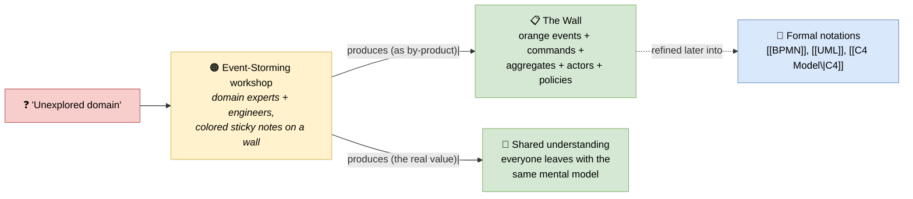

# 🧠 Topic: Event-Storming

> [!abstract] Executive Summary (ELI5)
> **Event-Storming** (Alberto Brandolini) is a **collaborative, workshop-based notation and technique** for exploring a business domain fast. You cover a wall with colored sticky notes — **orange = domain events** ("Order Placed", "Payment Captured"), then add commands, actors, aggregates, policies, and external systems in their own colors — and read the model left-to-right as a timeline. Its distinguishing trait: the **notation is fused with the process**. Unlike [[UML]] or [[BPMN]], you don't *draw* an Event-Storming diagram at your desk — you *produce* it by running a workshop where domain experts and engineers think out loud together. The picture is a by-product of the conversation.

> [!warning] The #1 confusion — Event-Storming is notation AND technique, fused
> People ask "is Event-Storming a notation or a workshop method?" — the honest answer is **both, inseparably**. The colored sticky-note convention is a real *notation* (typed elements with rules), but it only earns its keep when run as a *collaborative process*. Treat it as drawing-only and you've lost 80% of its value: the shared understanding emerges from the live negotiation, not from the picture. See the four-axis breakdown — its coupling and tooling values reflect this fusion.

> [!note] Part of the notations side of this folder
> Analyzed through the four notation axes (parent: [[Architecture Notation]]), alongside [[UML]], [[ArchiMate]], [[SysML]], [[BPMN]]. Its closest sibling is [[BPMN]] (both model process flow), but Event-Storming trades BPMN's formal precision for collaborative speed.

---

## 🎯 The "Why"

- **Problem Solved:** Traditional modeling (UML/BPMN drawn by an architect at a desk) produces a picture the *architect* understands but stakeholders had no part in making — so it captures the architect's assumptions, not the domain experts' knowledge, and surfaces misunderstandings only at implementation time. Event-Storming flips this: it **extracts knowledge from the people who have it**, fast, in one room, by making the conversation produce the model.
- **Alternatives:** **[[BPMN]]** drawn by an analyst (formal but second-hand — the analyst interprets), **interviews + documents** (slow, lossy), **[[UML]] use cases** (rigid, sequential, not exploratory). Event-Storming optimizes for *breadth and shared understanding*, not for *precision and executability*.
- **Trade-offs:** Event-Storming is **fast, broad, and shared**, but **imprecise and unenforceable** — it has no formal metamodel, no execution semantics, no tool-level checks. It is a *discovery* tool, not a *specification* tool. Use it at the start of a project; replace/augment with formal notations (BPMN, UML, C4) once the domain is understood.

## 💡 Mental Model & Analogy

- **Analogy:** If [[BPMN]] is **sheet music** (precise, written by one composer, played by trained musicians), Event-Storming is a **jam session** — the band and the songwriter get in a room, throw ideas at the wall, and the song emerges from the live play. The recording (the sticky-note wall) is valuable, but the real output is that everyone now *knows the song*.

## 🧭 Event-Storming Through the Four Notation Axes

### 1. Symbol set — *colored, typed sticky notes (informal but semantic)*

Event-Storming's elements are typed **by sticky-note color**. The colors *are* the symbol set, and the typing *is* the semantics:

| Color | Element type | Example |
|---|---|---|
| 🟠 **Orange** | **Domain Event** (the backbone — "something happened") | "Order Placed", "Payment Captured" |
| 🔵 **Blue (sticky)** | **Command** (the intent that triggers an event) | "Place Order", "Capture Payment" |
| 🟣 **Purple (large)** | **Aggregate** (the cluster of state that enforces invariants) | "Order", "Payment" |
| 👤 **Yellow** | **Actor** (a person/role who issues a command) | "Customer", "Ops Agent" |
| 🟨 **Pink/lilac** | **Policy** ("whenever X happens, do Y") | "Whenever Order Placed, reserve inventory" |
| 🟥 **Red** | **Hotspot / problem / question** | "Who actually owns pricing?" |
| 📦 **Green** | **Read model / view** (data the UI needs) | "Order summary screen" |
| 🌐 **Border color** | **External system / Bounded Context boundary** | "Stripe", "Warehouse BC" |

> The orange **domain event** is the keystone. Everything is anchored on a left-to-right timeline of events; commands, aggregates, actors, and policies attach to that backbone. The notation is informal (a sticky is just paper) but the *typing by color* is rigorous enough to be read consistently.

### 2. Diagram types — *three named workshop formats*

Event-Storming defines three **levels of zoom**, each a different "diagram" the workshop targets:

| Format | Question it answers | What you produce |
|---|---|---|
| **Big Picture** | "What is this whole domain, end-to-end, at a glance?" | A wall-spanning timeline of all domain events, with actors and hotspots |
| **Process Modeling** | "How does this specific process flow, step by step?" | Events enriched with commands → events (the flow), closer to a process model |
| **Software Design** | "What aggregates/services/boundaries should the software have?" | Events grouped into aggregates, aggregates into [[C4 Model\|bounded contexts]], with policies and read models |

> Notice the trajectory: **Big Picture → Process Modeling → Software Design** moves from *broad exploration* to *concrete design*. The format chosen drives the workshop's focus. This is the closest a notation in this folder comes to defining its own "viewpoints."

### 3. Metamodel coupling — *weak (the wall is the only source of truth)*

Event-Storming has a **conceptual model** (events, commands, aggregates, etc., with implicit relationships) but **no formal metamodel** and **no tool enforcement**.

| Coupling aspect | Event-Storming |
|---|---|
| **Conceptual types** | Yes — events, commands, aggregates, policies, actors, read models |
| **Formal metamodel** | No — relationships are by convention, not by typed rules |
| **Tool-level checks** | No — you can put anything anywhere; a "command without an event" is a human-judged smell, not a tool error |
| **Source of truth** | The physical wall (or a photo of it); there is no underlying typed model |

> Contrast: [[ArchiMate]] is strong-coupling (model-first, tool-checked); [[BPMN]] is variable-to-executable; Event-Storming is **weak** — the picture is the only source, and "correctness" is whatever the group agrees the wall means. This is deliberate: Event-Storming optimizes for *speed of exploration*, and a formal metamodel would slow the workshop down. See [[Architecture Metamodel]].

### 4. Tooling & format — *analog-first, digital-optional*

Event-Storming is famously **analog-first** — that's part of its method:

| Mode | Tools | Trade-off |
|---|---|---|
| **Analog (canonical)** | Wall + physical sticky notes + markers | Fastest, most collaborative, most tactile; the wall is the artifact |
| **Digital (pandemic-era)** | Miro/Mural/FigJam, specialized tools (EventStorming Board, LeanBoard) | Remote-friendly, persistent, exportable; loses some of the physical energy |
| **No standard interchange** | Photos, screenshots, manual transcription | Unlike XMI (UML) or BPMN XML, there is no interchange format — you transcribe insights into other tools by hand |

> The lack of a standard format is a known limitation: an Event-Storming wall must be **transcribed** into formal artifacts (a [[BPMN]] process, a [[C4 Model|C4]] Container diagram, a list of aggregates) to be maintained. The wall is a starting point, not a living model.

## ↔️ Event-Storming vs. BPMN — its closest sibling

Both model **process flow over time**, but they sit at opposite ends of the formality spectrum:

| | Event-Storming | [[BPMN]] |
|---|---|---|
| Origin | Collaborative discovery (DDD community) | Formal business-process modeling (OMG) |
| Precision | Loose, exploratory | Precise, even executable |
| Coupling | Weak (the wall) | Variable, up to executable (engine-runnable) |
| Produced by | A workshop of experts + engineers | One analyst, at a desk |
| Output's value | Shared understanding (the conversation) | A specification (the picture) |
| When to use | Start of a project — *understand the domain* | After understanding — *specify the process* |

> They are **complementary, not competing**: Event-Storm first to discover the domain and build shared understanding; then formalize selected flows in BPMN where precision or automation is needed.

## ↔️ Where Event-Storming sits relative to the course

Event-Storming is **not part of the C4 course** proper — it comes from the DDD community. But it connects to several course concepts:

- **Discovering [[Functional Viewpoint|Functional]] content:** the orange event timeline *is* a functional decomposition — what the business does, expressed as things that happen.
- **Feeding [[Business Architecture]] (TOGAF Phase C):** the event wall is a rich input to business capability and value-stream modeling.
- **Producing bounded contexts for [[Container Viewpoint|Container]] / [[Component Viewpoint|Component]] views:** the Software Design format yields aggregates and bounded contexts, which map onto C4 containers/components.
- **As a lightweight [[Architecture Process]]:** Event-Storming is a fast, collaborative entry into architecture work — discover → formalize — that pairs naturally with C4's iterative modeling.

## ⚠️ Pitfalls & Anti-patterns

- **Treating it as drawing-only:** the worst mistake. Event-Storming's value is the *live workshop negotiation*; a wall produced by one person at a desk is just bad [[BPMN]].
- **Skipping the "experts in the room" rule:** running it with only engineers. Without domain experts you get engineers' assumptions, not the domain — exactly what Event-Storming exists to avoid.
- **Trying to make it precise too early:** adding formal detail (full BPMN-style gateways, exact data) during a Big Picture workshop kills the speed that makes it work. Save precision for the transcription.
- **Never transcribing the wall:** the photo rots; insights get lost. Always follow a storm with formalization (BPMN, C4, aggregate list).
- **Treating the wall as the spec:** the wall is a *discovery artifact*, not an enforceable model. Don't build directly from it without translating to something checkable.
- **Ignoring hotspots (red stickies):** they are the unresolved questions and political disputes — *the most valuable output*. Parking them is fine; ignoring them loses the workshop's deepest insights.
- **One session only:** Event-Storming is iterative. A second pass (Process Modeling or Software Design) after the Big Picture is where the design emerges.

## 🔗 Deep Connections

- **Parent Topic:** [[Architecture Notation]] (the four notation axes), [[Architecture Framework]]
- **Concrete notation siblings:** [[UML]], [[ArchiMate]], [[SysML]], [[BPMN]] (closest sibling — both model process flow)
- **Course connections:** [[Functional Viewpoint]] (event timeline ≈ functional decomposition), [[Business Architecture]] (feeds Phase C), [[Container Viewpoint]]/[[Component Viewpoint]] (Software Design format yields aggregates/contexts → containers/components), [[System Modeling]]
- **Related Concepts:** [[Architectural Views]] (the Event-Storm wall is a view), [[Architecture Process]] (Event-Storming as a fast discovery process), [[Communicating the Model]] (its central purpose), [[Architecture Metamodel]] (Event-Storming's weak coupling is the contrast case)
- **Prerequisites:** [[Architecture Notation]], [[Architecture Framework]].

## ❓ Active Recall Questions

> [!faq]- What is Event-Storming, and what makes it different from other notations in this folder?
> A **collaborative, workshop-based notation and technique** for exploring a domain fast using colored sticky notes (orange = domain events, blue = commands, purple = aggregates, etc.). Its distinguishing trait: the **notation is fused with the process** — you don't *draw* it at a desk, you *produce* it by running a workshop where domain experts and engineers think out loud together. The picture is a by-product; the shared understanding is the real output.

> [!faq]- What are the four notation axes' values for Event-Storming?
> **Symbol set:** colored, typed sticky notes — orange domain events (the backbone), blue commands, purple aggregates, yellow actors, pink policies, red hotspots, green read models. **Diagram types:** three formats — Big Picture (whole domain), Process Modeling (one flow), Software Design (aggregates/contexts). **Metamodel coupling:** weak — conceptual types but no formal metamodel or tool checks; the wall is the only source of truth. **Tooling/format:** analog-first (physical wall), digital-optional (Miro/Mural), with **no standard interchange format**.

> [!faq]- Why is the orange "domain event" the keystone of Event-Storming?
> Because the whole model is anchored on a left-to-right **timeline of domain events** — things that happened in the business ("Order Placed", "Payment Captured"). Commands, aggregates, actors, and policies all attach to this event backbone. Events are chosen as the anchor because they are concrete, verifiable, and business-people-friendly — everyone agrees "X happened" in a way they don't agree about abstract processes or entities.

> [!faq]- How does Event-Storming relate to BPMN, and which should you use when?
> Both model **process flow**, but at opposite ends of formality. Event-Storming is **loose, exploratory, collaborative, and weak-coupling** — use it **at the start** of a project to discover the domain and build shared understanding. [[BPMN]] is **precise, formal, and (at high detail) executable** — use it **after** understanding, to specify processes that need precision or automation. They are complementary: Event-Storm to discover, BPMN to specify.

> [!faq]- What are the three Event-Storming formats, and what is the typical trajectory?
> **Big Picture** (whole domain at a glance), **Process Modeling** (one specific process flow), **Software Design** (aggregates and bounded contexts for the software). The trajectory is **Big Picture → Process Modeling → Software Design**, moving from broad exploration to concrete design. Each is a different "diagram"/workshop focus.

> [!faq]- Why is "treating it as drawing-only" the worst pitfall?
> Because Event-Storming's value is the **live workshop negotiation** between domain experts and engineers — the shared understanding emerges from the conversation, not from the picture. A wall produced by one person at a desk is just an inferior BPMN diagram, and it captures that person's assumptions instead of the domain's reality. The notation earns its keep only when run as a collaborative process.

---

## 📝 Related Notes

- [[Architecture Notation]]
- [[Architecture Framework]]
- [[UML]]
- [[ArchiMate]]
- [[SysML]]
- [[BPMN]]
- [[Functional Viewpoint]]
- [[Business Architecture]]
- [[Container Viewpoint]]
- [[Component Viewpoint]]
- [[Architectural Views]]
- [[Architecture Process]]
- [[Communicating the Model]]
- [[System Modeling]]
