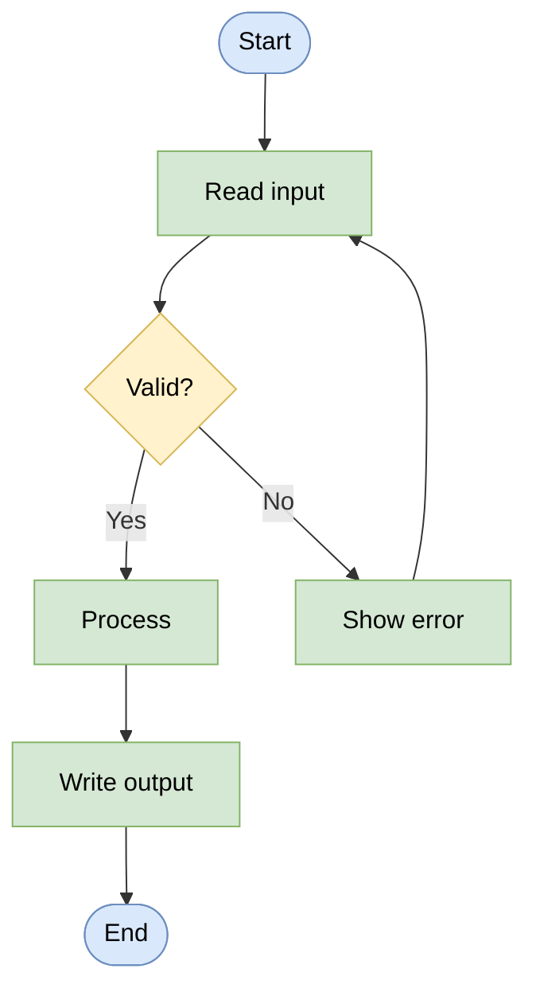

# 🧠 Topic: Flowchart

> [!abstract] Executive Summary (ELI5)
> A **flowchart** is the **generic, oldest process-flow notation** — a diagram of shapes connected by arrows that shows the steps and decisions of a process: do this, then test that, branch on the result, loop back. Its symbol set is small and near-universal (rectangle = step, diamond = decision, oval = start/end, parallelogram = input/output). Because it carries **almost no domain-specific semantics**, it is the **common ancestor** of the richer notations in this folder — [[BPMN]] and [[UML]] activity diagrams are both specialized descendants of the flowchart.

> [!warning] The #1 confusion — a flowchart is not "any diagram with boxes and arrows"
> In casual use, "flowchart" gets applied to anything with shapes and arrows. In the notation sense, a **flowchart** is specifically a diagram of **sequential process flow with decision branching** — algorithmic/logical steps, not architecture structure. A C4 container diagram is *not* a flowchart (it shows structure, not flow); a deployment diagram is *not* a flowchart. Reserve the word for *process flow with decisions*.

> [!note] Part of the notations side of this folder
> Analyzed through the four notation axes (parent: [[Architecture Notation]]). The simplest and weakest-coupled notation here — and the ancestor of [[BPMN]] and [[UML]] activity diagrams.

---

## 🎯 The "Why"

- **Problem Solved:** When you need to show *how a process unfolds step by step* — an algorithm, a decision procedure, a business workflow's logic — a flowchart makes the sequence and the branching visible at a glance. It is the lowest-friction way to externalize "first do A, then check B, if yes do C, else loop back."
- **Alternatives:** **[[BPMN]]** (richer, business-process-specific, executable), **[[UML]] activity diagrams** (richer, software-flavored), **[[Event-Storming]]** (collaborative, event-anchored rather than step-anchored). All three *specialize* the flowchart idea; none beats it for sheer simplicity and universal readability.
- **Trade-offs:** The flowchart is **minimal and universal but untyped** — it has no concept of "domain event," "actor," "service," or "message." Every rectangle is just "a step." This makes it perfect for sketching logic and unreadable for serious architecture (where the *type* of element matters). Use it for algorithms and simple workflows; reach for BPMN/UML when type and precision matter.

## 💡 Mental Model & Analogy

- **Analogy:** A flowchart is the **plain-text outline** of process notations. A novelist might jot the plot as a plain outline before choosing a genre's richer forms (screenplay format, stage-play format). Similarly, a flowchart sketches the bare sequence-and-branch logic before you commit to a richer notation (BPMN's events/gateways, UML's activity semantics). The outline isn't lesser — it's the shared skeleton underneath all of them.

A flowchart's four moves: **step → decision → branch → (optionally) loop**. That is the entire vocabulary — but it is enough to express any algorithmic flow.

## 🧭 Flowchart Through the Four Notation Axes

### 1. Symbol set — *small, near-universal, but untyped*

The classic ANSI/ISO flowchart symbols, recognized across decades and tools:

| Shape | Meaning |
|---|---|
| **Oval / rounded rectangle (terminator)** | Start / End |
| **Rectangle** | Process / Step (a generic action) |
| **Diamond (decision)** | A yes/no or multi-way branch point |
| **Parallelogram** | Input / Output |
| **Rectangle with double stripes** | Predefined process (subroutine) |
| **Hexagon** | Preparation / setup |
| **Arrow** | Sequence flow (the order) |

> These shapes are **universally readable** — anyone, technical or not, understands "rectangle = do something, diamond = choose a path." But they are **untyped** — every rectangle is just "a step," with no way to distinguish "a service call" from "a database write" from "a human task." That untyped-ness is the flowchart's core limitation. BPMN solves this by introducing typed events, gateways, tasks, and swimlanes.

### 2. Diagram types — *essentially one: the process flow*

There is essentially **one flowchart kind**: the process flow with decisions. Variants are minor:

| Variant | What differs |
|---|---|
| **Process flowchart** | The canonical form — steps, decisions, branches |
| **Swimlane flowchart** | Adds lanes for "who does this" — the ancestor of [[BPMN]] pools/lanes |
| **Cross-functional flowchart** | Same as swimlane, org-chart-oriented |
| **Decision flowchart / logic tree** | Branches only, no sequential steps (decision trees) |

> Unlike [[UML]] (14 kinds) or [[ArchiMate]] (~25 viewpoints), the flowchart is essentially **one diagram, often with swimlanes**. Its narrowness is its strength (low cognitive overhead) and its limit (one concern only).

### 3. Metamodel coupling — *weak (the picture is the only source)*

The flowchart has the **weakest coupling** of any notation in this folder:

| Coupling aspect | Flowchart |
|---|---|
| **Conceptual types** | Loose — "step," "decision," "start/end," "flow" |
| **Formal metamodel** | **None** — there is no flowchart metamodel; the shapes are a drawing convention |
| **Tool-level checks** | None — any shape can connect to any shape; no rules to violate |
| **Source of truth** | The picture alone |

> ISO 5807 (1985) did standardize the *symbols and conventions* for program flowcharts, but it is a **drawing standard**, not a typed metamodel — it says "this shape means X," not "this element may relate to Y in these ways." So even ISO-5807 flowcharts have no checkable model behind them. See [[Architecture Metamodel]].

### 4. Tooling & format — *universal — every drawing tool on Earth*

The flowchart is the most tool-supported notation in existence:

| Mode | Tools |
|---|---|
| **Dedicated flowchart tools** | draw.io, Lucidchart, Visio, Miro |
| **General diagramming** | Every drawing tool supports flowchart shapes |
| **Text-based** | Mermaid (`graph TD`), Graphviz/DOT, PlantUML |
| **Word processors** | PowerPoint, Google Slides, Word (built-in shapes) |

> There is **no standard interchange format** beyond what each tool provides — but you rarely need one, because the diagram is simple enough to redraw in any tool. Text-based formats (Mermaid, DOT) are the closest thing to "interchange" and have the bonus of being version-controllable.

## ↔️ The flowchart's descendants — BPMN and UML activity diagrams

This is the most useful framing: the flowchart is the **common ancestor**, and BPMN / UML activity diagrams are **specialized descendants**:

| | Flowchart | [[BPMN]] | [[UML]] Activity Diagram |
|---|---|---|---|
| Symbol richness | ~6 generic shapes | Many (events × triggers, gateways × types, tasks × types, pools/lanes) | Many (activity nodes, object flows, partitions, signals) |
| Element typing | **Untyped** ("step") | **Typed** (user task, service task, script task…) | **Typed** (call behavior, accept event, send signal…) |
| Semantics | Informal drawing | Formal, up to **executable** | Formal (under UML's metamodel) |
| Concern | Generic process logic | Business process (with execution) | Software / system behavior |
| Coupling | Weak | Variable, up to executable | Strong (under UML) |
| Ancestry | *(the root)* | Flowchart + business-process extensions | Flowchart + software-flavored extensions |

> The arc: **flowchart → specialized for business (BPMN) / for software (UML activity)**. Each descendant adds *typing* and *semantics* the flowchart lacks. This is why "use a flowchart when you need generic logic, BPMN when you need executable business processes, UML when you need formal software behavior."

## ↔️ When to use a flowchart vs. alternatives

| If your need is… | Use… |
|---|---|
| Sketch an algorithm or simple workflow, fast, for any audience | **Flowchart** |
| Model a business process with actors, events, and possibly automation | **[[BPMN]]** |
| Model software behavior under UML's formal umbrella | **[[UML]] activity** |
| Discover a domain collaboratively with experts | **[[Event-Storming]]** |
| Show system structure (components, not flow) | **Not a flowchart** — use [[C4 Model]], [[UML]] component, [[ArchiMate]] |

> The flowchart's sweet spot: **generic, universal, fast** process-logic sketches. Outside that niche, a specialized notation does the job better.

## ⚠️ Pitfalls & Anti-patterns

- **Calling every diagram "a flowchart":** a flowchart shows *process flow with decisions*, not structure. A component diagram, deployment diagram, or org chart is not a flowchart.
- **Using flowcharts for architecture structure:** rectangles aren't typed, so "the API talks to the DB" and "do step 3" look identical. Use typed notations (C4, UML, ArchiMate) for structure.
- **Overloading the diagram:** a flowchart with 200 boxes and 50 crossings is unreadable. Decompose into sub-processes or switch to a notation with hierarchical structure.
- **Treating it as a spec:** a flowchart has no semantics, no checks, no model. It is a sketch — don't treat it as an enforceable contract.
- **Not using swimlanes for multi-actor flows:** if different actors do different steps and you omit swimlanes, "who does what" becomes invisible. Add them.
- **Reinventing BPMN by extending flowcharts:** if you find yourself inventing typed tasks, error events, or message flows on a flowchart, you are reinventing BPMN badly — switch to it.

## 🔗 Deep Connections

- **Parent Topic:** [[Architecture Notation]] (the four notation axes), [[Architecture Framework]]
- **Concrete notation siblings:** [[UML]] (activity diagrams are descendants), [[BPMN]] (the business-process descendant), [[ArchiMate]], [[SysML]], [[Event-Storming]]
- **Course connections:** a flowchart can render the *flow* inside a [[Functional Viewpoint]] (capability flow) or a simple [[Concurrency Viewpoint]] slice, but its untyped shapes are too loose for the structural viewpoints
- **Related Concepts:** [[Architectural Views]] (a flowchart is a view of process logic), [[Architecture Metamodel]] (the flowchart is the weakest-coupling contrast case — pure drawing, no model), [[Communicating the Model]] (its universal readability is its strength)
- **Prerequisites:** [[Architecture Notation]], [[Architecture Framework]].

## ❓ Active Recall Questions

> [!faq]- What is a flowchart, and what is its relationship to BPMN and UML activity diagrams?
> A flowchart is the **generic, oldest process-flow notation** — steps (rectangles), decisions (diamonds), branches, and loops, connected by arrows. It is the **common ancestor**: [[BPMN]] is the business-process descendant (adds typed tasks, events, gateways, swimlanes, execution); [[UML]] activity diagrams are the software-flavored descendant (adds typed activity nodes, object flows). Both specialize the flowchart by adding typing and semantics it lacks.

> [!faq]- What are the four notation axes' values for the flowchart?
> **Symbol set:** small and universal (~6 ANSI/ISO shapes — terminator, process, decision, I/O, predefined process, arrow), but **untyped** (every rectangle is just "a step"). **Diagram types:** essentially one — the process flow, optionally with swimlanes. **Metamodel coupling:** **weak** — no formal metamodel; ISO 5807 standardizes symbols but only as a drawing convention, not a typed model. **Tooling/format:** universal — every drawing tool supports flowcharts; Mermaid/DOT are the closest to a text-based interchange.

> [!faq]- Why is "a flowchart is any diagram with boxes and arrows" a misuse of the term?
> In the notation sense, a flowchart is specifically a diagram of **sequential process flow with decision branching** — algorithmic steps, not architecture structure. A C4 container diagram shows *structure*, not flow; a deployment diagram shows *topology*. Calling those "flowcharts" blurs the distinction between flow and structure, and hides the fact that flowcharts are deliberately untyped (unlike structural notations where the type of each element matters).

> [!faq]- When should you use a flowchart vs. BPMN vs. UML activity?
> **Flowchart** for generic, universal, fast sketches of algorithm or simple workflow logic. **[[BPMN]]** when you need typed business-process modeling with actors, events, and possibly execution. **[[UML]] activity** when you need formal software/system behavior under UML's metamodel. The flowchart's niche is simplicity and universal readability; outside it, a specialized descendant does the job better.

> [!faq]- Why is the flowchart the weakest-coupled notation in this folder?
> Because it has **no formal metamodel and no tool-level checks** — it is purely a drawing convention. The shapes have agreed meanings, but nothing enforces rules about how they may relate, and there is no underlying typed model. Contrast [[ArchiMate]] (strong, model-first, tool-checked) or [[BPMN]] (variable, up to executable). The flowchart is pure picture; correctness is whatever the drawer intends.

---

## 📝 Related Notes

- [[Architecture Notation]]
- [[Architecture Framework]]
- [[UML]]
- [[BPMN]]
- [[ArchiMate]]
- [[SysML]]
- [[Event-Storming]]
- [[Functional Viewpoint]]
- [[Concurrency Viewpoint]]
- [[Architectural Views]]
- [[Architecture Metamodel]]
- [[Communicating the Model]]
