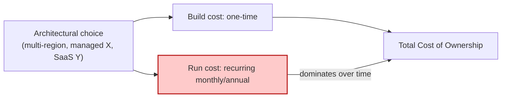

# 🧠 Topic: Cost Perspective

> [!abstract] Executive Summary (ELI5)
> This perspective asks: **"can we afford to build it, and — more importantly — can we afford to run it?"** It evaluates the financial impact of architectural decisions: the *build cost* (engineering time, licenses, one-time setup) and the *run cost* (cloud infrastructure, third-party APIs, ongoing operations). The trap is that run cost usually dwarfs build cost over the system's life, so optimizing for cheap-to-build can be very expensive over time.

> [!warning] The #1 trap — Optimizing build cost, ignoring run cost
> Teams pick the fast-to-build option (managed everything, over-provisioned cloud, third-party SaaS for every function) and ship quickly — then discover the monthly cloud bill is 10× what they planned. Build cost is paid once; run cost is paid every month for the system's lifetime. Total Cost of Ownership (TCO) is dominated by run cost, not build cost.

---

## 🎯 The "Why"

- **Problem Solved:** Architectural decisions have financial consequences that persist for years — a multi-region active-active deployment, a managed-service-heavy stack, or a chatty third-party API all generate recurring costs. Applying this perspective makes those consequences visible *at design time*, so cost is a deliberate constraint, not a surprise bill.
- **Alternatives:** "We'll optimize costs once we're making money." By then, the architecture is built around expensive choices that are hard to reverse. Cost-conscious design from the start is far cheaper than cost-reduction retrofitting.
- **Trade-offs:** Cost-optimal architectures may sacrifice some performance, resilience, or development speed. The discipline is to match spending to the *business value* — not to gold-plate, and not to under-invest in critical paths.

## 💡 Mental Model & Analogy

- **Analogy:** The Cost perspective is buying a car. The **sticker price** is the build cost. The **gas, insurance, maintenance, and parking** over 10 years is the run cost — and it often exceeds the sticker price. A cheap car that guzzles gas and breaks down can cost more than a pricier, efficient one. Total Cost of Ownership is the real number; the sticker price is just the down payment.

## 🛠️ Core Principles

1. **Distinguish build cost from run cost.** Build cost = engineering effort, licenses, one-time setup. Run cost = infrastructure, third-party APIs, operations, maintenance. They behave differently and are optimized differently.
2. **TCO is dominated by run cost.** Over a multi-year lifetime, the monthly run cost usually exceeds the one-time build cost. Optimize for TCO, not for "cheapest to build."
3. **Every architectural decision has a cost signature.** Multi-region active-active, managed services, chatty third-party APIs, over-provisioned capacity — each carries recurring cost. Make these trade-offs explicit, not accidental.
4. **Match spending to business value.** Not every component needs multi-AZ resilience or premium managed services. Spend on the critical path; economize on the non-critical.
5. **Cost is a constraint shared with other perspectives.** Cost trades against performance (more capacity costs more), resilience (redundancy costs more), and development speed (managed services are fast but pricey). Balance, don't optimize in isolation.

## 🏗️ Key Cost Categories

### Build cost (one-time)
*What you pay to get the system built.*
- **Engineering time** — the dominant build cost. Complexity and novelty increase it.
- **Licenses and tooling** — commercial frameworks, IDE licenses, CI/CD services.
- **Migration / setup** — if replacing an existing system, the transition cost.
- **Training** — if the architecture uses technologies new to the team (see [[Development Resource Perspective]]).

### Run cost (recurring)
*What you pay to keep the system running — usually the bigger number over time.*
- **Compute and storage** — cloud instances, serverless invocations, DB hosting, object storage.
- **Network egress** — data leaving your cloud (often the surprise cost; cross-region and internet egress add up).
- **Third-party services and APIs** — payment processing, email, maps, AI APIs. Per-call or per-volume pricing.
- **Licensing/SaaS subscriptions** — managed services, observability platforms, databases-as-a-service.
- **Operations staff** — the people keeping it running (often the largest hidden run cost).

### The cost-quality trade-off matrix
*How each sibling perspective drives cost.*

| Investment | Drives up cost | Drives (quality) |
|---|---|---|
| Multi-AZ / multi-region | infra | [[Availability and Resilience Perspective]] |
| Over-provisioning / autoscaling | infra | [[Performance and Scalability Perspective]] |
| Encryption, secrets mgmt, audits | effort + tooling | [[Security Perspective]] |
| Clean seams, low coupling | build effort | [[Evolution Perspective]] |
| Senior team, good tooling | salaries + licenses | [[Development Resource Perspective]] |
| Data residency (multi-region data) | infra + compliance | [[Location Perspective]] |

## ↔️ How the Perspective Connects

| Connects with | How |
|---|---|
| [[Performance and Scalability Perspective]] | Scaling costs money — more nodes, bigger DBs, more egress. Tension. |
| [[Availability and Resilience Perspective]] | Redundancy and failover cost money. Tension. |
| [[Security Perspective]] | Security controls (encryption, audits, vaults) cost effort and tooling. Tension. |
| [[Evolution Perspective]] | Clean seams cost upfront build effort; pay now or pay more later. |
| [[Development Resource Perspective]] | Senior skills and good tooling cost money but reduce long-run cost. |
| [[Location Perspective]] | Multi-region and data residency add significant infra cost. |

> Cost is the perspective most in tension with the others — almost every quality investment (resilience, security, performance) raises cost. The architect's job is to balance, not to optimize cost in isolation.

## ⚠️ Pitfalls & Anti-patterns

- **Optimizing build cost, ignoring run cost:** shipping fast with managed everything and over-provisioned cloud, then discovering the monthly bill dwarfs the build budget. TCO is the real number.
- **Ignoring network egress:** cross-region and internet data transfer is often the surprise cost in cloud bills. A chatty multi-region architecture can be egress-expensive.
- **Over-provisioning "for safety":** running 10 instances when 3 suffice. Autoscaling and right-sizing address this; static over-provisioning wastes money monthly.
- **Third-party API cost at scale:** a per-call API that's cheap at 1k calls/day can be ruinous at 1M. Model the cost at *projected* scale, not current.
- **Hidden operations cost:** counting infra but not the people needed to run it. Operations staff is often the largest run cost.
- **Gold-plating:** multi-region active-active for a system that could tolerate a 4-hour outage. Match resilience investment to the business cost of downtime.
- **Cost optimization after the fact:** retrofitting cost reduction onto an architecture built around expensive choices is hard and risky. Design cost-consciously from the start.

## 🔗 Deep Connections

- **Parent Topic:** [[Perspective]], [[Viewpoint]]
- **In tension with (most perspectives):** [[Performance and Scalability Perspective]], [[Availability and Resilience Perspective]], [[Security Perspective]], [[Location Perspective]] — all raise cost; Cost balances them.
- **Related:** [[System Architecture]] (cost is a business/architectural constraint), [[Deployment Viewpoint]] (topology drives infra cost)
- **Prerequisites:** [[Perspective]].

## ❓ Active Recall Questions

> [!faq]- Why does run cost usually dominate Total Cost of Ownership?
> Because build cost is paid once, while run cost (infrastructure, third-party APIs, operations staff) is paid every month for the system's lifetime. Over years, the recurring run cost typically exceeds the one-time build cost. Optimizing for "cheapest to build" can produce a system that's very expensive to run — TCO is the real number.

> [!faq]- Why is network egress a common surprise cost?
> Because data leaving your cloud (cross-region transfer, internet egress) is priced per-GB and adds up quickly in chatty, multi-region architectures. Teams budget for compute and storage but often overlook egress — and discover it as a large line item in the monthly bill. Modeling egress at projected scale is essential.

> [!faq]- How does the Cost Perspective interact with the other perspectives?
> It's the perspective most *in tension* with the others — almost every quality investment (redundancy for resilience, capacity for performance, encryption for security, residency for location) raises cost. The architect's job is to balance cost against the other qualities, matching spending to business value, not optimizing cost in isolation.

> [!faq]- Why is "gold-plating" a cost pitfall, and how do you avoid it?
> Gold-plating is over-investing in quality the system doesn't need — e.g., multi-region active-active for a system that could tolerate a 4-hour outage. It wastes money on resilience (or performance, or security) disproportionate to the business cost of the failure. Avoid it by matching investment to the *business cost of downtime/degradation*, not to "best practice" in the abstract.

> [!faq]- Why should third-party API costs be modeled at projected scale, not current?
> Because per-call or per-volume pricing that's negligible at current volume can become ruinous at projected scale — a payment or AI API that's cheap at 1k calls/day may be the dominant cost at 1M. Modeling cost at *projected* scale reveals whether the integration is sustainable before you've built the system around it.

---

## 📝 Related Notes

- [[Perspective]]
- [[Performance and Scalability Perspective]]
- [[Availability and Resilience Perspective]]
- [[Security Perspective]]
- [[Location Perspective]]
- [[Deployment Viewpoint]]
