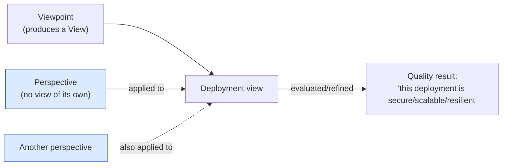

# 🧠 Topic: Architecture Perspective

> [!abstract] Executive Summary (ELI5)
> A **perspective** is a cross-cutting quality concern — security, performance, availability — that you **apply *to*** a viewpoint to ask "how *well* does this architecture behave?" A viewpoint produces a view (a picture of structure); a perspective produces **no view of its own**. Instead, it's a checklist/lens you hold up to *other* views: "is this deployment secure?", "can this container view scale 10×?", "will this data flow survive a node failure?"

> [!warning] The #1 confusion — Perspective ≠ Viewpoint
> "Show me the security view" is a **category error**. Security is a *perspective*, not a *viewpoint* — it has no diagram of its own. You take the Security perspective and *apply it to* an existing view (e.g., the Deployment view) to evaluate and refine it. Viewpoints build structure; perspectives evaluate quality. They **combine**: Security × Deployment = "is this deployment secure?"

---

## 🎯 The "Why"

- **Problem Solved:** Viewpoints answer "what does the system look like?" but not "how well does it behave?" A perfectly drawn Container diagram says nothing about whether the system is secure, fast, or resilient. Perspectives are the mechanism for evaluating quality attributes (the "-ilities") against your structural views — so quality is designed in, not bolted on after an incident.
- **Alternatives:** Treating quality as "non-functional requirements" buried in a spec doc that nobody reads at design time. Result: security/performance/resilience discovered in production, when fixing them is expensive.
- **Trade-offs:** Applying every perspective to every view is exhaustive but impractical. The discipline is to pick the perspectives that match your real risks — typically 3–5 of the seven core perspectives matter for any given system.

## 💡 Mental Model & Analogy

- **Analogy:** A viewpoint is a **floor plan** of a building (where the rooms are). A perspective is a **building inspector's checklist** held up to that plan — fire safety, structural load, accessibility, energy efficiency. The inspector doesn't redraw the building; they evaluate the existing plan against one concern and demand changes where it fails. One plan, many checklists. You don't have a "fire safety floor plan" — you have the floor plan *inspected for* fire safety.

The perspective (blue) never produces a box-and-arrow diagram. It evaluates the view and drives refinements to it.

## 🛠️ Core Principles

1. **A perspective is cross-cutting.** It applies to *any* view — Security applies to Context, Container, Deployment, Information alike. That's why it's not a viewpoint: it doesn't belong to one structural concern.
2. **A perspective evaluates quality, not structure.** Viewpoints build structure; perspectives ask "how well?" This maps directly to [[System Architecture]] → Quality Attributes (the "-ilities").
3. **A perspective is applied *to* a viewpoint.** It has no view of its own. You pick a view (e.g., Deployment) and a perspective (e.g., Security), and evaluate: "is this deployment secure?"
4. **A perspective produces refinements, not artifacts.** Its output is a set of changes to the existing view ("add a firewall here", "encrypt this data store", "add a replica there"), plus a documented assessment.
5. **Perspectives are selected by risk.** You don't apply all seven to all views. You pick the ones that address your system's real risks. A payment system leans hard on Security; a streaming platform on Performance/Scalability.

## 🏗️ The Seven Core Perspectives (course framework)

These are the cross-cutting quality concerns the course covers. Each is a deep-dive note of its own.

| Perspective | Quality concern | One-line question |
|---|---|---|
| [[Security Perspective]] | Confidentiality, integrity, availability of data & access | "Can the wrong people do the wrong things to our data?" |
| [[Performance and Scalability Perspective]] | Response time, throughput, load growth | "Will it stay fast as load grows 10×?" |
| [[Availability and Resilience Perspective]] | Uptime, fault tolerance, disaster recovery | "Will it keep running when things fail?" |
| [[Evolution Perspective]] | Changeability, extensibility, adaptability | "Can we change it without breaking it?" |
| [[Development Resource Perspective]] | Buildability, testability, team skills, tooling | "Can our team actually build and maintain this?" |
| [[Cost Perspective]] | Build cost, run cost, total cost of ownership | "Can we afford to build and run it?" |
| [[Location Perspective]] | Geography, data residency, latency, regulation | "Does *where* it runs create legal or latency problems?" |

### How to select perspectives (the risk-driven approach)

1. **Identify the system's biggest risks.** A healthcare app's top risk is data privacy → Security + Location. A black-friday e-commerce site's top risk is load → Performance/Scalability + Availability.
2. **Pick 3–5 perspectives that address those risks.** Applying all seven to all views is analysis paralysis.
3. **Apply each selected perspective to the views where it matters.** Security matters most on Information + Deployment; Performance on Concurrency + Deployment; Evolution on Container + Component.
4. **Document the assessment and the resulting refinements.** A perspective applied without recording the outcome is wasted effort.

## ↔️ Viewpoint vs. Perspective — the definitive table

| | **Viewpoint** | **Perspective** |
|---|---|---|
| Produces a view? | ✅ Yes (structure) | ❌ No (evaluates existing views) |
| Concern | Structural (what/where) | Quality (how well) |
| Example | "The Deployment viewpoint" | "The Security perspective" |
| Combined as | "Security × Deployment" | → "is this deployment secure?" |
| Maps to | C4 levels (Context/Container/Component) | Quality attributes (the "-ilities") |

> The pair is in the course title: **"C4 viewpoints *and* perspectives"** — structure *and* quality. C4 gives you the viewpoints; perspectives are how you evaluate them.

## ⚠️ Pitfalls & Anti-patterns

- **Treating a perspective as a viewpoint:** asking for "the security diagram." Security has no diagram — apply it to an existing view instead.
- **Applying all perspectives to all views:** exhaustive but impractical. Select by risk.
- **Applying perspectives too late:** evaluating Security/Performance only after the architecture is built. Perspectives must shape design, not just audit it.
- **Ignoring perspectives entirely:** "we'll handle performance later." Later is production, and later is expensive.
- **Confusing perspective with non-functional requirement:** an NFR is a *requirement* ("must handle 1000 RPS"); a perspective is the *lens* you use to ensure the architecture meets it across all views.
- **No documentation of the assessment:** applying a perspective but not recording the findings/refinements. The value is in the recorded decision trail.

## 🔗 Deep Connections

- **Parent Topic:** [[Viewpoint]] (the sibling concept — perspectives are applied *to* viewpoints), [[System Modeling]], [[Modeling Software Architecture]]
- **The seven perspectives:** [[Security Perspective]], [[Performance and Scalability Perspective]], [[Availability and Resilience Perspective]], [[Evolution Perspective]], [[Development Resource Perspective]], [[Cost Perspective]], [[Location Perspective]]
- **Related Concepts:** [[System Architecture]] (its "Quality Attributes" element is exactly what perspectives evaluate), [[System Modeling]]
- **Applied to viewpoints:** [[Context Viewpoint]], [[Functional Viewpoint]], [[Information Viewpoint]], [[Concurrency Viewpoint]], [[Deployment Viewpoint]], [[Operational Viewpoint]]
- **Prerequisites:** [[Viewpoint]], [[System Architecture]] (quality attributes).

## ❓ Active Recall Questions

> [!faq]- What is a perspective, and how does it differ from a viewpoint?
> A **perspective** is a cross-cutting quality concern (security, performance, availability) applied *to* a viewpoint. A **viewpoint** produces a view (structure); a perspective produces **no view of its own** — it evaluates and refines existing views. Viewpoints build structure; perspectives evaluate quality. "Security × Deployment = is this deployment secure?"

> [!faq]- Why is "show me the security view" a category error?
> Because security is a *perspective*, not a *viewpoint* — it has no diagram of its own. The correct framing is "apply the Security perspective *to* a specific view" (e.g., the Deployment or Information view). There is no standalone "security diagram."

> [!faq]- How many perspectives should you apply, and how do you choose?
> Typically **3–5** of the seven core perspectives, selected by **risk**: identify the system's biggest risks (data privacy for healthcare, load for e-commerce) and pick the perspectives that address them. Applying all seven to all views is analysis paralysis.

> [!faq]- What does a perspective produce, if not a view?
> It produces an **assessment** and a set of **refinements** to existing views ("add a firewall here", "encrypt this data store", "add a replica there"). The output is documented decisions and changes to the architecture, not a new diagram.

> [!faq]- What are the seven core perspectives in the course framework?
> Security; Performance & Scalability; Availability & Resilience; Evolution; Development Resource; Cost; Location.

---

## 📝 Related Notes

- [[Viewpoint]]
- [[System Architecture]]
- [[System Modeling]]
- [[Security Perspective]]
- [[Performance and Scalability Perspective]]
- [[Availability and Resilience Perspective]]
- [[Evolution Perspective]]
- [[Development Resource Perspective]]
- [[Cost Perspective]]
- [[Location Perspective]]
