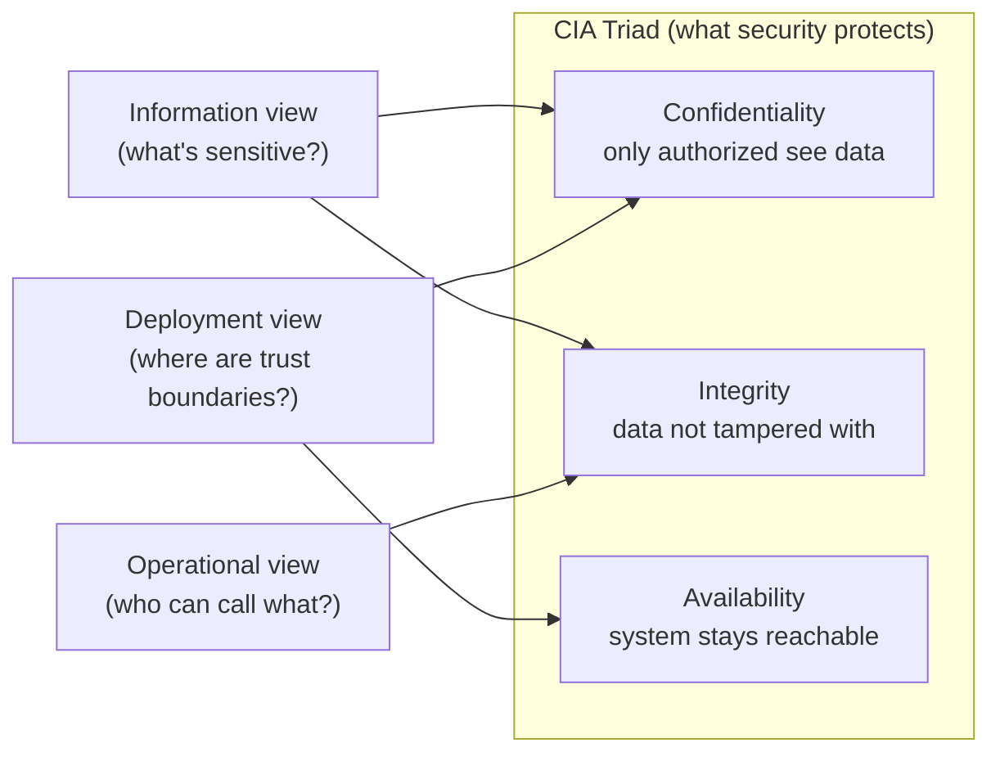

# 🧠 Topic: Security Perspective

> [!abstract] Executive Summary (ELI5)
> The Security Perspective asks: **can the wrong people do the wrong things to our data and system?** It's a lens you apply *to* existing views — not a diagram of its own. You hold it up to the Information view ("what data needs protecting?"), the Deployment view ("where are the trust boundaries?"), and the Operational view ("who can call what?") and demand refinements: encryption here, authentication there, least-privilege everywhere.

> [!warning] The #1 confusion — Security is a perspective, not a viewpoint
> There is no "security diagram." Security is a quality concern you *apply to* other views. You take the Security perspective + the Deployment view → "is this deployment secure?" You take Security + Information → "is this data protected?" The perspective drives refinements to those existing views; it never produces a standalone picture.

---

## 🎯 The "Why"

- **Problem Solved:** Security bolted on after launch is expensive, incomplete, and often too late. Applying the Security perspective *during design* surfaces threats (who can reach this data? what if this credential leaks?) while changes are still cheap. It also enforces the ** CIA triad ** — Confidentiality, Integrity, Availability of data and access — as an explicit design concern.
- **Alternatives:** "We'll add auth later," "we trust the internal network," "compliance will audit us." All of these defer security until it's a production incident or a regulatory fine.
- **Trade-offs:** Rigorous security adds friction — more auth checks, encryption overhead, stricter deployment boundaries. The discipline is to match the controls to the *actual* sensitivity and threat model, not to gold-plate everything.

## 💡 Mental Model & Analogy

- **Analogy:** The Security perspective is a **building's security audit**. The floor plan (the view) already exists — rooms, doors, corridors. The auditor walks it asking: "which doors need locks?", "who has keys?", "is the safe in a restricted area?", "what happens if a window breaks?" The audit doesn't redraw the building; it produces a list of changes — add locks, restrict access, install alarms. Same building, evaluated for security.

## 🛠️ Core Principles

1. **Security is applied *to* views, not drawn separately.** Hold the Security lens up to Information (data sensitivity), Deployment (trust boundaries), Operational (access paths), and Context (external actors).
2. **The CIA triad is the backbone.** *Confidentiality* — only authorized can read. *Integrity* — data can't be tampered with. *Availability* — the system resists denial of service. Every control maps to at least one.
3. **Threats first, controls second.** Before choosing controls (encryption, auth), identify *who* the attackers are and *what* they want (threat modeling). Controls without a threat model are cargo-cult security.
4. **Defense in depth.** No single control is trusted alone — layers: network (firewall), host (OS hardening), app (auth/authz), data (encryption). A breach of one layer is caught by the next.
5. **Least privilege.** Every component, user, and integration gets the minimum access needed to do its job — and no more. Over-permissioned services are the most common breach vector.

## 🏗️ Key Security Concerns (applied to views)

### Applied to the Information View
*What data needs protecting, and how?*
- Identify sensitive data (PII, PCI, PHI, credentials) — this is where [[Information Viewpoint]] flags it; Security decides *how* to protect it.
- **Encryption at rest and in transit.**
- **Minimization** — don't store what you don't need (the data you don't have can't leak).
- **Retention** — delete sensitive data when its purpose is served.

### Applied to the Deployment View
*Where are the trust boundaries, and what crosses them?*
- **Trust zones** — public DMZ, private subnet, restricted data zone. Traffic between zones is controlled.
- **Firewalls / network segmentation** — what's blocked, what's permitted. PCI data is often isolated in its own network scope.
- **Secrets management** — where credentials live (vault, not source code), how they rotate.

### Applied to the Operational View
*Who can call what, and how is it proven?*
- **Authentication** (who are you?) and **Authorization** (what may you do?) on every external-facing entry point.
- **Audit logging** — who did what, when; especially for sensitive data access.
- **Secure journeys** — does the checkout flow protect the card data end-to-end, including the external crossing to the payment provider?

### Threat Modeling (the prerequisite)
*Before controls: who attacks, what do they want, how?*
- Identify assets (the sensitive data), threat actors (outsiders, insiders, compromised services), and attack surfaces (public APIs, third-party integrations).
- Common frameworks: STRIDE (Spoofing, Tampering, Repudiation, Information disclosure, Denial of service, Elevation of privilege).
- Output: a prioritized list of threats → each drives a control on one of the views.

## ↔️ How the Security Perspective Connects

| Applied to | The question it asks |
|---|---|
| [[Information Viewpoint]] | What data is sensitive, and how is it encrypted/minimized/retained? |
| [[Deployment Viewpoint]] | Where are the trust boundaries, and what controls the crossings? |
| [[Operational Viewpoint]] | Who can call what, and how is it authenticated/authorized/audited? |
| [[Context Viewpoint]] | Which external actors and systems are trusted, and how far? |
| [[Perspective]] siblings | Overlaps with [[Availability and Resilience Perspective]] (DoS resistance is both security and availability); with [[Location Perspective]] (data residency is a security/legal constraint). |

## ⚠️ Pitfalls & Anti-patterns

- **Controls without a threat model:** "let's encrypt everything" without knowing what the threats are. Cargo-cult security adds cost without addressing real risks.
- **Trusting the internal network:** "our services are private, no need for auth between them." A single compromised service then has free rein — least privilege applies internally too.
- **Bolting security on late:** treating it as a pre-launch audit rather than a design-time perspective. Changes after build are 10–100× more expensive.
- **Over-permissioned services:** a service with admin DB credentials "for convenience." This is the most common lateral-movement vector in breaches.
- **Secrets in source code or configs:** credentials committed to repos or sitting in plaintext config. Use a vault with rotation.
- **Ignoring the Availability leg of CIA:** security isn't just secrecy — a system that can be trivially DoS'd fails the "A" in CIA.
- **Security as a single team's job:** making it "the security team's problem" instead of a cross-cutting perspective every architect applies.

## 🔗 Deep Connections

- **Parent Topic:** [[Perspective]] (the framework this belongs to), [[Viewpoint]] (the views this is applied *to*)
- **Most relevant viewpoints:** [[Information Viewpoint]] (data sensitivity), [[Deployment Viewpoint]] (trust boundaries), [[Operational Viewpoint]] (access control), [[Context Viewpoint]] (external trust)
- **Sibling perspectives:** [[Availability and Resilience Perspective]] (DoS is shared), [[Location Perspective]] (data residency), [[Cost Perspective]] (security controls cost money)
- **Related:** [[System Architecture]] (Quality Attributes — security is one), [[Information Viewpoint]] → sensitive data section
- **Prerequisites:** [[Perspective]], [[Viewpoint]], [[Information Viewpoint]].

## ❓ Active Recall Questions

> [!faq]- What does the Security Perspective protect, and what's the underlying model?
> It protects the **CIA triad** — Confidentiality (only authorized can read data), Integrity (data can't be tampered with), Availability (system resists denial of service). Every security control maps to at least one of these three.

> [!faq]- Why is "show me the security diagram" a category error?
> Because security is a *perspective*, not a *viewpoint* — it produces no diagram of its own. You apply the Security perspective *to* an existing view (Information, Deployment, Operational) to evaluate and refine it. There's no standalone "security picture."

> [!faq]- Why must threat modeling precede control selection?
> Because controls without a threat model are cargo-cult security — you don't know which threats you're addressing. Threat modeling identifies assets, threat actors, and attack surfaces *first*, producing a prioritized threat list that each drives a specific control. Otherwise you encrypt everything while leaving the real attack vector open.

> [!faq]- What does "least privilege" mean, and why is over-permissioning dangerous?
> Least privilege: every component/user/integration gets the minimum access needed, and no more. Over-permissioned services (e.g., a service with admin DB credentials) are the most common lateral-movement vector — once compromised, an attacker escalates freely because the service already has the keys.

> [!faq]- How does the Security Perspective relate to the Availability and Resilience Perspective?
> They overlap on **denial-of-service resistance** — a system trivially DoS'd fails the "Availability" leg of the CIA triad, so it's both a security concern and a resilience concern. The two perspectives must be applied together for systems facing load-based attacks.

---

## 📝 Related Notes

- [[Perspective]]
- [[Information Viewpoint]]
- [[Deployment Viewpoint]]
- [[Operational Viewpoint]]
- [[Availability and Resilience Perspective]]
- [[Location Perspective]]
