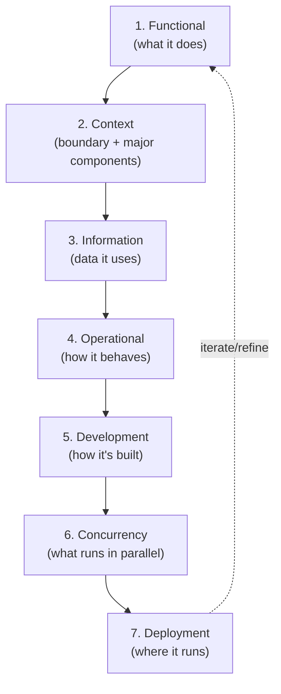

# 🧠 Topic: How to Create an Architecture Model

> [!abstract] Executive Summary (ELI5)
> Creating an architecture model means walking through the viewpoints in a deliberate order, each one building on the last, until you have a coherent picture of the system. There are **two starting situations**: building a model **from scratch** (greenfield — you decide the shape) and building a model **for an existing system** (brownfield — you reverse-engineer the shape that already exists). The viewpoints and end goal are the same; the *process* and *difficulty* differ.

> [!warning] The #1 mistake — drawing all viewpoints at once
> People open a tool and try to draw everything simultaneously — context, containers, data, deployment — in one pass. The result is chaos, because each viewpoint depends on the previous one. The process is **sequential by design**: Functional feeds Context, Context feeds Information, Information feeds Operational, and so on. Skip the order and the views contradict each other.

---

## 🎯 The "Why"

- **Problem Solved:** Without a process, architecture modeling becomes ad-hoc sketching — some views drawn, others forgotten, all inconsistent. A defined sequence ensures every viewpoint gets its turn, each built on a stable foundation, and the final model is coherent enough to guide implementation or explain an existing system.
- **Alternatives:** "Start with the database schema" or "start with the deployment diagram." These invert the order — you end up modeling *how* before *what*, and the early views lack the context that later viewpoints need. The viewpoint order exists for a reason.
- **Trade-offs:** The full sequence is effortful. For small systems you may collapse steps; for large ones you'll iterate the sequence multiple times. The discipline is to *always start at Functional/Context*, even for a quick model.

## 💡 Mental Model & Analogy

- **Analogy:** Building a model is like **writing a biography** in chapters. You don't start with "where they lived in chapter 7." You start with *who they are* (Context), then *what they did* (Functional), then *what they cared about* (Information), then *how their life unfolded* (Operational), and only then *where they lived and worked* (Deployment). Each chapter references the previous. Skip ahead and the story doesn't hold together.

The dashed arrow is key: this isn't strictly linear. Later viewpoints reveal gaps that send you back to refine earlier ones. It's a spiral, not a straight line.

## 🛠️ The Two Cases

| | **Case 1: From scratch (greenfield)** | **Case 2: For an existing system (brownfield)** |
|---|---|---|
| Starting point | Requirements, vision, a blank page | A running system with code, data, users |
| Goal | Decide the shape the system *will* have | Discover and document the shape it *already* has |
| Source of truth | Requirements, stakeholders, constraints | The code, the running system, the people who built it |
| Main risk | Over-designing for hypothetical needs | Missing the "why" behind decisions; capturing current state, not intended design |
| Difficulty | Lower — you control the decisions | Higher — you must reverse-engineer, untangle accreted complexity, and find people who remember why |
| Same output | The full set of viewpoints, coherently connected | The full set of viewpoints, coherently connected |

> Both cases produce the same artifact: a coherent architecture model. The difference is *where the answers come from* — your design decisions (greenfield) vs. the existing code and people (brownfield).

## 🏗️ The 7-Step Process (from scratch)

Each step is one viewpoint, building on the previous. This is the recommended order; it exists because each viewpoint depends on the one before it.

### Step 1 — Functional Viewpoint
*What must the system do?*
- Identify the **features, services, and user actions** the system needs to support.
- Capture them as **capabilities and use cases** — see [[Functional Viewpoint]].
- This is the foundation: every later viewpoint must serve these functions.
- *Output:* a list of capabilities and key use cases.

### Step 2 — Context Viewpoint
*What is the boundary, and what are the major pieces inside it?*
- Define the **system boundary** — what's "the system" vs. the outside world.
- Identify **external actors** (users, other systems) and **external dependencies**.
- **Group responsibilities into major components** — the first cut at internal structure.
- This is C4 Level 1 (System Context) — see [[Context Viewpoint]].
- *Output:* a context diagram + the major component groupings.

### Step 3 — Information Viewpoint
*What data does the system create and use?*
- Identify the **key entities** and their relationships — see [[Information Viewpoint]].
- Start **conceptual** (entities + relationships), then **logical** (attributes, keys).
- Flag **sensitive/regulated data** (PII, PCI, PHI) — this propagates into Security, Deployment, Location.
- The entities come from the Functional use cases (Step 1).
- *Output:* a conceptual data model + sensitive-data annotations.

### Step 4 — Operational Viewpoint
*How will the system behave during normal operation?*
- **Connect everything** — trace the user journeys and automated sequences through the components, data, and external systems.
- This is the integrator step: it validates that Steps 1–3 actually compose — see [[Operational Viewpoint]].
- If a journey can't be traced cleanly, an earlier step has a gap.
- *Output:* key user journeys + automated sequences, traced end-to-end.

### Step 5 — Development Viewpoint
*How will the system be built?*
- Decide the **code organization** — modules, packages, layers — see [[Development Viewpoint]].
- Define the **dependency rules** between layers/modules.
- Plan the **build and assembly** into the runtime containers.
- *Output:* module/layer structure + dependency rules + build approach.

### Step 6 — Concurrency Viewpoint
*What will run in parallel, and where do you need scalability or async?*
- Identify the **runtime units** and where **parallelism, scalability, or async processing** is needed — see [[Concurrency Viewpoint]].
- Decide where work is synchronous vs. queued; where state is shared vs. isolated.
- This is where performance/scalability concerns first shape the structure.
- *Output:* concurrency model — parallel units, shared state, async paths.

### Step 7 — Deployment Viewpoint
*Where will it run?*
- Map the containers onto **environments, nodes, and networks** — see [[Deployment Viewpoint]].
- Decide regions, scaling topology, network boundaries, third-party endpoints.
- This is where Location, Cost, and Availability perspectives bite hardest.
- *Output:* deployment diagram + container-to-node mapping.

> After Step 7, **iterate**. Applying perspectives (Security, Performance, Availability, etc.) to the views will reveal gaps that send you back to refine earlier viewpoints. The process is a spiral, not a straight line.

## 🔄 Adapting the Process for an Existing System (brownfield)

The viewpoint sequence is the **same**, but the *method* changes:

1. **Start by exploring, not deciding.** Read the code, talk to the people who built it, observe the running system. The answers already exist — your job is to find them.
2. **Work both directions.** From code you can often reconstruct Development, Concurrency, and Deployment directly. Functional, Context, and Information may require interviewing stakeholders to recover the *intent* behind what was built.
3. **Capture the "why," not just the "what."** An existing system's architecture includes the decisions and constraints behind it. Code shows you *what* was built; only people and history tell you *why*. Prioritize capturing rationale before the people who remember leave.
4. **Distinguish intended vs. accreted design.** Brownfield systems accumulate complexity that was never designed — workarounds, patches, "temporary" solutions that became permanent. Note these separately; they're often the most important findings.
5. **Expect more iteration.** You'll discover contradictions (the code says one thing, the docs another, the team remembers a third). Reconciling these takes multiple passes.

> The hardest part of brownfield modeling is usually **finding the "why."** Code is silent about the constraints and trade-offs that shaped it. Capture the rationale while the people who hold it are still around.

## ⚠️ Pitfalls & Anti-patterns

- **Drawing all viewpoints at once:** chaotic and inconsistent. Follow the sequence; each view builds on the previous.
- **Skipping Functional/Context and jumping to Deployment:** you model *where* before *what* and *why*. The early views lack the foundation later ones need.
- **Treating it as strictly linear:** the process is a spiral. Later viewpoints reveal gaps that require refining earlier ones. Iterate.
- **For brownfield: only reading the code:** code shows *what*, not *why*. Missing the rationale produces a model that documents current state but misses the constraints that will guide future change.
- **For greenfield: over-modeling:** designing every viewpoint in full detail before writing any code. Model enough to guide the next decision, then build, then refine the model.
- **Forgetting to apply perspectives after the views:** the viewpoints give you structure; the perspectives (Security, Performance, etc.) evaluate and refine it. Skipping perspectives leaves quality unaddressed.
- **Producing a model that goes stale:** a model is living documentation. If it's not updated as the system changes, it quietly becomes a lie — see [[Model]] pitfalls.

## 🔗 Deep Connections

- **Parent Topic:** [[System Modeling]] (the activity this process belongs to), [[Modeling Software Architecture]]
- **The 7 steps, as notes:** [[Functional Viewpoint]] → [[Context Viewpoint]] → [[Information Viewpoint]] → [[Operational Viewpoint]] → [[Development Viewpoint]] → [[Concurrency Viewpoint]] → [[Deployment Viewpoint]]
- **After the views: apply perspectives:** [[Perspective]] → [[Security Perspective]], [[Performance and Scalability Perspective]], [[Availability and Resilience Perspective]], [[Evolution Perspective]], [[Development Resource Perspective]], [[Cost Perspective]], [[Location Perspective]]
- **Related:** [[Model]] (the output of this process), [[System]] (what you're modeling), [[Levels of Abstraction]] (which system you're modeling), [[Communicating the Model]] (the model must be communicated, not just drawn), [[How to Document the Architecture Model]] (the next step once the model exists — Proposal / ADD / ADR)
- **Prerequisites:** [[System Modeling]], [[Viewpoint]], [[Perspective]].

## ❓ Active Recall Questions

> [!faq]- What are the two cases for creating an architecture model, and how do they differ?
> **From scratch (greenfield):** you *decide* the shape the system will have, sourcing answers from requirements and stakeholders. **For an existing system (brownfield):** you *discover and document* the shape that already exists, sourcing answers from code, the running system, and the people who built it. Both produce the same artifact (a coherent set of viewpoints); they differ in where the answers come from and in difficulty (brownfield is harder — you must reverse-engineer and recover the "why").

> [!faq]- What is the recommended sequence of viewpoints when modeling from scratch, and why that order?
> Functional → Context → Information → Operational → Development → Concurrency → Deployment. Each viewpoint *depends on the previous*: Functional defines what the system does, Context scopes it and groups components, Information identifies the data those functions use, Operational validates they compose, Development decides how it's built, Concurrency identifies parallelism/scalability, and Deployment places it on nodes. Skip the order and the views contradict each other.

> [!faq]- Why is the process a spiral rather than a straight line?
> Because later viewpoints reveal gaps in earlier ones — e.g., Deployment may surface a latency problem that requires revisiting Concurrency, or Operational may reveal a missing entity in Information. After the first pass you apply perspectives (Security, Performance, etc.), which expose further gaps. The process iterates: each loop refines the model.

> [!faq]- What's the hardest part of modeling an existing system, and why?
> Recovering the **"why"** behind decisions. Code shows *what* was built, but it's silent about the constraints, trade-offs, and intent that shaped it. Only the people who built the system hold that rationale — and capturing it before they leave (or forget) is critical, because it's what guides future change. Also: untangling accreted complexity (workarounds that became permanent) that was never designed.

> [!faq]- Why must perspectives be applied after the viewpoints are drawn?
> Because viewpoints give you *structure*; perspectives evaluate *quality*. A complete set of viewpoints says nothing about whether the system is secure, fast, or resilient. Applying [[Perspective]] concerns (Security, Performance, Availability, etc.) to the views is what surfaces quality gaps and drives refinements — it's the second half of the process.

---

## 📝 Related Notes

- [[System Modeling]]
- [[Functional Viewpoint]]
- [[Context Viewpoint]]
- [[Information Viewpoint]]
- [[Operational Viewpoint]]
- [[Development Viewpoint]]
- [[Concurrency Viewpoint]]
- [[Deployment Viewpoint]]
- [[Perspective]]
- [[Model]]
- [[How to Document the Architecture Model]]
