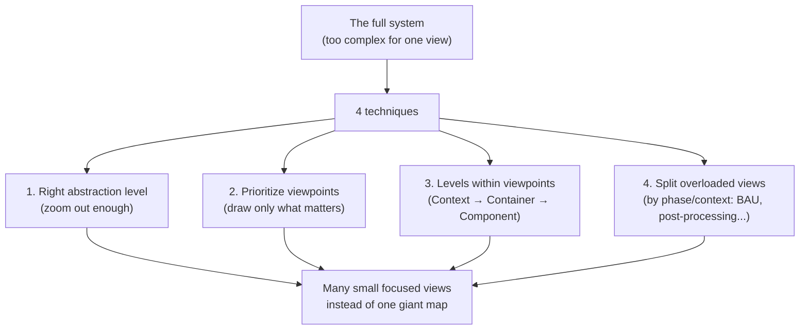

# 🧠 Topic: Handling the Complexity of an Architecture Model

> [!abstract] Executive Summary (ELI5)
> Real systems are too complex to show on one diagram. If you try, you get an unreadable wall of boxes that satisfies nobody. Handling complexity means **deliberately choosing what to show, at what zoom, and what to leave out** — using four techniques: pick the right abstraction level, prioritize the viewpoints that matter most, use levels *within* a viewpoint to zoom, and split overloaded views by phase/context. The goal is many small, focused views — never one giant map.

> [!warning] The #1 mistake — Putting everything on one diagram
> People draw every component, every connection, every environment on a single canvas "so it's all in one place." The result is an unreadable map nobody uses. **A diagram is not a database.** Its job is to answer one question for one audience. Complexity is handled by *splitting and zooming*, not by cramming everything in.

---

## 🎯 The "Why"

- **Problem Solved:** Architecture models of real systems are inherently complex — dozens of components, hundreds of relationships, multiple environments, many stakeholders. Showing all of it at once produces a model so dense it communicates nothing. The techniques below let you keep the model complete *across many views* while keeping each individual view simple enough to read and act on.
- **Alternatives:** "Just draw the high-level overview." This satisfies executives but hides the detail developers need. Or "draw the full detail" — satisfies nobody. Neither works; the answer is *multiple views at different zoom levels*.
- **Trade-offs:** More views mean more artifacts to keep consistent. The payoff is that each stakeholder gets a view tuned to their concern — readable, focused, and actionable.

## 💡 Mental Model & Analogy

- **Analogy:** Handling model complexity is like using an **online map**. You never look at "the whole map at full detail" — it's a wall of streets. Instead you zoom out for the region, zoom in for the city, and switch layers (transit, traffic, satellite). Each view answers one question. The same place, many zoom levels, many layers — that's how you handle complexity without losing information. One giant detailed map would be useless.

## 🛠️ The Four Techniques

### Technique 1 — Choose the right level of abstraction
*Zoom out until the picture is readable; resist the urge to show internals too early.*

- **Start high, drill down on demand.** The C4 model is built on this: System Context (one box) → Container (major units) → Component (internals) → Code (rarely). See [[Levels of Abstraction]].
- **Match the zoom to the audience.** Executives need Context; developers need Container/Component. Showing the wrong zoom to the wrong audience is noise — see [[Communicating the Model]].
- **The discipline of omission.** Abstraction is *choosing what to hide*. A good context diagram hides internals on purpose — that's its value (see [[Context Viewpoint]]).
- **Rule of thumb:** if a view has more than ~15–20 elements, you're probably at the wrong zoom level — step back or split.

### Technique 2 — Prioritize the most valuable viewpoints
*You don't need all seven viewpoints for every system. Draw the ones that answer real questions.*

- **Risk-driven selection.** A payment system leans on [[Information Viewpoint]] + [[Security Perspective]] + [[Deployment Viewpoint]]. A streaming platform leans on [[Concurrency Viewpoint]] + [[Performance and Scalability Perspective]]. Pick the viewpoints that address your system's biggest risks — see [[Perspective]] → "How to select perspectives."
- **Start with the essential few.** Functional, Context, and Information are almost always needed. Concurrency, Development, Operational, Deployment are added when the questions demand them.
- **Not every viewpoint needs a full diagram.** Sometimes a short textual description is enough for a low-risk viewpoint; save the detailed modeling for the ones that matter.
- **Rule of thumb:** if no stakeholder is asking the question a viewpoint answers, don't invest in drawing it deeply.

### Technique 3 — Use levels within viewpoints
*Even within one viewpoint, use the C4-style zoom to keep each level readable.*

- **C4 levels are the canonical example.** The same system at Context (1 box) → Container (~6 boxes) → Component (~15 boxes per container) → Code. Each level is readable; together they're complete. See [[Context Viewpoint]] → "Where it sits in the C4 model."
- **Cross-cutting with abstraction levels.** Enterprise/Solution/System (see [[Levels of Abstraction]]) are zoom across systems; C4 levels are zoom within one system. Combine them: any viewpoint can be drawn at any level.
- **Drill-down links.** Each level links to the next. A reader starts at Context and drills into the container/component they care about — progressive disclosure in action.
- **Rule of thumb:** don't draw a Component diagram if a Container diagram already answers the question. Stop drilling when the question is answered.

### Technique 4 — Split overloaded views into phases/contexts
*When one viewpoint's diagram is still too dense, split it by business phase or context.*

- **Split by operational phase.** A system with very different behaviors can be split into views by phase:
  - **BAU (Business As Usual)** — normal operation: users place orders, the system serves requests.
  - **Post-processing / batch** — nightly invoicing, reporting, reconciliation, cleanup.
  - **Onboarding / setup** — initial configuration, data migration.
  - **Exception/failure handling** — what happens during incidents, recovery.
- **Split by user journey or bounded context.** For a large system, draw the Operational view per journey (checkout, returns, admin) instead of one mega-flow.
- **Split by environment.** Dev vs. staging vs. prod may differ enough to warrant separate Deployment views — see [[Deployment Viewpoint]].
- **Each split view stays focused and readable.** The full picture is the *union* of the split views, cross-referenced — not a single overloaded canvas.
- **Rule of thumb:** if a single diagram can't fit on one screen without becoming unreadable, it's telling you to split by phase/context/journey.

## 📊 The Four Techniques at a Glance

| Technique | Question it answers | Example |
|---|---|---|
| **1. Right abstraction level** | How much to show? | Context (1 box) vs Container (6 boxes) — zoom out for execs |
| **2. Prioritize viewpoints** | Which views to draw at all? | Payment system → Information + Security + Deployment; skip Concurrency |
| **3. Levels within viewpoints** | How to zoom *inside* one viewpoint? | Context → Container → Component drill-down |
| **4. Split overloaded views** | What to do when one view is still too dense? | Split Operational into BAU / batch / onboarding / failure-handling |

## ⚠️ Pitfalls & Anti-patterns

- **Putting everything on one diagram:** the classic. Result: an unreadable wall of boxes nobody uses. A diagram is not a database — split and zoom.
- **Drawing all viewpoints equally deeply:** analysis paralysis. Prioritize by risk; some viewpoints need only a sentence, others a full diagram.
- **Wrong zoom for the audience:** showing Component detail to executives, or Context-only to developers. Match the abstraction level to the audience.
- **Skipping the drill-down levels:** drawing only Context and declaring done. Developers then lack the Container/Component detail they need. Each level serves a different reader.
- **Forgetting to split by phase:** one giant Operational flow that mixes BAU, batch, and failure handling. Each phase has different behavior; mixing them hides the differences.
- **Over-splitting:** so many tiny views that nobody can find anything. Balance focus with navigability — maintain an index/map that links them.
- **Inconsistent split views:** the same component named or drawn differently across split views. Consistency across views is what makes the model trustworthy.
- **Modeling without a question:** drawing views because "we should have them," not because they answer a stakeholder question. Purposeless views add noise — see [[Model]].

## 🔗 Deep Connections

- **Parent Topic:** [[System Modeling]], [[Architecture Model]] (this is *how* you keep the modeling process manageable), [[Modeling Software Architecture]]
- **Technique foundations:** [[Levels of Abstraction]] (technique 1 & 3), [[Viewpoint]] + [[Perspective]] (technique 2 — risk-driven selection), [[Communicating the Model]] (progressive disclosure)
- **Where the techniques apply:** all viewpoints — [[Context Viewpoint]], [[Container Viewpoint]], [[Functional Viewpoint]], [[Information Viewpoint]], [[Operational Viewpoint]], [[Development Viewpoint]], [[Concurrency Viewpoint]], [[Deployment Viewpoint]]
- **Related:** [[Mental Model]] (a view's job is to build a mental model, not to exhaustively document), [[Model]] (a model is purposeful abstraction — never "everything")
- **Prerequisites:** [[System Modeling]], [[Viewpoint]], [[Levels of Abstraction]].

## ❓ Active Recall Questions

> [!faq]- Why does "putting everything on one diagram" fail, and what's the alternative?
> Because a real system has too many components/connections to show at once — the result is an unreadable wall of boxes that communicates nothing. A diagram is not a database; its job is to answer one question for one audience. The alternative is **many small, focused views at different zoom levels and phases**, cross-referenced — the full picture is their union, never a single overloaded canvas.

> [!faq]- What are the four techniques for handling model complexity?
> (1) **Choose the right abstraction level** — zoom out until readable, match to audience. (2) **Prioritize viewpoints** — draw only the ones that answer real stakeholder questions, risk-driven. (3) **Use levels within viewpoints** — C4 Context → Container → Component drill-down. (4) **Split overloaded views** by phase/context — e.g., BAU vs. batch vs. failure-handling.

> [!faq]- How do you decide which viewpoints to prioritize?
> By **risk**: identify the system's biggest risks (data privacy for healthcare, load for e-commerce) and draw the viewpoints that address them. Functional, Context, and Information are almost always needed; Concurrency, Development, Operational, Deployment are added when their questions are actually being asked. If no stakeholder is asking a viewpoint's question, don't invest in drawing it deeply.

> [!faq]- Give an example of splitting an overloaded view by phase.
> An Operational view that's too dense can be split by operational phase: **BAU** (normal operation — users place orders, requests served), **post-processing/batch** (nightly invoicing, reporting, reconciliation), **onboarding/setup** (initial config, data migration), and **failure handling** (incident response, recovery). Each phase has very different behavior; splitting keeps each view focused and reveals differences a mega-flow would hide.

> [!faq]- How do abstraction levels (Enterprise/Solution/System) relate to C4 levels (Context/Container/Component)?
> They're orthogonal and combine. Enterprise/Solution/System are zoom levels *across systems* (see [[Levels of Abstraction]]); C4 levels are zoom levels *within one system*. Any viewpoint can be drawn at any abstraction level — e.g., a Container diagram is always at the System level of abstraction. Using both axes gives you a two-dimensional zoom for managing complexity.

---

## 📝 Related Notes

- [[System Modeling]]
- [[Architecture Model]]
- [[Levels of Abstraction]]
- [[Viewpoint]]
- [[Perspective]]
- [[Communicating the Model]]
- [[Context Viewpoint]]
- [[Model]]
