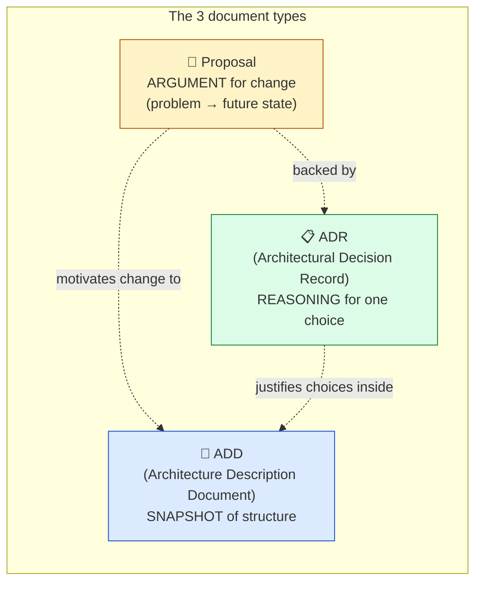
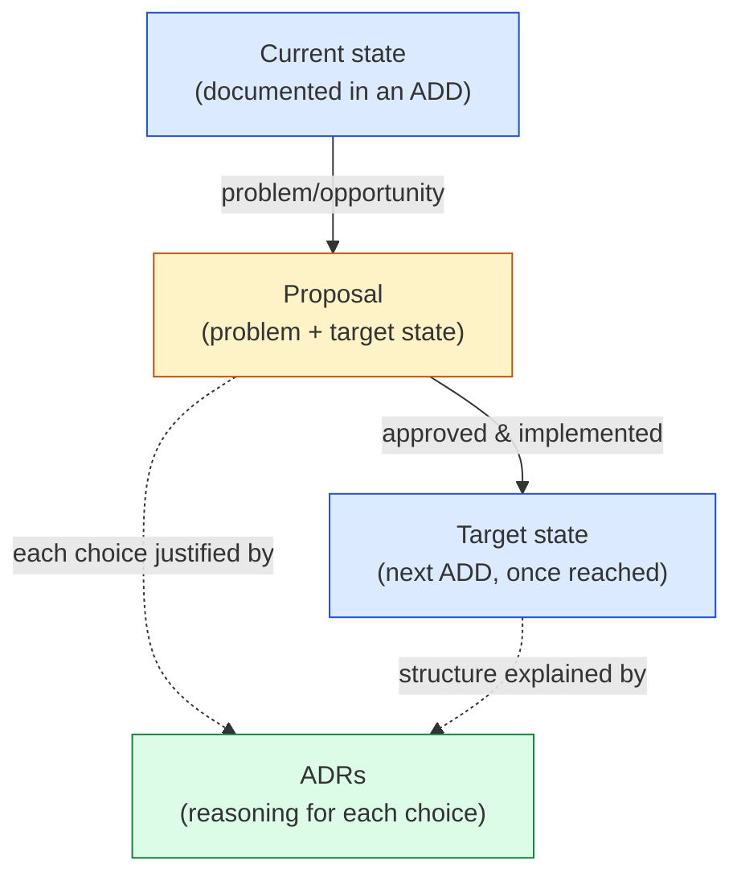

# 🧠 Topic: How to Document the Architecture Model

> [!abstract] Executive Summary (ELI5)
> Drawing the model is only half the job — you must also **write it down** so it survives the meeting, the quarter, and the people who built it. Architecture documentation is not one monolithic document; it is **three complementary types**, each answering a different question. A **Proposal** argues for change ("here is the problem, here is the future state I propose"). An **Architecture Description Document (ADD)** is a snapshot of the system as it is or will be ("here is the architecture at this point in time"). An **Architectural Decision Record (ADR)** captures one decision and its reasoning ("we chose X over Y because Z"). Together they form a layered trail: the ADD describes the structure, the Proposal motivates change to it, and the ADRs explain *why* that structure is the way it is.

> [!warning] The #1 confusion — conflating the three document types
> Teams often try to make one document do everything: describe the system *and* justify changes *and* record decisions. The result is a sprawling, perpetually-out-of-date wall of text that nobody reads. Each document type has a **different purpose, a different lifespan, and a different update cadence**. Keeping them separate is what keeps each one useful. The ADD is a snapshot (rarely updated); the Proposal is a one-shot argument (written once, then superseded by the change); the ADR is immutable history (write once, never edit).

---

## 🎯 The "Why"

- **Problem Solved:** Without structured documentation, architectural knowledge lives only in the heads of the people who built it — and walks out the door when they leave. Meetings re-litigate decisions because nobody remembers *why* a choice was made. New joiners ramp up slowly because there is no authoritative picture of the system. These three document types give that knowledge a durable, searchable home, each tuned to a specific need.
- **Alternatives:** "The code is the documentation." Code shows *what* the system does, but is silent about *why* — the constraints, alternatives, and trade-offs behind each decision. "Just keep a wiki." A wiki with no structure decays into an unsearchable graveyard; these three types impose structure so documentation stays navigable.
- **Trade-offs:** Writing documentation costs time. The discipline is to write **only what has lasting value** — decisions that will be questioned, structures that will be referenced, changes that need approval. Ephemeral detail (current sprint tasks, transient states) belongs elsewhere.

## 💡 Mental Model & Analogy

- **Analogy:** Think of architecture documentation like the records of a **city planning office**. The **ADD** is the *city survey* — an authoritative snapshot of what the city looks like today (or on the day a plan is ratified). The **Proposal** is a *planning application* — "the waterfront is congested (problem); here is a proposed transit line (future state); approve it." The **ADR** is the *minutes of the council vote* — "we approved the tram over a bus route because of capacity, despite higher upfront cost." Three documents, three purposes, one coherent record.

- The **ADD** is the noun (a structure). The **Proposal** is the verb (a change). The **ADR** is the reason (a decision).
- Every Proposal and every significant ADD should be **backed by ADRs** — that is where the transparency and traceability live.

---

## 🛠️ The Three Document Types

### 1. Proposal

*A one-shot document that argues for a change to the architecture.*

- **Purpose:** To state a problem in the current architecture, frame the opportunities, and **propose a future state** — then seek approval to move toward it. It is persuasive by nature: it makes a case.
- **Structure (typical):**
  1. **Current state** — how things are today, and why that is a problem.
  2. **Problems & opportunities** — the pain points, risks, or strategic openings the change would address.
  3. **Proposed future state** — the target architecture you argue for.
  4. *(Optionally)* **intermediate states** — the transitional steps from current to target (these mirror the Transition Architectures from [[Architecture Time Horizons]]).
- **Lifespan:** Written once. Once the proposal is approved and the change happens, it is **superseded** — the new reality becomes the next ADD's "current state." It is a moment-in-time argument, not a living doc.
- **Refers to:** Architecture Description Documents (it describes the current/target state *in terms of* what an ADD would snapshot) and the viewpoints/perspectives used to model them.

> A Proposal is forward-looking and persuasive. It says "we should move from A to B, and here is why." Once the move happens, it has served its purpose.

### 2. Architecture Description Document (ADD)

*A snapshot of the system's architecture at a specific point in time.*

- **Purpose:** To be the **authoritative picture** of the architecture — what it looks like and how it is structured — frozen at one moment. It is descriptive, not persuasive: it documents what *is* (or what *will be* once a target is ratified), not what should be.
- **What it contains:**
  - **The current state** — the architecture as it exists today.
  - **The target state** — the architecture as it is intended to be (once agreed).
  - *(Optionally)* **intermediate/transition states** — snapshots along the way (Baseline → Transition → Target; see [[Architecture Time Horizons]]).
  - A **mix of viewpoints and perspectives**, typically presented via C4 modeling — Context, Container, Component diagrams, plus the relevant perspectives (Security, Performance, etc.). See [[C4 Model]] and [[Viewpoint]].
- **When created:** **Only when needed** — at major milestones, not on a regular schedule. Architecture evolves slowly; an ADD is a deliberate, occasional snapshot, not a continuously-updated log. If you find yourself updating an ADD every sprint, you are using the wrong tool (that is what code + ADRs are for).
- **Lifespan:** Long, but **point-in-time**. Each ADD is a freeze-frame; the next significant milestone produces a *new* ADD rather than endlessly editing the old one. This preserves history: you can look back at the ADD from a year ago and see what the architecture was then.

> The ADD is a photograph, not a video. You take a new photo at meaningful moments; you don't keep retouching the same one. Architecture that changes weekly doesn't belong in an ADD — it belongs in code, tickets, and ADRs.

### 3. Architectural Decision Record (ADR)

*A short, immutable record of a single architectural decision and the reasoning behind it.*

- **Purpose:** To capture **major choices** — the ones a future engineer will ask "why did we do it this way?" — and preserve the **context, alternatives considered, and reasoning** that led to the decision. It ensures decisions are **reviewed** (an ADR is typically a lightweight, written approval artifact) and **reversible-in-theory-but-stable-in-practice**: you don't re-litigate a decision unless you write a new ADR superseding it.
- **What it contains (typical ADR template):**
  1. **Title & status** — proposed / accepted / superseded / deprecated.
  2. **Context** — the situation, constraints, and forces that prompted the decision.
  3. **Decision** — the option chosen, stated plainly.
  4. **Alternatives considered** — the other options and why they were rejected (this is the most valuable section for future readers).
  5. **Consequences** — the trade-offs, positive and negative, of the chosen path.
- **Lifespan:** **Write-once, never edit.** When a decision is overturned, you do not delete the old ADR — you mark it *superseded* and write a new one that references it. This preserves the full history of architectural reasoning.
- **Role:** ADRs **support and extend** both Proposals and ADDs. A Proposal's recommended future state is backed by the ADRs that justify each choice in it; an ADD's structure is explained by the ADRs behind it. They are what give architectural work **transparency and traceability**.

> ADRs are the institutional memory of the architecture. Without them, every generation of engineers re-debates the same questions because the original reasoning was never written down.

---

## ↔️ How the Three Relate

| | **Proposal** | **ADD** | **ADR** |
|---|---|---|---|
| **Question it answers** | "What should change, and why?" | "What does the architecture look like (at time X)?" | "Why did we choose this over the alternatives?" |
| **Nature** | Persuasive (an argument) | Descriptive (a snapshot) | Justificatory (a rationale) |
| **Time orientation** | Future (proposes a target) | Present/target (freezes a state) | Past (records a decision already made) |
| **Lifespan** | One-shot, then superseded | Point-in-time; new ADD per milestone | Immutable; superseded only by a new ADR |
| **Update cadence** | Never (write once) | Only when needed, rarely | Never edit; add a new one to overturn |
| **Granularity** | Whole-system change | Whole-system (or large slice) | A single decision |
| **Refers to** | ADDs (current/target state) | Viewpoints, perspectives, C4 | The Proposal/ADD it supports |

**Read it as a story:** An ADD snapshots the **current state**. A Proposal identifies a problem with it and argues for a **target state**. Each significant choice in that proposal is backed by an **ADR**. Once approved and implemented, the target state becomes the **current state** of the *next* ADD — and the ADRs remain as the permanent reasoning trail.

## 📋 When to Use Which

| Situation | Document | Why |
|---|---|---|
| "The system can't scale; we need to redesign the data layer." | **Proposal** | You're arguing for a change — state the problem and the future state. |
| "We're kicking off a new major version / milestone. Capture what we're building." | **ADD** | You need an authoritative point-in-time snapshot. |
| "Should we use Kafka or RabbitMQ for the event bus?" | **ADR** | A single decision needs its context, alternatives, and reasoning recorded. |
| "A new VP wants to understand the current architecture." | **ADD** | Hand them the current-state ADD. |
| "Why is the auth service a separate container?" | **ADR** | Look up the ADR that decided it. |
| "We need approval to migrate from monolith to microservices." | **Proposal** (backed by ADRs) | Persuade stakeholders; back each choice with a decision record. |
| "Someone asks why a past decision was made." | **ADR** (possibly superseded) | The ADR preserves the historical reasoning. |

## ⚠️ Pitfalls & Anti-patterns

- **The mega-document:** trying to make one doc serve as Proposal + ADD + ADR log. It becomes an unreadable, perpetually-stale wall. Keep the three types separate.
- **Treating the ADD as continuously updated:** an ADD is a snapshot. If you're editing it every sprint, you've turned it into a living doc it isn't designed to be — use code + ADRs for fast-moving detail, and take a fresh ADD snapshot at real milestones.
- **Writing ADRs that lack alternatives:** an ADR without the "what else did we consider and reject" section is nearly useless to future readers, who face the same alternatives and need to know why they were dismissed. The alternatives section is the most valuable part.
- **Deleting superseded ADRs:** never delete. Mark *superseded* and write a new one that links to it. The history of overturned decisions is itself valuable — it stops the team re-debating settled questions.
- **Proposal without a problem statement:** a proposal that jumps straight to a solution without anchoring in the current-state problem reads as advocacy, not analysis. Always start from the pain.
- **Skipping ADR review:** an ADR is meant to ensure decisions are *reviewed*. If ADRs are written in a vacuum and never socialized/approved, they lose their quality-assurance function.
- **Documenting trivia in ADRs:** an ADR is for *major* choices (data store, messaging tech, sync vs async, security model), not every minor implementation decision. Flooding the ADR log with noise makes the important decisions unfindable.
- **Not linking the three together:** a Proposal that doesn't reference the ADDs it changes, or ADRs that don't link to the Proposal/ADD they support, breaks the traceability chain that makes the set valuable.

## 🔗 Deep Connections

- **Parent topic:** [[Communicating the Model]] — documentation *is* communication made durable; this note is the written-artifact counterpart to that concept. [[System Modeling]], [[Modeling Software Architecture]].
- **Lifecycle continuation:** [[How to Version Control the Architecture Model]] — once the documents exist, versioning manages their change over time (ADD re-cuts, append-only ADR log, diagrams-as-code).
- **The model being documented:** [[How to Create an Architecture Model]] (the 7-step process whose output these documents capture) — sibling note in `practice/`. [[Architecture Model]] (the artifact itself).
- **ADD time horizons:** [[Architecture Time Horizons]] — the ADD's current/intermediate/target states map directly onto Baseline / Transition / Target Architectures.
- **ADD content:** [[C4 Model]] (the C4 levels that populate an ADD), [[Viewpoint]] (the viewpoints mixed into an ADD), [[Perspective]] (the perspectives applied).
- **Traceability & decisions:** ADRs are the mechanism that gives architectural work transparency; they are what makes an [[Architecture Model]] auditable rather than opaque.
- **Broader framework context:** [[Architecture Development Method]] (TOGAF ADM produces Request for Architecture Work / architecture contracts that play a similar proposal-and-approval role), [[Architecture Content Framework]] (TOGAF catalogs/matrices/diagrams are the structured content an ADD assembles).
- **Prerequisites:** [[Communicating the Model]], [[Architecture Model]], [[Viewpoint]], [[C4 Model]].

## ❓ Active Recall Questions

> [!faq]- What are the three types of architecture documents, and what question does each answer?
> **Proposal** — "what should change, and why?" (an argument for a future state). **Architecture Description Document (ADD)** — "what does the architecture look like at this point in time?" (a snapshot). **Architectural Decision Record (ADR)** — "why did we choose this over the alternatives?" (the reasoning for one decision). They are complementary: Proposal = verb/change, ADD = noun/structure, ADR = reason/decision.

> [!faq]- What is an ADD, and why is it created only when needed rather than updated regularly?
> An ADD is a **point-in-time snapshot** of the system's architecture (current state, target state, optionally intermediate states), assembling a mix of viewpoints/perspectives/C4 diagrams. It is created **only at major milestones** because architecture evolves slowly — it's a photograph, not a video. Continuously editing an ADD turns it into something it isn't; fast-moving detail belongs in code and ADRs. Each milestone produces a *new* ADD, preserving history.

> [!faq]- What does an ADR capture, and why must it never be edited or deleted?
> An ADR captures one major decision: its **context, the decision, the alternatives considered, and the consequences**. The alternatives section is the most valuable — it tells future readers what was rejected and why, so they don't re-debate settled questions. ADRs are **write-once**: when overturned, you mark the old one *superseded* and write a new one referencing it. Deleting or editing would destroy the history of architectural reasoning.

> [!faq]- How do the three document types relate to each other?
> An ADD snapshots the **current state**. A Proposal identifies a problem and argues for a **target state**, drawing on ADDs to describe current and target. Each significant choice in the proposal is backed by an **ADR**. Once approved and implemented, the target becomes the current state of the *next* ADD, while the ADRs remain as the permanent reasoning trail. ADRs thus **support and extend** both Proposals and ADDs, giving the work transparency and traceability.

> [!faq]- Why is "one document that does everything" an anti-pattern?
> Because each type has a different purpose, lifespan, and update cadence. An ADD is a rarely-updated snapshot; a Proposal is a one-shot argument; an ADR is immutable history. Merging them produces a sprawling doc that is simultaneously trying to describe structure, persuade change, and record decisions — and ends up perpetually stale and unread. Keeping them separate keeps each one useful.

> [!faq]- What should an ADR's "alternatives considered" section contain, and why does it matter most?
> It should list the realistic options that were weighed (not a strawman) and, for each, why it was rejected — on what grounds (cost, complexity, team skills, constraints). This matters most because it's exactly what a future engineer needs when they face the same alternatives: knowing *why* an option was dismissed stops them from re-litigating the decision or accidentally reintroducing a rejected approach.

---

## 📝 Related Notes

- [[Communicating the Model]]
- [[How to Create an Architecture Model]]
- [[Architecture Model]]
- [[How to Version Control the Architecture Model]]
- [[Architecture Time Horizons]]
- [[C4 Model]]
- [[Viewpoint]]
- [[Perspective]]
- [[Architecture Development Method]]
- [[Architecture Content Framework]]
- [[System Modeling]]
