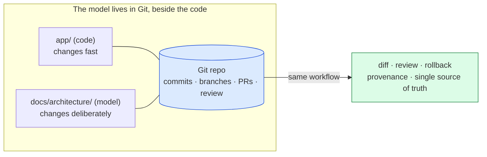
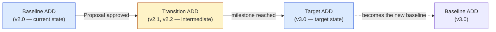

# 🧠 Topic: How to Version Control the Architecture Model

> [!abstract] Executive Summary (ELI5)
> An architecture model is a **living artifact**: the system changes, so the model must change too, or it quietly becomes a lie. **Version control** is how you manage that change deliberately — recording what changed, when, why, and by whom, so you can trace the model's history, roll back mistakes, and keep documentation and reality in sync. The model is not one thing but three ([[How to Document the Architecture Model]]: Proposal, ADD, ADR), and each is versioned **differently**: the ADD is a snapshot you re-cut, the ADR is an append-only log you never rewrite, and the diagrams underneath them are best kept as **text (diagrams-as-code)** so they diff and review like source code. Treat the model the way you treat the codebase, and most problems disappear.

> [!warning] The #1 mistake — versioning the model as a black box
> Teams store architecture docs as binary files (`.docx`, `.png`, `.drawio` binaries, PDF exports) and "version" them by copying `Architecture_v2_final_FINAL.docx` into a shared drive. None of that is real version control: you can't see *what* changed between versions, can't review a change before it lands, can't diff a diagram, and can't answer "why does the model say X when the code says Y?" Real version control means **text-based artifacts under a VCS (Git)**, with meaningful commit messages, review, and a defined cadence — the same discipline as the code.

---

## 🎯 The "Why"

- **Problem Solved:** Without version control, architecture documentation either (a) **rots** — nobody dares touch the "official" diagram, so it drifts from reality until it's useless; or (b) **fragments** — every team keeps a private copy and nobody knows which is authoritative. Version control fixes both: change becomes cheap and safe (you can always roll back), provenance is automatic (who changed what, when, why), and there is one source of truth that everyone references.
- **Alternatives:** "Final-final" file naming on a shared drive; wiki pages with a revision history nobody reads; Confluence pages where the last editor wins. All of these lack diffing, branching, review, and a guarantee that the doc matches the code.
- **Trade-offs:** Text-based diagrams (Mermaid, PlantUML, Structurizr) are slightly less polished than drag-and-drop tools, and there's a learning curve. The payoff is enormous: diagrams become reviewable, diffable, and automatable — and they stop rotting.

## 💡 Mental Model & Analogy

- **Analogy:** Treat the architecture model like the **source code** of the system's *intent*. You wouldn't manage code by emailing `.zip` files named `service_v3_realFinal.jar`; you use Git with commits, branches, PRs, and review. The model deserves the same treatment — it's just another codebase, one that describes the system rather than implementing it. The commit history of the model is the **narrative of how the architecture evolved**, and it's as valuable as the model itself.



Co-locating the model **in the same repo as the code** (or a closely-coupled one) is the single highest-leverage decision: a docs change can ship in the same PR as the code change that prompted it, so documentation and reality stay locked together.

## 🛠️ Versioning by Artifact Type

The model is documented through three artifact types ([[How to Document the Architecture Model]]), and each has a **different versioning model** — getting this wrong is the most common mistake.

| Artifact | Versioning model | Why |
|---|---|---|
| **ADD** (snapshot) | **Re-cut, don't edit.** Each major milestone produces a *new* dated ADD; the old one is archived, not overwritten. The ADD itself can carry a semantic version (e.g., `ADD v2.3`). | An ADD is a point-in-time photograph; editing it destroys the history it's meant to preserve. |
| **ADR** | **Append-only log.** Never edit or delete an ADR. To overturn a decision, mark it *superseded* and add a new ADR that links to it. The log *is* the version history. | ADRs are institutional memory; rewriting them erases the reasoning future engineers need. |
| **Proposal** | **Write-once, then superseded.** A proposal is a moment-in-time argument; once approved and implemented, it's done — the change becomes the next ADD's "current state." | A proposal is an argument for a specific change, not a living document. |
| **Diagrams** (underneath all three) | **Text-based, Git-versioned.** Keep diagrams as code (Mermaid, PlantUML, Structurizr DSL) so they diff and review like any other source. | Binary diagrams (`.png`, `.drawio`) can't be diffed or reviewed; text diagrams can. |

### The principle: edit cadence follows artifact nature

- **Fast-changing detail** (a container's components, a deployment tweak) → lives in code + ADRs, versioned continuously through Git.
- **Slow-changing structure** (the system's shape) → snapshotted periodically into a new ADD.
- **Permanent reasoning** (why a choice was made) → ADRs, never rewritten.

> If you find yourself continuously editing an ADD, you've confused the snapshot for the living layer. The ADD is the freeze-frame; the ADR log + code are where continuous change belongs.

## 🏗️ Practices for Versioning the Model

### 1. Keep diagrams as text (diagrams-as-code)

This is the foundation. A diagram stored as a `.png` or binary `.drawio` is a **black box** to version control: Git tracks that it changed, but not *what* changed, and you can't review a meaningful diff. A diagram stored as **text** (Mermaid, PlantUML, Structurizr DSL, C4-PlantUML) diffs line-by-line, reviews in a PR, and renders automatically.

| Format | Notation fit | Notes |
|---|---|---|
| **Mermaid** | [[Flowchart]], sequence, class, C4 (via `C4Context` macros) | Native to Markdown/Obsidian/GitHub — renders inline. Best default. |
| **PlantUML** | [[UML]], C4 (via C4-PlantUML macros) | Mature, expressive; needs a render step. |
| **Structurizr DSL** | [[C4 Model]] (all 4 levels) | First-class C4; can export to multiple notations. |
| **draw.io / `.drawio` XML** | General | The XML *is* text and diffs reasonably — store the `.drawio` source, not just PNG exports. |

> The test: *can I see what changed in a code review?* If yes, it's diagrams-as-code. If the reviewer sees only "binary file changed," it isn't.

### 2. Co-locate the model with the code

Put `docs/architecture/` (ADDs, ADRs, diagrams) **inside the same repository** as the code it describes (or a repo that the architecture PR can reference). This lets a documentation change ride in the **same PR** as the code change that caused it — the strongest possible guard against drift.

```
repo/
├── src/                        # the code
└── docs/architecture/
    ├── add/                    # dated snapshots: 2026-07-ADD-v2.md ...
    ├── adr/                    # 0001-use-postgres.md, 0002-event-bus.md ...
    ├── proposals/              # 2026-07-microservices-split.md
    └── diagrams/               # *.mmd, *.puml (text!)
```

### 3. Version the ADDs with dates + semantic versions

Each ADD snapshot is a file named with both a **date and a version**, so the timeline is sortable and unambiguous:

- `docs/architecture/add/2026-07-22-ADD-v2.3.md` — the snapshot from 2026-07-22, version 2.3.
- Use **semantic versioning** for the ADD: major (system shape changed), minor (new container/component), patch (correction, no structural change).
- Old ADDs are **never deleted** — they're the history. The "current" ADD is simply the highest-numbered one.

### 4. Number ADRs sequentially; supersede, never edit

ADRs live as a numbered sequence — `adr/0001-...`, `adr/0002-...` — so the log reads like a timeline. When a decision is overturned:

1. **Do not delete or edit** `0007-use-rabbitmq.md`.
2. Add `Status: Superseded by [00023-use-kafka.md]` to its header.
3. Write a new `00023-use-kafka.md` that links back to the one it replaces and explains *why* the change was made.

The ADR directory is now a complete, auditable history of architectural reasoning.

### 5. Write meaningful commit messages

A model change is itself an architectural event — treat the commit message as a mini-ADR:

```
docs(arch): split monolith into order + payment containers (ADD v2.3)

- Re-cut Context/Container diagrams for the post-split shape
- Supersedes ADD v2.2 (single-container model)
- See ADR 0014 for the decision rationale

Refs: ADR-0014, Proposal 2026-07-microservices-split
```

Link the commit to the relevant ADR/Proposal so the VCS history and the doc cross-reference each other.

### 6. Detect and prevent drift (model ↔ code)

The model and the code describe the same system; when they diverge, **one is lying**. Drift is the core risk of any living document, and version control gives you the tools to fight it:

- **Same-PR rule:** a structural code change (new container, new service, changed dependency) should include the model update in the same PR. A reviewer who sees code change without a doc change should flag it.
- **CI checks:** lint/validate diagrams-as-code on every PR (a broken Mermaid/PlantUML fails the build). Optionally, generate a diff between the model's declared components and the code's actual modules.
- **Scheduled reconciliation:** periodically (e.g., quarterly) compare the current ADD against the real system and file the gaps as work. This is the "re-cut the snapshot" cadence from [[How to Document the Architecture Model]].

> Drift is inevitable; the question is whether you detect it early (in a PR review) or late (when a new joiner is misled). Version control + same-PR updates push detection as early as possible.

## ↔️ How Versioning Connects to the Time Horizons

Architecture versioning maps cleanly onto the TOGAF **time horizons** ([[Architecture Time Horizons]]):



Each ADD version is a snapshot on the Baseline → Transition → Target timeline; the ADR log explains the decisions that moved the system along that timeline; the Git history records the commits that implemented those decisions.

## ⚠️ Pitfalls & Anti-patterns

- **Versioning docs as binary black boxes:** `.docx`/`.png`/`.drawio`-export-only files. Git tracks *that* they changed, not *what* changed — no diff, no review. Use diagrams-as-code.
- **Continuously editing the ADD:** treating the snapshot as a living doc. You lose the point-in-time history. Re-cut a new ADD per milestone; let ADRs + code carry continuous change.
- **Editing or deleting superseded ADRs:** destroys the reasoning trail. Mark *superseded*, write a new one, link them.
- **Model and code in separate, uncoupled VCS streams:** the doc lives in Confluence, the code in Git, and nobody updates the doc when the code changes → instant drift. Co-locate, or at minimum require a doc-reference in the code PR.
- **No drift detection:** assuming "we'll keep it updated." Without a same-PR rule or scheduled reconciliation, drift is guaranteed and silent. See [[Evolution Perspective]] on managing change.
- **Meaningless commit messages:** "updated diagram," "final." The commit history of the model is its evolution narrative; write it like a mini-ADR with rationale and cross-refs.
- **Unreviewed model changes:** anyone can push to `docs/architecture/`. Model changes should go through PR review, just like code — that's where errors and omissions get caught.
- **Treating versioning as archiving:** "we version it" meaning "we keep old copies somewhere." Real version control is active: diff, review, branch, rollback, and a defined cadence — not a dusty archive folder.

## 🔗 Deep Connections

- **Parent topic:** [[How to Document the Architecture Model]] — versioning is the lifecycle management of the three document types (Proposal/ADD/ADR) defined there. [[Communicating the Model]], [[System Modeling]].
- **The model being versioned:** [[How to Create an Architecture Model]] (the process whose output is versioned), [[Architecture Model]] (the artifact).
- **Time horizons:** [[Architecture Time Horizons]] — ADD versions map onto Baseline/Transition/Target; versioning is how you move deliberately along that timeline.
- **Change & evolution:** [[Evolution Perspective]] — the quality concern most directly tied to versioning; "can we change it without breaking it?" is partly a version-control question (rollback, traceability, drift detection).
- **ADR lifecycle:** [[Architecture Development Method]] (TOGAF ADM phases produce architecture work that maps to versioned artifacts), [[Architecture Content Framework]] (the catalogs/matrices/diagrams that an ADD assembles and that Git tracks).
- **Notation/tooling:** [[Flowchart]]/[[UML]]/[[BPMN]] as text (Mermaid/PlantUML), [[C4 Model]] via Structurizr DSL or C4-PlantUML — the diagrams-as-code formats that make the model diffable.
- **Prerequisites:** [[How to Document the Architecture Model]], [[Architecture Model]], [[Communicating the Model]].

## ❓ Active Recall Questions

> [!faq]- Why should architecture diagrams be kept as text (diagrams-as-code) rather than as binary images?
> Because a binary diagram (`.png`, `.drawio` export) is a **black box** to version control — Git tracks *that* it changed, but not *what* changed, and you can't review a meaningful diff or render it inline in a PR. A text-based diagram (Mermaid, PlantUML, Structurizr DSL) diffs line-by-line, reviews in code review, renders automatically in Markdown/GitHub/Obsidian, and can be CI-validated. The test: *can a reviewer see what changed?*

> [!faq]- How is each of the three document types (Proposal, ADD, ADR) versioned differently?
> **ADD:** re-cut a new dated+versioned snapshot per milestone; never overwrite the old one (it's the history). **ADR:** append-only — never edit or delete; to overturn, mark *superseded* and add a new one that links back. **Proposal:** write-once; once approved and implemented, it's superseded by the next ADD's "current state." The unifying rule: **edit cadence follows artifact nature** — fast detail in code+ADRs, slow structure in periodic ADDs, permanent reasoning in the ADR log.

> [!faq]- What is "drift," and how does version control help prevent it?
> Drift is the divergence between the model and the real system — when the doc says one thing and the code says another, one is lying. Version control helps by enabling the **same-PR rule** (a structural code change ships with its model update in one PR), CI validation of diagrams-as-code, and scheduled reconciliation (re-cutting the ADD vs. the real system). Drift is inevitable; VCS pushes detection from "late, when someone is misled" to "early, in PR review."

> [!faq]- Why co-locate the architecture model with the code in the same repository?
> So a documentation change can ride in the **same PR** as the code change that caused it. This is the single strongest guard against drift — the reviewer sees code and model change together, and either both land or neither does. When docs live in a separate system (Confluence, shared drive) that nobody touches during code review, drift becomes guaranteed and silent.

> [!faq]- What happens to an ADR when the decision it records is overturned?
> You **never edit or delete it**. You add `Status: Superseded by [ADR-0023]` to its header, then write a *new* ADR (`0023-...`) that links back to the one it replaces and explains the new context/reasoning. This preserves the full history of architectural reasoning — future engineers can see not just the current decision but every prior one and why each was overturned, which stops the team re-debating settled questions.

> [!faq]- How does versioning the model connect to the Baseline/Transition/Target time horizons?
> Each ADD version is a snapshot on the Baseline → Transition → Target timeline ([[Architecture Time Horizons]]): v2.0 is the baseline, v2.1/v2.2 are transition snapshots, v3.0 is the target — which then becomes the new baseline. The ADR log explains the decisions that moved the system along the timeline; the Git history records the commits that implemented them. Versioning is how you move *deliberately* (and traceably) between horizons rather than by drift.

---

## 📝 Related Notes

- [[How to Document the Architecture Model]]
- [[How to Create an Architecture Model]]
- [[Architecture Model]]
- [[Architecture Time Horizons]]
- [[Evolution Perspective]]
- [[Architecture Development Method]]
- [[Architecture Content Framework]]
- [[C4 Model]]
- [[Communicating the Model]]
- [[System Modeling]]
