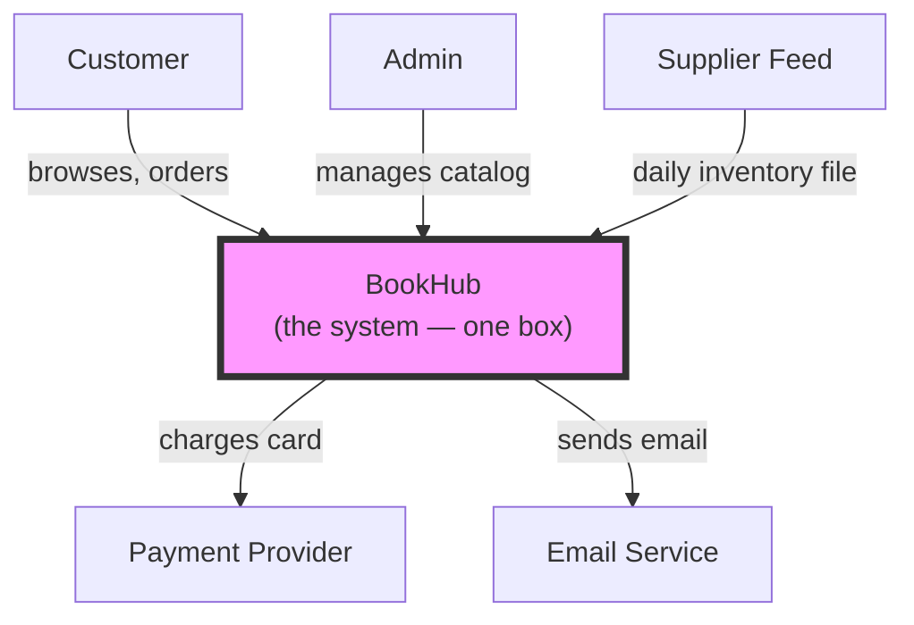
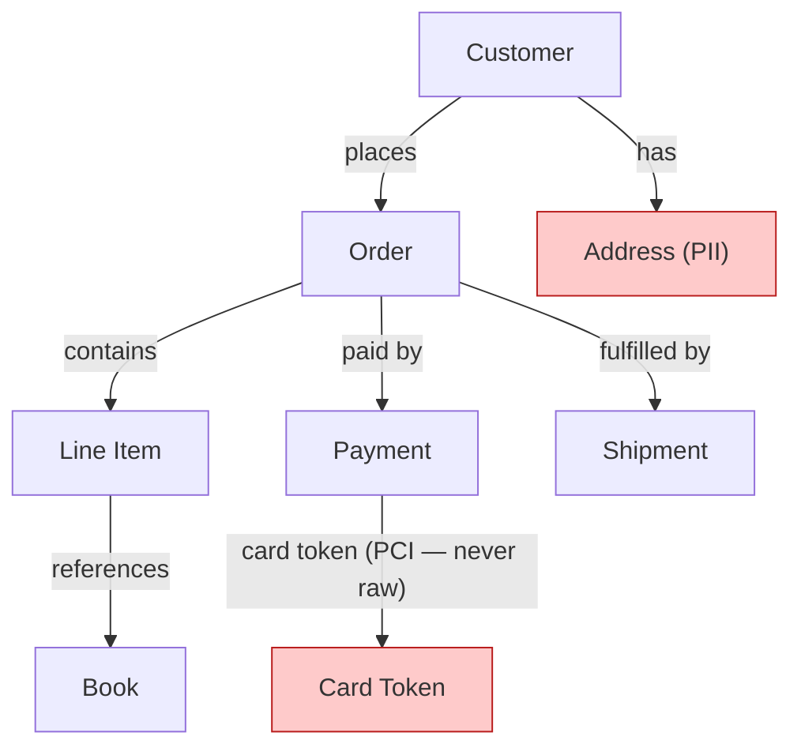
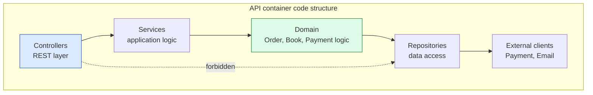
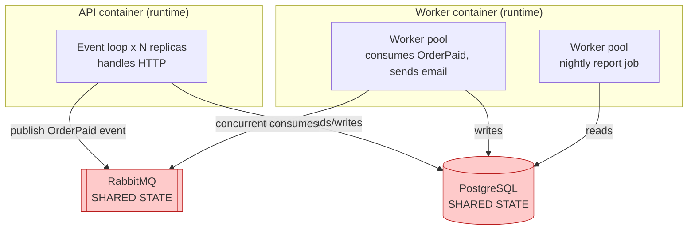
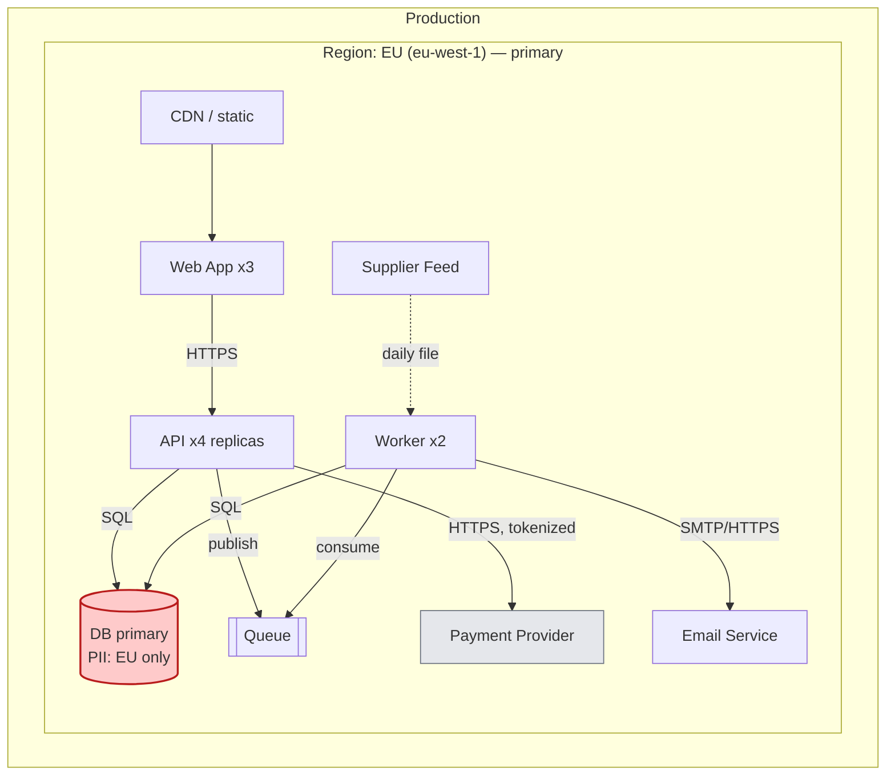

# 🧠 Topic: Worked Example — BookHub (Online Bookstore)

> [!abstract] Executive Summary (ELI5)
> This note walks a **single example system** — an online bookstore called **BookHub** — through every viewpoint in the recommended order (see [[Architecture Model]]). Each section is one viewpoint, building on the previous, with a concrete diagram and the key decisions. The goal: see how the abstract framework translates into a real (if simplified) architecture model, step by step.

> [!info] How to read this note
> This is a **greenfield** example (see [[Architecture Model]] → "Case 1: from scratch"). Each viewpoint section follows the same structure: *what this view answers → the diagram → key decisions → what it feeds into next*. Read top to bottom — each step depends on the previous.

---

## 🎯 System Overview

**BookHub** is an online bookstore where customers browse a catalog, build a cart, check out with a card, and receive order confirmations + shipping updates by email. The business also needs **nightly reporting** (sales summaries) and **inventory sync** with a supplier feed.

### Stakeholders & their concerns
| Stakeholder | Concern |
|---|---|
| Customer | Fast browse/checkout; reliable order updates |
| Business owner | Sales reporting; payment reliability |
| Operations | Uptime; cost; easy deployment |
| Compliance (GDPR/PCI) | PII residency; card data never stored |

---

## Step 1 — Functional Viewpoint

> **Answers:** *What must BookHub do?* See [[Functional Viewpoint]].

### Capabilities
- **Browse catalog** — search, filter, view book details
- **Manage cart** — add/remove/quantity
- **Checkout & pay** — capture order + charge card
- **Order tracking** — status updates + email notifications
- **Inventory sync** — consume supplier feed, update stock
- **Reporting** — nightly sales summaries for the business

### Key Use Cases

**UC1: Customer completes checkout**
```text
Actor:    Customer
Goal:     Purchase the books in the cart
Preconditions: cart non-empty, customer authenticated
Main scenario:
  1. Customer reviews cart
  2. Customer enters shipping address
  3. Customer enters payment (card)  → PCI: tokenized, never stored
  4. System charges card via Payment Provider
  5. System creates Order (status: PAID)
  6. System sends confirmation email
Postconditions: Order persisted, email sent
Extensions:
  4a. Card declined → System offers retry
  6a. Email service down → System queues email for retry
```

**UC2: Nightly sales report (automated)**
```text
Actor:    (scheduled — no human)
Trigger:  nightly at 02:00
Goal:     Produce yesterday's sales summary
Main scenario:
  1. Read orders created yesterday
  2. Aggregate by category / total revenue
  3. Store report
  4. Email summary to business owner
```

> These use cases reveal the **nouns** that become entities in Step 3: Customer, Cart, Order, Book, Payment, Shipment. They also reveal external crossings (Payment Provider, Email Service) and an automated sequence (nightly report).

---

## Step 2 — Context Viewpoint (C4 L1)

> **Answers:** *What is the boundary, and who/what does BookHub interact with?* See [[Context Viewpoint]].



### Key decisions
- **Boundary:** everything BookHub owns (catalog, cart, checkout, orders, reporting) is inside the box. Payment, email, and the supplier are external.
- **External actors/systems:** Customer, Admin (human); Payment Provider, Email Service, Supplier Feed (external systems).
- **Discipline:** the database, the API, the worker — none are shown. They're internal; they appear at [[Container Viewpoint]] (Step 7's drill-down). The single box *is* the boundary definition.

### What this feeds into
The external systems (Payment, Email) and the automated supplier feed + nightly report hint at the data BookHub must handle (Payment, Email, Inventory) — which Step 3 elaborates.

---

## Step 3 — Information Viewpoint

> **Answers:** *What data does BookHub create and use?* See [[Information Viewpoint]].

### Conceptual data model



### Key entities
- **Customer** — id, name, email, address
- **Book** — id, title, author, price, stock level
- **Order** — id, status (NEW/PAID/SHIPPED), total
- **Line Item** — book + quantity (child of Order)
- **Payment** — id, amount, card **token** (never raw card data), provider reference
- **Shipment** — id, carrier, tracking number, status

### Sensitive data (annotated in red above)
- **Customer.Address, Customer.Email** → **PII** (GDPR): must be stored in the right jurisdiction, encrypted, with retention limits.
- **Payment card** → **PCI**: BookHub **never stores raw card data**. The Payment Provider tokenizes it; BookHub keeps only the token. This is the single most important architectural decision here — it keeps BookHub largely out of PCI-DSS scope.

> **Why this matters here (not later):** knowing "Payment holds a token, not raw card" in the Information Viewpoint propagates immediately: the [[Security Perspective]] has less to protect, the [[Deployment Viewpoint]] can place the Payment container more freely, and the [[Location Perspective]] cares mainly about Customer PII, not card data.

---

## Step 4 — Operational Viewpoint

> **Answers:** *How does BookHub behave during normal operation?* This is the **integrator** step — it validates Steps 1–3 compose. See [[Operational Viewpoint]].

### UC1 realized: Customer completes checkout (the journey)

```text
1. Browse catalog         [Web App]            reads Book
2. Add to cart            [Web App → API]      updates Cart
3. Checkout               [API]                reads Cart, creates Order
4. Pay                    [API → Payment*]     creates Payment (token)  (* external crossing)
5. Confirm                [API → Worker]       Order → PAID, publish event
6. Worker → Email*        [Worker → Email*]    sends confirmation       (* external crossing)
```

This trace ties together: Functional (UC1), Information (Cart/Order/Payment), Context (Payment/Email external), and foreshadows the containers (Web App, API, Worker).

### UC2 realized: Nightly report (automated sequence)

```text
Trigger: 02:00 daily
1. Worker reads yesterday's Orders   [Worker → API/DB]
2. Aggregates by category + revenue
3. Stores Sales Report
4. Emails summary to business owner  [Worker → Email*]   (* external crossing)
```

### Failure paths (traced, not just the happy path)
- **4a. Card declined** → API returns error to Web App; Order stays NEW (not PAID); customer offered retry.
- **6a. Email service down** → Worker retries with backoff; if still failing, email job is dead-lettered for manual review. The Order is still PAID — email failure doesn't block the order.
- **Supplier feed malformed** → Worker quarantines the file; alerts ops; yesterday's inventory remains valid.

> **The integrator check:** both journeys trace cleanly through the structure and data — no missing entity, no impossible ordering. If UC1 couldn't be traced (e.g., no Payment entity, or no Email external crossing), an earlier step would have a gap. This is the Operational Viewpoint's job.

---

## Step 5 — Development Viewpoint

> **Answers:** *How will BookHub be built (code structure)?* See [[Development Viewpoint]].

### Container → modules (for the API container)



### Dependency rules (enforced by CI)
- **Layer direction:** Controllers → Services → Domain → Repositories → External clients. Dependencies point toward stability (Domain).
- **Forbidden:** Controllers must NOT call Repositories directly (dashed arrow). Enforced by a lint rule + CI gate.
- **No circular dependencies** between services.
- **Shared library:** a `common` package (DTOs, error types) consumed by Web App, API, and Worker — versioned and published.

### Key decisions
- **Tech stack:** Node.js + TypeScript for API and Worker; React for Web App; PostgreSQL for the relational store; RabbitMQ for the event queue.
- **Monorepo** with clear package boundaries; each container is a build target.
- **Testability:** Services depend on Repository *interfaces*, not implementations → easy unit testing with mocks.

---

## Step 6 — Concurrency Viewpoint

> **Answers:** *What runs in parallel, and where does BookHub need scalability or async?* See [[Concurrency Viewpoint]].



### Runtime units
- **API** — stateless Node.js event loop, scaled horizontally to N replicas. Single-threaded per replica, but many replicas = parallel request handling.
- **Worker** — a pool of consumer processes. One set handles `OrderPaid` (email); another runs the nightly report.

### Shared state (the hazard — in red)
- **PostgreSQL** — the shared mutable state. Multiple API replicas + workers read/write concurrently. Protected by transactions + optimistic concurrency on Order status.
- **RabbitMQ** — shared event store. The queue decouples the API (fast path) from email/reporting (slow path).

### Scalability decisions
- **API is stateless** → freely replicated; horizontal scale for browse/checkout traffic.
- **Slow work moved off the request path** → email and reporting go through the queue, not the HTTP request. The checkout response returns as soon as the Order is PAID + event published; the customer doesn't wait for the email to send.
- **"async ≠ parallel" reminder:** the API's event loop is concurrent (interleaved) per replica, not parallel within one replica. Parallelism comes from multiple replicas.

---

## Step 7 — Deployment Viewpoint

> **Answers:** *Where does BookHub run, and how do containers map to nodes?* See [[Deployment Viewpoint]].



### Container → node mapping

| Container | Environment | Nodes | Region | Notes |
|---|---|---|---|---|
| Web App | prod | CDN + 3 instances | eu-west-1 | static + SSR |
| API | prod | 4 replicas | eu-west-1 | stateless, horizontally scaled |
| Worker | prod | 2 instances | eu-west-1 | consumes queue; runs nightly job |
| DB primary | prod | 1 node | eu-west-1 | **PII residency: EU only** (Customer data) |
| Queue | prod | managed | eu-west-1 | decouples API from Worker |

### Key decisions
- **Single region (EU):** customers are EU-based; Customer PII must stay in EU (GDPR). No multi-region needed yet — matches [[Cost Perspective]].
- **Card data never touches BookHub's DB:** the API calls the Payment Provider with a tokenized flow; raw card data is never persisted. This keeps the DB node out of strict PCI scope.
- **Redundancy:** API has 4 replicas (no SPOF for serving); DB primary is managed with automated backups (RPO ~5min). Single primary DB is an accepted SPOF for this scale (see [[Availability and Resilience Perspective]]).
- **Network:** Web App → API over HTTPS; API → DB over private subnet; Payment/Email cross the public boundary (external).

### What this feeds back into
The single-region + single-primary-DB choices are exactly what the [[Availability and Resilience Perspective]] would flag ("what if the EU region fails?") and what [[Location Perspective]] validates ("PII stays in EU — good"). The spiral loops back.

---

## 🔄 Applying Perspectives (the second half of the process)

After the seven views exist, apply the risk-selected perspectives. For BookHub, the top risks are **data privacy** and **payment reliability**, so:

| Perspective | Finding on BookHub | Refinement |
|---|---|---|
| [[Security Perspective]] | Customer PII in the DB; card data tokenized (good) | Encrypt PII at rest; least-privilege DB credentials for API vs Worker; audit-log access to Customer data |
| [[Performance and Scalability Perspective]] | API is stateless (good); DB primary could be the bottleneck under write load | Add read replicas for browse; monitor write contention; queue slow work (done) |
| [[Availability and Resilience Perspective]] | Single region; single DB primary (SPOF) | Acceptable for current scale; plan multi-AZ for DB; ensure Worker dead-letters stuck emails |
| [[Location Perspective]] | EU customers; PII in EU region (compliant) | Confirm supplier-feed ingest doesn't move PII cross-border; backups stay in-EU |
| [[Cost Perspective]] | Single region keeps run cost low | Watch queue + DB costs as order volume grows; right-size replicas |

> Notice: the perspectives don't *redraw* BookHub — they evaluate the existing views and demand refinements. That's the definition of a perspective (see [[Perspective]]).

---

## ⚠️ What This Example Deliberately Simplifies

- **Scale:** single region, single DB primary — realistic for a startup, insufficient for a global retailer. See [[Performance and Scalability Perspective]] / [[Availability and Resilience Perspective]].
- **Auth:** omitted for brevity; a real model adds an identity provider on the Context diagram and auth middleware in the Development view.
- **Search:** a real bookstore likely needs a dedicated search engine (e.g., Elasticsearch) as its own container — a candidate 4th container in the Container View.
- **Multi-tenancy / admin UI:** folded into "Admin" actor; a fuller model would split them.

---

## 🔗 Deep Connections

This example exercises the full framework. Every section links to its viewpoint note:

- **Process:** [[Architecture Model]] (the 7-step sequence this follows), [[Handling Complexity of Architecture Model]]
- **Viewpoints:** [[Functional Viewpoint]] → [[Context Viewpoint]] → [[Information Viewpoint]] → [[Operational Viewpoint]] → [[Development Viewpoint]] → [[Concurrency Viewpoint]] → [[Deployment Viewpoint]]
- **C4 zoom drill-down:** [[Context Viewpoint]] (L1) → [[Container Viewpoint]] (L2) → [[Component Viewpoint]] (L3)
- **Perspectives applied:** [[Security Perspective]], [[Performance and Scalability Perspective]], [[Availability and Resilience Perspective]], [[Location Perspective]], [[Cost Perspective]]
- **Foundations:** [[System]], [[Key Elements of Architecture View]], [[Model]], [[Levels of Abstraction]]

## ❓ Active Recall Questions

> [!faq]- In the BookHub example, what is the single most important Information Viewpoint decision, and why?
> That **Payment holds a tokenized card reference, never raw card data**. This keeps BookHub largely out of PCI-DSS scope, reduces what Security must protect, and frees the Deployment topology. It's modeled at the Information level because it propagates into Security, Deployment, and Location — proving the Information Viewpoint's integrative value.

> [!faq]- Why does the Operational Viewpoint move email sending to a Worker via a queue, instead of doing it synchronously in the checkout API call?
> To keep the fast path fast and decouple load. The customer's checkout response returns as soon as the Order is PAID + the `OrderPaid` event is published; they don't wait for the email to send. If the email service is slow or down, the Worker retries with backoff instead of blocking or failing the checkout. This is asynchrony as a scalability/resilience tool (see [[Concurrency Viewpoint]]).

> [!faq]- Why is BookHub single-region, and what perspective would challenge that?
> Single-region (EU) because customers are EU-based and Customer PII must stay in EU (GDPR) — see [[Location Perspective]]. It also keeps run cost low (see [[Cost Perspective]]). The [[Availability and Resilience Perspective]] challenges it: a single region is one regional outage from total failure. For current scale it's an accepted trade-off; multi-AZ for the DB is the next step.

> [!faq]- What does the Concurrency Viewpoint reveal as the shared-state hazard in BookHub?
> PostgreSQL and RabbitMQ are the shared mutable state (shown in red). Multiple API replicas + Workers read/write the DB concurrently (protected by transactions + optimistic concurrency). The queue is shared state that decouples producers (API) from consumers (Worker). Identifying these is the Concurrency Viewpoint's core job.

> [!faq]- How do the perspectives interact with the BookHub views — do they redraw the system?
> No — perspectives produce *no view of their own*. They evaluate the existing views and demand refinements: Security demands PII encryption; Performance suggests read replicas; Availability flags the single DB primary. The output is documented decisions and changes to the views, not new diagrams. See [[Perspective]].

---

## 📝 Related Notes

- [[Architecture Model]]
- [[Functional Viewpoint]]
- [[Context Viewpoint]]
- [[Information Viewpoint]]
- [[Operational Viewpoint]]
- [[Development Viewpoint]]
- [[Concurrency Viewpoint]]
- [[Deployment Viewpoint]]
- [[Perspective]]
- [[Container Viewpoint]]
