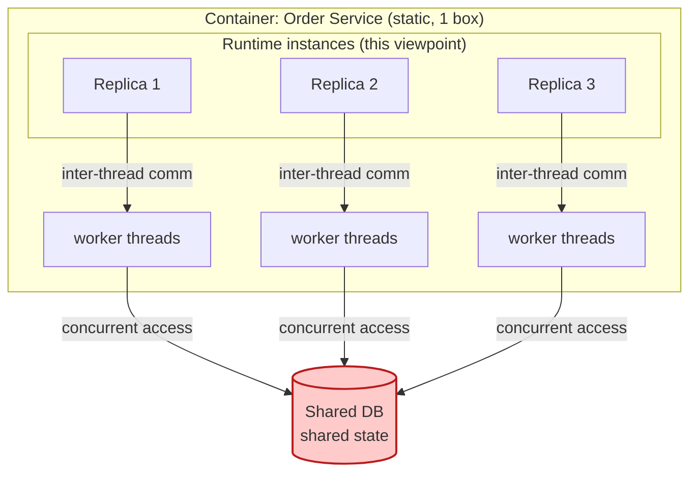

# 🧠 Topic: Concurrency Viewpoint (Runtime)

> [!abstract] Executive Summary (ELI5)
> The Concurrency Viewpoint answers: **what runs at the same time, and how do those parallel things avoid stepping on each other?** It models the system as a set of *runtime units* (processes, threads, tasks, event loops) that execute concurrently, the *communications* between them, and the *shared state* they must protect. If the Functional Viewpoint is "what the system does" and the Information Viewpoint is "what it knows," the Concurrency Viewpoint is "what it's doing *right now*, all at once."

> [!warning] The #1 confusion — Concurrency Viewpoint ≠ Container Viewpoint
> People conflate them because both show "things that run." But the **Container Viewpoint** (C4 L2) shows *deployable units* as static structure — one box per app/service/DB. The **Concurrency Viewpoint** shows *runtime instances* — the same container may spawn many runtime units (a service scaled to 5 replicas, each with 8 worker threads). One container, many runtime units. Static structure ≠ runtime behavior.

---

## 🎯 The "Why"

- **Problem Solved:** Performance, scalability, and a whole class of bugs (race conditions, deadlocks, data corruption) all live in the *concurrency* dimension. No structural diagram reveals them. You need a viewpoint that explicitly asks "what runs in parallel, what do they share, and how is that sharing made safe."
- **Alternatives:** Hoping concurrency "just works" because the language has async/await. It doesn't — shared mutable state across concurrent units is where the hardest bugs live, and they only appear under load or specific timing.
- **Trade-offs:** Modeling concurrency adds a runtime dimension that's harder to draw than static boxes. The payoff is that you reason about performance and the scariest class of bugs *before* production, not during an incident.

## 💡 Mental Model & Analogy

- **Analogy:** The Concurrency Viewpoint is a **kitchen during dinner service**. The static structure (menu, stations, equipment) is the Container Viewpoint. The Concurrency Viewpoint is the *live choreography*: three cooks at the same station (threads), two waiters running orders (tasks), and a single shared cutting board (shared state) that only one cook can use at a time (a lock). A kitchen designed without thinking about this choreography — where everyone reaches for the same board simultaneously — is a kitchen that fails under load.

One container becomes many runtime units; the shared database is the **shared state** every unit touches concurrently — the red element where contention and races live.

## 🛠️ Core Principles

1. **Runtime units, not components.** The elements here are *instances that execute*: OS processes, threads, fibers, async tasks, event-loop iterations, worker jobs. The same code component may be instantiated into many runtime units.
2. **Identify what is genuinely concurrent.** Not everything is. A single-threaded event loop handles one thing at a time; a process pool handles many. The first modeling job is to enumerate where parallelism actually exists.
3. **Shared state is the hazard.** Concurrency becomes a problem only when parallel units touch the same mutable state (memory, file, DB row). No shared state → no race. The viewpoint must make shared state explicit.
4. **Communication is part of the model.** Concurrent units coordinate via shared memory (locks, atomics), message passing (queues, channels), or shared stores (DB). The choice of communication mechanism is an architectural decision with deep trade-offs.
5. **Liveness and safety are the two concerns.** *Safety* = nothing bad happens (no data corruption). *Liveness* = something good eventually happens (no deadlock, no starvation). Every concurrency design balances both.

## 🏗️ The Concurrency Vocabulary

### Runtime units
*The things that execute concurrently.*
- **Process** — OS-level, isolated memory, heavy to spawn. Communicates via IPC/pipes/sockets.
- **Thread** — OS-level, shared memory within a process, cheaper than a process. Source of most races.
- **Fiber / coroutine / async task** — user-space, cooperative, single thread can run many. Cheapest, but concurrency is cooperative (a task must yield).
- **Event loop** — single-threaded, processes events from a queue. Node.js, Nginx. High concurrency, no intra-loop races, but one slow handler blocks everything.

### Shared state
*The mutable thing multiple runtime units can touch.*
- In-memory variables/objects across threads (→ locks, mutexes, atomics).
- A shared database row (→ transactions, row-level locks, optimistic concurrency).
- A shared file or cache (→ file locks, invalidation).
- *Implicit* shared state: a third-party API with a rate limit is shared state — concurrent calls contend for the limit.

> The architectural rule of thumb: **minimize shared mutable state.** Every piece of shared state is a potential race, a lock, a bottleneck. Message passing (no shared state) trades complexity for safety.

### Communication mechanisms

| Mechanism | Sharing model | Typical use | Risk |
|---|---|---|---|
| **Shared memory + locks** | shared mutable state | intra-process threads | races, deadlocks, lock contention |
| **Message passing (queue/channel)** | no shared state | inter-thread, inter-service | ordering, delivery guarantees |
| **Async event bus** | no shared state | domain events, fan-out | eventual consistency, duplicate delivery |
| **Transactional shared store** | shared state via DB | cross-service coordination | coupling, contention, 2PC complexity |

## ↔️ How the Concurrency Viewpoint Connects

| Connects to | How |
|---|---|
| [[Container Viewpoint]] | A container is the static deployable unit; the Concurrency Viewpoint opens it to show its runtime instances and threading model. Static ≠ runtime. |
| [[Functional Viewpoint]] | Each use case has a runtime realization — the Concurrency Viewpoint shows *how its steps run in parallel*. The Dynamic diagram (per use case) and the Concurrency Viewpoint are siblings. |
| [[Information Viewpoint]] | Shared state is data — the entities from the Information Viewpoint become the shared mutable resources concurrency must protect. |
| [[Key Elements of Architecture View]] | Runtime units are a flavor of component at runtime; shared state is a special, high-risk connector. |
| [[Perspective]] | Performance and Scalability perspectives are evaluated *against* this viewpoint — concurrency is where they live or die. |

## ⚠️ Pitfalls & Anti-patterns

- **Conflating container and runtime unit:** assuming "one service = one thing executing." A service with a thread pool or multiple replicas is many concurrent units. Model the actual parallelism.
- **Hidden shared state:** a rate-limited external API, a shared cache, a "stateless" service that writes to a common DB — all are shared state. If you didn't model it, it will bite you.
- **Shared mutable memory across threads with ad-hoc locking:** the classic source of races. Prefer message passing or immutable data; reach for locks deliberately, never by default.
- **Ignoring liveness:** designing for safety (correct locking) and creating deadlocks or starvation. A correct-but-deadlocked system serves nobody.
- **Single-threaded event loop with a blocking call:** one slow DB query or synchronous file read freezes the whole loop. The concurrency model must account for blocking.
- **Assuming "async = parallel":** async tasks on a single event loop are concurrent but not parallel — they interleave, they don't run simultaneously. Mixing this up leads to overestimating throughput.
- **No model under load:** concurrency bugs (races, deadlocks) appear only under contention. A model that ignores "what happens at 5x load" misses exactly when the system breaks.

## 🔗 Deep Connections

- **Parent Topic:** [[Viewpoint]] (the Concurrency Viewpoint is one of the standard R&W viewpoints), [[System Modeling]]
- **Sibling Viewpoints:** [[Container Viewpoint]] (static units — the thing this viewpoint opens into runtime), [[Functional Viewpoint]] (use cases realized concurrently), [[Information Viewpoint]] (shared state is data)
- **Related Concepts:** [[Key Elements of Architecture View]] (runtime units as components; shared state as a high-risk connector), [[System]] (its "Behaviour" property — concurrency is behavior over time), [[System Architecture]] (quality attributes like performance and scalability are decided here)
- **Applied-to:** [[Perspective]] (Performance, Scalability, Reliability perspectives are evaluated against this viewpoint)
- **Prerequisites:** [[Viewpoint]], [[System]], basic understanding of threads/processes/async.

## ❓ Active Recall Questions

> [!faq]- What does the Concurrency Viewpoint model, and how is it different from the Container Viewpoint?
> It models **runtime units** (processes, threads, async tasks, event loops) that execute concurrently, the communication between them, and the shared state they protect. The Container Viewpoint shows *static deployable units* (one box per service); the Concurrency Viewpoint shows *runtime instances* — one container may map to many concurrent runtime units.

> [!faq]- Why is "shared state" the central hazard of concurrency?
> Concurrency is only a problem when parallel units touch the same mutable state — that's where races, corruption, and the need for locks arise. No shared state → no race. The viewpoint must make every piece of shared state explicit, because unmodeled shared state (a shared DB, a rate-limited API) is exactly what causes production incidents.

> [!faq]- What's the architectural guidance for handling shared mutable state?
> **Minimize it.** Every piece of shared mutable state is a potential race and a lock. Prefer message passing (no shared state), immutable data, or isolated state per unit. Reach for locks and transactions deliberately, never as a default.

> [!faq]- What are the two concerns every concurrency design must balance?
> **Safety** ("nothing bad happens" — no data corruption, no races) and **liveness** ("something good eventually happens" — no deadlock, no starvation). Designing for safety alone can create deadlocks; designing for liveness alone allows races.

> [!faq]- Why is "async" not the same as "parallel"?
> Async tasks on a single-threaded event loop *interleave* (cooperative multitasking) — they do not run simultaneously. Parallel execution requires multiple hardware threads/cores. Confusing the two leads to overestimating throughput and misdiagnosing performance issues.

> [!faq]- How does the Concurrency Viewpoint relate to quality attributes like performance and scalability?
> Performance and scalability are decided *here* — they are consequences of the concurrency model (how many units run, how they share state, where contention is). The Performance and Scalability perspectives are applied *to* this viewpoint to evaluate it.

---

## 📝 Related Notes

- [[Viewpoint]]
- [[Functional Viewpoint]]
- [[Information Viewpoint]]
- [[Container Viewpoint]]
- [[Key Elements of Architecture View]]
- [[System]]
- [[System Architecture]]
