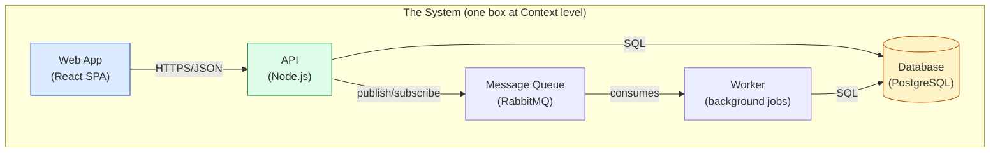

# 🧠 Topic: Container Viewpoint (C4 Level 2)

> [!abstract] Executive Summary (ELI5)
> The Container Viewpoint **opens the box**. Where the [[Context Viewpoint]] showed the whole system as one box, the Container Viewpoint looks *inside* it and shows the **major runnable/deployable units** — the web app, the API, the database, the message queue — and how they interact. In C4, a "container" is **not** a Docker container; it's anything that runs code or stores data and needs to be deployed independently.

> [!warning] The #1 confusion — "Container" ≠ Docker container
> The word collides with Docker. In C4, a **container** is a logical concept: a single application/data-store that runs in its own process space, is deployed separately, and communicates via well-defined interfaces. Examples: a Spring Boot API, a React SPA, a PostgreSQL database, a Redis cache. Docker containers are *one way to deploy* a C4 container — they are not the same thing.

---

## 🎯 The "Why"

- **Problem Solved:** The Context diagram intentionally hides internals — but at some point you must show *what the system is made of* to make technology choices, plan deployment, and reason about scalability. The Container Viewpoint is the first level that reveals internal structure: the high-level shape of the system, the major technology decisions, and how the parts cooperate.
- **Alternatives:** Jump straight to Component/Code detail. You lose the intermediate "shape" that non-deep-technical stakeholders (tech leads, architects) can still read, and you drown them in detail too early.
- **Trade-offs:** Containers expose technology decisions (this API is Node.js, this DB is Postgres) that the Context diagram abstracted away. That's deliberate — at this level, the high-level tech stack matters.

## 💡 Mental Model & Analogy

- **Analogy:** If the Context Viewpoint is "the company as one building" (who interacts with it), the Container Viewpoint is the **floor plan** — the major rooms (departments) inside: the reception (web app), the back office (API), the archive (database), the mailroom (message queue). You see the rooms and the corridors between them, but not yet the desks and people inside each room (that's the Component Viewpoint).

Each box is a container — a separately deployable unit. Note the technology label (React, Node.js, PostgreSQL) is part of the container's description.

## 🛠️ Core Principles

1. **A container is a single deployable/runnable unit.** It runs in its own process space (or equivalent), is deployed independently, and stores/executes code or data.
2. **Containers are the major building blocks.** Not every class or module — the handful of "big things" that make up the system. Typically 3–10 containers; if you have 30, you're at the wrong level (see [[Handling Complexity of Architecture Model]]).
3. **Technology is shown, deliberately.** Unlike Context (audience-neutral), the Container Viewpoint names the tech: "React SPA," "PostgreSQL DB," "Spring Boot API." These are the high-level technology decisions.
4. **Containers communicate via explicit interfaces.** The arrows are real integration mechanisms — HTTPS/JSON, SQL, message queues — not vague "talks to." See [[Key Elements of Architecture View]] → connectors.
5. **It is the bridge level.** Above: Context (one box). Below: [[Component Viewpoint]] (internals of one container). The Container Viewpoint connects the business view to the technical view.

## 🏗️ What Counts as a Container?

| Is a container | Is NOT a container |
|---|---|
| A web application (SPA, SSR app) | A library/package shared between apps |
| An API/backend service | A single class or module |
| A database (PostgreSQL, MongoDB) | A single table |
| A message broker / queue | A single message type |
| A background worker / job runner | A single scheduled job |
| A file system / object store | An individual file |

> The test: *would this thing be deployed/started/stopped/replaced independently?* If yes, it's a container. If it's a piece *inside* something that deploys as a unit, it's a component (C4 L3) or code.

## ↔️ How the Container Viewpoint Connects

| Connects to | How |
|---|---|
| [[Context Viewpoint]] (C4 L1) | The Container Viewpoint opens the single Context box. All containers together = the system. |
| [[Component Viewpoint]] (C4 L3) | Drilling into one container reveals its components. One container → many components. |
| [[Deployment Viewpoint]] | Each container gets mapped onto nodes/environments. Container = *what*; Deployment = *where*. |
| [[Concurrency Viewpoint]] | A container is the static unit; the Concurrency Viewpoint opens it into runtime instances (threads, replicas). |
| [[Development Viewpoint]] | The code modules that *build into* a container. One container ← many modules. |
| [[Key Elements of Architecture View]] | Containers are components (in the generic sense); their interactions are connectors. |

## ⚠️ Pitfalls & Anti-patterns

- **Confusing C4 containers with Docker containers:** the name collides. A C4 container is a logical deployable unit; Docker is one deployment mechanism. Don't equate them.
- **Too many containers:** 30 "containers" means you're at the wrong zoom — you've leaked Component-level detail into the Container view. Step back; group into ~5–8 major units.
- **Vague connectors:** arrows labeled "talks to" with no protocol. The connector type (HTTPS, SQL, async event) is an architectural decision — name it.
- **Mixing logical and deployment concerns:** drawing AWS nodes, regions, or load balancers here. That belongs to the Deployment Viewpoint. The Container Viewpoint is logical — *what* runs, not *where*.
- **Showing shared libraries as containers:** a shared package used by multiple apps is not a container (it doesn't run independently) — it's a component or a dependency.
- **Inconsistent with Context:** the containers must collectively equal the single system box from the Context diagram. If a container exists that wasn't implied by the Context, reconcile the two.

## 🔗 Deep Connections

- **Parent Topic:** [[Viewpoint]], [[System Modeling]]
- **C4 neighbors:** [[Context Viewpoint]] (L1, one level up), [[Component Viewpoint]] (L3, one level down)
- **Other viewpoints built on it:** [[Deployment Viewpoint]] (where containers run), [[Concurrency Viewpoint]] (runtime instances of containers), [[Development Viewpoint]] (code that builds containers)
- **Related:** [[Key Elements of Architecture View]], [[Handling Complexity of Architecture Model]], [[Levels of Abstraction]]
- **Prerequisites:** [[Context Viewpoint]], [[Viewpoint]], [[System]].

## ❓ Active Recall Questions

> [!faq]- What does the Container Viewpoint show, and how does it relate to the Context Viewpoint?
> It **opens the single box** from the Context diagram, showing the major deployable/runnable units inside the system (web app, API, database, queue) and how they interact. Context shows the system as one box + external actors; Container reveals the internal high-level shape and technology choices. Together, all containers = the system.

> [!faq]- Is a C4 "container" the same as a Docker container?
> No. A C4 container is a **logical concept**: a single application/data-store that runs in its own process space, is deployed independently, and stores/executes code or data. Docker containers are *one way to deploy* a C4 container — they are not the same thing. A PostgreSQL database is a C4 container whether or not it runs in Docker.

> [!faq]- What's the test for whether something is a container?
> *Would this thing be deployed/started/stopped/replaced independently?* If yes, it's a container (web app, API, database, queue, worker). If it's a piece *inside* something that deploys as a unit, it's a component (C4 L3) or code. A shared library is not a container; it doesn't run independently.

> [!faq]- Why does the Container Viewpoint show technology, when the Context Viewpoint doesn't?
> Because at this zoom level, the high-level technology decisions (React SPA, Node.js API, PostgreSQL DB) matter — they drive deployment, scalability, and team-skill decisions. The Context diagram is audience-neutral and abstracts tech away; the Container Viewpoint deliberately surfaces it as part of the system's shape.

> [!faq]- How does the Container Viewpoint differ from the Deployment Viewpoint?
> Container is **logical** — *what* the major runnable units are and how they interact, environment-agnostic. Deployment is **physical** — *where* those containers actually run (nodes, regions, networks) and the container-to-node mapping. Don't draw AWS regions or load balancers on a Container diagram; that belongs to Deployment.

---

## 📝 Related Notes

- [[Context Viewpoint]]
- [[Component Viewpoint]]
- [[Deployment Viewpoint]]
- [[Concurrency Viewpoint]]
- [[Development Viewpoint]]
- [[Key Elements of Architecture View]]
- [[Viewpoint]]
