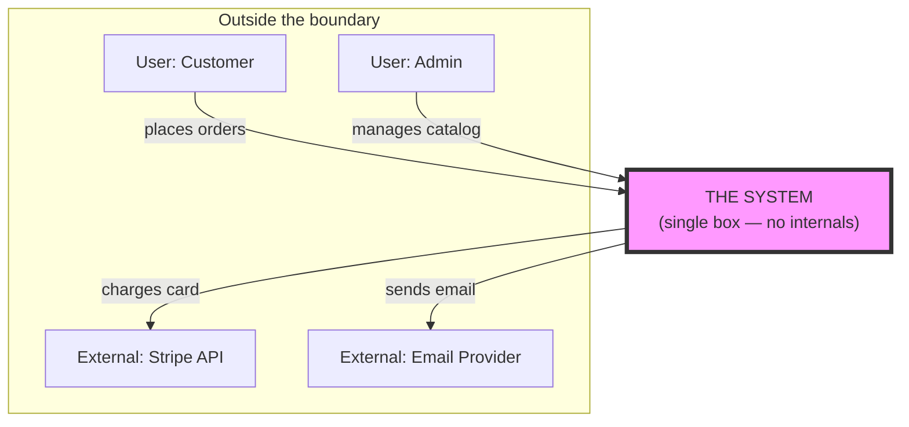
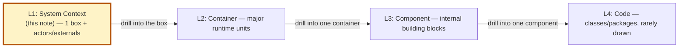

# 🧠 Topic: Context Viewpoint (System Context)

> [!abstract] Executive Summary (ELI5)
> The Context Viewpoint is the **widest-angle lens** in architecture modeling. It draws the system as a **single box in the center**, surrounded by the people and external systems it talks to — and **nothing else**. No internals, no databases, no code. It answers two questions only: *what is this system?* and *who/what does it interact with?* This is the entry point everyone understands, from the CEO to the newest developer.

> [!warning] The #1 mistake
> People "improve" the context diagram by adding the database, the message broker, or the internal microservices. The moment you do that, it stops being a context diagram and becomes a half-baked container diagram. The whole value of this viewpoint is the **discipline of showing nothing inside** — that single box is the boundary you are defining.

---

## 🎯 The "Why"

- **Problem Solved:** Before you can model a system's internals, you must agree on its **boundary** — what is "the system" and what is "the outside world." The Context Viewpoint makes that boundary explicit and visible. It also forces you to name every actor and external dependency in one place, which surfaces hidden integration risk early.
- **Alternatives:** Jumping straight to a Container/Component diagram. You lose the shared, audience-neutral starting point and end up re-explaining the boundary in every meeting because nobody drew it.
- **Trade-offs:** The context diagram is intentionally shallow — it tells you nothing about *how* the system works. Its power is precisely that shallowness: it is the one diagram that serves every audience as an entry point.

## 💡 Mental Model & Analogy

- **Analogy:** The Context Viewpoint is the **back-of-the-book blurb**, not the table of contents. It tells you what the story is about and who the main characters are, without revealing any plot. Or think of it as a **country on a world map** — you see its borders and which countries border it, but not the roads, cities, or politics inside.

The system is **one box**. Everything around it is an actor (person) or external system. The arrows are responsibilities/interactions, not internal data flows.

## 🛠️ Core Principles

1. **The system is a single box.** No matter how complex it is internally, at this level it is one element in the center. This is the hardest discipline — and the whole point.
2. **The boundary is the message.** What is inside the box is "what we build/own." What is outside is "what we depend on or serve." Getting that line right is the architectural decision this viewpoint captures.
3. **Show actors and external systems only.** People who use the system (actors) and other systems it integrates with. No databases, no queues, no internal services — those belong to [[Container Viewpoint]] (C4 Level 2).
4. **Target audience: everyone.** This is the one diagram a business sponsor, a developer, and an ops engineer can all read. Keep the vocabulary non-technical.
5. **It is the entry point.** Every other viewpoint (container, component, deployment) is reached by *drilling into* this box. If the context diagram is wrong, everything downstream is wrong.

## 🏗️ What Belongs on a Context Diagram

| Element | Include? | Notes |
|---|---|---|
| The system under consideration | ✅ | One box, center, clearly labeled with its purpose. |
| Human users (actors) | ✅ | Named by role ("Customer", "Support agent"), not by name. |
| External systems you integrate with | ✅ | Payment provider, identity provider, third-party API. |
| External systems you *depend on* implicitly | ✅ often missed | DNS, SMTP relay, time-sync — anything whose failure breaks you. |
| Database, message broker, cache | ❌ | These are **internal**. They appear at the Container level. |
| Internal microservices/components | ❌ | Internal. Container/Component level. |
| Code, classes, packages | ❌ | Internal. Code level (rarely drawn). |

> The most valuable row is the last "✅ often missed." Implicit external dependencies (an SMTP relay, a DNS service, a license server) are the ones that cause 3 AM outages because nobody modeled them. The context diagram is your best chance to surface them.

## 🔼 Where It Sits in the C4 Model

The Context Viewpoint is **C4 Level 1** ("System Context"). It is the top of the zoom hierarchy:

- **One level up:** the enterprise map — your single box is one node among many systems. See [[Levels of Abstraction]] (Enterprise level).
- **One level down:** open the box → [[Container Viewpoint]] diagram (databases, apps, APIs appear here).

Because it is a structural lens, the Context Viewpoint is itself an instance of the general [[Viewpoint]] concept — see [[Viewpoint]] for how viewpoints/perspectives/views relate.

## ⚠️ Pitfalls & Anti-patterns

- **Drawing internals:** Adding the database, the broker, or microservices. The moment you do, it's no longer a context diagram — move that content to a Container diagram.
- **Vague boundary:** "The platform" with no clear scope. If reviewers argue about whether X is inside or outside the system, the boundary is undefined — that argument *is* the modeling work.
- **Missing implicit dependencies:** Forgetting the SMTP relay, the identity provider, or an external API the system silently depends on. These belong on the context diagram precisely because they're easy to forget.
- **Technical jargon:** Naming actors with tech terms ("the JWT issuer") instead of roles ("Customer"). This diagram is for everyone — keep it human.
- **Too many external systems:** If the diagram is a sea of arrows, your system may have too many integrations — which is itself an architectural finding worth surfacing, not hiding by omission.
- **Treating it as a one-time artifact:** The boundary shifts as the system grows. Re-draw it when scope changes, or it quietly lies.

## 🔗 Deep Connections

- **Parent Topic:** [[Viewpoint]] (the Context Viewpoint is a structural lens — one of the standard viewpoints), [[System Modeling]]
- **Sibling Viewpoints:** [[Container Viewpoint]] (C4 L2 — the drill-down from here), [[Component Viewpoint]] (C4 L3)
- **Related Concepts:** [[System]] (a context diagram *defines* a system's boundary), [[Levels of Abstraction]] (this is the most zoomed-out *intra-system* level; the enterprise map is one level above), [[Key Elements of Architecture View]] (actors and external systems are components/connectors at this zoom), [[Communicating the Model]] (this is the most universally readable view — tailor accordingly)
- **Prerequisites:** [[Viewpoint]], [[System]], [[Model]].

## ❓ Active Recall Questions

> [!faq]- What does the Context Viewpoint show, and what does it deliberately hide?
> It shows the **system as a single box** plus the human actors and external systems it interacts with. It deliberately hides all internals — databases, brokers, services, code. The single box *is* the boundary definition.

> [!faq]- Why is "adding the database to the context diagram" a mistake?
> The database is **internal** to the system, so it belongs at the Container level (C4 L2), not the context. The value of the context viewpoint is the discipline of showing nothing inside — once you draw internals, it stops being a context diagram and becomes a half-baked container diagram.

> [!faq]- Which dependencies are most often forgotten on a context diagram, and why does that matter?
> **Implicit external dependencies** — SMTP relay, DNS, identity provider, external license APIs. They're easy to miss precisely because the system depends on them silently. Surfacing them here is the best chance to model them, and they're the usual culprits of 3 AM outages.

> [!faq]- How does the Context Viewpoint relate to the C4 model and to levels of abstraction?
> It is **C4 Level 1** — the top of the intra-system zoom (Context → Container → Component → Code). In terms of [[Levels of Abstraction]], one level *above* it is the enterprise map (your box is one node among many); one level *below* is the Container diagram where you open the box.

> [!faq]- Who is the audience for a context diagram, and what does that imply for how you draw it?
> **Everyone** — business sponsors, developers, ops. That breadth means you should use non-technical vocabulary, name actors by role (not by tech), and keep it readable. It is the one diagram shared across all audiences.

---

## 📝 Related Notes

- [[Viewpoint]]
- [[System]]
- [[Container Viewpoint]]
- [[Levels of Abstraction]]
- [[Key Elements of Architecture View]]
- [[Communicating the Model]]
