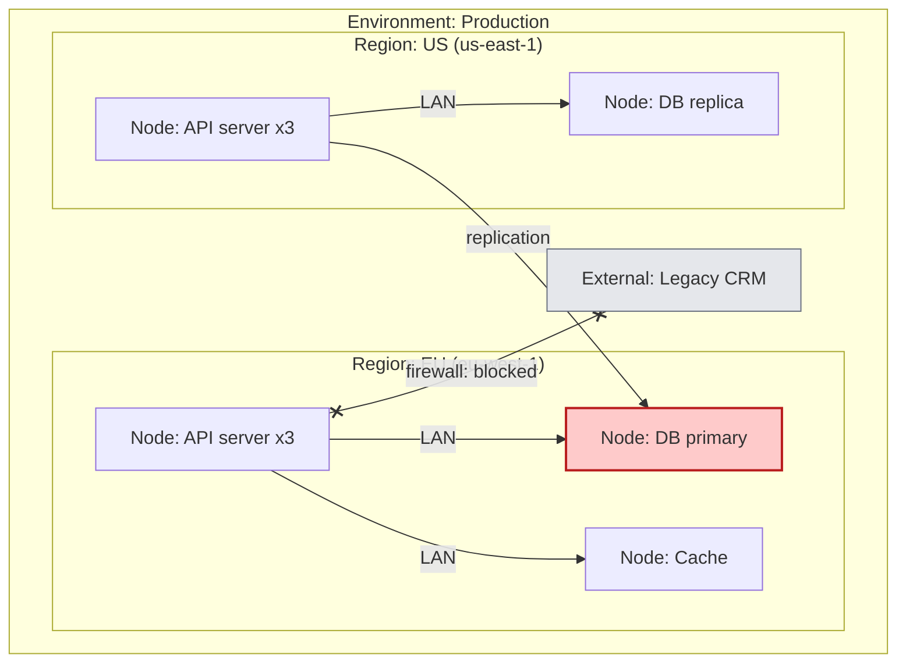

# 🧠 Topic: Deployment Viewpoint

> [!abstract] Executive Summary (ELI5)
> The Deployment Viewpoint answers: **where does the system actually run, and how does software map onto hardware?** It shows the environments (dev, staging, prod), the physical or virtual hosts (servers, containers, cloud regions), the networks between them, and — crucially — *which container runs on which node*. If the Container Viewpoint defines *what gets deployed*, the Deployment Viewpoint defines *where it lands and how the pieces are connected in reality*.

> [!warning] The #1 confusion — Deployment Viewpoint ≠ Container Viewpoint
> They look similar because both show "boxes that run." But the **Container Viewpoint** (C4 L2) is a *logical* view — it shows the deployable units and their logical interactions, environment-agnostic. The **Deployment Viewpoint** is *physical* — it shows the actual environments, hosts, and networks, and maps each container onto the node(s) where it really runs. One container in the logical view may map to many nodes across regions in the deployment view.

---

## 🎯 The "Why"

- **Problem Solved:** A logical architecture that "works on the whiteboard" can fail in production because of where things run — a database in a different region than its API (latency), a service that can't reach a dependency through the firewall, sensitive data landing in the wrong jurisdiction. The Deployment Viewpoint surfaces these problems *before* you deploy, by making the environment and the software-to-hardware mapping explicit.
- **Alternatives:** "We'll figure out deployment during release." Result: performance problems from network topology, compliance violations from data residency, and outages from environmental differences nobody modeled.
- **Trade-offs:** Environments change frequently (especially with cloud/IaC), so deployment diagrams go stale faster than logical ones. The payoff is that the riskiest operational decisions — where data lives, how failover works, what the network permits — are made deliberately, not discovered in an incident.

## 💡 Mental Model & Analogy

- **Analogy:** The Container Viewpoint is the **org chart** of a company (who reports to whom, logically). The Deployment Viewpoint is the **office floor plan** — which building each team sits in, which floor, and which buildings are connected by tunnels or bridges. The same team (container) may have desks in multiple offices (nodes/regions). A great org chart with a terrible floor plan still produces a dysfunctional company.

The red node is where the primary DB lives (a deployment decision with latency and residency consequences). The dashed X marks a network constraint the firewall imposes — invisible in any logical view.

## 🛠️ Core Principles

1. **Physical/logical split.** The Deployment Viewpoint is *where*, not *what*. It maps the containers from the [[Container Viewpoint]] onto real environments, hosts, and networks.
2. **Environments are first-class.** Dev, staging, prod (and others) differ in ways that break systems: data volume, configuration, third-party sandbox vs. live, scale. Model the environments you actually run, especially prod.
3. **The container-to-node mapping is the core artifact.** The single most useful thing this viewpoint produces is a table/diagram answering: "Container X — where does it run, how many instances, in which region?"
4. **Networks and boundaries are architectural.** Firewalls, VPCs, subnets, public/private zones, latency between regions — these are not "ops details," they are architectural constraints that shape what the system can do.
5. **Third-party/external dependencies are physical too.** A SaaS API your system calls lives *somewhere* with a latency, an availability, and a contractual boundary. It belongs on the deployment diagram, not just the context diagram.

## 🏗️ What the Deployment Viewpoint Contains

### Environments
*The distinct contexts in which the system runs.*
- **Dev / staging / prod** — and any others (QA, pre-prod, DR). Each can have a different topology.
- Differences that matter: data volume, scale, third-party sandbox vs. live, configuration, security posture.
- A common failure: a bug that appears only in prod because the staging topology differed in a way nobody modeled.

### Nodes (hosts)
*The physical or virtual machines/instances where software executes.*
- Bare-metal servers, VMs, Kubernetes pods, serverless functions, managed services (RDS, Cloud Run).
- Properties to capture: CPU/memory profile, location/region, ownership, lifecycle (ephemeral vs. persistent).
- A single logical container often maps to many nodes (horizontal scaling, multi-region).

### Networks
*The connections between nodes — and the constraints on them.*
- LAN, VPC/subnet, public internet, VPN, peering, service mesh.
- **Constraints are the point:** firewalls (what's blocked), latency (regions apart), bandwidth, and trust boundaries (public zone vs. private zone).
- A deployment diagram that only shows "everything connects to everything" hides exactly the constraints that cause incidents.

### Mapping: container → node
*Which logical unit runs where. The bridge between Container and Deployment viewpoints.*

| Container (logical) | Environment | Nodes | Region | Notes |
|---|---|---|---|---|
| Web App | prod | CDN + 3 instances | global / eu-west-1 | static + SSR |
| API | prod | 6 instances (3 per region) | eu-west-1, us-east-1 | stateless, horizontally scaled |
| DB primary | prod | 1 node | eu-west-1 | PII residency: EU only |
| DB replica | prod | 1 node | us-east-1 | read-only, async replication |

This table is often more valuable than the diagram — it forces every container to have a concrete home.

### Third-party / external dependencies
*Services you don't own but depend on at runtime.*
- Payment provider, identity provider, email service, analytics SDK.
- Each has a physical reality: latency, availability SLA, rate limits, data egress implications (does calling it send PII outside your jurisdiction?).
- Lives on both the [[Context Viewpoint]] (logical relationship) and here (physical endpoint + constraints).

## ↔️ How the Deployment Viewpoint Connects

| Connects to | How |
|---|---|
| [[Container Viewpoint]] | Deployment maps each container onto the node(s)/environment(s) where it runs. Container = *what*; Deployment = *where*. |
| [[Concurrency Viewpoint]] | Runtime units (threads, replicas) run *on* nodes. The Deployment Viewpoint provides the physical substrate the concurrency model executes on. |
| [[Context Viewpoint]] | External systems on the context diagram become physical endpoints here, with latency, availability, and network constraints. |
| [[Information Viewpoint]] | Data residency and jurisdiction are decided here — sensitive data (PII/PCI/PHI) must land in nodes/regions that satisfy legal constraints. |
| [[Perspective]] | Performance, Scalability, Reliability, and Security perspectives are applied *to* the deployment view — they live or die in physical topology. |

## ⚠️ Pitfalls & Anti-patterns

- **Conflating deployment with container:** assuming "we drew the containers, deployment is obvious." It isn't — the container-to-node mapping, environments, and network constraints are separate decisions with separate risks.
- **Only modeling prod:** dev/staging differences cause "works on my machine" failures. If environments differ meaningfully, model the differences — especially staging vs. prod.
- **Ignoring network constraints:** drawing "everything connected" and hiding firewalls, latency, and trust boundaries. Those constraints are the deployment view's whole point — they're what cause incidents.
- **Forgetting data residency:** placing a PII database in a region that violates GDPR/HIPAA. The [[Information Viewpoint]] flags *what* is sensitive; the Deployment Viewpoint decides *where* it may legally live.
- **Stale diagrams:** cloud/IaC environments drift fast. A deployment view that isn't regenerated from or checked against reality becomes a lie — treat it as living documentation.
- **Treating third-party deps as logical only:** a SaaS API isn't just a box on the context diagram; it has physical latency, availability, and egress implications. Put it on the deployment diagram too.
- **One-node-per-container thinking:** forgetting horizontal scaling and multi-region. One logical container often maps to many nodes across environments and regions.

## 🔗 Deep Connections

- **Parent Topic:** [[Viewpoint]] (the Deployment Viewpoint is one of the standard R&W viewpoints), [[System Modeling]]
- **Sibling Viewpoints:** [[Container Viewpoint]] (the *what* that this viewpoint places *where*), [[Concurrency Viewpoint]] (runtime units run on these nodes), [[Context Viewpoint]] (external systems become physical endpoints), [[Information Viewpoint]] (data residency is a deployment decision)
- **Related Concepts:** [[Key Elements of Architecture View]] (nodes are a runtime flavor of component; networks are connectors with physical constraints), [[System Architecture]] (its "Environment" element is exactly what this viewpoint elaborates), [[System Modeling]]
- **Applied-to:** [[Perspective]] (Performance, Scalability, Reliability, Security perspectives are evaluated against the deployment view)
- **Prerequisites:** [[Viewpoint]], [[System]], [[Container Viewpoint]], basic understanding of environments/hosts/networking.

## ❓ Active Recall Questions

> [!faq]- What does the Deployment Viewpoint show, and how does it differ from the Container Viewpoint?
> The Deployment Viewpoint shows **where** the system runs — environments (dev/staging/prod), nodes/hosts, networks, and the container-to-node mapping. The Container Viewpoint is *logical* (what deployable units exist and how they interact, environment-agnostic); the Deployment Viewpoint is *physical* (where each container actually lands and what the network permits). Container = *what*; Deployment = *where*.

> [!faq]- Why is the "container → node" mapping the core artifact of this viewpoint?
> Because it forces every logical container to have a concrete home: which environment, how many instances, which region. This is where logical architecture meets physical reality — and where latency, residency, failover, and network constraints become visible. A deployment view without this mapping is just a picture of servers.

> [!faq]- Why must network constraints (firewalls, latency, trust boundaries) be shown explicitly?
> Those constraints are the deployment view's entire point — they're invisible in any logical view and they're what cause production incidents ("the API can't reach the DB through the firewall," "cross-region latency blew our SLA"). A diagram that shows everything connected hides exactly the constraints you need to see.

> [!faq]- How does the Deployment Viewpoint relate to sensitive/regulated data?
> The [[Information Viewpoint]] identifies *what* is sensitive (PII/PCI/PHI); the Deployment Viewpoint decides *where* it may legally live — which regions, which nodes, what egress paths. Data residency and jurisdiction are deployment decisions with legal consequences, and they must be modeled here, not discovered during an audit.

> [!faq]- Why is "we only modeled production" a pitfall?
> Because dev/staging/prod differ in ways that break systems — topology, data volume, third-party sandbox vs. live, scale. Bugs that appear only in prod often come from environmental differences nobody modeled. If environments differ meaningfully, model the differences.

> [!faq]- How do Performance, Scalability, and Security perspectives relate to this viewpoint?
> They are applied *to* the deployment view, because those qualities live or die in physical topology — latency between regions, horizontal scaling across nodes, firewalls and trust boundaries. A logically correct architecture can fail all three if the deployment is wrong.

---

## 📝 Related Notes

- [[Viewpoint]]
- [[Container Viewpoint]]
- [[Concurrency Viewpoint]]
- [[Context Viewpoint]]
- [[Information Viewpoint]]
- [[Key Elements of Architecture View]]
- [[System Architecture]]
