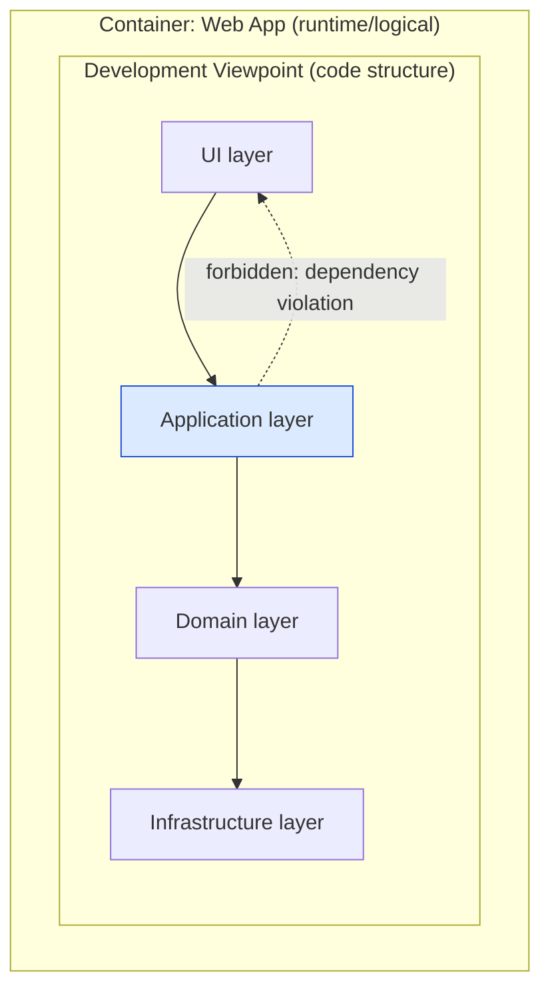

# 🧠 Topic: Development Viewpoint

> [!abstract] Executive Summary (ELI5)
> The Development Viewpoint answers: **"how is the system organized as *code* — and how will it be built?"** Where the Container Viewpoint shows deployable units and the Deployment Viewpoint shows where they run, the Development Viewpoint shows the **source-code structure**: modules, packages, layers, libraries, and the build/dependency rules between them. It's the view your developers and build tools live in every day.

> [!warning] The #1 confusion — Development Viewpoint ≠ Container Viewpoint
> They look related because both are about "how the system is organized." But the **Container Viewpoint** (C4 L2) is *logical/runtime* — deployable units (web app, API, DB) and their interactions. The **Development Viewpoint** is *code/build* — how the source for those containers is split into modules/packages/layers, what depends on what at compile time, and how it's assembled into a build. One container may be built from many modules; one module's code may feed several containers.

---

## 🎯 The "Why"

- **Problem Solved:** Code organization is where developers spend their working lives, and where most day-to-day pain lives — circular dependencies, "spaghetti" imports, code no one dares touch. The Development Viewpoint makes the code structure and its rules *explicit and visible*, so the team can enforce layering, prevent dependency rot, and keep the build manageable as the system grows.
- **Alternatives:** Letting code structure "emerge organically." Result: a big ball of mud where every module imports every other, the build is slow, and changes ripple unpredictably. Explicit development modeling prevents this.
- **Trade-offs:** Strict layering and module rules add discipline (some upfront design, some CI enforcement). The payoff is a codebase that stays navigable, testable, and changeable over years — see [[Evolution Perspective]].

## 💡 Mental Model & Analogy

- **Analogy:** If the Container Viewpoint is the **departments** of a company (Sales, Engineering, Finance — who they are and how they interact), the Development Viewpoint is the **org chart *within* Engineering** — teams, reporting lines, who can block whom, how work flows. The departments are stable; the internal org chart is where the daily friction lives. A company with clear departments but a tangled internal org chart still can't get anything done.

The dashed arrow is a *forbidden* dependency — exactly the kind of rule this viewpoint defines and CI should enforce.

## 🛠️ Core Principles

1. **Code structure is a first-class architectural concern.** How source is split into modules/packages/layers, and what may depend on what, is not "just implementation detail" — it determines whether the system can evolve and be tested.
2. **Dependency direction matters.** Dependencies should point toward *stability* (the domain core), not away from it (toward volatile UI or infrastructure details). Inverting this is the most common cause of code rot.
3. **Layering and module boundaries are the rules of the game.** Define them explicitly (e.g., "UI may not call Infrastructure directly") and enforce them (lint rules, CI checks, module boundaries).
4. **Build and assembly are part of the view.** How is the code compiled, packaged, and assembled into the runtime containers? Build time, dependency graph, and tooling are concerns here.
5. **The Development Viewpoint is the home of testability and maintainability.** Code structure determines how easily components can be unit-tested in isolation and how much a change ripples — see [[Evolution Perspective]] and [[Development Resource Perspective]].

## 🏗️ What the Development Viewpoint Contains

### Code organization
*How the source is structured.*
- **Modules / packages** — the units of code organization. Cohesive, with clear responsibilities.
- **Layers** — horizontal slices (UI, application, domain, infrastructure) with dependency rules between them.
- **Libraries / shared code** — internal shared packages, and how they're versioned and consumed.
- **Bounded contexts / modules per business area** — vertical slicing aligned with domain boundaries (DDD).

### Dependency rules
*What may depend on what — the architectural constraints on the code.*
- **Layer dependency direction** — e.g., UI → Application → Domain; Infrastructure depends on Domain, not the reverse (Dependency Inversion).
- **No circular dependencies** — modules must not depend on each other cyclically.
- **Stable dependencies** — dependencies point toward packages that change less often.
- **Enforcement** — these rules are only real if CI/lint catches violations. Unenforced rules rot.

### Build and assembly
*How code becomes a runnable system.*
- **Build pipeline** — compile, test, package, assemble into containers.
- **Build time and dependency graph** — a tangled dependency graph slows builds and blocks parallelization.
- **Monorepo vs. multi-repo** — where the code lives and how cross-cutting changes are coordinated.
- **Tooling** — package managers, build tools, CI configuration.

## ↔️ How the Development Viewpoint Connects

| Connects to | How |
|---|---|
| [[Container Viewpoint]] | A container is the runtime unit; the Development Viewpoint shows the *code modules* that build into it. One container ← many modules. |
| [[Component Viewpoint]] (C4 L3) | Components are often 1:1 with code modules/classes — the Development Viewpoint is where C4 L3 lives in practice. |
| [[Key Elements of Architecture View]] | Modules/components are the "components"; dependency rules are the "connectors" at the code level. |
| [[Evolution Perspective]] | Clean module boundaries and dependency rules are what make the system evolvable. Overlap. |
| [[Development Resource Perspective]] | Code structure determines buildability, testability, and cognitive load for the team. Overlap. |

## ⚠️ Pitfalls & Anti-patterns

- **Letting code structure emerge:** no defined modules/layers. Result: a big ball of mud where everything imports everything.
- **Dependency direction violations:** the UI or infrastructure reaching into the domain in the wrong direction, coupling stable core to volatile details.
- **Unenforced rules:** "we have a layering rule" that CI doesn't check. Unenforced architectural rules are aspirations, not constraints — they rot.
- **Circular dependencies:** modules A and B depending on each other. Kills testability, build parallelization, and changeability.
- **Confusing this with the Container Viewpoint:** thinking "we drew the containers, the code structure is obvious." It isn't — the code module split, dependency rules, and build are separate concerns.
- **Over-engineering the structure:** elaborate module hierarchies and abstractions the current system doesn't need. Adds accidental complexity (see [[Development Resource Perspective]]).
- **Ignoring build/tooling:** a dependency graph so tangled that builds take forever and nobody can refactor safely.

## 🔗 Deep Connections

- **Parent Topic:** [[Viewpoint]] (the Development Viewpoint is one of the standard R&W viewpoints), [[System Modeling]]
- **Sibling Viewpoints:** [[Container Viewpoint]] (runtime units this viewpoint builds from), [[Component Viewpoint]] (C4 L3 — often maps to code modules), [[Deployment Viewpoint]] (where the built artifacts run)
- **Related Concepts:** [[Key Elements of Architecture View]] (modules = components, dependency rules = connectors), [[System Architecture]] (Maintainability/Testability quality attributes live here)
- **Perspectives that bite here:** [[Evolution Perspective]] (changeability), [[Development Resource Perspective]] (buildability/testability)
- **Prerequisites:** [[Viewpoint]], [[System]], [[Container Viewpoint]].

## ❓ Active Recall Questions

> [!faq]- What does the Development Viewpoint show, and how does it differ from the Container Viewpoint?
> It shows the **source-code structure** — modules, packages, layers, dependency rules, and the build. The Container Viewpoint is *logical/runtime* (deployable units and their interactions); the Development Viewpoint is *code/build* (how source is organized and assembled). One container may be built from many modules; the code split and dependency rules are separate concerns.

> [!faq]- Why does dependency direction matter, and which way should dependencies point?
> Because dependencies pointing the wrong way couple the stable domain core to volatile details (UI, infrastructure), causing code rot. Dependencies should point toward **stability** — e.g., UI → Application → Domain, with Infrastructure depending on Domain abstractions (Dependency Inversion), never the reverse.

> [!faq]- Why must architectural dependency rules be enforced by tooling/CI?
> Because unenforced rules are aspirations, not constraints — developers under pressure will violate them, and without automated checks the violations accumulate until the structure rots. Lint rules, module boundary checks, and CI gates turn "we have a layering rule" into an actual architectural constraint.

> [!faq]- How does the Development Viewpoint relate to Evolution and Development Resource perspectives?
> With [[Evolution Perspective]]: clean module boundaries and dependency rules are *what make the system evolvable* — a tangled codebase can't change safely. With [[Development Resource Perspective]]: code structure determines buildability, testability, and cognitive load. The Development Viewpoint is where both perspectives' concerns are realized in practice.

> [!faq]- What's the relationship between the Development Viewpoint and C4 Level 3 (Component)?
> They overlap heavily: C4 Level 3 components are often 1:1 with code modules/classes. The Development Viewpoint is effectively where C4 L3 lives in practice — it shows the internal building blocks of a container and their dependency rules, which is what a Component diagram visualizes.

---

## 📝 Related Notes

- [[Viewpoint]]
- [[Container Viewpoint]]
- [[Component Viewpoint]]
- [[Deployment Viewpoint]]
- [[Key Elements of Architecture View]]
- [[Evolution Perspective]]
- [[Development Resource Perspective]]
