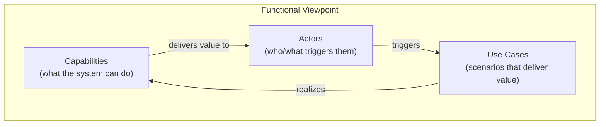

# 🧠 Topic: Functional Viewpoint

> [!abstract] Executive Summary (ELI5)
> The Functional Viewpoint answers one question: **what does the system do?** — not how it is built, not where it runs. It describes the system as a set of **capabilities** and the **use cases** (scenarios) that deliver them to users. Think of it as the system's *job description*. The course frames it primarily through **use cases**, because they connect business value to system behavior in a way every stakeholder can read.

> [!warning] The #1 confusion — Functional Viewpoint ≠ C4 level
> C4 has no "functional" level. C4 levels (Context/Container/Component/Code) are *structural* zoom. The Functional Viewpoint comes from **Rozanski & Woods** and lives **alongside** C4. When the lecture says "functional viewpoint," it is stepping outside the C4 zoom ladder to ask "what does this thing *do*?" — and use cases are its main tool.

---

## 🎯 The "Why"

- **Problem Solved:** Before reasoning about *how* to build a system, you must agree on *what* it does and *for whom*. The Functional Viewpoint captures capabilities and use cases in a form the business can validate and the developers can implement against. Without it, teams build elegant architecture for the wrong problem.
- **Alternatives:** Jumping straight to a Container diagram. You get structure without knowing whether the structure actually serves a use case — the "we built it, but what does it do?" failure.
- **Trade-offs:** A functional model alone says nothing about scalability, security, or deployment (those are [[Perspective]] concerns applied to structural viewpoints). Its power is precisely that it isolates the *what* so it can be validated independently of the *how*.

## 💡 Mental Model & Analogy

- **Analogy:** The Functional Viewpoint is the system's **job description**. A job description lists responsibilities ("process orders", "send invoices") and the situations in which they happen ("when a customer checks out"). It does not list the employee's brain structure or which desk they sit at — that's the organizational architecture. Use cases are the "day in the life" stories that show the responsibilities in action.



A capability is an abstraction ("process payments"). A use case is a concrete scenario ("customer checks out with a credit card and the payment is captured"). Actors trigger use cases; use cases realize capabilities.

## 🛠️ Core Principles

1. **Capability-first.** Start from *what the system can do* (capabilities/functions), not from components. "Manage orders" is a capability; "OrderService" is a component that might realize it.
2. **Use cases are the unit of functional description.** A use case is a scenario: an actor wants to achieve a goal, the system responds, value is delivered. This is the form the lecture emphasizes.
3. **Actors drive everything.** Every capability and use case must trace to an actor (human role or external system). A capability nobody can invoke is dead weight.
4. **It is orthogonal to structure.** The same use case can be realized by many architectures; the same architecture can serve many use cases. Do not collapse them.
5. **It is the validation anchor for everything else.** Every container, component, and connector should eventually trace back to a use case — otherwise it is architecture for architecture's sake.

## 🏗️ The Functional Vocabulary (course-aligned)

### Capabilities
*What the system can do, at a high level.* Noun-verb, stable, business-facing.
- "Manage catalog", "Process payments", "Authenticate users", "Generate reports".
- Capabilities change slowly; components change fast. Model capabilities first.

### Use Cases (the lecture's focus)
*A scenario in which an actor uses the system to achieve a goal.*

A well-formed use case captures:
- **Actor** — who/what initiates it (a role or external system).
- **Goal** — the outcome the actor wants.
- **Main success scenario** — the happy path, step by step.
- **Extensions / alternates** — what happens when things go differently (errors, cancellations).
- **Preconditions / postconditions** — state that must hold before/after.

```text
Use Case: Customer checks out
  Actor:    Customer
  Goal:     Complete a purchase
  Preconditions: cart is non-empty, customer is authenticated
  Main scenario:
    1. Customer reviews cart
    2. Customer enters shipping address
    3. Customer selects payment method
    4. System charges the payment provider
    5. System confirms the order
  Extensions:
    3a. Payment declined → System offers retry
    4a. Provider timeout → System queues order for retry
  Postconditions: order is persisted, confirmation email sent
```

> Use cases are the bridge between business and architecture: the business can read and validate them, and the architect can ask "what structure realizes *this* scenario?"

### Actors
*Who or what interacts with the system to get value.*
- Human roles ("Customer", "Admin") and external systems ("Payment provider", "Reporting BI").
- Actors here are the same ones you draw on the [[Context Viewpoint]] — the Functional Viewpoint zooms into *what they do*, not *who they are*.

## 🔼 How the Functional Viewpoint Maps to C4

C4 has no functional level, so you express the functional view through three mechanisms:

| Mechanism | Where in C4 | What it gives |
|---|---|---|
| **Responsibility text** on the Context box | [[Context Viewpoint]] (L1) | A one-line capability summary — the most "functional" structural C4 element |
| **Supplementary Dynamic diagram** | Above/alongside C4 | A runtime trace of *how components cooperate to serve one use case* — the truest functional view |
| **Use case → component traceability** | Cross-cutting | Mapping each use case to the containers/components that realize it |

The **Dynamic diagram** is the key one for use cases: pick a use case, draw the sequence of component interactions that deliver it. That is your functional view expressed in C4 vocabulary.

## ↔️ Functional Viewpoint vs. Its Siblings

| Concept | Question it answers | Source |
|---|---|---|
| **Functional Viewpoint** | What does the system *do*? | Rozanski & Woods |
| [[Context Viewpoint]] | What is the system and what does it interact with? | C4 L1 / R&W |
| [[Viewpoint]] (general) | The lens concept itself | R&W (meta) |
| [[Perspective]] | How *well* must it behave (security, perf)? | R&W |

Functional tells you *what*; structural viewpoints (Context/Container/Component) tell you *how it's organized*; perspectives tell you *how well*.

## ⚠️ Pitfalls & Anti-patterns

- **Collapsing function into structure:** naming a use case after a component ("the OrderService flow"). Use cases describe goals in business language, not implementation.
- **Use cases that are too granular:** "User clicks the submit button" is a UI step, not a use case. A use case delivers *value* — "Customer completes checkout".
- **Use cases nobody owns:** a capability with no actor is a smell — either find the actor or drop the capability.
- **Modeling function without scenarios:** listing capabilities without use cases leaves them abstract and untestable. The lecture's use-case focus exists precisely to avoid this.
- **Ignoring alternates:** only the happy path modeled. Real behavior lives in the extension paths (payment declined, timeout) — that's where architecture decisions get tested.
- **Forgetting that functional ≠ C4 level:** expecting a "Functional" C4 diagram and being confused when it doesn't exist. It's a Rozanski & Woods viewpoint expressed *through* C4 mechanisms.

## 🔗 Deep Connections

- **Parent Topic:** [[Viewpoint]] (the Functional Viewpoint is one of the standard R&W viewpoints — see the table there), [[System Modeling]] → "Functional Modeling"
- **Related Concepts:** [[Context Viewpoint]] (actors and capabilities are first sketched on the context diagram), [[System]] (its "Function" property is exactly this viewpoint), [[System Architecture]] ("architecture is driven by requirements" — functional requirements feed this viewpoint), [[Communicating the Model]] (use cases are a storytelling/scenario technique listed there)
- **Contrast:** [[Perspective]] (quality concerns applied *to* this viewpoint), structural C4 levels ([[Container Viewpoint]], [[Component Viewpoint]]) that *realize* these use cases.
- **Prerequisites:** [[Viewpoint]], [[System]], [[Model]].

## ❓ Active Recall Questions

> [!faq]- Does C4 have a "Functional" level? If not, where does functionality live?
> No — C4 levels (Context/Container/Component/Code) are structural zoom. The Functional Viewpoint is a **Rozanski & Woods** viewpoint that lives alongside C4. In C4 practice it is expressed via responsibility text on the Context box and, mainly, the supplementary **Dynamic diagram** that traces a use case through cooperating components.

> [!faq]- What is a use case, and why does the course emphasize it for the Functional Viewpoint?
> A use case is a scenario where an actor uses the system to achieve a goal — with a main success path, extensions, and pre/postconditions. The course emphasizes it because use cases bridge business (readable, validatable) and architecture (each one must be realized by structure), and they make the "what does the system do" question concrete instead of abstract.

> [!faq]- What distinguishes a capability from a use case?
> A **capability** is a high-level "what the system can do" ("Process payments") — stable, noun-verb, business-facing. A **use case** is a concrete scenario ("Customer checks out with a card and the payment is captured") that *realizes* a capability. Capabilities are the abstraction; use cases are the instances.

> [!faq]- Why must every use case trace to an actor?
> Because a capability nobody can invoke delivers no value and cannot be validated. Actors (human roles or external systems) are the source of functional requirements — an actor-less use case is a smell that the capability is dead weight or mis-scoped.

> [!faq]- How do you express the Functional Viewpoint using C4 mechanisms?
> Three ways: (1) responsibility text on the [[Context Viewpoint]] box (one-line capability summary); (2) a supplementary **Dynamic diagram** tracing a use case through component interactions (the truest functional view); (3) use-case-to-component traceability, mapping each scenario to the containers/components that realize it.

---

## 📝 Related Notes

- [[Viewpoint]]
- [[Context Viewpoint]]
- [[System]]
- [[System Modeling]]
- [[System Architecture]]
- [[Communicating the Model]]
